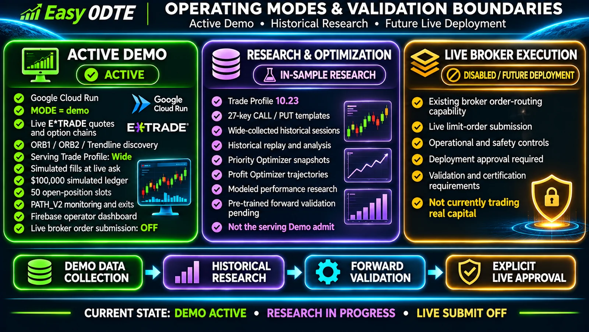
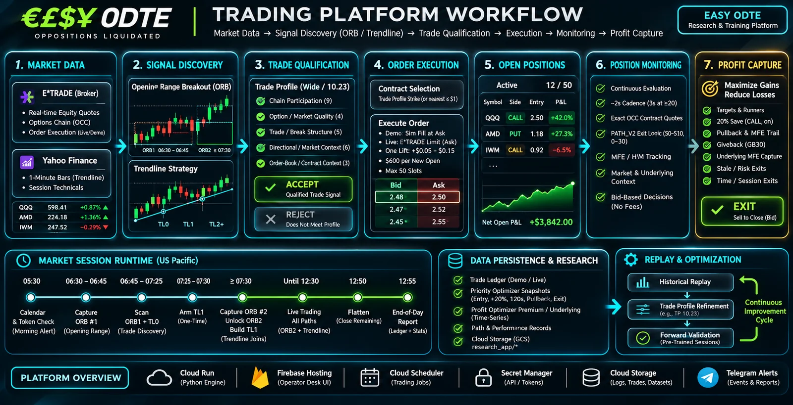
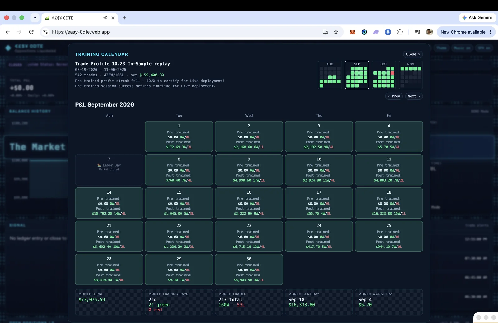
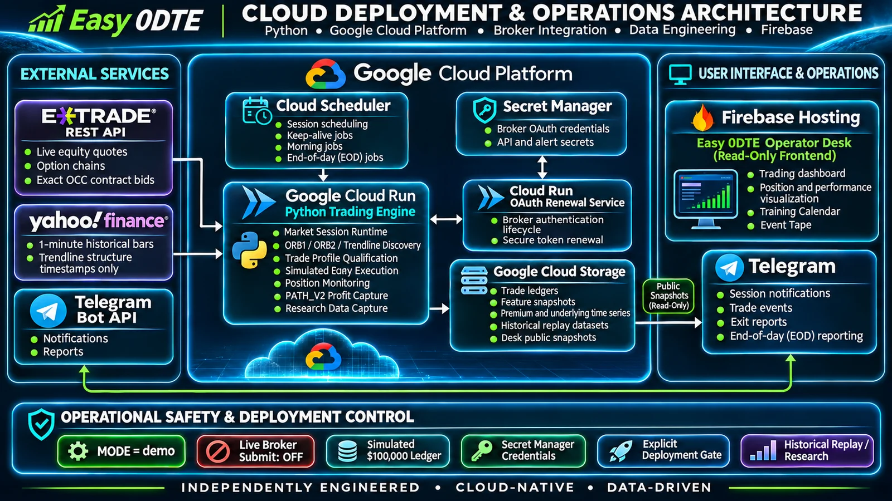

# Executive Summary — Easy 0DTE Strategy

**Last updated:** November 7, 2026  
**Product:** Easy 0DTE — cloud research desk for same-day listed U.S. options  
**Desk:** [https://easy-0dte.web.app](https://easy-0dte.web.app)  
**Public tour:** [README.md](README.md)

This file is the product specification. Path geometry, admit structure, order routing, monitor cadence, and the exit catalog stay in the guides in §2. Broker credentials, GCP project IDs, and account numbers are not documented here.

**Contents:** [What this app is](#1-what-this-app-is) · [Session](#3-the-session) · [Discovery](#4-discovery) · [Admit](#5-admit-trade-profile-wide-training-toward-1023) · [Orders](#6-order-execution) · [Risk](#7-risk-and-sizing) · [Monitor](#8-monitoring-and-profit-capture) · [Training](#9-training-data-and-the-training-calendar) · [Desk](#10-alerts-and-the-desk) · [Cloud](#11-cloud)

**Operating posture (7 November 2026):** Cloud Run Demo (`MODE=demo`), admit **Wide**, simulated ledger **$100,000**, **50** slots, **$600** per new open. Live broker submit is off. Trade Profile **10.23** is the in-sample research successor (local **S0_maxnet**): 8/19–11/6 **542 trades · 436W/106L · 80.4% · +$159,400.39** fee-inclusive. Wide stays on so those sessions remain collectable. Serving revision and rollback live in [docs/ARCHITECTURE.md](docs/ARCHITECTURE.md).



*Demo is the running book. Wide is the serving admit. 10.23 is in-sample research. Live broker submission is disabled. Forward certification has not passed.*

---

## 1. What this app is

One Cloud Run service trades same-day listed options from the US cash open through flatten. It discovers CALL and PUT signals on three paths, accepts or rejects each signal with one Trade Profile, sizes the accept, and opens it on a simulated ledger in Demo (or on the E\*TRADE account in Live). Open positions are watched on one monitor so Profit Capture can exit them. The market calendar decides which sessions stay off.

Demo is the running book. It uses live E\*TRADE quotes and chains and fills `MockOptionsExecutor` at the ask. Live uses the same pick and submits that strike to E\*TRADE. `MODE` is the switch. Live submit is off.

The three running paths share one options account, one slot pool, one monitor, and one end-of-day report:

| Path | Geometry | Window (PT) | Guide |
|------|----------|-------------|--------|
| **ORB1 Breakout** | ORB#1 box, 06:30–06:45 high/low | Discovery 06:45–**07:25**, then hard stop | [0DTEORB1Breakout.md](docs/0DTEORB1Breakout.md) |
| **Trendline** | TL0 on the ORB#1 box; TL1–TL6 on the ORB#2 box | TL0 through **07:25**; TL1+ after ORB#2 until 12:30 | [0DTETrendline.md](docs/0DTETrendline.md) |
| **ORB2 Breakout** | ORB#2 box from 07:30 | Unlocks when ORB#2 is frozen, through 12:30 | [0DTEORB2Breakout.md](docs/0DTEORB2Breakout.md) |

ORB SO (ETF), the 7:00 validation candle, 7:15 signal collection, and Portfolio Protection / Red Day are off. Discovery mode is `ORB_0DTE_DISCOVERY_MODE=watch`.



*Application process covered in §1–§8: market data → discovery → Trade Profile qualification → order execution → open book → position monitoring → Profit Capture. Session clocks are US Pacific. Sample quotes, the bid/ask ladder, and the 12/50 open-book P&L in the graphic are illustrative — not Demo ledger or 10.23 research. Serving admit is **Wide**; Live submit is off. The 2s / 3s monitor interval is the scheduler target. Booked settlement is fee-inclusive.*

---

## 2. How to read the rest of the docs

| Question | Document |
|----------|----------|
| GitHub tour | [README.md](README.md) |
| Modules, data plane, deploy shape | [docs/ARCHITECTURE.md](docs/ARCHITECTURE.md) |
| The session, in order | [docs/ProcessFlow.md](docs/ProcessFlow.md) |
| Cloud Run, scheduler, deploy | [docs/Cloud.md](docs/Cloud.md) · [docs/Deploy.md](docs/Deploy.md) |
| Quotes, chains, freshness | [docs/Data.md](docs/Data.md) |
| Accept / reject, 27-key templates, Wide vs 10.23 | [docs/TradeProfile.md](docs/TradeProfile.md) |
| Strike to fill | [docs/0.OrderExecution.md](docs/0.OrderExecution.md) |
| Slots, $600, cooldowns, calendar gate | [docs/0DTERisk.md](docs/0DTERisk.md) |
| Open-book watch and recorded-tape audit | [docs/PositionMonitoring.md](docs/PositionMonitoring.md) |
| Exit catalog | [docs/0DTEProfitCapture.md](docs/0DTEProfitCapture.md) |
| Holidays and skip days | [docs/MarketCalendar.md](docs/MarketCalendar.md) |
| Telegram | [docs/Alerts.md](docs/Alerts.md) |
| Desk UI and Training Calendar | [docs/Frontend.md](docs/Frontend.md) |
| Env catalog | [docs/Configs.md](docs/Configs.md) |
| Training rows | [docs/PriorityOptimizer.md](docs/PriorityOptimizer.md) |

Per-cell threshold bounds are not published. The public Trade Profile overview is [docs/TradeProfile.md](docs/TradeProfile.md).

---

## 3. The session

Clocks are US Pacific. The cash session is 06:30–13:00 PT (09:30–16:00 ET). Flatten is 12:50 PT. The unified end-of-day Telegram is 12:55 PT.

```text
Calendar gate (skip or trade)
  → OAuth alive, morning Telegram
  → ORB#1 capture 06:30–06:45
  → Yahoo 1m timestamps → TL0
  → TL0 + ORB1 discovery until 07:25
  → arm TL1 once (07:25–07:30)
  → ORB#2 freeze ≥07:30 → ORB2 unlock → Yahoo → one TL1 build → TL joins
  → shared discovery through 12:30
  → each break: Trade Profile Wide → size → order → enroll
  → monitor ~2s (3s at ≥20 opens) → PATH_V2
  → flatten leftovers 12:50 → EOD 12:55
```

Discovery is the next **24** names every **10s**. The cursor always advances. A running watch must not occupy the scan slot (`unified_discovery_scan_slot_free`). The task yields up to **0.8s** for the exit monitor, quotes those 24 names, yields up to **0.5s**, then ORB1, Trendline, and ORB2 compare that quote to the line. A slow exit quote does not skip the break check. The scan quote stays the decision quote for **2 minutes** (`TP_FREEZE_QUOTE_MAX_AGE_SEC` default 120). Yahoo bar load and open-position path-chain stamps run after the order.

ORB1 and TL0 stop at `DISCOVERY_ORB1_TL0_END_PT=07:25`. From 07:25 to 07:30 the app arms TL1 once and persists `tl1_build_pending`. It does not take new TL0 or ORB1 entries in that gap. At or after 07:30 it freezes ORB#2, unlocks ORB2, builds TL1 once (Trendline is held during that build), then lets Trendline join the same 24/10s scan through 12:30.

Scheduler keep-alives stay enabled. `validation-candle-700` and `prefetch-validation-715` stay paused. Job list: [docs/ProcessFlow.md](docs/ProcessFlow.md).

---

## 4. Discovery

All three paths read `0dte_list.csv` and the same E\*TRADE equity quotes. Each path only decides whether its own structure broke.

**ORB1.** The opening range is the 06:30–06:45 high and low. From 06:45 a break of that box is a CALL or PUT candidate. Discovery expires at 07:25.

**Trendline.** TL0 is the dual-side line on the ORB#1 box and expires at 07:25. TL1 is built once from ORB#2. TL2 and later wait for TL1 and a reclaim inside the ORB#2 box. Activation is **0.08%**. TL1–TL4 stay armed for **3 hours** after `built_at`. Yahoo 1-minute bars supply structure timestamps for A1/A2 only.

**ORB2.** After ORB#2 is frozen, a break of that box is a CALL or PUT candidate. ORB2 does not wait for TL1 to finish. It uses the same admit spine as ORB1 and Trendline.

A signal that is still forming is held for a later scan. A data error rejects it. A profile reject does not write the entry snapshot.

---

## 5. Admit — Trade Profile Wide, training toward 10.23

Every discovered signal takes one admit path. There is no second quality stack on the serving image.

1. **Must Execute** is feasibility, not a quality score. Order: signal geometry, cooldown and day-exclude, book-full (`max_open_positions_reached`, no chain call), one chain read, data readiness, Call Skip Signal and Put Skip Signal, then one contract pick.
2. **One stamp.** `decision_stamp` freezes the keys the profile will read. `decision_digest` is the hash of that dict. A digest mismatch rejects `data_unavailable:stamp_parity`.
3. **One profile evaluation.** Serving loads `easy0DTE/configs/trade_profile_wide.json`.
4. **Accept or reject.** `tp_admit:<cell>` or `tp_reject:<key>:<min|max|missing|not_and>`.
5. **Size.** The $600 sum cap and the 50-slot book run after the accept.

Wide is the collection profile. The working research profile is **10.23** (`easy0DTE/configs/trade_profile_10.23.json`, current local **S0_maxnet**). Public structure, methodology, and labeled outcomes: [docs/TradeProfile.md](docs/TradeProfile.md). Per-cell bounds are not published. `TRADE_PROFILE_VERSION` stays `wide` until an explicit admit deploy selects 10.23.

Wide rules, in short: same-side `call_share` or `put_share` above 0.10; `break_distance_pct` at most 0.025 on ORB1 and ORB2; `equity_volume_ratio` at least **0.012** on every path. A missing key passes, except `equity_volume_ratio` (reject) and the share key (defer). `TRENDLINE_MAX_ENTRY_DISTANCE_PCT` at 5% is a score bonus only.

### 27-key CALL and PUT templates

10.23 is a flat **10 cells × 27 keys** profile (`flat-27-key-cells-v2`): ORB1, TL0, TL1, TL2+, Breakout (ORB2) × CALL, PUT. Each cell uses this official template order (approved 17 October 2026). A key is a min, a max, a min–max range, or **PASS**. Listing a key does not activate a bound. `call_share` / `put_share` are derived from stamped chain volumes. PUT `delta` is `abs(delta)`. `dir_pct_change_5m` stays on the template and is not a 10.23 gate.

**CALL**

1. `call_chain_volume` · 2. `put_chain_volume` · 3. `total_chain_vol_oi` · 4. `call_chain_vol_oi` · 5. `put_chain_vol_oi` · 6. `put_chain_open_interest` · 7. `call_chain_open_interest` · 8. `call_share` · 9. `put_share` *(Chain Participation)*
10. `theta` · 11. `chain_sanity_best_same_side_spread_pct` · 12. `atr` · 13. `vega` *(Option / Market Quality)*
14. `price_volume_efficiency_3m` · 15. `break_distance_pct` · 16. `otm_pct` · 17. `iv` · 18. `gamma` *(Trade / Break Structure)*
19. `spy_change_pct` · 20. `dir_pct_change_5m` · 21. `distance_from_vwap_atr` · 22. `rsi` · 23. `bollinger_position` · 24. `bollinger_width` *(Directional / Market Context)*
25. `underlying_l1_imbalance` · 26. `option_l1_imbalance` · 27. `delta` *(Order-Book / Contract Context)*

**PUT** (same 27 names; order inside the groups differs)

1. `call_chain_volume` · 2. `put_chain_volume` · 3. `total_chain_vol_oi` · 4. `put_chain_vol_oi` · 5. `call_chain_vol_oi` · 6. `put_chain_open_interest` · 7. `call_chain_open_interest` · 8. `put_share` · 9. `call_share` *(Chain Participation)*
10. `theta` · 11. `atr` · 12. `chain_sanity_best_same_side_spread_pct` · 13. `vega` *(Option / Market Quality)*
14. `price_volume_efficiency_3m` · 15. `break_distance_pct` · 16. `gamma` · 17. `otm_pct` · 18. `iv` *(Trade / Break Structure)*
19. `dir_pct_change_5m` · 20. `spy_change_pct` · 21. `distance_from_vwap_atr` · 22. `rsi` · 23. `bollinger_position` · 24. `bollinger_width` *(Directional / Market Context)*
25. `option_l1_imbalance` · 26. `underlying_l1_imbalance` · 27. `delta` *(Order-Book / Contract Context)*

Call SS and Put SS stay outside the profile and are hard. A missing share or dir% input holds the break for up to **90s**, then retires it with no cooldown. The pick uses the live chain already in memory. Spread percents are 8 (ORB1), 30 (ORB2), and 30 (Trendline), or an ask−bid of at most $0.01. Premium band **$0.03–$2.50**.

The chain read is one door: `fetch_0dte_intent_chain`. `chain_fetch_manager` budgets discovery. `OptionsChainManager` owns expiry and cache (same-day 0DTE when listed, otherwise the nearest weekly). `ETradeOptionsAPI` is HTTP only. Prime Data Manager supplies equity spots and candles. It does not fetch chains.

---

## 6. Order execution

Trade Profile records the contract. It does not send the order. `OptionsTradingExecutor` sends the strike on `po_decision_freeze.single_tp.pick`.

| | Demo (`MODE=demo`) | Live (`MODE=live`) |
|--|--------------------|--------------------|
| Chain and strike | Live E\*TRADE chain, Trade Profile pick | Same pick |
| Submit | No broker order. Fill on `MockOptionsExecutor` at the ask | Limit at that ask, then one lift |
| Price margin | — | 10% of the ask, floor $0.05, cap $0.15 |
| Trade id | `D-…` | `L-…` |
| Ledger | GCS `research_app/mock_options_history.json` | Broker portfolio and GCS `research_app/live_options_history.json` |

A missing listed row may move to the nearest listed strike within **$1** only when that ask is still inside the price margin. After the fill, `enqueue_0dte_pending_monitor` hands the name to the monitor. `ENROLLMENT_FAILED` fires only when that fill never joins the roster.

`BROKER=etrade` is the only complete broker. Guide: [docs/0.OrderExecution.md](docs/0.OrderExecution.md).

---

## 7. Risk and sizing

`Unified0DTEPortfolioRiskManager` is the pre-broker choke point for the shared book.

| Control | Serving value |
|---------|----------------|
| Combined opens | `TOTAL_0DTE_MAX_POSITIONS=50` |
| Slot divisor | `0DTE_SLOT_COUNT=50` |
| Each path cap | 50 |
| New-open sum | `0DTE_MAX_POSITION_SIZE_SUM=600` |
| Contract count cap | Off (`LIVE_MAX_CONTRACTS_PER_TRADE=0`) |
| Demo cash | `0DTE_DEMO_STARTING_BALANCE=100000` |
| Same-side cooldown | 1 hour after a reject or an exit, symbol + path slot + side |

Contracts are `floor(600 / (premium × 100))`, minimum 1. Book-full is checked before any chain call. The calendar is the session switch: `MARKET_CLOSED`, `LOW_VOLUME`, or `PRE_HOLIDAY` (previous weekday session only — it does not chain through a long weekend). Detail: [docs/0DTERisk.md](docs/0DTERisk.md) · [docs/MarketCalendar.md](docs/MarketCalendar.md).

---

## 8. Monitoring and Profit Capture

`Unified0DTEPositionMonitor._monitor_loop` is the only open-book scheduler. The interval is **2s**, and **3s** when 20 or more positions are open. That interval is the **scheduler target**, not a claim that saved JSONL rows are 2-second broker ticks. Every open name is exit-checked on that tick. Fill enroll flags the next tick; it does not run a second full-book pass.

Quotes are exact OCC, bid for the sell-to-close mark. PATH_V2 pret is this tick’s option bid / entry − 1 (`live_path_v2_pret_from_tick`). Missing, ≤0, NaN, or ±infinity bid → STEP 0 HOLD. Mark and `pnl_pct` are never pret.

Evaluate does not call the broker for the underlying. Age wins: ≤**4s** usable, ≤**8s** last-good, older unavailable. A 2s `_ul_refresh_loop` skip-cache-refreshes owned names (cap **25**, oldest first). A slow UL batch is left running (`ul_refresh_slow` / `ul_refresh_hung`, cancel=false). Inner OCC waves of **25** run one HTTP at a time and `yield_lane_to_equity_batch` between waves. A new OCC fetch is deferred only while last exact is reusable. Leftover (closed-winner) OCC is skipped while any owned name is open (`0DTE_LEFTOVER_SHADOW_SKIP_WHEN_OWNED_SLOW=true`) because leftover shares `occ_fetch`. Path-chain refresh skips when the last cycle exceeds **8000ms**. Those TTLs are not raised to hide a slow wide book.

Exits are PATH_V2 in `modules/path_v2_exit.py`. Exit decisions compare bid with entry. Booked dollars, Telegram, and the desk use:

`(exit − entry) × contracts × 100 − contracts × $1.30`

Fees are $0.65 per contract to open and $0.65 per contract to close. Headline percent is that dollar result divided by premium plus the opening fee (`net_result_pnl_dollars` / `net_result_pnl_fraction`). A flat bid is a fee loss. 20% Save is ON CALL-only.

Telegram exit alerts are a notification-only queue (`ledger_alert_flush.py`: FIFO 32, 3 attempts, 8s). A drop does not rewrite ledger, fills, or GCS.

At 12:50 PT the app flattens whatever is still open, primes session tech on the remaining names once, then writes the unified EOD.

Saved JSONL gaps are a different clock from the 2s/3s target (persist min 5s, sequential OCC, load). The 8/19–11/6 recorded-tape audit — reconstructed grids, PATH_END HOLD, observed saved cadence, bid coverage — lives in [docs/PositionMonitoring.md — Recorded-tape quality](docs/PositionMonitoring.md#recorded-tape-quality-819116). Keep S0 frozen and labeled modeled. Do not retune exits from reconstructed tapes.

Guides: [docs/PositionMonitoring.md](docs/PositionMonitoring.md) · [docs/Data.md](docs/Data.md) · [docs/0DTEProfitCapture.md](docs/0DTEProfitCapture.md).

---

## 9. Training data and the Training Calendar



*Firebase Training Calendar (September 2026 view). Header is Trade Profile **10.23** in-sample replay: 8/19–11/6 **542 · 436W/106L · +$159,400.39**. September tile **+$73,075.59** (21 green / 0 red). Pre trained streak **0/11**. These figures are not the running Demo ledger. The market-data lifecycle diagram is in the [README](README.md#data-engineering).*

Wide is on so the book keeps producing accepts. Those accepts, the rejects, and the premium path of each open are the corpus for 10.23.

Priority Optimizer snapshots are written off the exit check, from cache already on the tick: closed-minute session tech, the handoff freeze on the executed row, live OCC age on `first_red`, greeks restamped from that quote, chain volumes nulled when older than 60s. Flatten primes remaining opens once; persist after that is cache-only. The first body written for an object name is kept.

Profit Optimizer records the premium path (compact JSONL, 5s min gap). New rows keep `path_v2_peak` / `path_pret` / `path_v2_reason`, quote clocks, contracts, and modeled fees. Replay uses `eval_now`. `PATH_END` is end-of-tape HOLD, not a live exit.

The desk **Training Calendar** posts that research: in-sample 10.23 P&L by day, and a Pre trained / Post trained log for each session’s bound work. It does not change the live admit.

**As of 7 November 2026** (desk tiles; fee-inclusive Post / current book): 8/19–11/6 **542 · 436W/106L · 80.4% · +$159,400.39**. September **+$73,075.59** (21d, 21 green). October **+$44,030.50** (21d, 20 green / 1 red — 9 Oct −$567.10). November through 11/6 **+$9,251.50** (5d, 5 green, 44 · 36W/8L). Pre trained streak **0/11**. Live certification is **60 profitable Pre trained sessions**. These replay results are in-sample on Wide-collected sessions. They are not the running Demo ledger and not live investment returns.

Guides: [docs/PriorityOptimizer.md](docs/PriorityOptimizer.md) · [docs/Frontend.md](docs/Frontend.md).

---

## 10. Alerts and the desk

Telegram is the pager: morning or holiday, ORB1 and ORB2 capture, path-labeled fills and rejects, exits, and one `END-OF-DAY 0DTE` report. Catalog: [docs/Alerts.md](docs/Alerts.md).

The desk is a static Firebase site, [https://easy-0dte.web.app](https://easy-0dte.web.app). Cloud Run writes `research_app/desk_public/` (`snapshot.json`, `head.json`, `actions.json`, `discovery.json`). The desk polls those objects. It does not invent fills or P&L. Bid MFE% is the PATH_V2 bid peak; Mark MFE% is mark HWM. Source lives in the sibling `0. Easy 0DTE Desk UI` folder, not in this service image.


*Live Firebase desk (7 November 2026): Demo, $100,000 reseeded ledger, market closed. KPI strip and Event Tape are booked Demo state, not 10.23 in-sample research.*

---

## 11. Cloud



*Cloud Run session engine and OAuth renewal, Cloud Scheduler, Secret Manager, GCS, Firebase Hosting, E\*TRADE, Yahoo 1-minute Trendline timestamps, Telegram. Live broker submit is off.*

| Piece | Role |
|-------|------|
| Cloud Run `easy-etrade-strategy` | This app. Demo. Scale-to-zero |
| Cloud Run `easy-etrade-strategy-oauth` | E\*TRADE token renewal |
| GCS `easy-etrade-strategy-data` | Namespace `research_app/` — ledger, markers, optimizer objects, desk snapshots |
| Secret Manager | OAuth and alert secrets |
| Cloud Scheduler | Keep-alives, morning alert, EOD. Validation jobs paused |
| Firebase Hosting | Desk UI (`easy-0dte`) and the OAuth web app |

`/health` is a cheap keepalive. Deploys pass an empty liveness probe so a busy event loop is not killed for a slow HTTP check. Startup remains TCP on port 8080.

The Docker image is **Python 3.11** (`python:3.11-slim`). Local development is **Python 3.12.3**. The Cloud Run runtime is 3.11.

Deploy only when asked, with `DEPLOY_NOW=YES ./scripts/deploy_demo_service.sh`. That script merges env, refuses the Live service, and refuses a ledger reseed. Do not deploy during the cash session unless the request is an explicit emergency. The Live sibling `easy-etrade-strategy-live` is not the work target.

---

## 12. Settlement of this spec

The running Research app is a three-path 0DTE options desk in Demo. It collects with Trade Profile Wide, orders the accepted strike, watches the book on a 2-second monitor (3s at ≥20 opens) with exact OCC bids and PATH_V2 exits, and records time-correct training rows for 10.23. The desk mirrors that ledger and posts the Training Calendar. The guides linked above are the detail. This file is the contract they have to match. Serving revision is recorded in [ARCHITECTURE.md](docs/ARCHITECTURE.md), not in this public spec header.
