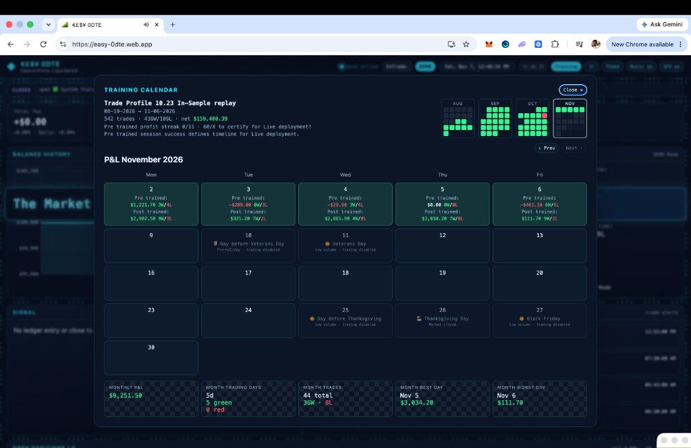
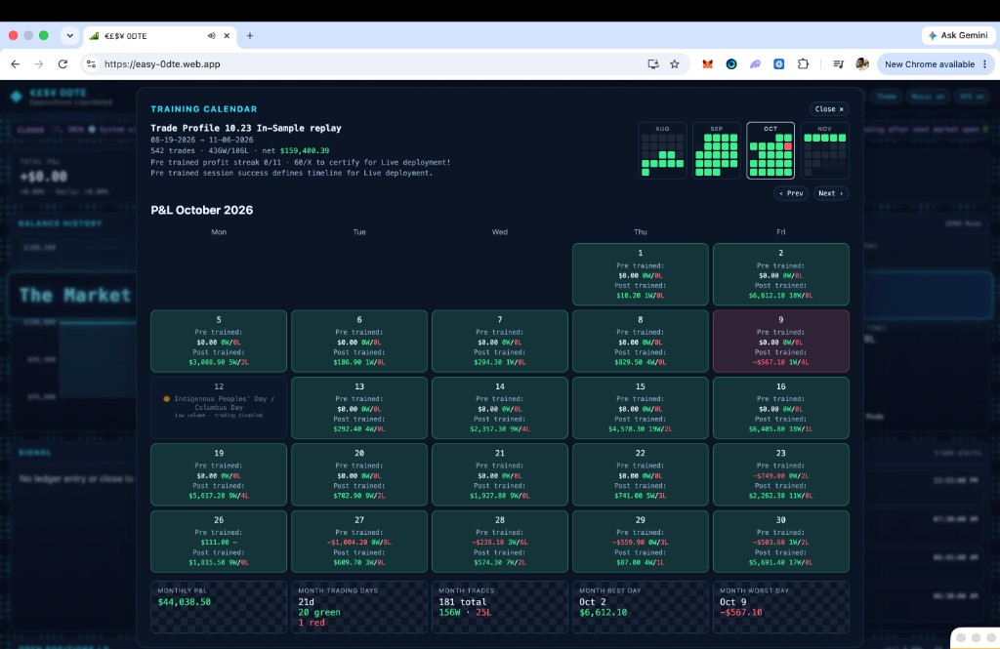

# Easy 0DTE Strategy

Cloud-hosted research desk for same-day listed U.S. options.

The service discovers opening-range and trendline breaks, admits or rejects each signal with one Trade Profile, sizes the accept, and watches the open on a two-second monitor. Demo fills a simulated book at the live ask. The same code path can submit Live orders to E\*TRADE. A Firebase desk shows booked performance and the Training Calendar used to tighten the next profile.

**Status:** Active research. Demo on, Live submit off. Training Calendar figures are **in-sample** 10.23 replay. They are not live trading results.

**Desk:** [https://easy-0dte.web.app](https://easy-0dte.web.app)  
**Spec:** [EXECUTIVE_SUMMARY.md](EXECUTIVE_SUMMARY.md)

---

## What you are looking at

Easy 0DTE is one Python service on Cloud Run plus a static operator desk.

| Layer | Role |
|-------|------|
| Session engine | Calendar gate → capture → three discovery paths → admit → size → fill → monitor → flatten |
| Broker / data | Live E\*TRADE quotes and option chains. Yahoo 1-minute bars timestamp Trendline structure only |
| Training | Time-correct snapshots and premium-path tapes. Replay compares the profile before vs after each day’s bound work |
| Desk | Mirrors the Demo ledger. Does not place orders or invent P&L |

Broker credentials, project IDs, and account numbers are not in this README.

---

## Training Calendar (7 November 2026)

Trade Profile **10.23** in-sample replay, **19 August → 6 November 2026**. Settlement is fee-inclusive:

`(exit − entry) × contracts × 100 − contracts × $1.30`

| Window | Trading days | Green / red | Trades | Net |
|--------|--------------|-------------|--------|-----|
| Full sample | — | — | **542 · 436W/106L** | **+$159,400.39** |
| September 2026 | 21 | 21 / 0 | 213 · 160W/53L | +$73,075.59 |
| October 2026 | 21 | 20 / 1 | 181 · 156W/25L | +$44,030.50 |
| November 2026 (through 6 Nov) | 5 | 5 / 0 | 44 · 36W/8L | +$9,251.50 |

October’s red day is **9 October −$567.10**. Cloud Run still **admits Wide** so those sessions stay collectable. **10.23** is the research successor on disk; it is not the live admit. Live certification is **60 profitable Pre trained sessions**. The Pre trained streak on this date is **0/11**.

---

## How a session runs

Clocks are US Pacific. Cash open is 06:30 PT (09:30 ET). Flatten is 12:50 PT.

1. Skip a closed, low-volume, or pre-holiday session.
2. Capture the 06:30–06:45 opening range and draw Trendline TL0.
3. Scan **ORB1** and **TL0** together until **07:25**.
4. Arm TL1, freeze the 07:30 range, unlock **ORB2**, build TL1 once, then scan Trendline and ORB2 until **12:30**.
5. Send each break through Must Execute, then Trade Profile **Wide**.
6. Size the accept ($600 sum cap, 50 slots) and buy that strike.
7. Watch every open on a **2-second** monitor (**3 seconds** at 20 or more opens) and exit with Profit Capture PATH_V2.
8. Flatten leftovers at **12:50** and send one end-of-day report at **12:55**.

Discovery is the next **24** names every **10 seconds**. The scan yields so the exit monitor can run.

---

## The three paths

All three trade long CALLs and long PUTs on one options account.

| Path | What breaks | When it can enter |
|------|-------------|-------------------|
| **ORB1** | The 06:30–06:45 high or low | 06:45 until 07:25 |
| **Trendline** | TL0 on that morning box, then TL1–TL6 on the 07:30 box | TL0 until 07:25. Later lines after ORB#2, through 12:30 |
| **ORB2** | The 07:30 high or low | As soon as ORB#2 is frozen, through 12:30 |

Must Execute checks that the trade is possible. Wide then accepts or rejects the stamped row. A reject does not write an entry snapshot.

---

## Demo and Live

| | Demo (running) | Live (same code, submit on) |
|--|----------------|-----------------------------|
| Quotes and chains | Live E\*TRADE | Same |
| Orders | Simulated fill at the ask | Broker limit at that ask, then one lift of $0.05–$0.15 |
| Cash | $100,000 simulated ledger | The E\*TRADE 0DTE account |
| Trade ids | `D-…` | `L-…` |

Headline percent is settlement dollars divided by premium plus the opening fee. A flat bid is a fee loss.

While a trade is open the monitor quotes the **exact OCC contract** and marks the exit on the **bid**. A missing or non-finite bid is a hold. Underlying age on that check is cache-only (usable to 4s, last-good to 8s). Those clocks are not stretched to hide a slow book.

---

## Repository map

| You want | Open |
|----------|------|
| Product spec | [EXECUTIVE_SUMMARY.md](EXECUTIVE_SUMMARY.md) |
| Component map | [docs/ARCHITECTURE.md](docs/ARCHITECTURE.md) |
| Session order | [docs/ProcessFlow.md](docs/ProcessFlow.md) |
| Paths | [ORB1](docs/0DTEORB1Breakout.md) · [Trendline](docs/0DTETrendline.md) · [ORB2](docs/0DTEORB2Breakout.md) |
| Admit (Wide and 10.23) | [docs/0.TradeProfiles.md](docs/0.TradeProfiles.md) |
| Orders, risk, monitor, exits | [Order execution](docs/0.OrderExecution.md) · [Risk](docs/0DTERisk.md) · [Monitoring](docs/PositionMonitoring.md) · [Profit Capture](docs/0DTEProfitCapture.md) |
| Desk | [docs/Frontend.md](docs/Frontend.md) |
| Doc index | [docs/README.md](docs/README.md) |

| Area | Path |
|------|------|
| Session loop | `modules/prime_trading_system.py` |
| Admit | `easy0DTE/modules/single_tp_admit.py` |
| Profiles | `easy0DTE/configs/trade_profile_wide.json`, `trade_profile_10.23.json` |
| Monitor and exits | `Unified0DTEPositionMonitor`, `modules/path_v2_exit.py` |
| Settlement | `modules/options_trade_economics.py` |

Python **3.12.3**. Local Demo needs `requirements.txt` and E\*TRADE OAuth from the env template — credentials stay out of git. Deploy and cloud operations: [docs/Deploy.md](docs/Deploy.md) · [docs/Cloud.md](docs/Cloud.md).
