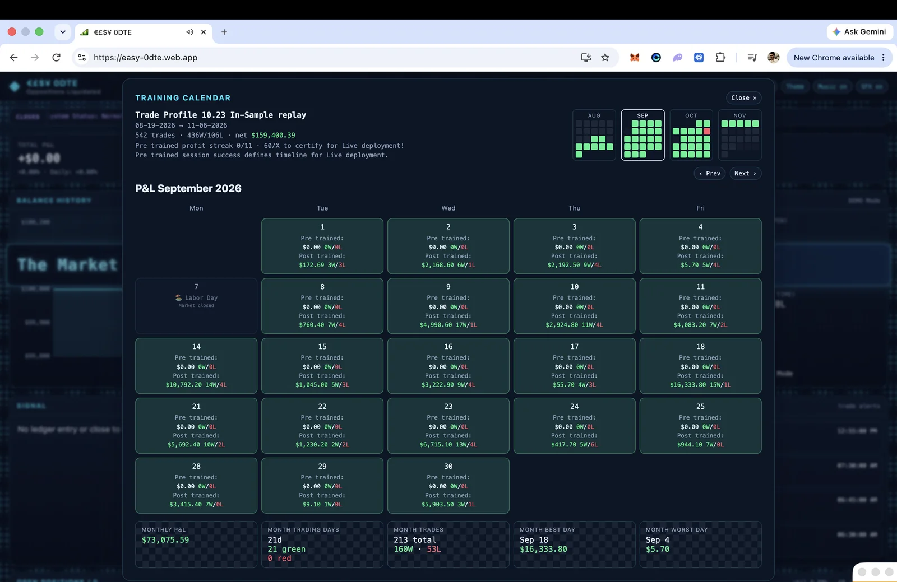
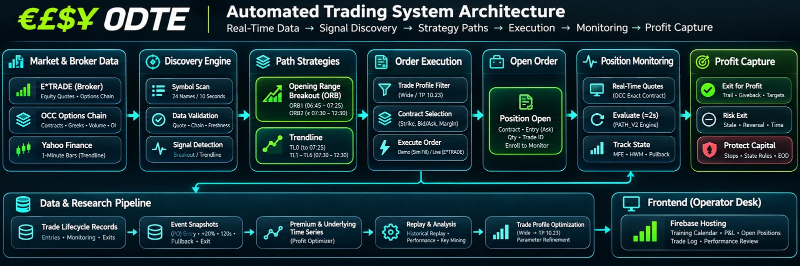
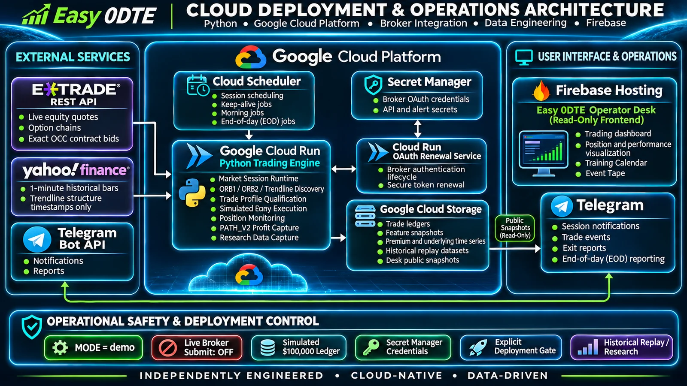
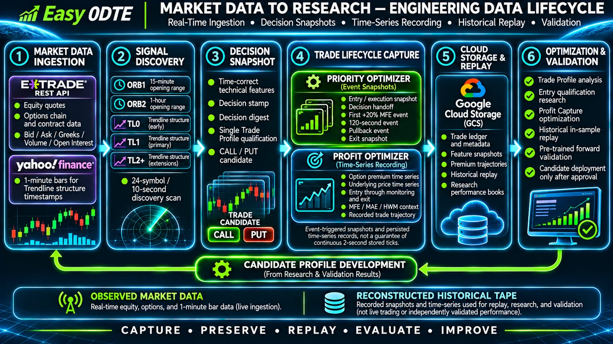
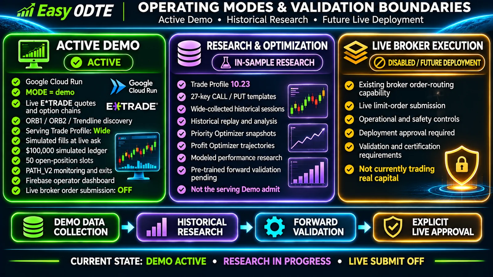

# Easy 0DTE

A cloud-native research engine that discovers same-day listed U.S. option setups, qualifies them with one Trade Profile, and monitors simulated fills through a live broker data plane.

I designed and built Easy 0DTE as an independent engineering project: session orchestration, broker integration, admit logic, risk, monitoring, replay, and the operator desk.

**Status:** Active research. **Demo is on.** Serving admit is **Trade Profile Wide**. **Live broker execution is disabled.** Training Calendar figures are in-sample 10.23 replay, not Demo ledger results and not live investment returns.

---

## Application preview

<a href="https://easy-0dte.web.app" target="_blank" rel="noopener noreferrer">Open the Demo desk →</a>

*Firebase operator desk at [https://easy-0dte.web.app](https://easy-0dte.web.app) (7 November 2026). Demo mode, $100,000 simulated ledger after reseed, market closed. KPI strip, equity curve, last signal, and Event Tape are the live desk — not Trade Profile 10.23 in-sample research. Serving admit remains **Wide**. Live broker submit is off.*

The dashboard is a read-only Firebase site. Cloud Run writes public snapshot objects; the desk polls them. It does not place orders or invent P&L.

*System pipeline: E\*TRADE market data and exact OCC chains, Yahoo 1-minute Trendline timestamps, 24/10s discovery, ORB and Trendline paths, Trade Profile, Demo fill or Live submit, unified monitor, PATH_V2 Profit Capture, GCS research store, and Firebase operator desk. Serving admit is **Wide**; Live submit is off. Evaluate ~2s is the scheduler target, not guaranteed saved-tape cadence.*

---

## What I built

- **Cloud-native Python trading research engine** on Cloud Run that runs the cash session from calendar gate through flatten.
- **E\*TRADE market-data and broker integration** for live equity quotes, option chains, and exact OCC contract bids. Live order submit stays off.
- **ORB1, ORB2, and Trendline discovery** on one shared 24-name / 10-second scan, with Yahoo 1-minute bars used only to timestamp Trendline structure.
- **Single Trade Profile qualification** — one decision stamp, one digest, one admit path (serving **Wide**).
- **Simulated execution and risk controls** — Demo fills at the live ask; 50 slots; $600 new-open sum; $100,000 simulated ledger.
- **Shared position monitoring and Profit Capture** — one monitor, exact OCC bids, PATH_V2 exits, fee-inclusive settlement.
- **Feature snapshots and premium time-series collection** for later profile replay (Priority Optimizer + Profit Optimizer).
- **Historical replay and optimization** that scores a candidate profile against Wide-collected sessions without changing the serving admit.
- **Firebase operator dashboard and Telegram notifications** for fills, exits, and the end-of-day report.

Specification: [EXECUTIVE_SUMMARY.md](EXECUTIVE_SUMMARY.md).

---

## Cloud deployment architecture

*Deployed Demo topology: Python on Cloud Run, Cloud Scheduler session jobs, Secret Manager, a separate OAuth renewal service, GCS persistence, Firebase Hosting (read-only desk), E\*TRADE market data, Yahoo 1-minute Trendline timestamps, and Telegram alerts. Live broker submit is off. Serving revision lives in [docs/ARCHITECTURE.md](docs/ARCHITECTURE.md).*

| Component | Role |
|-----------|------|
| **Cloud Run** | Session engine (`easy-etrade-strategy`, `MODE=demo`) plus a separate OAuth token-renewal service |
| **Cloud Scheduler** | Keep-alives, morning alert, and end-of-day. Validation jobs stay paused |
| **Cloud Storage** | Ledgers, markers, optimizer objects, and `desk_public/` snapshots |
| **Secret Manager** | OAuth and alert secrets — not in source |
| **Firebase Hosting** | Read-only operator desk at [easy-0dte.web.app](https://easy-0dte.web.app) |
| **E\*TRADE** | Live quotes, chains, and exact OCC bids. Demo does not submit broker orders |
| **Yahoo 1-minute structure data** | Trendline timestamps only — never used as a quote or fill |
| **Telegram** | Session, fill, exit, and EOD alerts (notification-only queue) |

---

## Engineering challenges and solutions

**Asynchronous session orchestration.** Capture, three discovery lanes, chain reads, monitoring, and desk writes share one event loop. Discovery yields to the exit monitor (up to 0.8s before the quote batch, 0.5s after) so a slow chain call does not skip a break check, and a slow exit quote does not skip discovery.

**Three paths, one account.** ORB1, Trendline, and ORB2 compete for the same 50 slots, $600 sum cap, and unified monitor. Book-full is checked before any chain call. A running watch must not occupy the scan slot.

**Decision-time snapshot integrity.** The profile must not see a restamped quote. `decision_stamp` freezes the keys; `decision_digest` hashes that dict; a mismatch rejects `data_unavailable:stamp_parity`.

**Quote freshness and exact OCC identity.** Exits mark the **bid** of the **exact** listed contract, not a mid or a symbol-level proxy. Underlying last is cache-only on evaluate (usable ≤4s, last-good ≤8s). Those TTLs are not raised to hide a wide book.

**Monitoring under broker latency.** The scheduler **target** is 2s (3s at ≥20 opens). Sequential OCC batches of 25 yield to the equity refresh between waves. Saved JSONL gaps are a different clock (persist minimum 5s). Recorded-tape evidence: [docs/PositionMonitoring.md](docs/PositionMonitoring.md#recorded-tape-quality-819116).

**Replay provenance.** Historical tapes include reconstructed grids and end-of-tape HOLD rows. 10.23 results are labeled **modeled / in-sample**. Reconstructed rows are not treated as 2-second broker ticks, and exits are not retuned from them.

**Deployment safety.** Demo deploys require an explicit `DEPLOY_NOW=YES`. The script refuses the Live service and refuses a ledger reseed. An empty liveness probe avoids killing a busy event loop. Cash-session deploys are not the default.

**Simulated execution vs live submit.** `MODE=demo` fills `MockOptionsExecutor` at the live ask (`D-…` ids). Live would submit a limit on the same pick (`L-…` ids). That submit path is off.

---

## Data engineering

*Observed E\*TRADE quotes and Yahoo 1-minute Trendline timestamps become a decision stamp, Priority Optimizer event snapshots, Profit Optimizer premium time-series, and in-sample replay. Persisted tapes are event-triggered records, not a guarantee of 2-second stored ticks. Forward certification is a required stage, not a completed result (Pre trained 0/11).*

---

## Operating modes and research validation

*Current boundaries. Demo is the running book (live quotes, simulated fills, admit **Wide**). Trade Profile 10.23 is in-sample research on Wide-collected sessions — not the serving admit. Live broker submission is disabled. Forward certification has not passed.*

Latest verified **Trade Profile 10.23** replay (August 19–November 6, 2026):

| | |
|--|--|
| Trades | **542** |
| Wins / losses | **436 / 106** |
| Win rate | **80.4%** |
| Fee-inclusive modeled net P&L | **+$159,400.39** |

These figures are **historical in-sample replay** on **Wide-collected** sessions. They are **not** the running Demo ledger and **not** live investment returns.

**Wide remains the serving admit** so those sessions stay collectable. Forward validation has not passed. Live certification requires **60 profitable Pre trained sessions**. Current Pre trained streak: **0/11**.

Settlement is fee-inclusive: `(exit − entry) × contracts × 100 − contracts × $1.30`. Methodology: [docs/TradeProfile.md](docs/TradeProfile.md). Data lifecycle: [EXECUTIVE_SUMMARY.md](EXECUTIVE_SUMMARY.md#9-training-data-and-the-training-calendar).

---

## Technology stack

| Layer | Stack |
|-------|--------|
| Language | **Python 3.11** in the Docker image (`python:3.11-slim`). Local development is **Python 3.12.3**. The Cloud Run runtime is 3.11 |
| Runtime | `asyncio`, FastAPI health endpoints |
| Data | pandas, numpy, python-dateutil |
| Broker / market data | E\*TRADE REST (OAuth), yfinance (1-minute Trendline timestamps) |
| Cloud | Cloud Run, Cloud Scheduler, Cloud Storage, Secret Manager, Cloud Logging |
| Desk | Firebase Hosting (static), GCS `desk_public/` |
| Alerts | Telegram Bot API |

---

## Explore the project

| | |
|--|--|
| Live Demo dashboard | [https://easy-0dte.web.app](https://easy-0dte.web.app) |
| Executive Summary (spec) | [EXECUTIVE_SUMMARY.md](EXECUTIVE_SUMMARY.md) |
| Architecture | [docs/ARCHITECTURE.md](docs/ARCHITECTURE.md) |
| Session workflow | [docs/ProcessFlow.md](docs/ProcessFlow.md) |
| Trade Profile overview | [docs/TradeProfile.md](docs/TradeProfile.md) |
| ORB1 / Trendline / ORB2 | [docs/0DTEORB1Breakout.md](docs/0DTEORB1Breakout.md) · [docs/0DTETrendline.md](docs/0DTETrendline.md) · [docs/0DTEORB2Breakout.md](docs/0DTEORB2Breakout.md) |
| Monitoring and exits | [docs/PositionMonitoring.md](docs/PositionMonitoring.md) · [docs/0DTEProfitCapture.md](docs/0DTEProfitCapture.md) |
| Orders, risk, data | [docs/0.OrderExecution.md](docs/0.OrderExecution.md) · [docs/0DTERisk.md](docs/0DTERisk.md) · [docs/Data.md](docs/Data.md) |
| Desk, deploy, cloud | [docs/Frontend.md](docs/Frontend.md) · [docs/Deploy.md](docs/Deploy.md) · [docs/Cloud.md](docs/Cloud.md) |

---

## Security and operational status

Broker credentials, OAuth tokens, and Telegram secrets live in **Secret Manager**, not in this repository. Account numbers and GCP project IDs are not documented here.

The public application is **Demo-only**: live quotes and chains, simulated fills, Live submit off. Serving revision is tracked in [docs/ARCHITECTURE.md](docs/ARCHITECTURE.md), not as a hardcoded hash in this README.

This repository is an engineering and research snapshot. It is not an offer to trade, solicit, or manage capital.
