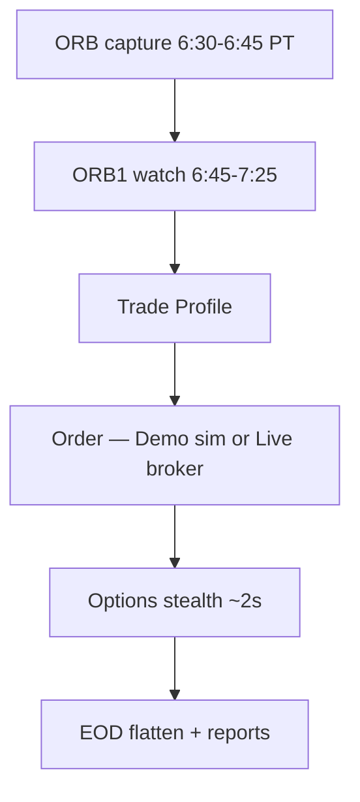
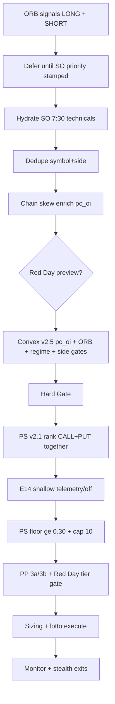

# Easy 0DTE — ORB SO · ORB1 Breakout

**Filename:** `0DTEORB1Breakout.md` (ORB1 Breakout / ORB SO · formerly `0DTEORB.md`)  
**Last updated:** October 30, 2026 — serving Demo `easy-etrade-strategy-00618-cvb`. Local source also has the Trade Profile strike-to-fill path ([0.OrderExecution.md](0.OrderExecution.md)), which that image does not yet include.

**This path (live):** **ORB1 Breakout** is a rolling watch on the **first 15 minutes**. The box is the High and Low of **06:30–06:45**, frozen at **06:45**. Entries run **06:45–07:25** exclusive, shared with TL0, on the next **24** names every **10s**. First print **0.08%** beyond that box → Trade Profile → order. It is **not** a 7:30 batch.

**Admit:** [0.TradeProfiles.md](0.TradeProfiles.md). **Order:** [0.OrderExecution.md](0.OrderExecution.md). **Monitor / exit:** [PositionMonitoring.md](PositionMonitoring.md) · [0DTEProfitCapture.md](0DTEProfitCapture.md).

**Clocks (PT):**

| Window | What |
|--------|------|
| **06:30–06:45** | ORB1 box. Day-freeze `{ns}/daily_markers/{date}.json` → `orb` |
| **06:45–07:25** exclusive | ORB1 watch + TL0. `DISCOVERY_ORB1_TL0_END_PT=07:25` |
| **07:25–07:30** | Capture gap. Arm TL1 once. No new ORB1 entries |
| **07:30–12:30** | ORB2 + TL1+ (not this path) |
| **12:50 / 12:55** | Flatten / EOD report |

**Mode:** `ORB_0DTE_DISCOVERY_MODE=watch` · `ENABLE_0DTE_STRATEGY=true`. Fill = one ORB1 trade per symbol. Reject = 1h same-side cooldown until cutoff. Opposite H/L can still fire before 07:25. After a fill there is no second ORB1 that session.

**Persistence (required):** ORB1 `orb_high` / `orb_low` in the daily marker. A restart must not recapture a different 15-minute box.

**ORB SO ETF (Part II):** paused. `ENABLE_ORB_STRATEGY=false` · `ENABLE_ORB_SIGNAL_COLLECTION=false` · `ENABLE_VALIDATION_CANDLE=false`. Not the live options path.

**Legacy / unused:** `ORB_0DTE_DISCOVERY_MODE=batch` plus Signal Collection / Convex / Hard Gate / PS v2.1 / 7:30 lotto batch (`modules/orb_shared_730_pipeline.py`). That stack is still in the tree and in Part III historical sections. Dated notes that say ORB1 stops at **07:10** — live stop is **07:25**. E16 Quality Gate is not the admit.

**Not this file:** Trendline → [0DTETrendline.md](0DTETrendline.md) · ORB2 → [0DTEORB2Breakout.md](0DTEORB2Breakout.md) · risk → [0DTERisk.md](0DTERisk.md) · exits → [0DTEProfitCapture.md](0DTEProfitCapture.md) · env → [Configs.md](Configs.md).

### App path matrix

| App / Mode | ORB SO ETF | ORB1 0DTE (watch) |
|------------|------------|----------|
| **RESEARCH Demo** | ❌ paused | ✅ |
| **RESEARCH Live** | ❌ blocked | ✅ |
| **FINAL Demo/Live** | ❌ paused | ✅ |

**Status (local):** `ENABLE_ORB_STRATEGY=false` · `ENABLE_ORB_SIGNAL_COLLECTION=false` · `ENABLE_VALIDATION_CANDLE=false` · `ENABLE_0DTE_STRATEGY=true` · `ORB_0DTE_DISCOVERY_MODE=watch` · PP/Red Day **off**.  
**Universe:** `0dte_list.csv` only.  
**Path code (SO — paused):** `modules/orb_so_step5_execution.py` · `configs/ORBSO.env`  
**Path code (ORB1 0DTE):** `modules/orb1_0dte_watch.py` · `modules/discovery_watch_batch.py` · `easy0DTE/*` · `configs/ORB0DTE.env`  
**Legacy batch rollback:** `ORB_0DTE_DISCOVERY_MODE=batch` + re-enable SC/PP — `modules/orb_shared_730_pipeline.py`

**How to read**

| Layer | Sections | Purpose |
|-------|----------|---------|
| **Strategy mission** | [ORB1 Breakout Mission](#orb-0dte-mission) · [Grade A characteristics](#grade-a-orb-0dte-characteristics) · [Grade A vs Skip](#grade-a-vs-skip-framework-orb-0dte) | What the path is trying to accomplish — read before implementation |
| **Strategy architecture** | [Three-path comparison](#3-three-path-comparison) · [Pipeline steps](#pipeline-steps--shared-reference) · Part II / Part III step maps | How ORB SO and ORB1 Breakout relate without blending lanes |
| **Current implementation** | §4–§19 · [Configs](#16-configuration) · [Code map](#17-code-map) | How the running system works today |

---

## Table of contents

**Quick reference**

- [At a glance](#at-a-glance)
- [Which guide for which path?](#which-guide-for-which-path)

**Part I — Shared ORB foundation (both paths)**

1. [Shared executive overview](#1-shared-executive-overview)
2. [Daily timeline — SO + 0DTE together](#2-daily-timeline--so--0dte-together)
3. [Three-path comparison](#3-three-path-comparison)

**Part II — ORB SO (eight pipeline steps)**

| Step | Topic | Section |
|:----:|--------|---------|
| 1 | ORB Capture | [§1 ORB Capture](#step-1--orb-capture-shared) |
| 2 | Signal Collection | [§2 Signal Collection](#step-2--signal-collection-orb-so) |
| 3 | Portfolio Protection Gate | [§3 Portfolio Protection](#step-3--portfolio-protection-gate-orb-so) |
| 4 | Position Sizing / Risk | [§4 Position Sizing / Risk](#step-4--position-sizing--risk-orb-so) |
| 5 | Execution | [§5 Execution](#step-5--execution-orb-so) |
| 6 | Position Monitoring | [§6 Position Monitoring](#step-6--position-monitoring-orb-so) |
| 7 | Exits | [§7 Exits](#step-7--exits-orb-so) |
| 8 | EOD | [§8 EOD](#step-8--eod-orb-so) |

4. [ORB SO — the 7:30 CALL batch](#4-orb-so--the-730-call-batch) *(overview)*
5. [ORB SO — pipeline, ranking & gates](#5-orb-so--pipeline-ranking--gates) *(detail)*
6. [ORB SO — monitoring, equity exits & config](#6-orb-so--monitoring-equity-exits--config) *(detail)*

**Part III — ORB1 Breakout**

*Mission (read first)*

7. [ORB1 Breakout Mission](#orb-0dte-mission)
8. [Grade A ORB1 Breakout characteristics](#grade-a-orb-0dte-characteristics)
9. [Grade A vs Skip framework (ORB1 Breakout)](#grade-a-vs-skip-framework-orb-0dte)
10. [Role of the Priority Optimizer (ORB1 Breakout)](#role-of-the-priority-optimizer-orb-0dte)
11. [Current stack — E16 Quality Gate + PS v2.1](#current-stack-matrix-baseline)
12. [Priority Score (PS v2.1) — purpose & formula](#priority-score-ps-v21) ← **after Signal Collection · before Execution**

*Pipeline steps (operational order)*

| Step | Topic | Section |
|:----:|--------|---------|
| 1 | ORB Capture | [§1 ORB Capture](#step-1--orb-capture-shared-0dte) |
| 2 | Signal Collection | [§2 Signal Collection](#step-2--signal-collection-orb-0dte) |
| 2b | Quality Gate (E16) → Hard Gate | [§2b Qualification](#step-2b--730-qualification-pipeline) · [§8.3](#83-quality-gate-e16--step-4) |
| **2c** | **Priority Score (PS v2.1) rank + Gate 3c** | [**PS section**](#priority-score-ps-v21) · [§8.5](#85-priority-score-ps-v21--step-6) |
| 3 | Portfolio Protection Gate | [§3 Portfolio Protection](#step-3--portfolio-protection-gate-orb-0dte) |
| 4 | Position Sizing / Risk | [§4 Position Sizing / Risk](#step-4--position-sizing--risk-orb-0dte) |
| 5 | Execution | [§5 Execution](#step-5--execution-orb-0dte) |
| 6 | Position Monitoring | [§6 Position Monitoring](#step-6--position-monitoring-orb-0dte) |
| 7 | Exits | [§7 Exits](#step-7--exits-orb-0dte) |
| 8 | EOD | [§8 EOD](#step-8--eod-orb-0dte) |

13. [ORB1 Breakout — the 7:30 CALL/PUT decision](#7-orb-0dte--the-730-callput-decision) *(overview)*
14. [ORB1 Breakout — Signal Collection → Execution](#8-orb-0dte--signal-pipeline) *(detail — Collection → QG → **PS** → Execution)*
15. [Convex Eligibility Filter / Quality Gate E16](#9-convex-eligibility-filter) *(admission)*
16. [Hard Gate, viability, and chain selection](#10-hard-gate-viability-and-chain-selection)
17. [Priority ranking detail (fallbacks)](#11-priority-ranking-at-730) *(PS v2.1 + SO-mirror + legacy)*
18. [Strategy types and execution](#12-strategy-types-and-execution)
19. [Monitoring and exits (options)](#13-monitoring-and-exits-options)
20. [Risk, capital, and position limits](#14-risk-capital-and-position-limits)
21. [Alerts and Cloud forensics](#15-alerts-and-cloud-forensics)
22. [Configuration](#16-configuration)
23. [Code map](#17-code-map)
24. [Production baseline and recent desks](#18-production-baseline-and-recent-desks)
25. [Revision history](#19-revision-history)
26. [Profitability first (development rule)](#profitability-first)
27. [Appendix: ORB0DTE.env snapshot](#appendix-configsorb0dteenv-snapshot)
28. [Related documentation](#related-documentation)

---

## At a glance

ORB1 Breakout shares the **06:30–06:45** capture with the paused SO path. It does **not** wait for a 7:30 decision clock. Entries are rolling **06:45–07:25**.

| | **ORB SO** | **ORB1 Breakout** |
|---|------------|--------------|
| **What trades** | **ETF / stock** long only | **US 0DTE options** (long premium) |
| **Direction @ 7:30** | **CALL** thesis only (price **>** ORB high → long ETF) | **CALL** (breakout) **+ PUT** (breakdown) |
| **Selectivity** | SO ranking + PP (paused) | Trade Profile after 0.08% beyond the 15m box. E16 / PS v2.1 / 7:30 batch are legacy |
| **Max opens** | **15** (`MAX_CONCURRENT_TRADES`) — paused | Shared 0DTE slot pool (50 on Demo) |
| **Universe** | `0dte_list.csv` (ORB SO LONG rules on same list) | `0dte_list.csv` |
| **Entry contract** | N/A (shares) | Trade Profile pick on the live chain. [0.OrderExecution.md](0.OrderExecution.md) |
| **Exit engine** | **Equity** stealth (`prime_stealth_trailing_tp.py`) | **Options premium** stealth — **same engine** as Trendline 0DTE (`orb_options_stealth` instance) |
| **Exit enum** | `ExitReason` (underlying) | `OptionsStealthExitReason` — [catalog](0DTEProfitCapture.md#exit-taxonomy) |
| **Priority research** | [ORBSOImprovementGuide § SO registry](../../1.%20The%20Easy%20ORB%20Strategy%20FINAL%20APP/docs/Improvement%20Guide/ORBSOImprovementGuide.md#orb-so--long-call-registry) | [ORB0DTEImprovementGuide § 0DTE registries](../../1.%20The%20Easy%20ORB%20Strategy%20FINAL%20APP/docs/Improvement%20Guide/ORB0DTEImprovementGuide.md#orb-0dte--call-signal-registry) |
| **PO snapshots** | [PriorityOptimizer §3](PriorityOptimizer.md#3-orb-so-etf-standard-orders) | [PriorityOptimizer §4](PriorityOptimizer.md#4-orb-0dte-opening-batch) |



**Third path (not in this file):** [Easy Trendline 0DTE](0DTETrendline.md) — **TL1 on ORB2** after ORB1 Breakout (mission geometry contest + envelope), intraday break emit, simple quality gate. **Lane:** resolution after first-hour structure, not ORB continuation.

---

## Which guide for which path?

| Path | Read this | Research / rank tuning |
|------|-----------|------------------------|
| **ORB SO** (ETF long CALL) | **[ORBSO.md](ORBSO.md)** (canonical) · this file Part II (summary) | [ORBSOImprovementGuide.md](../../1.%20The%20Easy%20ORB%20Strategy%20FINAL%20APP/docs/Improvement%20Guide/ORBSOImprovementGuide.md) · [ORB_Pipeline_Ranking_and_Execution.md](../../1.%20The%20Easy%20ORB%20Strategy%20FINAL%20APP/docs/Improvement%20Guide/ORB_Pipeline_Ranking_and_Execution.md) |
| **ORB1 Breakout** (CALL + PUT options) | **This file — Part III** | Same improvement guide (0DTE registries) · [0DTEProfitCapture.md](0DTEProfitCapture.md) · [0DTERisk.md](0DTERisk.md) |
| **Trendline 0DTE** (intraday) | **[0DTETrendline.md](0DTETrendline.md)** | [Trendline Strategy Mission](../../1.%20The%20Easy%20ORB%20Strategy%20FINAL%20APP/docs/Improvement%20Guide/Trendline%20Improvements/Trendline%20Strategy%20Mission.md) · [Grade A](../../1.%20The%20Easy%20ORB%20Strategy%20FINAL%20APP/docs/Improvement%20Guide/Grade%20A%20Trendlines.md) · [Skip](../../1.%20The%20Easy%20ORB%20Strategy%20FINAL%20APP/docs/Improvement%20Guide/Skip%20Trendlines.md) · [TrendlineImprovementGuide](../../1.%20The%20Easy%20ORB%20Strategy%20FINAL%20APP/docs/Improvement%20Guide/Trendline%20Improvements/TrendlineImprovementGuide.md) |
| **ORB2 Breakout 0DTE** (delayed ORB#2 high/low) | **[0DTEORB2Breakout.md](0DTEORB2Breakout.md)** | Confirmation + quality + dir% hard · shared slot pool with ORB1/Trendline |
| **All paths — PO retrieve** | [PriorityOptimizer.md](PriorityOptimizer.md) | `python3.11 priority_optimizer/retrieve_execution_snapshots.py --date YYYY-MM-DD` |

**Do not copy rank weights across paths.** SO continuation-first scoring, 0DTE Convex + geometry tier, and Trendline simple quality score answer different edge hypotheses.

---

## Pipeline steps — shared reference

Every path follows: capture the box → watch for a break → Trade Profile → order → monitor → exit → flatten. **ORB1 Breakout live** is the watch below. The 7:30 batch text later in this file is the paused SO / rolled-back options batch.

```text
ORB1 Breakout (live watch)
  1 ORB Capture          → 6:30–6:45 PT freeze
  2 Rolling watch        → 6:45–7:25 · 0.08% beyond the box · shared 24/10s scan with TL0
  3 Trade Profile        → Skip Signals + one pick + one stamp ([0.TradeProfiles.md](0.TradeProfiles.md))
  4 Position Sizing      → sacred buffer · equal 1/N · shared pool
  5 Execution            → that strike ([0.OrderExecution.md](0.OrderExecution.md))
  6 Monitor / Exits / EOD → stealth · 12:50 flatten · 12:55 report
```

| Step | ORB SO | ORB1 Breakout | Primary module(s) |
|:----:|--------|----------|-------------------|
| **1** | Shared ORB high/low | Shared | `prime_orb_strategy_manager.py` |
| **2** | LONG rules → `_pending_so_signals` + SO priority_score | CALL/PUT → enrich → Convex → Hard Gate → **single rank** → `_pending_dte0_signals` | ORB manager · `prime_0dte_strategy_manager.py` |
| **3** | Gates 3a–3f (SO pool) | PP **3a/3b** on execution queue (`ensure_pp_ready`) | `portfolio_protection_step5.py` |
| **4** | 6-step batch sizing | Equal 1/N + `0DTE_SLOT_COUNT` | `calculate_position_sizing` · `trendline_capital_allocation` |
| **5** | ETF smart execution | Options executor + chain | `smart_equity_execution` · `options_trading_executor` |
| **6** | Equity stealth loop | Options stealth ~2s | `prime_stealth_trailing_tp` · `prime_options_stealth_trailing_tp` |
| **7** | ETF exits / EOD | Premium ladder + EOD | [0DTEProfitCapture.md](0DTEProfitCapture.md) |

---

## 1. Shared executive overview

The **Easy ORB Strategy** runs on one Cloud Run service with **one shared ORB capture**. At **7:30 AM PT (10:30 AM ET)** two batch paths execute from the morning impulse:

| Path | One-line thesis |
|------|-----------------|
| **ORB SO** | Rank **long ETF** breakouts above ORB high; deploy equity capital on continuation quality. |
| **ORB1 Breakout** | Rank **CALL + PUT** convex setups; deploy options gamma only when Convex and chain gates pass. |

**Shared principles:**

| Principle | Meaning |
|-----------|---------|
| **One ORB clock** | 6:30–6:45 capture defines high/low for all paths. |
| **7:30 decision** | **Legacy / paused SO.** Live ORB1 does not wait for 7:30. |
| **Execution ≠ alpha** | Ranking and gates separate *what moved* from *what to trade* — see [ORBSO.md](ORBSO.md) execution · [0DTERisk.md §11](0DTERisk.md#11-liquidity--adv-guard-execution-risk-layer). |
| **Live broker data** | Production uses E*TRADE batch quotes for ORB/validation; options paths use live chains when API wired. |

**Core idea (0DTE, live):** ORB defines *direction*. The 15-minute box is frozen at 06:45. A 0.08% print beyond it goes to the Trade Profile. An accept orders that strike. E16 / PS v2.1 / 7:30 batch are the rolled-back executor.

**Core idea (SO):** Continuation quality at 7:30 beats spent geometry and raw confidence; winner-profile filter rejects chase extensions before the ETF batch fires.

---

## 2. Daily timeline — SO + 0DTE together

All times **Pacific (PT)**.

### Current default (watch mode — Aug 7+)

| Time (PT) | Stage | Notes |
|-----------|--------|-------|
| **6:30–6:45** | ORB#1 window → **ORB1 capture** ≥06:45 | Day-freeze; prerequisite for TL0 + ORB1 Breakout |
| **≥06:45** (~06:45–06:46) | Yahoo 1m → **TL0 inject** | Structure chain must finish before discovery |
| **After structure ready → &lt;07:25** | **TL0 + ORB1 BO discovery** (shared) | Floor start **06:45**; both arm together; shared **24**/10s → 0.08% → Trade Profile → order |
| **07:25–07:30** | Arm TL1 pending once | No ORB2 / BO yet. No new ORB1 |
| **≥07:30** | ORB2 → **BO unlock** → Yahoo → TL1 (TL held) → **TL join** | [0DTEORB2Breakout.md](0DTEORB2Breakout.md) |
| **12:50 / 12:55** | EOD flatten + unified report | Same as below |

### Legacy batch / SO timeline (paused — rollback only)

| Time (PT) | ET | Stage | ORB SO | ORB1 Breakout |
|-----------|-----|--------|--------|----------|
| **6:25** | 9:25 | Token prep | `ORB_TOKEN_PREP` — live SPY probe | Same |
| **6:30–6:45** | 9:30–9:45 | **ORB capture** | ORB high/low — **required** | Same ORB on underlyings |
| **7:00–7:15** | 10:00–10:15 | Validation candle | Volume color + ORB position | Same |
| **7:15–7:30** | 10:15–10:30 | Signal collection | Scan → `_pending_so_signals` (LONG) | Scan → `_pending_dte_signals` (CALL/PUT) |
| **7:30** | 10:30 | **Decision + execution** | Rank SO → gates → ETF batch (≤**15**) | Enrich → Convex → Hard Gate → **single rank** → Gate 3c → PP (`ensure_pp_ready`) → options (≤**10**) |
| **7:30** | 10:30 | **Alerts** | Unified **Signal Collection** (SO + 0DTE sections) | **Options Execution** alert (fills or zero-exec) |
| **7:30–12:50** | — | Monitoring | Equity stealth loop | Options stealth ~**2s** |
| **12:50–12:51** | 3:50–3:51 | EOD flatten | `flatten_all_paths_for_eod_scheduler()` | Same unified flatten |
| **12:55** | 3:55 | EOD report | **unified 0DTE** only (`🏦 END-OF-DAY 0DTE`); SO ETF EOD skipped when `ENABLE_ORB_STRATEGY=false` | |

**Prerequisite chain (watch):** No ORB1 capture → no TL0 / no ORB1 Breakout. **Prerequisite chain (legacy batch):** No ORB capture → no validation → **no 7:30 SO or 0DTE candidates**.

**Scheduler jobs:** validation-candle-700, prefetch-validation-715, end-of-day-report — see [ORBSO.md §11](ORBSO.md#11-ops--scheduler--oauth--gcs) or [Cloud.md](Cloud.md).

---

## 3. Three-path comparison

| Dimension | **ORB SO (Part II)** | **ORB1 Breakout (Part III)** | Trendline 0DTE |
|-----------|----------------------|-------------------------|----------------|
| **7:30 role** | Execute long ETFs | Execute **CALL + PUT** options | Arm defer only; **TL1 after ORB2** (no 7:30 options) |
| **7:30 thesis** | Continuation above ORB high | Continuation **CALL** / breakdown **PUT** | **Resolution** of ORB2 cap/floor (not lowest MSE chord) |
| **Direction** | Long only (CALL thesis) | **CALL + PUT** from ORB break | **CALL** on descending resistance break; **PUT** on ascending support break |
| **Selectivity** | SO rank + PP (paused) | **E16 QG** + Layer C **dir% hard** (`pc_oi` off) + Hard Gate / PS (batch) or per-confirm admit (watch) | Build: mission geometry contest · emit: simple quality ≥ **55** |
| **Max batch / slots** | **15** concurrent (`MAX_CONCURRENT_TRADES`) | **10** (`ORB_0DTE_PRIORITY_RANK_FINAL_BATCH_MAX`) | Rolling intraday within shared **10** slot pool |
| **Combined options cap** | — | ORB + TL + Breakout ≤ **10** (`TOTAL_0DTE_MAX_POSITIONS`) | Same shared pool |
| **Exit brain** | Equity stealth | Options premium stealth | Same options stealth |
| **Guide** | **[ORBSO.md](ORBSO.md)** · Part II summary | **This file — Steps 1–8 (Part III)** | [0DTETrendline.md — Steps 1–8](0DTETrendline.md#pipeline-steps--eight-stages) |

---

# Part II — ORB SO (ETF · long CALL @ 7:30)

**Canonical SO guide:** [ORBSO.md](ORBSO.md). Part II below is the shared pipeline summary kept next to ORB1 Breakout for the 7:30 clock.

Each subsection below maps to one **pipeline step**. Detailed mechanics follow in §4–6.

### Step 1 — ORB Capture (shared) {#step-1--orb-capture-shared}

| Item | Detail |
|------|--------|
| **When** | **6:30–6:45 AM PT** (9:30–9:45 ET) |
| **Output** | `orb_high`, `orb_low`, `orb_range_pct` per symbol (**unified `0dte_list.csv`**) |
| **Prerequisite** | `ORB_TOKEN_PREP` @ 6:25 · live SPY probe — no capture → no 7:30 path |
| **Persistence** | **Required** — see [ORB1 persistence](#orb1-persistence-required) |
| **Detail** | [§2 Daily timeline](#2-daily-timeline--so--0dte-together) · [ORBSO.md](ORBSO.md) |

#### ORB1 persistence required {#orb1-persistence-required}

Cloud Run restart mid-session must **not** re-capture ORB#1 from live quotes. Valid post-**06:45 PT** freezes are day-locked.

| Persist key | Meaning | Store |
|-------------|---------|-------|
| `orb_high` / `orb_low` | Frozen 06:30–06:45 box per symbol | `{ns}/daily_markers/{date}.json` → `orb.snapshot` |
| `capture_time` / `captured_at` | Prove freeze is today’s post-06:45 capture | same |
| `orb.alert_sent` | One ORB capture Telegram / day | same |

**Policy:** `DailyRunTracker.record_orb_capture` — skip overwrite of valid day freeze unless `force=True`. Hydrate: `_hydrate_orb1_from_daily_markers`. Catalog: [Data.md §10](Data.md#persistence-required-for-app-performance).

### Step 2 — Signal Collection (ORB SO) {#step-2--signal-collection-orb-so}

| Item | Detail |
|------|--------|
| **When** | **7:15–7:30 PT** scan → **7:30 cutoff** revalidation |
| **Rules** | Price ≥ ORB high×1.001 · GREEN 7:00–7:15 candle · close > ORB high |
| **Queue** | `_pending_so_signals[]` |
| **Sub-step: Priority Ranking** | @ 7:30 — `calculate_so_priority_score()` → sort → `execution_window_input` snapshot |
| **Detail** | [§4](#4-orb-so--the-730-call-batch) · [§5 Signal pipeline](#5-orb-so--pipeline-ranking--gates) · [PriorityOptimizer §3](PriorityOptimizer.md#3-orb-so-etf-standard-orders) |

### Step 3 — Portfolio Protection Gate (ORB SO) {#step-3--portfolio-protection-gate-orb-so}

| Item | Detail |
|------|--------|
| **When** | Immediately after rank, **before** ETF fills |
| **Gates** | 3a unified batch → 3b composite risk → 3c zero-PS → 3d–3f symbol gates |
| **Detail** | [§5 Gates](#5-orb-so--pipeline-ranking--gates) · [PortfolioProtectionGuide.md](PortfolioProtectionGuide.md#canonical-execution-pipeline) |

### Step 4 — Position Sizing / Risk (ORB SO) {#step-4--position-sizing--risk-orb-so}

| Item | Detail |
|------|--------|
| **Sizing** | Equal 1/N slots (shared allocator) · rank selects top-K · optional rank multipliers off by default |
| **Caps** | `MAX_CONCURRENT_TRADES` (default **15**) |
| **Config** | `configs/ORBSO.env` · `configs/Risk.env` |
| **Detail** | [§5 Step 5 sizing](#5-orb-so--pipeline-ranking--gates) · [SORisk.md](SORisk.md) |

### Step 5 — Execution (ORB SO) {#step-5--execution-orb-so}

| Item | Detail |
|------|--------|
| **When** | **7:30 AM PT** batch |
| **How** | Smart limit ladder (`USE_MARKET_ORDERS=false`, `ENABLE_SMART_EXECUTION=true`) |
| **Alert** | ORB SO Execution Telegram |
| **Detail** | [§4](#4-orb-so--the-730-call-batch) · [§5](#5-orb-so--pipeline-ranking--gates) |

### Step 6 — Position Monitoring (ORB SO) {#step-6--position-monitoring-orb-so}

| Item | Detail |
|------|--------|
| **Engine** | `prime_stealth_trailing_tp.py` — **underlying / ETF marks** |
| **Loop** | Main trading loop + health checks (every **15 min**) |
| **Window** | **7:30–12:50 PT** |
| **Detail** | [§6 Monitoring](#6-orb-so--monitoring-equity-exits--config) · [0DTEProfitCapture — SO](0DTEProfitCapture.md#orb-so-stealth-trailing-tp) |

### Step 7 — Exits (ORB SO) {#step-7--exits-orb-so}

| Item | Detail |
|------|--------|
| **Triggers** | 14 equity exit rules (BE, trail, profit lock, invalidation, urgency routing) |
| **Closes** | Stops/EOD → MARKET; scale-outs → passive limits |
| **Not here** | `OPTION_STEALTH_*` — options only ([0DTEProfitCapture.md](0DTEProfitCapture.md)) |
| **Detail** | [§6](#6-orb-so--monitoring-equity-exits--config) · [0DTEProfitCapture.md](0DTEProfitCapture.md) |

### Step 8 — EOD (ORB SO) {#step-8--eod-orb-so}

| Item | Detail |
|------|--------|
| **Flatten** | **12:50–12:51 PT** — `flatten_all_paths_for_eod_scheduler()` |
| **Report** | **12:55 PT** — skipped when `ENABLE_ORB_STRATEGY=false` (`skipped:so_etf_retired`); otherwise `_send_demo_eod_summary` |
| **Env** | `SO_ETF_EOD_CLOSE_START_PT` / `END_PT` in `configs/ORBSO.env` |
| **Detail** | [§2 timeline](#2-daily-timeline--so--0dte-together) · [§6](#6-orb-so--monitoring-equity-exits--config) |

---

## 4. ORB SO — the 7:30 CALL batch

**Easy ORB Standard Orders (SO)** trades **long ETF/stock** positions when price is **above ORB high** at the 7:30 cutoff — a **CALL-direction** continuation thesis implemented as **equity long**, not options.

### What is decided at 7:30 (SO)

| Decision | Rule |
|----------|------|
| **Direction** | **LONG only** — price must be above ORB high (with validation candle + volume rules). **No SHORT / PUT** on SO path. |
| **Eligibility** | Pass ORB scan, 7:00–7:15 validation, breakout re-check (`CALL_RECHECK_BREAKOUT_MULTIPLIER`). |
| **Queue order** | `calculate_so_priority_score()` — **continuation-first** (Rev **00349**); sort descending. |
| **Batch size** | Up to **`MAX_CONCURRENT_TRADES`** (default **15** in `configs/ORBSO.env`). |
| **Capital** | Equal-slot sizing from sacred buffer + `tradable_equity / 0DTE_SLOT_COUNT` on demo ledger (~**$5k** baseline). |

### SO vs 0DTE direction (do not conflate)

| Signal type | ORB SO | ORB1 Breakout |
|-------------|--------|----------|
| Above ORB high | **Long ETF** ✓ | **Long CALL** option ✓ |
| Below ORB low | *Not traded* | **Long PUT** option ✓ |

SO **never** opens a short ETF or put option. Breakdown names appear only on the **0DTE** path.

### 7:30 orchestration (SO code) — six steps

| Step | Name |
|:----:|------|
| **1** | **ORB Capture** (6:30–6:45 PT — shared; prerequisite) |
| **2** | **Signal Collection** — scan + 3 rules → 7:30 cutoff → `_pending_so_signals` |
| **3** | **Priority Ranking** — enrich → `calculate_so_priority_score()` → sort → `execution_window_input` snapshot |
| **4** | **Portfolio Protection Gate** — 3a unified batch → 3b composite risk → 3c zero-PS → 3d–3f symbol gates |
| **5** | **Position Sizing → Execution** — Risk Manager batch sizing → execute → SO Execution alert |
| **6** | **Profit Capture** — intraday **`prime_stealth_trailing_tp`** on underlying marks |

Detail: [Portfolio Protection — canonical pipeline](PortfolioProtectionGuide.md#canonical-execution-pipeline) · [Profit Capture — SO step 6](0DTEProfitCapture.md#orb-so-stealth-trailing-tp).

**Priority Optimizer:** `execution_window_input` + `signal_collection_730` snapshots — [PriorityOptimizer §3](PriorityOptimizer.md#3-orb-so-etf-standard-orders).

---

## 5. ORB SO — pipeline, ranking & gates

### Signal pipeline (Rev 00372 — six steps)

```text
Step 1 — ORB Capture
  6:30–6:45 PT · unified 0dte_list.csv · orb_high / orb_low / orb_range_pct

Step 2 — Signal Collection
  7:15–7:30 scan → _pending_so_signals[] → 7:30 cutoff revalidation

Step 3 — Priority Ranking
  enrich + calculate_so_priority_score → sort → execution_window_input snapshot

Step 4 — Portfolio Protection Gate
  3a unified batch → 3b composite risk → 3c zero-PS
  → 3d signal-level Red Day (opt) → 3e winner profile → 3f adaptive filter

Step 5 — Position Sizing → Execution
  batch sizing → execute (≤15) → SO Execution alert

Step 6 — Profit Capture
  prime_stealth_trailing_tp · underlying BE +0.75% @ 6.4m · trail +0.7% · EOD 12:50 PT
```

| Stage | Module | Output |
|-------|--------|--------|
| ORB intake | `PrimeORBStrategyManager` | Breakout candidates |
| Enrichment | `prime_trading_system.enrich_signal_with_technical_data` | Tech fields @ 7:30 |
| Rank | `calculate_so_priority_score` | `priority_score`, `SO_RANK_BREAKDOWN` |
| Gates | Portfolio Protection Gate (3a–3f) | Filtered execution list |
| Execute | `prime_unified_trade_manager` / smart equity execution | ETF fills |
| **Profit Capture** | `prime_stealth_trailing_tp.py` | Equity stealth — step **6** |

**Deep dive:** [ORB_Pipeline_Ranking_and_Execution.md](../../1.%20The%20Easy%20ORB%20Strategy%20FINAL%20APP/docs/Improvement%20Guide/ORB_Pipeline_Ranking_and_Execution.md) (SO section).

<a id="orb-so-profit-capture"></a>
### ORB SO — Profit Capture (step 6)

**When:** After SO fill @ 7:30 through **12:50 PT** EOD. **Mark:** underlying share price.

| Layer | Trigger | Lock / action |
|-------|---------|---------------|
| Entry bar floor | First **30 min** | Vol-scaled floor **2–8%** |
| Breakeven | **+0.75%** after **6.4 min** | Lock **+0.2%** (Rev **00196**) |
| Trailing | **+0.7%** after **6.4 min** | **1.5–2.5%** from peak |
| Take profit | **+3%** | Arms trailing — no exit |
| Low equity volume | `volume_ratio` below **0.50** | **No standalone ORB SO exit by default**; volume is an entry/rank and Portfolio Protection input |
| Profit timeout | **2.5 h** if profitable | Exit unprotected winners |
| EOD | **12:50 PT** | Flatten leftover paths |

**Guide:** [0DTEProfitCapture.md §0b](0DTEProfitCapture.md#orb-so-stealth-trailing-tp) · **Config:** `configs/Risk.env` (`STEALTH_*`)

### Priority Ranking — step 3 (before Portfolio Protection)

**When:** Immediately after Signal Collection revalidation @ 7:30 PT.  
**Before:** Position sizing, winner profile, adaptive filter (those run in Portfolio Protection step 4).

| Item | Detail |
|------|--------|
| **Function** | `calculate_so_priority_score()` in `modules/orb_priority_score.py` |
| **Input** | Enriched 7:30 fields: VWAP distance, RS vs SPY, volume ratio, RSI, MACD, momentum, ORB range |
| **Output** | `priority_score` per symbol → sort descending → `priority_rank` 1..N → `execution_window_input` GCS snapshot |

**Chosen formula (Rev 00349 / 00374 — continuation-first):**

```text
base = 0.36 × continuation_quality
     + 0.64 × (0.24×VWAP + 0.18×RS + 0.28×vol + 0.10×conf + 0.14×RSI + 0.06×orb_range)

priority_score = base × quality_multiplier − stack_penalties − exhaustion/deceleration ± geometry
                 → clamp ≥ 0
```

| Component | Weight / role |
|-----------|----------------|
| **Continuation quality** | **36%** of base — momentum slope, acceleration, MACD, directional consistency |
| **VWAP** | 24% of remainder — plateau 0–22%; taper **>35%**; not monotonic “farther = better” |
| **ORB volume** | 28% of remainder — participation, not solo ranker |
| **RS vs SPY** | 18% of remainder — meaningful on diversified ETF book |
| **Confidence** | 10% — boost only when continuation ≥ **0.50** |
| **RSI** | 14% — regime-aware (BULL vs MIXED) |
| **ORB range** | 6% — soft wide-ORB context |

**Stack penalties:** below-VWAP + weak continuation; VWAP chase **>35%**; weak continuation **<0.42**.

**Jun 1 desk:** NET **#1**, SNOW **#4** — rank correct; MSTR PS=**0.000** trimmed by Gate **3c** (not rank formula).

**Greps:** `SO_RANK_BREAKDOWN` · `SO_CONTINUATION_VS_EXTENSION_BIAS`  
**Config:** `configs/ORBSO.env` — `SO_CONTINUATION_MOMENTUM_WEIGHT=0.36`, `SO_ENTRY_*`, `SO_WINNER_*`

### Gates before SO execution (Portfolio Protection Gate — order)

| Layer | Gate |
|:-----:|------|
| — | Duplicate guard (`_so_executed_symbols_today`) |
| **3a** | **Unified batch protection** (Rev 00369 + split-tape **00375**) — Patterns 1–3 + Protection Day (below-VWAP **or** median VWAP &lt; 2%) |
| **3b** | **Composite risk** — `composite_risk_score ≥ 0.75` ([PortfolioProtectionGuide.md](PortfolioProtectionGuide.md)) |
| **3c** | **Zero priority score** — `SO_SKIP_ZERO_PRIORITY_SCORE` / `0DTE_SKIP_ZERO_PRIORITY_SCORE` (local 00372/00374) |
| **3d** | **Signal-level Red Day** (optional, default off) |
| **3e** | **Winner profile** — VWAP extension, weak continuation + high confidence |
| **3f** | **Adaptive expense filter** — fair share / whole-share affordability |
| **4** | Top-N execution after batch sizing |

### May 29 SO desk (BUILD 00370)

```text
8 ranked @ collection (post breakout re-check from 8)
  → 3  ORB-valid after 7:30 price filter
  → 1  protected top-3 fill (affordable fallback: 0 adds)
```

Scan **+3s late** (`07:30:03` PT); expensive-name day vs **~$5k** demo ledger.

---

## 6. ORB SO — monitoring, equity exits & config

**Pipeline steps covered here:** [Step 6 — Position Monitoring](#step-6--position-monitoring-orb-so) · [Step 7 — Exits](#step-7--exits-orb-so) · [Step 8 — EOD](#step-8--eod-orb-so)

### Monitoring & exits (equity — not options)

| Aspect | Detail |
|--------|--------|
| Engine | `prime_stealth_trailing_tp.py` — **underlying / ETF P&amp;L** |
| Loop | Main trading loop + health checks (every **15 min**) |
| Opens | Smart limit ladder when `USE_MARKET_ORDERS=false` + `ENABLE_SMART_EXECUTION=true` |
| Closes | Urgency routing — stops/EOD → MARKET; scale-outs → passive limits |
| EOD | `SO_ETF_EOD_CLOSE_START_PT`–`END_PT` (default **12:50–12:51** PT) — see [Step 8 — EOD](#step-8--eod-orb-so) |

**Not covered here:** `OPTION_STEALTH_*` keys apply to **0DTE options** only — see [0DTEProfitCapture.md](0DTEProfitCapture.md).

### EOD flatten and reports (Step 8)

| Event | Time (PT) | Behavior |
|-------|-----------|----------|
| **EOD close** | **12:50–12:51** | `flatten_all_paths_for_eod_scheduler()` — all open SO ETFs |
| **EOD report** | **12:55** | **Unified 0DTE** Telegram only (`send_scheduled_unified_0dte_eod` → `🏦 END-OF-DAY 0DTE`) when SO paused |
| **Scheduler** | Cloud | `end-of-day-report` job — see [Cloud.md](Cloud.md) |

### SO configuration

| File | Role |
|------|------|
| **`configs/ORBSO.env`** | SO path toggle, rank weights, winner profile, batch caps, equity EOD |
| **`configs/Risk.env`** | Portfolio ceilings, Red Day |
| **`configs/Shared.env`** | Cross-path caps, execution flags |

**Merge order:** `Data.env` → `Shared.env` → **`ORBSO.env`** → `ORB0DTE.env` → …

### SO code map

| Responsibility | Path |
|----------------|------|
| ORB scan & signals | `modules/prime_orb_strategy_manager.py` |
| 7:30 rank + execute | `modules/prime_trading_system.py` |
| Equity stealth | `modules/prime_stealth_trailing_tp.py` |
| Smart equity fills | `modules/smart_equity_execution.py` |
| Alerts | `modules/prime_alert_manager.py` |
| Init toggle | `main.py` (`ENABLE_ORB_STRATEGY`) |

### SO log tokens (grep)

`SO_RANK_BREAKDOWN` · `SO_WINNER_FILTER_CHASE` · `SO_CONTINUATION_VS_EXTENSION_BIAS` · `PIPELINE | STEP 4 SIGNAL COLLECTION` · `PIPELINE | STEP 5 TRADE EXECUTION` · `ORB_CAPTURE` · `ORB_TOKEN_PREP`

---

# Part III — ORB1 Breakout (options · CALL + PUT, rolling 06:45–07:25)

The 7:30 batch sections later in Part III (Signal Collection, Convex, PS v2.1, lotto-first) describe the rolled-back executor. The live path is the watch: ORB#1 freeze → 0.08% → Trade Profile → order.

Read **mission and Grade A** sections below before pipeline steps and §7–§19 implementation detail.

---

## ORB1 Breakout Mission {#orb-0dte-mission}

**ORB1 Breakout** exists to monetize **opening-range continuation** with **options convexity** — not to classify charts, not to chase reversals, and not to mirror Trendline structure logic.

| Mission pillar | What it means |
|----------------|---------------|
| **Capture continuation moves** | Trade the 15-minute box when price **holds** above ORB high (**CALL**) or below ORB low (**PUT**) anytime **06:45–07:25**. Not a 7:30 batch. |
| **Priority Optimizer ranks capital** | Among valid names, rank which deserve limited option slots — ranking is **capital allocation**, not the strategy thesis. |
| **Low delta, high convexity** | Prefer contracts in the shared entry band that maximize **gamma per dollar** when the move extends — moonshot asymmetry over high-delta certainty. |
| **Profit Capture monetizes extension** | After fill, premium stealth exits exist to **lock and trail** large directional moves — see [0DTEProfitCapture.md](0DTEProfitCapture.md). |
| **Continuation, not reversal** | ORB1 Breakout is a **continuation** strategy. Do not tune it like a mean-reversion or trapped-participant system. |

### Three paths — never blend conceptually

| Path | Instrument | 7:30 thesis | Guide |
|------|------------|-------------|-------|
| **ORB SO** | Stock / ETF long | **Continuation** above ORB high (CALL direction on equity) | Part II · [ORBSOImprovementGuide.md](../../1.%20The%20Easy%20ORB%20Strategy%20FINAL%20APP/docs/Improvement%20Guide/ORBSOImprovementGuide.md) |
| **ORB1 Breakout** | 0DTE options | **Continuation** — CALL breakout / PUT breakdown | **Part III** · [ORB0DTEImprovementGuide.md](../../1.%20The%20Easy%20ORB%20Strategy%20FINAL%20APP/docs/Improvement%20Guide/ORB0DTEImprovementGuide.md) |
| **Trendline 0DTE** | 0DTE options | **First-hour structure resolution** — cap/floor break after control build | [0DTETrendline.md](0DTETrendline.md) · [Trendline Strategy Mission](../../1.%20The%20Easy%20ORB%20Strategy%20FINAL%20APP/docs/Improvement%20Guide/Trendline%20Improvements/Trendline%20Strategy%20Mission.md) |

**ORB SO** = stock/ETF continuation. **ORB1 Breakout** = option continuation on the same ORB clock. **Trendline 0DTE** = structure resolution after the 7:30 line build. Shared ORB capture does **not** mean shared ranking weights, shared exit logic, or shared research cohorts.

---

## Grade A ORB1 Breakout Characteristics {#grade-a-orb-0dte-characteristics}

Desk winners repeatedly share a **profile**, not a single indicator. Future Priority Optimizer work should optimize toward this **Grade A profile** rather than isolated feature wins.

| Trait | Grade A signal | Desk anchors |
|-------|----------------|--------------|
| **Strong Priority Optimizer rank** | Top of **executed** cohort correlates with top $ when continuation is real | **COIN** #1 Jun 3 · **SLV** top PS among fills Jun 4 |
| **Clean directional continuation** | Price stays on break side after 7:30; tape expands in trade direction | **COIN/NFLX** PUT breakdown · **TSLA** CALL lotto winner |
| **Early momentum expansion** | MFE develops quickly; Profit Capture can trail | **SLV** +233% MFE · **COIN** +140% MFE |
| **Good liquidity** | Chain passes Hard Gate; spreads executable at entry | Jun 3–4 lotto fills; contrast **LLY** `spread_selection_failed` Jun 4 |
| **Executable contract chain** | Single-leg or ladder finds tradable strike in δ band | **SLV** `D-SLV-66p-660` · **COIN** lotto PUT |
| **Low δ with sufficient liquidity** | Convex payoff without buying certainty | **SLV** δ≈0.31 · **COIN** δ≈0.35 |
| **Strong convex payoff** | Realized % in moonshot band on winners | PUT **+100% to +216%** · CALL **+20–40%** on desk |

**False negatives to preserve:** May 22 desk **Tier A** CALL signals (**VST**, **ARM**, **CEG**) blocked at uniform Convex — geometry continuation without fill is still Grade A *signal* class; see [ORB0DTEImprovementGuide — May 22](../../1.%20The%20Easy%20ORB%20Strategy%20FINAL%20APP/docs/Improvement%20Guide/ORB0DTEImprovementGuide.md#orb-0dte--call-signal-registry).

**Anti-patterns (Skip class):** Wide break without follow-through (**OPEN** Jun 3 `time_exit`) · high convex with no progress (**GOOGL/HIMS/IWM** `no_progress` Jun 4) · rank #1 selected but execution-layer miss (**LLY** Jun 4).

---

## Grade A vs Skip Framework (ORB1 Breakout) {#grade-a-vs-skip-framework-orb-0dte}

**Purpose:** Every calibration or gate change should answer:

> *Does this move us closer to Grade A winners — or only improve a metric?*

| | **Grade A** | **Skip** |
|---|-------------|----------|
| **Structure** | Tight ORB + clean break on correct side | Wide/chase break · break without follow-through |
| **Execution** | Fill in δ band · tradable chain · acceptable spread | `spread_selection_failed` · illiquid legs · delta out of band |
| **Follow-through** | MFE expands · premium trails | `no_progress` · immediate fade · `time_exit` on chop |
| **Premium expansion** | Peak premium well above entry | Flat premium · scratch exits |
| **Liquidity** | Volume/OI support entry and exit marks | Chain gaps · degraded spread at monitor |
| **Profitability** | Positive $ on closed cohort | Repeated small losses dominating net |

**Research cohorts:** [ORB0DTEImprovementGuide — fill registry](../../1.%20The%20Easy%20ORB%20Strategy%20FINAL%20APP/docs/Improvement%20Guide/ORB0DTEImprovementGuide.md#orb-0dte--executed-fill-registry) · [Profit/Loss matrix](../../1.%20The%20Easy%20ORB%20Strategy%20FINAL%20APP/docs/Improvement%20Guide/ORB0DTEImprovementGuide.md#profit-loss-trade-matrix) · [PriorityOptimizer §4](PriorityOptimizer.md#4-orb-0dte-opening-batch) · [Profit Optimizer cohorts](../profit_optimizer/README.md) when retrieved.

**Trendline Skip cohort** is separate — do not import Trendline [Skip Trendlines](../../1.%20The%20Easy%20ORB%20Strategy%20FINAL%20APP/docs/Improvement%20Guide/Skip%20Trendlines.md) rules into ORB1 Breakout gates.

---

## Role of the Priority Optimizer (ORB1 Breakout) {#role-of-the-priority-optimizer-orb-0dte}

The **Priority Optimizer is not the strategy.** It is the **ranking engine** that decides which **valid** 7:30 continuation setups receive capital within batch and combined caps.

| Role | ORB1 Breakout |
|------|----------|
| **Strategy** | Continuation thesis + Convex admission + Hard Gate + execution |
| **Priority Optimizer** | Order fills among survivors — **PS v2.1** `priority_score` · Gate 3c ≥ **0.30** · cohort snapshots |
| **Profit Capture** | Post-fill premium management — not rank input |
| **Improvement guides** | Longitudinal proof — desk registries, moonshot class, false positives |

**PO must learn from:**

- **Execution outcomes** — fill vs reject, spread path, delta viability  
- **Profitability outcomes** — closed P&amp;L %, MFE, capture % — [0DTEProfitCapture.md](0DTEProfitCapture.md)  
- **Grade A desk rows** — COIN, NFLX, SLV, TSLA class in [ORB0DTEImprovementGuide](../../1.%20The%20Easy%20ORB%20Strategy%20FINAL%20APP/docs/Improvement%20Guide/ORB0DTEImprovementGuide.md)  
- **Skip / false-positive rows** — OPEN, no_progress cluster, May 22 Convex blocks  

**Not from:** theoretical chart assumptions alone, single-session indicator tweaks, or Trendline geometry labels.

**Workflow:** `retrieve_execution_snapshots.py` → `populate_improvement_guides.py` → review AUTO ledger — [ORB0DTEImprovementGuide — Auto-Generated Research Ledger](../../1.%20The%20Easy%20ORB%20Strategy%20FINAL%20APP/docs/Improvement%20Guide/ORB0DTEImprovementGuide.md#auto-generated-research-ledger-orb-0dte).

---

## Current stack — E16 Quality Gate + PS v2.1 {#current-stack-matrix-baseline}

**Canonical ORB1 Breakout stack:** **ORB1 watch 06:45–07:25 with TL0** · Trade Profile admit · 0.08% first print · 1h reject cooldown · fill = one trade. E16 / PS v2.1 / 7:30 batch are the rolled-back executor.  


| Layer | Lock | Keys / notes |
|-------|------|----------------|
| **Discovery** | Shared CSV tier→row rotate **24**/10s · ORB1 window **06:45–07:25** (with TL0 after structure) · activate hydrates ORB#1 day-freeze first · CONFIRM/READY persist in `watch_fsm` but do **not** pin scan slots · **hard-expire at 07:25** (`expire_orb1_discovery_after_cutoff`) · 0.08% first print → Trade Profile | `ORB_0DTE_DISCOVERY_MODE=watch` · Shared `DISCOVERY_ORB1_TL0_*` · `discovery_watch_batch.py` · `discovery_watch_fsm_persist.py` · `BREAKOUT_BREAK_MIN` |
| **Hard admit** | dir% **> 0.10** · vol **> 0.12** · ORB width **0.25–8.0%** · min break **0.08%** · max break **2.50%** · \|δ\| **0.18–0.42** | `GATE_ORB_dir_pct=hard` · Hard Gate vol floors **0.12** · `QG_BREAK_MAX=2.50` |
| **Layer C pc_oi** | **off** (removed from admit) | `GATE_ORB_pc_oi=off` |
| **MACD (E16)** | Disagree **eps=99** (deep soft-neg observe) + **mild soft-neg deadband ON** | Noise band **±0.50** · ORB ≤**1.0%** · MACD **line ≥0.60** or vol **&lt;0.20** — blocks Aug 5 SLV/DAL fades; keeps Aug 6 ASML/MU/SNDK |
| **Exceptions** | E10/E11/E7/chase **ON** · PUT-wide **removed** | Jun 26 Tier A carve-out; index grind skip |
| **Score** | Extension-confidence **observe** (rank only) | Not Convex ≥0.75 |
| **Rank** | **PS v2.1** → PS floor **≥0.30** → top **10** (batch path) | Watch path admits per confirm; see [Priority Score](#priority-score-ps-v21) |
| **E14** | Telemetry/off | Conflicts with Jun 26 E11 below-VWAP CALL winners |

**Matrix baseline (historical ★ 80%/85%):** still the prior win-pass / loss-block reference for Convex v2.5 + exceptions — E16 widens opportunity (orb≤8 · MACD observe) then re-adds mild deadband for Aug 5 fade control. Replay: `scripts/star_stack_matrix_sweep.py` · `priority_optimizer/tools/replay_ps_v2_multiday.py`.

### Module placement — ★ stack vs Portfolio Protection

The **Quality Gate + PS / Gate 3c always enforce** when enabled. They are **not** Portfolio Protection and are **unaffected** by `PORTFOLIO_PROTECTION_BLOCK_EXECUTION=false` (observe-only).

| Layer | Module | When | Blocks? |
|-------|--------|------|---------|
| **E16 Quality Gate** (`admit_pre_exec`) | `quality_gate_stack.py` · shim `convex_eligibility_filter.py` | ORB1 watch confirm (chain hydrate) · legacy batch @ 7:30 | ✅ Always |
| **Hard Gate** | `prime_0dte_strategy_manager.py` | Pre-rank | ✅ Always |
| **PS v2.1 rank** | `orb_priority_score.calculate_0dte_priority_score_v2` | After Hard Gate | Orders queue |
| **PS floor ≥ 0.30 + cap 10** | `dte0_execution_filters.py` | Gate 3c post-rank | ✅ Always |
| **E14 shallow telemetry** | `e14_shallow_gates_pass()` | Step 4 | 🔬 Off for admission |
| **PP Gates 3a/3b** | `portfolio_protection_step5.py` | Pre-execute | 🔬 **Observe only** |

**Env:** `PORTFOLIO_PROTECTION_BLOCK_EXECUTION=false` in `ORBSO.env` (RESEARCH) and `Risk.env` (FINAL).

---

## Priority Score (PS v2.1) — purpose & formula {#priority-score-ps-v21}

**Canonical PS guide (full quality-term maps · Gate 3c · fallbacks · future TL/BO):** **[0DTEPriorityScore.md](0DTEPriorityScore.md)**.

**Operational order (watch — default):** unified discovery → BO confirm on ORB#1 (shared `Breakout0DTE.env` sole **0.08%** first print → QG; continuation / FT **deleted**) → chain hydrate → **Quality Gate (E16, dir% hard)** → sizing → **`_execute_0dte_options_trades`**.  
**Operational order (legacy batch):** Signal Collection → QG + Hard Gate → **PS ranking** → Gate 3c → sizing → execute.

### Purpose

| Question | Owner |
|----------|--------|
| *Did the name break ORB#1 correctly?* | **ORB1 confirm** (`process_breakout_tick`) |
| *Is options capital justified?* | **Quality Gate (E16)** — admit / reject (incl. dir%) |
| *Which survivors fill first inside the slot cap?* | **Priority Score (PS v2.1)** — rank (batch) / quality-weighted handoff (watch) |
| *Drop near-zero ranks / trim to cap?* | **Gate 3c** — PS **≥ 0.30** + batch max (batch path) |

PS is an **options-path early-continuation ranker**. It does **not** replace ORB SO stock PS, and it does **not** admit losers that QG already rejected. Goal: put Grade-A continuation (CRCL / GLD / IBIT / deep soft-neg ASML-class) ahead of mid-RSI flat-MACD noise (SBUX-class) and Aug 5 mild soft-neg fades.

**Default:** `0DTE_PRIORITY_USE_PS_V2=true` in `ORB0DTE.env`.  
**Module:** `modules/orb_priority_score.py` · `calculate_0dte_priority_score_v2()` · wired in `_rank_signals_by_priority()`.  
**Logs:** `0DTE_PRIORITY_PS_V2` · `0DTE_PS_V2`.

### Formula (PS v2.1) — summary

Side-aligned features → quality terms ∈ [0,1] → weighted blend → confidence nudge → penalties / floors → clamp to [0,1]. **Full CALL/PUT quality-term maps:** [0DTEPriorityScore.md §2](0DTEPriorityScore.md#2-orb-priority-score-ps-v21).

```text
# Feature inputs (session tech + chain)
ad   = same-side dir%          # CALL: call/(call+put); PUT: put/(call+put)
vol  = volume_ratio
orb  = orb_range_pct
vwap = vwap_distance_pct
macd = macd_histogram          # session RTH
rsi  = rsi
conf = confidence

# Quality terms (CALL shown; PUT has native RSI/MACD/VWAP branches)
dir_q, rsi_q, macd_q, vwap_q, vol_q, orb_q  ∈ [0, 1]

base = 0.26·dir_q + 0.24·rsi_q + 0.20·macd_q
     + 0.12·vwap_q + 0.10·vol_q + 0.08·orb_q

base *= 0.94 + 0.06·clamp01((conf − 0.70) / 0.20)

# Penalties / floors (selected)
if mid-RSI (54–65) and |macd|<0.10 and dir%<0.78:  base *= 0.50   # SBUX/CSCO
if orb≥5 and rsi≥55:                               base *= 0.55
if CALL mild soft-neg (−0.50≤macd<0) and orb>1.2 and vol≥0.25: base *= 0.55  # Aug 5 fade
if CALL deadband-quality (orb≤1.2 · mild soft-neg · thin vol or |hist|≥0.20): base = max(base, 0.78)  # GLD/IBIT
if CALL hot+vol (rsi≥75 · vol≥1.2 · dir%≥0.75):    base = max(base, 0.72)  # CRCL-class
if PUT macd≥0 and rsi≥50:                          base *= 0.45

priority_score = clamp01(base)
```

| Weight | Term | What it rewards |
|-------:|------|-----------------|
| **26%** | dir_q | Same-side chain volume conviction (strong above 0.65 / 0.75) |
| **24%** | rsi_q | Cool/continuation RSI (CALL prefers ~32–50; PUT prefers ≤42) |
| **20%** | macd_q | MACD regime — soft-neg OK when tight ORB / thin vol; demotes noise |
| **12%** | vwap_q | Constructive VWAP distance (preserves below-VWAP CALL Tier A) |
| **10%** | vol_q | Participation |
| **8%** | orb_q | ORB geometry (favors 0.8–5%; wide+hot demoted) |

### Fallbacks

| Flag | Ranker |
|------|--------|
| `0DTE_PRIORITY_USE_PS_V2=true` (default) | **PS v2.1** — [0DTEPriorityScore.md](0DTEPriorityScore.md) |
| PS_V2=false · `0DTE_PRIORITY_USE_SO_RANK=true` | SO-mirror CALL / reversed SO PUT |
| both off | Legacy Rev **00352** blend |

Detail + SO formula: [§11 Priority ranking](#11-priority-ranking-at-730) · [0DTEPriorityScore.md §4](0DTEPriorityScore.md#4-fallbacks-off-by-default).  
**Replay:** `priority_optimizer/tools/replay_ps_v2_multiday.py`.  
**Research goal (residual):** keep refining so matrix wins stay high-rank and matrix losses fall below Gate 3c when possible — without relaxing E16 admit.

---

## Implementation — pipeline steps

Each subsection below maps to one **pipeline step**. Detailed mechanics follow in §7–§19.

### Step 1 — ORB Capture (shared) {#step-1--orb-capture-shared-0dte}

Same as ORB SO — [Step 1 — ORB Capture](#step-1--orb-capture-shared). ORB high/low on every `0dte_list` underlying.

### Step 2 — Signal Collection (ORB1 Breakout) {#step-2--signal-collection-orb-0dte}

| Item | Detail |
|------|--------|
| **When** | **7:15–7:30 PT** 30s scan loop · **7:30 cutoff** fresh-quote revalidation |
| **Module** | `PrimeORBStrategyManager` → `_pending_dte_signals[]` |
| **Universe** | `data/watchlist/0dte_list.csv` |
| **GCS** | `daily_markers/signal_collection_730/{date}.json` (cross-instance) |
| **Detail** | [§8 — Signal Collection → Execution](#8-orb-0dte--signal-pipeline) |

**CALL (LONG) — three rules @ collection + 7:30 re-check**

| Rule | Condition | Key setting |
|------|-----------|-------------|
| ORB break | Price **> ORB high** | `SO_BULLISH_THRESHOLD=0.001` (`ORBSO.env` / `ORBPipeline.env`) |
| Validation candle | **GREEN** (7:00 open vs 7:15 close) | `SO_VALIDATION_CANDLE_START=07:00` · `SO_VALIDATION_CANDLE_END=07:15` |
| Close vs ORB | Close **> ORB high** | — |
| 7:30 re-check | Price **≥ orb_high × multiplier** | `CALL_RECHECK_BREAKOUT_MULTIPLIER=1.000` |
| Tape | Price **≥ VWAP** · volume **>** ORB avg | Enriched @ 7:30 |

**PUT (SHORT) — three rules @ collection + 7:30 re-check**

| Rule | Condition | Key setting |
|------|-----------|-------------|
| ORB break | Price **< ORB low** | `SO_INVERSE_THRESHOLD=0.001` |
| Validation candle | **RED** | Same validation window |
| Close vs ORB | Close **< ORB low** | — |
| 7:30 re-check | Price **≤ orb_low × multiplier** | `PUT_RECHECK_BREAKDOWN_MULTIPLIER=1.000` |
| Tape | Price **≤ VWAP** · volume **>** ORB avg | Enriched @ 7:30 |

**Output:** `_pending_dte_signals[]`. Next: [§2b Quality Gate](#step-2b--730-qualification-pipeline) → [**Priority Score**](#priority-score-ps-v21) → Execution.

### Step 2b — 7:30 Qualification pipeline (Quality Gate → Hard Gate → PS) {#step-2b--730-qualification-pipeline}

| Sub-step | Module | Output |
|----------|--------|--------|
| Hydrate + SO stamp | `orb_shared_730_pipeline.py` | session tech · `so_priority_score` |
| Chain skew enrich | `convex_chain_skew.py` | `put_call_oi_ratio` (observe) |
| **E16 Quality Gate** | `quality_gate_stack.admit_pre_exec` · shim `convex_eligibility_filter.py` | [§9](#9-convex-eligibility-filter) |
| **Hard Gate** | `prime_0dte_strategy_manager.py` | [§10](#10-hard-gate-viability-and-chain-selection) |
| **PS v2.1 rank** | `orb_priority_score.calculate_0dte_priority_score_v2` | [**PS section**](#priority-score-ps-v21) |
| **Gate 3c ★** | `dte0_execution_filters.py` | E14 off + PS **≥ 0.30** + cap **10** |
| Queue | — | `_pending_dte0_signals[]` (≤10) → Execution |

### Step 3 — Portfolio Protection Gate (ORB1 Breakout) {#step-3--portfolio-protection-gate-orb-0dte}

| Item | Detail |
|------|--------|
| **Gate 3c (pre-queue)** | E14 telemetry/off + PS **≥ 0.30** + cap **10** — in `listen_to_orb_signals()` before queue finalized |
| **Gates 3a/3b (pre-execute)** | `ensure_pp_ready_before_execution()` @ `_execute_0dte_options_trades()` |
| **Red Day tier gate** | Pre-execute when `_red_day_filter_blocked` |
| **Detail** | [§8 step 8](#8-orb-0dte--signal-pipeline) · [0DTERisk.md §3](0DTERisk.md#3-portfolio-protection--red-day) |

### Step 4 — Position Sizing / Risk (ORB1 Breakout) {#step-4--position-sizing--risk-orb-0dte}

| Item | Detail |
|------|--------|
| **Tiers** | Tier 1 **35%** · Tier 2 **20%** · Tier 3 **10%** |
| **Caps** | `0DTE_MAX_POSITIONS` / `ORB_0DTE_PRIORITY_RANK_FINAL_BATCH_MAX` (**10**) · combined ORB+Trendline ≤ **10** (`TOTAL_0DTE_MAX_POSITIONS` / `0DTE_SLOT_COUNT`) |
| **Detail** | [§14](#14-risk-capital-and-position-limits) · [0DTERisk.md](0DTERisk.md) |

### Step 5 — Execution (ORB1 Breakout) {#step-5--execution-orb-0dte}

| Item | Detail |
|------|--------|
| **When** | **7:30 AM PT** — `_execute_0dte_options_trades()` |
| **How** | Chain fetch · strike validation · lotto-first single-leg · **Execution Risk Layer** → `execute_lotto_sleeve()` |
| **Alert** | Options Execution Telegram · `0DTE_ZERO_EXEC_ALERT_SENT` if zero fills |
| **Sibling handoff** | At Step 5 **start**: arm deferred **Trendline** only (no TL1 / no ORB2 yet). After ORB1 Breakout batch: **ORB #2** capture → hard gate (freeze stamped + usable coverage ≥50%) → **TL1 build (ORB2)** → release TL watch + Breakout activate (`_release_tl_bo_after_orb_0dte`). Incomplete ORB2 → hold TL1/TL/BO; recovery retries ORB2 → TL1. See [0DTETrendline.md](0DTETrendline.md) · [0DTEORB2Breakout.md](0DTEORB2Breakout.md). |
| **Detail** | [§12](#12-strategy-types-and-execution) · [0DTERisk.md §11](0DTERisk.md#11-execution-risk-layer-live-entry) |

### Step 6 — Position Monitoring (ORB1 Breakout) {#step-6--position-monitoring-orb-0dte}

| Item | Detail |
|------|--------|
| **Engine** | `prime_options_stealth_trailing_tp.py` (`orb_options_stealth`) |
| **Dispatcher** | `Unified0DTEPositionMonitor.maybe_tick` → `monitor_0dte_options_positions()` ~**2s** — **[PositionMonitoring.md](PositionMonitoring.md)** |
| **Marks** | Chain hydrate + bid/ask mid → `effective_premium` |
| **Detail** | [§13 — Monitoring](#13-monitoring-and-exits-options) (first half) |

### Step 7 — Exits (ORB1 Breakout) {#step-7--exits-orb-0dte}

| Item | Detail |
|------|--------|
| **Basis** | **Premium + und runner** — `OPTION_*` / `OPTION_SINGLE_*` / `OPTION_STEALTH_ORB_*` |
| **Layers** | **`price_stop` −1.8%** (before ARM_TRAIL) · **+30%** gate → **price runner** (`price_trail` 0.20% · und hard TP **OFF** · prem BE) · BE ≥60m **−0.05%…&lt;+2%** · scratch ≥62m **&lt;−0.05%** · MFE/Hold **OFF** |
| **Detail** | [§13 — Exits](#13-monitoring-and-exits-options) · [0DTEProfitCapture.md](0DTEProfitCapture.md) · [0DTE_Exit_Optimization.md §5.10.15](0DTE_Exit_Optimization.md) |

### Step 8 — EOD (ORB1 Breakout) {#step-8--eod-orb-0dte}

| Item | Detail |
|------|--------|
| **Flatten** | **12:50–12:51 PT** — shared `flatten_all_paths_for_eod_scheduler()` |
| **Report** | **12:55 PT** — included in **unified 0DTE** EOD (`send_scheduled_unified_0dte_eod`) |
| **Detail** | [§2 timeline](#2-daily-timeline--so--0dte-together) · [§13](#13-monitoring-and-exits-options) |

---

## 7. ORB1 Breakout — the 7:30 CALL/PUT decision

**Easy ORB1 Breakout** is the **options sleeve** of the shared ORB system. At **7:30 AM PT** it decides which names earn **US 0DTE options** as **CALLs** (breakout / LONG) or **PUTs** (breakdown / SHORT).

The **7:30 AM PT** moment is the operational center of Part III. Everything before 7:30 prepares data; everything after 7:30 executes and monitors options positions chosen at that cutoff.

### What is decided at 7:30 (0DTE)

| Decision | Rule |
|----------|------|
| **Direction** | **CALL** if price is above ORB high (breakout / LONG). **PUT** if price is below ORB low (breakdown / SHORT). |
| **Eligibility** | Symbol must pass ORB validation (price, 7:00–7:15 candle, volume color), then **Convex v2.5** (pc_oi + ORB range/break + trend regime + symmetric side gates + score **≥ 0.75**). |
| **Queue order** | Surviving CALL + PUT ranked together — **PS v2.1** (default `0DTE_PRIORITY_USE_PS_V2=true`); SO-mirror when PS_V2 off; legacy **00352** when both off |
| **Contract form** | `strategy_type` chosen (single-leg, debit spread, etc.); live chain fetch; strikes validated at execution. |
| **Batch size** | At most **`ORB_0DTE_PRIORITY_RANK_FINAL_BATCH_MAX`** (**10**) new ORB1 Breakout opens @ 7:30 funnel; combined ORB1 Breakout + Trendline ≤ **`TOTAL_0DTE_MAX_POSITIONS`** (**10** shared pool). |

### CALL vs PUT — direction-aware rules

| Condition | CALL (LONG) | PUT (SHORT) |
|-----------|-------------|-------------|
| ORB break | Price **>** ORB high | Price **<** ORB low |
| VWAP | Price **≥** VWAP | Price **≤** VWAP |
| Volume | Current volume **>** ORB volume average | Same |
| **Red Day** (portfolio) | **Blocked** at execution (non-Tier-1) | May remain eligible for Convex; tier gate at pre-execute |
| **Convex** | v2.5: `put_call_oi_ratio` **< 1.0** + ORB **≥ 0.25%** + trend regime + side gates + score **≥ 0.75** | v2.5: `put_call_oi_ratio` **> 1.0** + same stack |

### 7:30 orchestration (code)

1. **`_hydrate_dte_signals_for_convex()`** — copies SO 7:30 fields (`vwap_distance_pct`, `macd_histogram`, `rsi`, `orb_volume_ratio`, `priority_score`, price) onto pending 0DTE rows (Rev 00350). Session tech (`tech_source=session_1m_rth`) always overwrites daily placeholders.
2. **`apply_session_tech_for_convex()`** — overwrite VWAP / MACD / RSI / volume_ratio from the **central session-tech hub** (`modules/session_tech_indicators.py`: broker quote minutes → day_seed → optional Yahoo RTH 1m when closes &lt; 15). Env: `0DTE_CONVEX_SESSION_TECH=true` · `0DTE_SESSION_TECH_YF_1M_BACKFILL=true`. Grep: `0DTE_SESSION_TECH` · `SESSION_TECH`.
3. **`_dedupe_orb_signals_by_symbol_side()`** — one row per symbol+side with richest enrichment.
4. **Chain skew enrich** — `convex_chain_skew.enrich_signals_with_chain_skew_for_convex()` fetches live E*TRADE chain OI via `OptionsChainManager` and sets `put_call_oi_ratio` on each row (grep `0DTE_CONVEX_PC_OI`).
5. **Red Day preview** — `0DTE_CONVEX_RED_DAY_PREVIEW` before first Convex when pattern is already visible; **`0DTE_CONVEX_RED_DAY_REFRESH`** if Red Day confirms after Gate 3a (re-runs listen pipeline).
6. **Convex pass** — per-symbol `CONVEX_PASS` / `CONVEX_REJECT` (v2.5: pc_oi + ORB + regime + **session** side gates + score).
7. **Hard Gate** — allowlist, session window, volume / volume_ratio (wide ORB % → warn only).
8. **Rank** — `_rank_signals_by_priority()` in `prime_0dte_strategy_manager.py`.
9. **Execute** — `_execute_0dte_options_trades()` in `prime_trading_system.py`.
10. **Alert** — Options Execution Telegram; if zero fills → **`⚠️ NO OPTIONS EXECUTED`** (`0DTE_ZERO_EXEC_ALERT_SENT`).

### 7:30 re-check multipliers

| Side | Env key | File |
|------|---------|------|
| CALL / SO LONG vs ORB high | `CALL_RECHECK_BREAKOUT_MULTIPLIER` | `configs/ORBSO.env` |
| PUT vs ORB low | `PUT_RECHECK_BREAKDOWN_MULTIPLIER` | `easy0DTE/configs/0dte.env` (default **1.000**) |

---

## 8. ORB1 Breakout — Signal Collection → Execution {#8-orb-0dte--signal-pipeline}

**Order contract:** [0.OrderExecution.md](0.OrderExecution.md). After a Trade Profile accept, that strike is the order (Demo sim ledger or Live E*TRADE). The nine steps below are the older 7:30 collection path.

**Desk reference:** **Signal Collection** → **Quality Gate (E16)** → **Hard Gate** → **Priority Score (PS v2.1)** → Gate 3c → **Execution** @ 7:30 PT. Stack: [Current stack — E16 + PS v2.1](#current-stack-matrix-baseline). Full PS formula: [Priority Score](#priority-score-ps-v21).

**Nine steps @ 7:30** (Rev **00373–00374** + **Aug 6 E16 / PS v2.1**):

| Step | Name | Module | Key settings (see subsections) |
|:----:|------|--------|--------------------------------|
| **1** | ORB Capture | `prime_orb_strategy_manager.py` | `ORB_WINDOW_*` · `0dte_list.csv` |
| **2** | **Signal Collection** | ORB manager | `SO_BULLISH/INVERSE_THRESHOLD` · validation candle · `CALL/PUT_RECHECK_*` |
| **3** | Hydrate + SO stamp + **session tech** | `orb_shared_730_pipeline.py` | `stamp_so_priority_for_0dte()` · `_hydrate_dte_signals_for_convex()` · `apply_session_tech_for_convex()` |
| **3b** | Chain skew enrich | `convex_chain_skew.py` | Live E*TRADE chain → `put_call_oi_ratio` (**observe**) |
| **4** | **Quality Gate admit (E16)** | `quality_gate_stack.py` · shim `convex_eligibility_filter.py` | [§8.3](#83-quality-gate-e16--step-4) · [§9](#9-convex-eligibility-filter) |
| **5** | **Hard Gate** | `prime_0dte_strategy_manager.py` | [§10](#10-hard-gate-viability-and-chain-selection) · vol floors **0.12** |
| **6** | **Priority Score (PS v2.1)** | `orb_priority_score.py` | [**PS section**](#priority-score-ps-v21) · `0DTE_PRIORITY_USE_PS_V2=true` |
| **7** | **PS floor + cap ★** | `dte0_execution_filters.py` | PS **≥ 0.30** · cap **10** |
| **8** | **Portfolio Protection 3a/3b** | `portfolio_protection_step5.py` | **Observe only** · pre-execute |
| **9** | **Sizing → Execution** | `prime_trading_system.py` | [§12](#12-strategy-types-and-execution) · lotto-first |

```text
Signal Collection (7:15–7:30) → _pending_dte_signals
  → hydrate + session VWAP/MACD (RTH 1m) + chain skew
  → E16 Quality Gate → Hard Gate
  → PS v2.1 rank → PS floor ≥ 0.30 + cap 10 → _pending_dte0_signals
  → PP 3a/3b @ execute (observe only) → sizing → lotto execution → stealth monitor
```

### 8.1 Signal Collection (step 2)

See [Step 2 — Signal Collection](#step-2--signal-collection-orb-0dte). **Window:** `SO_ENTRY_TIME=07:15` · `SO_CUTOFF_TIME=07:30` · `SO_EXECUTION_TIME=07:30` (`ORBSO.env`).

### 8.2 Hydrate + session tech + chain skew (steps 3–3b)

| Action | Module | Greps |
|--------|--------|-------|
| Copy SO 7:30 fields onto 0DTE rows | `_hydrate_dte_signals_for_convex()` | `ORB_ENRICH_FOR_0DTE` |
| **Session VWAP/MACD/RSI** (overwrite daily) | `apply_session_tech_for_convex()` · `session_tech_indicators.py` | `0DTE_SESSION_TECH` |
| Stamp `so_priority_score` | `stamp_so_priority_for_0dte()` | `0DTE_PRIORITY_SO_MIRROR` |
| Dedupe symbol+side | `_dedupe_orb_signals_by_symbol_side()` | `0DTE_DEDUPE` |
| Fetch chain OI skew | `enrich_signals_with_chain_skew_for_convex()` | `0DTE_CONVEX_PC_OI` |

**Session tech (Jul 16 · Aug 4):** Quality Gate L3/L4 VWAP extension, MACD disagreement, and E14 shallow must use **today’s RTH session** distance/momentum — not multi-day daily VWAP. Bars: central hub (`ensure_session_tech_bars` / `hydrate_equity_session_tech`) — broker quote minutes + bounded Yahoo RTH 1m backfill when RSI-thin. Missing RSI/MACD → **null** + `*_missing` (soft-skip; never invent 50/0). Env: `0DTE_CONVEX_SESSION_TECH=true` (default on). `tech_source=session_1m_rth` on hydrated rows. See [Data.md §4](Data.md#4-session-tech-hub).

### 8.3 Quality Gate E16 (step 4) {#83-quality-gate-e16--step-4}

Full admission table: [§9 Convex Eligibility Filter](#9-convex-eligibility-filter). **Hard checks AND**. Extension score is **observe / rank only**. **E14 shallow is OFF for admission**.

**Current ORB1 Breakout Quality Gate settings (E16 — Aug 6 local):**

| Gate | Mode | Expected level | Notes |
|------|------|----------------|-------|
| Direction | hard | CALL only above ORB high; PUT only below ORB low | Recheck multiplier **1.000** |
| ORB range | hard | **0.25%–8.0%** | E15 widen (MELI/HOOD / Aug headroom); was 5.5% |
| Convex score | observe | Extension ranker (not ≥0.75) | Shared with ORB2; rank only |
| **dir%** | **hard** | Same-side chain volume **> 0.54** | Superior Aug 6 chain filter |
| **pc_oi** | **off** | Removed from admit | `GATE_ORB_pc_oi=off` |
| VWAP | hard | Extension reject **±15%** | Session RTH tech |
| **MACD** | **E16** | Disagree **eps=99** (deep soft-neg observe) + **mild deadband quality ON** | Noise band **±0.50**; inside band need ORB ≤**1.0%** and (MACD **line ≥0.60** or vol **&lt;0.20**) |
| Volume | hard | QG + Hard Gate floor **0.12** | `<0.30` only in compound chase |
| Exceptions | hard | E10/E11/E7/chase **ON** | Protection CALL carve-out; PUT-wide **removed** |
| Rank (next) | — | **PS v2.1** → PS **≥0.30** · cap **10** | After QG + Hard Gate — [PS section](#priority-score-ps-v21) |
| Contract | hard | δ **0.18–0.42**, OTM **≤5.5%**, prem **≥$0.03**, vol **≥50**, OI **≥100**, spread max **8%** | Same-day 0DTE preferred |

| E14 shallow | CALL (LONG) | PUT (SHORT) |
|-------------|-------------|-------------|
| Reject when | `vwap < 0` AND `macd < 2.0` | `vwap > 0` AND `macd > −2.0` |
| Env | `0DTE_SHALLOW_E14_ENABLED=false` · `0DTE_SHALLOW_CALL_MACD_MIN=2.0` · `0DTE_SHALLOW_PUT_MACD_MAX=-2.0` |

**Primary env (`ORB0DTE.env`):** `ORB_0DTE_DISCOVERY_MODE=watch` · `QUALITY_GATE_STACK_CUTOVER=true` · `GATE_ORB_dir_pct=hard` · `GATE_ORB_pc_oi=off` · `0DTE_DIR_VOLUME_MIN_PCT=0.10` · `0DTE_CONVEX_ORB_RANGE_MIN=0.25` · `0DTE_CONVEX_ORB_RANGE_MAX_PCT=8.0` · `0DTE_CONVEX_REGIME_ORB_MULT=1.0` · `0DTE_CONVEX_V25_SYMMETRIC_ENABLED=true` · `0DTE_CONVEX_MACD_DISAGREE_EPS=99` · `0DTE_QG_MACD_DEADBAND_QUALITY_ENABLED=true` · `0DTE_QG_MACD_DEADBAND_NOISE_BAND=0.50` · `0DTE_QG_MACD_DEADBAND_ORB_MAX_PCT=1.0` · `0DTE_QG_MACD_DEADBAND_MACD_ABS_MIN=0.60` · `0DTE_QG_MACD_DEADBAND_VOL_MAX=0.20` · `0DTE_CONVEX_SESSION_TECH=true` · `0DTE_CONVEX_VWAP_EXTENSION_REJECT_PCT=15.0` · `0DTE_CONVEX_MIN_SCORE=0.75` · `0DTE_PRIORITY_USE_PS_V2=true`.

**Ownership:** Step 4 admit is `quality_gate_stack.admit_pre_exec` (ORB stack). `ConvexEligibilityFilter` is a thin shim → QG; shared kernels remain in `convex_eligibility_filter.py`.

**Greps:** `CONVEX_PASS` · `CONVEX_REJECT` · `GATE_STACK_REPORT` · `E14 shallow` · `0DTE_SESSION_TECH` · `MACD-noise`

### 8.4 Hard Gate (step 5)

Full spec: [§10 Hard Gate](#10-hard-gate-viability-and-chain-selection). Runs **before** rank so cap backfills from survivors.

**Watch-mode env (current):** execute clock = Shared `DISCOVERY_ORB1_TL0_START_PT/END_PT` (**06:45–07:25 PT** via `modules/session_clock.py`). Do not set a second `0DTE_HARD_GATE_ET_*` window in watch mode. Batch SC rollback still uses 10:30–10:40 ET.

### 8.5 Priority Score PS v2.1 (step 6) {#85-priority-score-ps-v21--step-6}

**Canonical write-up (purpose + formula):** [Priority Score (PS v2.1)](#priority-score-ps-v21).

| Side | Rank source |
|------|-------------|
| CALL / PUT | `calculate_0dte_priority_score_v2()` when `0DTE_PRIORITY_USE_PS_V2=true` |
| Fallback | SO-mirror / legacy 00352 — [§11](#11-priority-ranking-at-730) |

Assigns **`priority_rank`** 1..N on Hard Gate survivors only.

### 8.6 PS floor + cap ★ (step 7)

**Module:** `easy0DTE/modules/dte0_execution_filters.py` · `_apply_dte0_priority_execution_filters()` in `prime_0dte_strategy_manager.py`.

| Layer | CALL (LONG) | PUT (SHORT) | Env |
|-------|-------------|-------------|-----|
| **PS floor** | Reject: `priority_score < 0.30` | Same | `0DTE_MIN_PRIORITY_SCORE_FOR_EXECUTION=0.30` |
| **Cap** | Keep top **10** by rank; backfill dropped slots | Same | `ORB_0DTE_PRIORITY_RANK_FINAL_BATCH_MAX=10` |

**Greps:** `0DTE_PS_FLOOR` · `0DTE_PIPELINE | stage=dte0_execution_filters`

### 8.7 Portfolio Protection 3a/3b (step 8) — observe only

Runs **`ensure_pp_ready_before_execution()`** immediately before broker submit.

**`PORTFOLIO_PROTECTION_BLOCK_EXECUTION=false`** — PP **evaluates and logs** Red Day / Protection Day triggers but **does not set `_red_day_filter_blocked`** or skip the batch. The Quality Gate + PS / Gate 3c above still enforce independently.

| Gate | When | Key settings (`ORBSO.env`) |
|------|------|---------------------------|
| **3a** | Red Day Patterns 1–3 · Protection Day · split-tape | `ENABLE_PORTFOLIO_PROTECTION=true` · `PORTFOLIO_PROTECTION_MEDIAN_VWAP_MIN_PCT=2.0` · `PORTFOLIO_PROTECTION_MEDIAN_VOLUME_MAX=0.45` |
| **3b** | Composite risk → size multiplier | Sets `_execution_position_size_multiplier` |
| Observe-only | Default — no batch block | `PORTFOLIO_PROTECTION_BLOCK_EXECUTION=false` |
| **Red Day tier gate** | Pre-execute trim | Tier 1 CALL ✅ · Tier 2+ CALL ❌ · all PUT ✅ |

### 8.8 Position sizing + Execution (step 9)

| Phase | Module | Key settings |
|-------|--------|--------------|
| Sizing | `calculate_position_sizing()` | Equal 1/N via `compute_0dte_capital_snapshot` · `0DTE_SLOT_COUNT=10` · `0DTE_RANK_SIZING_ENABLED=false` |
| Strategy type | `_select_strategy_type()` | `0DTE_ORB_LOTTO_FIRST=true` |
| Contract pick | Trade Profile `pick_contract`, then [0.OrderExecution.md](0.OrderExecution.md) | That strike is the order. `select_lotto_strike` runs only when the pick is missing |
| Spread cap | chain manager | `0DTE_MAX_BID_ASK_SPREAD_PCT=8.0` |
| Execution | `_execute_0dte_options_trades()` | `execute_lotto_sleeve()` · Execution Risk Layer |
| Alert | `prime_alert_manager` | Options Execution · `0DTE_ZERO_EXEC_ALERT_SENT` |

Detail: [§12 Strategy types and execution](#12-strategy-types-and-execution) · [0DTERisk.md §11](0DTERisk.md#11-execution-risk-layer-live-entry).

**Signal-load policy:** ORB1 Breakout is a one-shot 7:30 batch path. Signals that are skipped or rejected inside this batch do **not** enter the TL/BO 1-minute exec-ready retry window and are not eligible for later accidental execution.



| Stage | Module | Output |
|-------|--------|--------|
| Signal Collection | `PrimeORBStrategyManager` | `_pending_dte_signals[]` |
| 7:30 pipeline | `run_orb_0dte_pipeline_at_730()` → `listen_to_orb_signals()` | Qualified queue |
| Chain skew | `convex_chain_skew.py` | `put_call_oi_ratio` |
| Convex v2.5 | `convex_eligibility_filter.py` | `CONVEX_PASS` / `CONVEX_REJECT` |
| Hard Gate | `prime_0dte_strategy_manager.py` | Volume/time allowlist survivors |
| Rank | `_rank_signals_by_priority()` | `priority_rank` |
| Gate 3c | `portfolio_protection.py` | `_pending_dte0_signals[]` ≤10 |
| Execute | `prime_trading_system._execute_0dte_options_trades()` | Fills + telemetry |
| Monitor | `prime_options_stealth_trailing_tp.py` | Premium exits |

**Universe:** **`data/watchlist/0dte_list.csv`** — single source for ORB capture, ORB SO, ORB1 Breakout, Trendline, and Breakout (**78** symbols at Jun 9, 2026). CSV **row order** is diagnostic priority (**SPX** first when listed). **`tier`** column: Red Day CALL gating (ORB/TL) **and** fair rotation order for Trendline/Breakout **`WAITING_FOR_BREAK`** (`rotation_tier_key` — tier → row); **not** used in ORB 7:30 rank or TL/BO opportunity ranking. Legacy `core_list.csv` is **not loaded** at runtime (Jun 29, 2026).

**Data policy (production fidelity):**

- `REQUIRE_LIVE_OPTION_DATA=true`
- `0DTE_DEMO_SYNTHETIC_CHAIN=false`
- `OPTION_STEALTH_REQUIRE_LIVE_OPTION_DATA=true`
- Demo and Live both use **real E*TRADE** chains/quotes for selection, monitoring, and exits.

**Expiry:** all ``0dte_list.csv`` symbols use **same-day first** (0DTE intent); optional nearest only after empty same-day. Logs: `SYMBOL_CLASSIFICATION` (`0DTE_WATCHLIST`/tier), `CHAIN_EXPIRY_SELECTION`.

---

## 9. Convex Eligibility Filter / Quality Gate E16 {#9-convex-eligibility-filter}

**Canonical QG guide (ORB + TL + BO):** **[0DTEQualityGates.md](0DTEQualityGates.md)**.

**Modules:** `easy0DTE/modules/quality_gate_stack.py` (`admit_pre_exec`) · `easy0DTE/modules/convex_eligibility_filter.py` (shim + kernels) · `easy0DTE/modules/convex_chain_skew.py` · `modules/orb_shared_730_pipeline.py`  
**Role at 7:30:** Decide which ORB-derived CALL/PUT candidates are **eligible for options** (admission). Quality Gate does **not** set execution order—that is **[Priority Score PS v2.1](#priority-score-ps-v21)**.

### Admission rules (E16 Quality Gate — Aug 6, 2026)

**Module:** `admit_pre_exec` / Convex shim — hard checks **AND**; extension score **observe** (not ≥ 0.75). **pc_oi is off** (Aug 7).

| # | Check | CALL (LONG) | PUT (SHORT) |
|---|-------|-------------|-------------|
| 1 | **Chain OI skew (`pc_oi`)** | **Off** — not in admit | Same |
| 1b | **Same-side session dir% (Layer C)** | `call/(call+put)` **strictly > 0.54** (**hard**) | `put/(call+put)` **strictly > 0.54** (**hard**) |
| 2 | **ORB range / ATR / breakdown** | `orb_range_pct` **≥ 0.25%** and **&lt; 8.0%** | Same |
| 3 | **ORB break** | Price **> ORB high** | Price **< ORB low** |
| 4 | **Trend regime** | Not **rotation** — see regime inference below | Same (symmetric) |
| 5 | **v2.5 + E16 MACD** | Reject VWAP ext **> +15%** · wide ORB **≥8%** · mild soft-neg deadband fail (hist ∈ (−0.50,0) needs ORB≤1.0% and line≥0.60 or vol&lt;0.20); deep soft-neg **observe** (eps **99**) | Symmetric PUT rules |
| 6 | **Extension score** | **observe** — rank only (not Convex ≥0.75) | Same |

**Trend regime inference** (`_infer_market_regime`) — symmetric CALL/PUT, no side-specific env keys:

| Signal | Regime = **trend** when |
|--------|-------------------------|
| VWAP distance | `\|vwap_distance_pct\| > 0DTE_CONVEX_REGIME_VWAP_ABS` (default **1.0%**) |
| ORB width | `orb_range_pct ≥ ORB_RANGE_MIN × REGIME_ORB_MULT` |
| ORB break | Price beyond ORB high (CALL) or ORB low (PUT) |
| Else | **rotation** → hard reject when `0DTE_CONVEX_TREND_DAY_REQUIRED=true` |

**Accepted symmetric setting:** `0DTE_CONVEX_REGIME_ORB_MULT=1.0` — ORB at minimum width (**0.25%**) counts as trend. Quality Gate replay baseline admitted tight-ORB PUT winners (e.g. **QQQ Jun 9** orb **0.29%**); prior default **1.5** required **0.375%** and blocked those rows in development replay.

**Ratio:** `put_oi / call_oi` summed across fetched 0DTE chain (`convex_chain_skew.py`). **`pc_oi = 1.0`** fails both sides. Missing skew → `pc_oi_missing_chain_skew` (reject).

**Same-side dir% (Jul 28):** `direction_volume_confirmation_pass` beside pc_oi — CALL uses `call_chain_volume/(call+put)`, PUT uses put share; **strictly > `0DTE_DIR_VOLUME_MIN_PCT` (0.54)**. Fail-closed when chain vols missing. Blocks coin-flip class (e.g. Jul 28 QQQ PUT ~50%); keeps IBM/OKLO-class ≥~55%. Shared helper also used by Trendline / Breakout pre-exec.

**Chain data @ 7:30:** `run_orb_0dte_pipeline_at_730()` → `enrich_signals_with_chain_skew_for_convex()` → live E*TRADE chain via `OptionsChainManager.fetch_options_chain()`.

**Separate from Priority Optimizer:** RESEARCH PO snapshots use `modules/options_snapshot_fields.py` for full microstructure (37 fields). Runtime Convex uses **`convex_chain_skew.py` only** — no PO schema dependency in either app.

**Primary env keys:** `0DTE_CONVEX_ORB_RANGE_MIN=0.25` · `0DTE_CONVEX_REGIME_ORB_MULT=1.0` · `0DTE_CONVEX_V25_SYMMETRIC_ENABLED=true` · `0DTE_CONVEX_SESSION_TECH=true` · `0DTE_CONVEX_VWAP_EXTENSION_REJECT_PCT=15.0` · `0DTE_CONVEX_ORB_RANGE_MAX_PCT=5.5` · `0DTE_CONVEX_MIN_SCORE=0.75` · **`0DTE_DIR_VOLUME_GATE_ENABLED=true`** · **`0DTE_DIR_VOLUME_MIN_PCT=0.10`** (`configs/ORB0DTE.env`).

**Session VWAP/MACD inputs:** `apply_session_tech_for_convex()` runs in `run_orb_0dte_pipeline_at_730()` **before** Convex. L3/L4 and E14 read `vwap_distance_pct` / `macd_histogram` with `tech_source=session_1m_rth`. Do **not** interpret those fields as multi-day daily VWAP.

**Grep:** `CONVEX_PASS` / `CONVEX_REJECT` / `CONVEX_REJECT_DETAIL` · `0DTE_CONVEX_STAGE` · `0DTE_SESSION_TECH` · `Market regime:` · `pc_oi_` · `v2.5 symmetric`

### Canonical post-Convex filters (Quality Gate — RESEARCH + FINAL)

Applied **after** Convex v2.5 + Hard Gate + priority rank, at **Gate 3c** / pre-execution queue. **Aug 5 lock:** E14 is telemetry/off, while PS floor remains live.

| Layer | Rule | CALL (LONG) | PUT (SHORT) |
|-------|------|-------------|-------------|
| **E14 shallow** | Telemetry/off unless matrix re-enabled | Would reject `vwap < 0` and `macd_histogram < 2.0` | Would reject `vwap > 0` and `macd_histogram > −2.0` |
| **Gate 3c PS floor** | `priority_score ≥ 0.30` | Same | Same |

**Stack status (RESEARCH + FINAL):** **Convex v2.5**, **`REGIME_ORB_MULT=1.0`**, Layer C pc_oi/dir%, E10/E11/E7/chase/PUT-wide exceptions, and **PS ≥ 0.30** are live. E14 is telemetry/off. PP 3a/3b **observe only**. Replay: `scripts/star_stack_matrix_sweep.py`.

**Known tradeoffs (accepted):** **5** missed wins · **4** loss leaks (GOOGL, OPEN, AEHR, INTC) — see [ORB0DTEImprovementGuide.md](../../1.%20The%20Easy%20ORB%20Strategy%20FINAL%20APP/docs/Improvement%20Guide/ORB0DTEImprovementGuide.md).

**Offline replay:** `scripts/convex_v2_matrix_backtest.py` · `tests/test_convex_pc_oi_mode.py` · `tests/test_convex_chain_skew.py`

### Historical note

| Period | Convex |
|--------|--------|
| Pre–Jun 26 | 8-check weighted stack + Red Day PUT floor **0.62** |
| Jun 26 (brief) | Docs/deploy described **pc_oi + ORB range only** (binary score) |
| **Jun 29** | **Convex v2.5** restored — full table above · **`REGIME_ORB_MULT=1.0`** · PS ≥ **0.10** on execution queue (raised to **0.30** Aug 6 PS v2.1 desk) |
| **Aug 5 (current)** | E14 admission OFF; Layer C pc_oi/dir% + E10/E11/E7/chase/PUT-wide exceptions locked from win/skip books |

### Forensics

grep **`CONVEX_REJECT`**, **`CONVEX_PASS`**, **`CONVEX_REJECT_DETAIL`**, **`0DTE_CONVEX_STAGE`**, **`0DTE_HARD_GATE_SYMBOL_SUMMARY`**, **`0DTE_HARD_GATE_CONTINUATION_VOL_ALIGN`**, **`SO_EXEC_REJECT`**, **`ORB_CRITICAL_WINDOW`**, **`STARTUP_CONFIG_AUDIT`**. Zero-pass days log top rejection buckets (**pc_oi** · **orb_range** · **rotation** · **v2.5 symmetric** · **score**). **Hard Gate per-strike `FAILED` during chain scan ≠ trade rejected** (Jun 5 **MSTR** case).

**Offline cohort:** `priority_optimizer/tools/build_0dte_execution_cohort.py` — requires `load_configuration()` so Convex keys match local `ORB0DTE.env`.

---

## 10. Hard Gate, viability, and chain selection

### Hard Gate (pre-execution queue)

- Eligible symbol / 0DTE target allowlist
- Session **time window** (`0DTE_HARD_GATE_ET_*`)
- **Volume / volume_ratio** — when `0DTE_HARD_GATE_ALIGN_CONTINUATION_VOL=true` (default), effective threshold is **`min(0DTE_HARD_GATE_VOLUME_MULTIPLIER, direction vol floor)`** using **`0DTE_HARD_GATE_CONTINUATION_VOL_FLOOR`** (CALL) or **`0DTE_HARD_GATE_BREAKDOWN_VOL_FLOOR`** (PUT). Log: `0DTE_HARD_GATE_CONTINUATION_VOL_ALIGN`.
- Very wide ORB % → **warning only** (not auto-reject on max ORB range — Rev 00326)

Hard Gate does **not** replace chain liquidity—that runs at execution.

**May 27 desk (`00350`):** **6/6** Convex pass → **6/6** Hard Gate volume fail (`volume_ratio` **0.17–0.70** vs legacy **1.0** precheck). Root cause: precheck hardcoded `volume_multiplier=1.0` and no Convex-floor align — fixed in **Rev 00368** on **`00351-65z`**.

**May 28 desk (`00351-65z`):** **33** candidates → **6** Convex/Hard Gate → **6** selector attempts → **0** fills. Directional engine healthy; **contract construction** (Tier D δ/premium/spread) was the bottleneck — not Convex or chain fetch. Forensic audit + opening execution pass documented in [May 28 session](doc_elements/Sessions/2026/May28%20Session/SESSION_SUMMARY_MAY28_2026.md).

### Precheck vs execution chain alignment (May 28 — local)

At prequeue, each surviving signal stores **`orb_0dte_precheck_chain_snapshot`** (best same-side spread, volume, OI, ATM bid/ask) and **`orb_0dte_liquidity_class`**. At execution, live chain is compared — grep **`ORB_0DTE_CHAIN_SNAPSHOT_EXECUTION_COMPARE`**, **`ORB_0DTE_PRECHECK_EXECUTION_DIVERGENCE`**. Does **not** yet drop names from queue when precheck spread is extreme (NET/MAGS-class); telemetry only.

### Viability and chain health

| Check | Default / notes |
|-------|-----------------|
| Viability floor | `0DTE_MIN_VIABILITY_THRESHOLD` **0.30** |
| Chain health relax | `ORB_0DTE_CHAIN_HEALTH_RELAX_MIN_ELIGIBILITY` **0.76** |
| Fallback ladder | `ORB_0DTE_CHAIN_HEALTH_FALLBACK_*` before final reject |
| Overextension | `ORB_0DTE_OVEREXTENSION_*` — soft penalty, strong-continuation bypass, extreme hard reject |

### Payoff guardrails

- `0DTE_MIN_RISK_REWARD`, `0DTE_MIN_MAX_PROFIT_PER_SPREAD`, `0DTE_MAX_DEBIT_TO_WIDTH_PCT`
- `0DTE_EXECUTION_STRICTNESS_PROFILE` (e.g. `balanced`)

### Selector forensics

On ladder exhaustion or `spread_selection_failed`:

- **`ORB_0DTE_SELECTOR_FULL_REPLAY`** — single JSON `INFO` line (240k char guard)
- Pair with **`0DTE_EXEC_REJECT`**, stage tags (`poor_payoff_profile`, `spread_selection_failed`, etc.)

**Tier D note:** `select_lotto_strike` uses **`profile="directional"`** (unified **0.18–0.42** band; near-ATM / higher δ among passers). Legacy `0DTE_SELECTOR_FAILOVER_TARGET_DELTA` no longer widens past **0.42**.

**Opening-window telemetry (May 28 — local):** `ORB_0DTE_OPENING_SELECTOR_*` · `ORB_0DTE_CONVEX_PRESERVATION_*` · `ORB_0DTE_SELECTOR_DEFERRED_RETRY_*` · `ORB_0DTE_VOL_EXOTIC_DEFERRED` · `ORB_0DTE_SYMBOL_LIQUIDITY_CLASS` · `ORB_0DTE_NEAREST_LIQUID_SCORE` · `ORB_0DTE_EXITABILITY_SCORE` · `ORB_0DTE_BEST_EXECUTABLE_MISSED_CONTRACT`.

---

## 11. Priority ranking at 7:30

**Canonical PS v2.1 purpose + formula:** **[0DTEPriorityScore.md](0DTEPriorityScore.md)** · summary [Priority Score (PS v2.1)](#priority-score-ps-v21) — sits **after Signal Collection / Quality Gate / Hard Gate** and **before Execution**.

**Prerequisite:** Symbols must already pass **[§9 Quality Gate](#9-convex-eligibility-filter)**. Priority only orders the **eligible** queue—it does not replace QG admission.

### PS v2.1 — ORB1 Breakout early-continuation (default `0DTE_PRIORITY_USE_PS_V2=true`)

**Placement:** After **Hard Gate**, before Gate **3c** — execution `priority_rank` via `_rank_signals_by_priority`. Path-specific options ranker — **does not** replace ORB SO stock PS.

| Side | Rank source |
|------|-------------|
| **CALL / LONG** | `calculate_0dte_priority_score_v2()` |
| **PUT / SHORT** | same v2 scorer (native PUT branch — no SO invert) |

**Blend:** dir% · cool RSI · MACD regime · VWAP · vol · ORB geometry (weights **26/24/20/12/10/8**). Demotes mid-RSI+flat MACD (SBUX-class), wide+hot ORB, Aug 5 soft-neg noise; floors GLD/IBIT deadband quality and CRCL hot+vol. Full equation: [PS section](#priority-score-ps-v21).

**After rank:** Gate **3c** — PS **< 0.30** dropped → re-rank → cap **`ORB_0DTE_PRIORITY_RANK_FINAL_BATCH_MAX`** (**10**). E14 shallow remains telemetry/off. **Then** Portfolio Protection **3a/3b** via `ensure_pp_ready_before_execution()` on execution queue.

**Module:** `modules/orb_priority_score.py` · **Wiring:** `_rank_signals_by_priority()` · **Logs:** `0DTE_PRIORITY_PS_V2` · `0DTE_PS_V2`

**Aug 6 shadow (E15 → top10):** SO-mirror **−12%** 5/5 → PS v2 **+230%** 9/1 (option-proxy). Replay: `priority_optimizer/tools/replay_ps_v2_multiday.py`.

### Fallback — Rev 00374 SO-mirror (`0DTE_PRIORITY_USE_PS_V2=false`, `0DTE_PRIORITY_USE_SO_RANK=true`)

| Side | Rank source |
|------|-------------|
| **CALL / LONG** | Stamped or calculated **SO `priority_score`** |
| **PUT / SHORT** | **`calculate_so_put_priority_score()`** — reversed SO for bearish tape |

**SO base formula** (ORB SO shared — `calculate_so_priority_score()`):

```text
base = 0.36 × continuation_quality
     + 0.64 × (0.24×VWAP + 0.18×RS + 0.28×vol + 0.10×conf + 0.14×RSI + 0.06×orb_range)
priority_score = base × quality_multiplier − stack_penalties → max(0, …)
```

**Logs / greps:** `0DTE_PRIORITY_SO_MIRROR` · `0DTE_PIPELINE | stage=convex_complete` · `ORB_ENRICH_FOR_0DTE`

### Legacy Rev 00352 blend (`0DTE_PRIORITY_USE_PS_V2=false` and `0DTE_PRIORITY_USE_SO_RANK=false`)

Continuation-first ranking for the combined CALL + PUT queue (still available via config):

| Component | Weight |
|-----------|--------|
| Breakout continuation (`_0dte_breakout_continuation_score`) | **30%** |
| VWAP continuation (`_0dte_vwap_continuation_score`) | **24%** |
| SO alignment | **24%** |
| Volume | **18%** |
| Confidence | **8%** |

- Peak breakout rank ~**1.2–2.8%** above ORB (not 0.1% micro-breaks).
- **`_0dte_priority_execution_penalty()`** — desk matrix deprioritizes chase patterns.
- SO align **≥ 0.98** → **×1.10**

**Rev 00352 geometry (on `00349`):** `modules/orb_priority_geometry.py` — Tier **A** = tight ORB (**≤4%**) + moderate break (**≤4%**); **×1.12** on priority (`0DTE_PRIORITY_TIER_A_GEOMETRY_MULT`), **×0.88** Tier B (`0DTE_PRIORITY_TIER_B_GEOMETRY_MULT`). **Tier-A CALL Convex exception:** `0DTE_CONVEX_TIER_A_CALL_EXCEPTION=true` with SO priority floor `0DTE_CONVEX_TIER_A_SO_PRIORITY_FLOOR=0.50` (VST/ARM/CEG-class without large 7:30 break). **Rev 00353** (local): `compute_orb_signal_confidence()` — plateau break, penalize chase; deploy before trusting confidence-only collection sort.

**May 20 local replay top-4:** DAL → IONQ → CRDO → CRWD (chart-aligned); NET/QCOM/NVDA/PLTR deprioritized.

**May 22 AM desk (`00347`):** **37/37** Convex reject at **0.75**; **0** option fills. Confidence rank favored QCOM #1 vs desk Tier A (VST, ARM, CEG, SOXL). **On `00349`:** non-zero VWAP/MACD/RSI in `execution_window_input` (**00351**); geometry-ranked alerts + Tier-A Convex CALL telemetry (**00352**).

**May 26 desk (`00349`):** **0** 0DTE fills — Convex momentum path treated missing tech as **0** (**24/28** reject); sibling ORB SO chop book. Fix: **00354** local. SO rank research: [ORBSOImprovementGuide §11c](../../1.%20The%20Easy%20ORB%20Strategy%20FINAL%20APP/docs/Improvement%20Guide/ORBSOImprovementGuide.md#priority-score-and-confidence-accuracy-research).

**Replay tools:** `priority_optimizer/tools/replay_0dte_priority_rank.py`, `build_0dte_execution_cohort.py`, `scripts/predeploy_continuation_validation.py`.

---

## 12. Strategy types and execution

### Strategy type assignment (`_select_strategy_type`)

| Tier | `strategy_type` | Notes |
|------|-----------------|-------|
| ORB1 Breakout default | **`lotto`** | `0DTE_ORB_LOTTO_FIRST=true` — single-leg primary (Jun 4 2026); grep `orb_lotto_first_default` |
| SO-tier CALL (optional) | **`debit_spread`** | Only when `0DTE_ORB_SPREAD_PRIMARY_ENABLED=true` and LONG + SO PS ≥ `0DTE_STRATEGY_SO_DEBIT_SPREAD_MIN_PS` (0.17) |
| Strong | `long_call` / `long_put` | Directional single-leg |
| Moderate | `lotto` | When `enable_lotto_sleeve` on |
| Weak | `momentum_scalper` | Spread-centric label; still tries single-leg first |
| Else | `itm_probability_spread` | Higher-probability debit structure |

**Default tier thresholds** (`configs/ORB0DTE.env`):

| Tier | Keys | Baseline |
|------|------|----------|
| Strong | `0DTE_STRONG_*` | momentum 70, breakout ratio 0.08, conf 0.72, vol ratio 1.05 |
| Moderate | `0DTE_MODERATE_*` | 55, 0.02, 0.58, 0.90 |
| Weak | `0DTE_WEAK_*` | 50, 0.015, 0.55, 0.72 |

### Unified entry delta policy (Jun 2 → **Jul 27 update**)

**ORB1 Breakout**, **Trendline**, and **Breakout** share one entry band at contract pick — **not** separate path δ targets. Profit capture stays path-specific via `OPTION_STEALTH_*` only ([0DTEProfitCapture.md](0DTEProfitCapture.md)).


### Unified entry contract package (Jul 27 — local R+F)

Shared across **ORB1 Breakout**, **Trendline**, and **Breakout** (see `easy0DTE/modules/unified_contract_select.py` + `dte0_entry_selection.py`):

| Item | Value | Env / notes |
|------|-------|-------------|
| Allowed abs δ @ entry | **0.18 – 0.42** | `0DTE_ENTRY_DELTA_MIN/MAX` in `Shared.env` |
| Rank among passers | **Near-ATM / higher δ** (not lowest-δ) | `0DTE_ENTRY_PREFER_LOWEST_DELTA=false` |
| Premium band | **$0.03–$2.50** / share | `0DTE_MIN_ENTRY_PREMIUM` / `0DTE_MAX_ENTRY_PREMIUM` in `Shared.env` |
| OTM prefer / hard | **≤5.5%** prefer == hard (Jul 28 book lock) | `0DTE_ENTRY_OTM_PCT_*` · BO: `BREAKOUT_*` · TL: `TRENDLINE_*_MAX_OTM_PCT` |
| Walk | ask &lt; floor **or** δ &lt; min → closer toward ATM; δ &gt; max → **one** step further OTM | `pick_with_premium_delta_walk` |
| Cheap-lotto guard | Reject/downsize cheap+large unless near-ATM (≤5% OTM) | `BREAKOUT_CHEAP_LOTTO_*` (BO; shared policy intent) |
| `delta_out_of_band` δ≈0 / missing | **Transient** (no day-exclude) | `path_exec_day_exclude.is_terminal_path_exec_reject` |
| Empty band after walk | Terminal day-exclude | `no_contract_in_band` / `contract_otm_too_deep` |

**Desk counterfactual (Jul 27 · 10/10 exits):** path book ≈ **ORB +$90 · TL +$24 · BO +$484** (combined ≈ **+$598**) when contract gates + VWAP/FT quality skip never-armed in-band losers. **Not deployed** until `deploy now`.


| Item | Value | Env / module |
|------|-------|----------------|
| Allowed abs δ @ entry | **0.18 – 0.42** | `0DTE_ENTRY_DELTA_MIN` / `0DTE_ENTRY_DELTA_MAX` (`configs/Shared.env`) |
| Rank among passing strikes | **Near-ATM / higher δ** | `0DTE_ENTRY_PREFER_LOWEST_DELTA=false` → `single_leg_sort_key()` + `unified_contract_select.pick_with_premium_delta_walk` |
| Directional premium band | **$0.03–$2.50** / share | `0DTE_MIN_ENTRY_PREMIUM` / `0DTE_MAX_ENTRY_PREMIUM` (`configs/Shared.env`) |
| High-δ liquid bypass | **Off** | Opening path `allow_high_delta_liquid=False` — no **0.45–0.55** escape hatch |
| Qty sizing | Unchanged formula | `floor(capital / (premium × 100))` — lower premium → more contracts automatically |

**Code:** `select_single_leg_contract()` / lotto `profile="directional"` in `options_chain_manager.py`; opening params + sort in `orb_0dte_opening_execution.py`; TL/BO live pick in `trendline_options_executor.py` / `breakout_options_executor.py` via `unified_contract_select.py`.

**Still outside unified band (optional follow-up):** `itm_probability_spread` long legs (~**0.60–0.70** δ); nearest-liquid preservation may rank by executable quality with δ as a **5%** tie-break only.

**Delta viability (Jun 4 — local):** `easy0DTE/modules/dte0_delta_viability.py` — still used as a viability assist on some ORB paths; **primary rank is near-ATM** (Jul 27). Grep **`DELTA_VIABILITY_AUDIT`** · **`UNIFIED_CONTRACT_WALK`**.

**Tests:** `tests/test_unified_contract_select.py` · `tests/test_dte0_entry_lowest_delta.py` · `tests/test_orb_0dte_lotto_first_selection.py` · `tests/test_orb_0dte_jun02_2026_profitability_recovery.py`.

### Lotto-first path (`0DTE_ORB_LOTTO_FIRST=true` — Jun 4 local default)

When lotto-first is on (committed in `configs/ORB0DTE.env`):

```text
Rank → structure strategy_type=lotto → select_lotto_strike / single_leg_primary only
  → no debit_spread / momentum_scalper / ITM spread fallback ladders
  → terminal reject: single_leg_selection_failed + 0DTE_SELECTOR_REJECT_DETAIL
```

| Key | Default | Role |
|-----|---------|------|
| `0DTE_ORB_LOTTO_FIRST` | `true` | `orb_lotto_first_default` at 7:30 structure selection |
| `0DTE_ORB_SPREAD_PRIMARY_ENABLED` | `false` | Legacy SO-tier **`debit_spread`** override (LLY-class Jun 4 prod failure) |
| `0DTE_ORB_SPREAD_FALLBACK_ENABLED` | `false` | No spread ladders after single-leg miss |

Grep: **`ORB_0DTE_EXECUTION_MODE`** · **`lotto_first_single_leg`**.

### Execution route (7:30 batch)

**When `0DTE_ORB_LOTTO_FIRST=true`:** steps 1–6 below are **skipped** for spread-primary paths — only **`lotto_first_single_leg`** runs (see subsection above).

1. **Opening-mode single-leg** (May 28 — local) — when **07:30–07:40 PT**, convex **≥ 0.90** (`CONVEX_DEFERRED_RETRY_MIN`), `momentum_scalper`, and symbol is not `thin_or_speculative`: `select_opening_preservation_contract(mode=opening)` via `modules/orb_0dte_opening_execution.py` **before** spread ladders; candidates filtered to unified δ band and sorted **near-ATM / higher δ** when multiple pass.
2. **`route=single_leg_primary`** — `select_single_leg_contract` (directional): δ **0.18–0.42**, premium **≥ $0.03** (+ spot-scaled max), spread **≤ 8%** (opening window / HG relax per env). Among qualifiers, **near-ATM / higher δ** wins.
3. **Early convex preservation** (May 28 PM — local) — if step 2 fails and convex **≥ 0.90**: one degraded single-leg attempt (**~37.5%** size) **before** spread ladder A–D. Telemetry: `ORB_0DTE_CONVEX_PRESERVATION_EARLY_*`.
4. On further failure: selector fallback ladder **Tiers A–D** for `momentum_scalper`; debit-spread width loops for spread types. **Tier D** tries `opening_preservation` **before** directional lotto — same unified δ band for single-leg legs.
5. **Tier E — convex preservation** (May 28 — local) — after Tier D fails (skipped if early preservation already ran): nearest-liquid same-direction contract within unified δ band where applicable; premium down to **~$0.12** on sub-$25 names, spread up to **~12%**, size **~37.5%**. Tag: `execution_mode=opening_degraded`. Telemetry: `ORB_0DTE_CONVEX_PRESERVATION_*`. (Historical prod allowed δ up to **~0.55** — removed for opening path.)
6. **Deferred selector retry** (May 28 — local) — one shot on `selector_fallback_ladder_exhausted` when convex **≥ 0.90**: wait **15–25s**, re-fetch chain, re-run opening selector once.
7. **Opens:** `etrade_options_api.py` — capped `NET_DEBIT` on spreads; smart single-leg ladder (`USE_MARKET_ORDERS` default true; smart path when false + `ENABLE_SMART_EXECUTION`).
8. **Closes:** `options_trading_executor.py` — `resolve_options_exit_plan` (URGENT / MODERATE / PASSIVE), last-look, LIMIT vs MARKET; Live **`execute_exit()`** retry loop — [0DTEProfitCapture.md §3.6](0DTEProfitCapture.md#36-live-broker-exit-execution).

### Execution Risk Layer (Live entry — Jun 8)

Immediately after upstream qty is computed and **before** `submit_option_order()`, **`execute_lotto_sleeve()`** runs **`apply_live_execution_risk_limits()`** (`modules/dte0_execution_risk_manager.py`). Shared by ORB1 Breakout and Trendline 0DTE.

### Shared execution safety validator (Jul 2026)

**Before** `execute_lotto_sleeve()`, ORB single-leg routing calls **`validate_option_entry_liquidity()`** (`easy0DTE/modules/option_entry_liquidity_validator.py`) from `execute_by_strategy()`.

| Layer | ORB volume rule | Notes |
|-------|-----------------|-------|
| **Selector** | `0DTE_SINGLE_LEG_MIN_VOLUME=75` (opening relaxations may lower) | Path-specific scoring / δ band |
| **Shared execution floor** | `0DTE_ENTRY_MIN_VOLUME=50` | Final safety net — both paths |

Volume **50–74** may pass the shared floor but **fail ORB selection** (selector stricter) — acceptable. Trendline uses the shared floor at contract pick and pre-execution.

**Canonical rejects:** `option_low_volume` · `option_low_open_interest` · `option_spread_too_wide` · `option_premium_too_low` · `option_quote_stale` · `option_too_expensive_for_budget`. Telegram shows measured vs configured values (`volume=… min_volume=…`).

**Greps:** `ORB_0DTE_ENTRY_LIQUIDITY_REJECT` · `0DTE_EXECUTION_POLICY_AUDIT` · `LIVE_ENTRY_MARKET_QUALITY_REJECT`

| # | Gate | Behavior |
|---|------|----------|
| 1 | Position clamp | `LIVE_MAX_CONTRACTS_PER_TRADE` (**0**=off) |
| 2 | Buying power | Clamp to broker balance |
| 3 | Participation | **2%** volume · **1%** OI |
| 4 | Market quality | Spread / ask **or bid** size / quote age — fail-closed reject (`ask_size_too_small` · `bid_size_too_small` same MQ path) |

**Demo:** audit-only (default). **Live:** always enforce. Full detail: [0DTERisk.md §11](0DTERisk.md#11-execution-risk-layer-live-entry). Greps: `LIVE_ENTRY_EXECUTION_RISK_AUDIT` · `LIVE_ENTRY_QUANTITY_CLAMP`.

**Hard guards (opening / preservation — code defaults, not new env keys):** zero bid / missing bid-ask at quote level; spread **> 20%** and microscopic premium enforced in **exitability** scoring (`compute_exitability_score`). **MAGS-class** chains stay blocked.

### Liquidity classes (May 28 — hardcoded in code)

| Class | Examples | Opening behavior |
|-------|----------|------------------|
| `ultra_liquid_etf_index` | SPY, QQQ, IWM, **SLV**, GLD | Wider spread tolerance (~12%) at open |
| `mid_liquid_momentum_equity` | SOFI, OPEN, NET, IONQ, … | Sub-$25 premium min **~$0.12**; slight ITM preferred over penny OTM (e.g. OPEN **4.5C** over **5C @ $0.035**) |
| `vol_exotic` | VIX, UVXY, VXX | **Defer** ITM spread first 10 min — `ORB_0DTE_VOL_EXOTIC_DEFERRED` (**VIX** removed from trading watchlists May 28 — regime quotes via `ORB_RTH_INTRADAY_SYMBOLS` only) |
| `thin_or_speculative` | MAGS | **No** opening relax — strict Tier D rules |

### Executable-quality nearest-liquid selector (May 28 late — local)

`select_nearest_liquid_opening_contract()` in `modules/orb_0dte_opening_execution.py` ranks candidates by **executable quality**, not delta alignment. Used by opening selector, Tier E preservation, deferred retry, and Trendline degraded selector.

**Strike band (`_opening_strike_in_play`):** slight ITM through moderate OTM — calls **0.88–1.20×** spot; puts **0.80–1.12×** spot. Far OTM wings (NET-class) do not compete unless a better ATM contract exists.

**Weighted score (`score_executable_contract`, 0–100, higher wins):**

| Component | Weight | Intent |
|-----------|--------|--------|
| Spread quality | **30%** | Tighter spread wins |
| Premium realism | **20%** | Penalize microscopic premium; reward **~$0.18+** |
| ATM proximity | **22%** | Near-ATM / slight ITM over far wings |
| Liquidity (vol/OI/spread) | **16%** | Volume + OI composite |
| Exitability | **24%** | Manageable premium exits (see below) |
| Delta fit | **5%** | Tie-break only — **not** dominant; candidates still must pass unified **0.18–0.42** band when `dte0_entry_selection` is active on that path |

**Exitability (`compute_exitability_score`):** Hard rejects — zero bid, spread **> 20%**, premium **< $0.03** (`ABSOLUTE_MICRO_PREMIUM`). Soft penalties — weak bid fraction, thin vol/OI, trail-hostile wide spread + low premium. Code constant `PENNY_EXITABILITY_PREMIUM = 0.12` aligns with sub-$25 opening floor — **no global premium floor below ~$0.12**.

**Missed-contract telemetry:** On opening / early / Tier E / deferred / ladder-exhausted rejects, grep **`ORB_0DTE_BEST_EXECUTABLE_MISSED_CONTRACT`** — best almost-traded strike with `reason_not_selected`, `rejection_stage`, `exitability_score`, `nearest_liquid_score`. Distinguishes **no realistic trade** vs **selector still too conservative**.

**May 28 poster case — OPEN (rank #4, +5.77% MFE after reject):** Production Tier D favored penny **5C @ ~$0.035**; local pass rejects that class and ranks **4.5C / 4C** ~$0.18–0.35 when liquid. See [May 28 session — OPEN case study](doc_elements/Sessions/2026/May28%20Session/SESSION_SUMMARY_MAY28_2026.md).

**Tests:** `tests/test_orb_0dte_opening_selector_may28_2026.py` — **13/13** pass (Python 3.11).

### ITM / vol products (VIX)

**Production (`00369`):** `itm_probability_spread` runs normal ITM debit spread selector at 7:31 — often fails dual-leg liquidity on vol.

**May 28 local:** During first **10 minutes** after 7:30 PT, VIX (and `vol_exotic` class) **skips** ITM spread unless chain quality is excellent; alert reason becomes **`vol_exotic_deferred`** instead of generic spread exhaustion.

**ITM spread fallback stages (when not deferred):** `ITM_SPREAD_PRIMARY` → `RELAXED` → `ATM_SPREAD` → `SINGLE_LEG` → `FINAL_REJECT`.

**PUT/CALL ITM:** CALL `strike < underlying`; PUT `strike > underlying`.

---

## 13. Monitoring and exits (options)

<a id="orb-0dte-profit-capture"></a>

**Pipeline steps covered here:** [Step 6 — Position Monitoring](#step-6--position-monitoring-orb-0dte) · [Step 7 — Exits](#step-7--exits-orb-0dte) · [Step 8 — EOD](#step-8--eod-orb-0dte). Canonical ladder: [0DTEProfitCapture §0c](0DTEProfitCapture.md#orb-0dte-profit-capture-summary).

**Premium-only exits:** ORB1 Breakout uses `prime_options_stealth_trailing_tp.py` (`orb_options_stealth`). Monitor ownership: Live **`BrokerPositionSynchronizer`** → **`PremiumEngine`** → **`stealth.evaluate`** → close executor. Floors / giveback / weak exits use **premium % from the frozen snapshot**, not underlying return. Underlying assists **favorable-underlying no-progress bypass** and spread degraded logic only. **`fast_fail` removed** (Jun 1). Bid economics: [0DTEProfitCapture §3.4](0DTEProfitCapture.md#34-bidask-executable-pricing--monitor--exit). Full chain: [0DTEProfitCapture §2.2](0DTEProfitCapture.md#22-monitor-cadence).

```text
7:30 ORB batch fill  →  ConfirmedOpenFact → synchronizer.register_confirmed_fill (Live)
        →  Unified0DTEPositionMonitor.maybe_tick  (~2s cadence)
              →  exact OCC quotes → monitor_0dte_options_positions()
              →  PremiumEngine · stealth.evaluate → ExitDecision
              →  dispatch → close executor → broker flat reconcile
```

**Engine:** Generic `OPTION_STEALTH_*` (delta BE, trailing, timeouts, giveback) are canonical in **`configs/Shared.env`** / **`ProfitCapture.env`** (§ **0DTE options stealth**); ORB path overlays in **`OPTION_STEALTH_ORB_*`**. Spreads add **`OPTION_STEALTH_SPREAD_*`**.

### Unified monitor dispatcher (Jul 17 exact-contract · ownership Jul 14)

**Canonical scheduler:** `Unified0DTEPositionMonitor._monitor_loop` calls the same `maybe_tick`. Fill enroll flags `_0dte_force_monitor_tick` + `request_wake` (no second full-book tick). Collects ORB + Trendline + Breakout (Demo + Live). Downstream evaluation remains **`monitor_0dte_options_positions()`**. Full architecture: **[PositionMonitoring.md](PositionMonitoring.md)**.

**Broker data budget while any 0DTE is open (Jul 27–28):** P0 = exact OCC (~2s) · P1 = PO entry/exit force enrich · P2 = shadow OCC (cap 4) · P3 = **one merged TL+BO discovery ≤24** when both due + open exact healthy · P4 = everything else. Steady-state discovery scan: **`0DTE_DISCOVERY_SYMBOLS_PER_TICK=24`** · **`0DTE_DISCOVERY_INTERVAL_SEC=10`** (`Shared.env`). Do **not** flip `0DTE_PO_HEAVY_ENRICH_WHILE_OPEN` for mid-session hydrate. Details: [PositionMonitoring.md § Broker Data Budget](PositionMonitoring.md#broker-data-budget-open-positions--discovery).

| Trigger | Typical interval | Notes |
|---------|------------------|-------|
| `unified\|monitor_task` | ~**2s** (`0DTE_POSITION_MONITOR_INTERVAL_SEC`) | Canonical `_monitor_loop` — `u0dte_<ms>` per cycle |
| `unified\|main_loop` | fallback only | Used when the dedicated loop task is down |
| `shared_loop_30s_watchdog` | 30s | Unhealthy-only when unified idle; may hydrate (`force_refresh=None`) |
| `durability_reconcile_*` | Post-fill | Durability pump |
| Legacy `fast_loop_*` | — | Only when `0DTE_UNIFIED_POSITION_MONITOR_ENABLED=false` |

**Tick order (Jul 17):** exact OCC batch → bridge underlyings **only if** incomplete → Live `synchronize()` → PremiumEngine → ORB/TL `evaluate` + dispatch. Exact-complete: **`full_chain_requests=0`**. Grep: **`UNIFIED_0DTE_MONITOR`**, **`BROKER_POSITION_SYNC`**, **`ORB_0DTE_MONITOR_CHAIN_HYDRATE_SKIPPED`**.

**Dedup:** Unified = same-`tick_id` only (`duplicate_same_tick`). Legacy wall-clock `duplicate_cycle_skip` (~2s) for non-unified callers. Grep: **`ORB_0DTE_MONITOR_LATENCY_AUDIT`**.

**One owner per concern:** scheduler = `maybe_tick` · position membership = synchronizer (Live) · premium = Premium Engine · exit decision = stealth `evaluate` · submits = close executor.

| Rev | ORB1 Breakout monitor behavior |
|-----|---------------------------|
| **Jun 2 (00358)** | **`quote_grade`** assigned before PO observe (fixes UnboundLocalError on open positions); profitability selector bundle (spot cap, HG **10%**, debit width ladder) |
| **00364** | ORB single-leg **trusted-degraded HWM**; no-progress exit-grade relax |
| **00365** | `_ensure_orb_options_stealth_engine()` — env-backed `load_option_stealth_config` |
| **May 29 (00371)** | Centralized chain hydrate; live leg quotes from cache; post-fill hydration burst; scheduler recovery; spread/Stage-B/selector audit telemetry |

**Exit IDs:** Stealth emits canonical ids from [0DTEProfitCapture §3](0DTEProfitCapture.md#exit-taxonomy). **Primary enabled today:** `price_stop` (−1.8% und, before ARM_TRAIL) · **price runner** after +30% (`price_trail`) · `breakeven` (≥60m, never-armed, **−0.05%…&lt;+2%**) · `scratch` (≥62m, **&lt;−0.05%**) · `time_exit` · `no_progress` · `no_data` · `degraded_data` · `eod_close`. **Config-off:** `mfe_giveback` · Hold **removed**. **Disabled:** `profit_floor` · `trailing_stop` · `profit_target`. **Emergency fallback only:** `fail_safe` · `health_emergency`. Broker/ledger/Telegram: [0DTEProfitCapture § Close-path](0DTEProfitCapture.md#profit-capture-architecture) · `options_exit_reason_catalog.py`.

**Jun 27 close reliability (local — deploy with `deploy now`):**

| Fix | Module | Grep token |
|-----|--------|------------|
| Rich external close payload on stealth exit | `prime_trading_system._build_0dte_external_close_payload()` | passed to `close_position_with_data()` |
| Ghost position recovery | `options_trading_executor` · `mock_options_executor` | `OPTIONS_CLOSE_IDEMPOTENT` · `OPTIONS_LIFECYCLE_CLEARED` |
| Idempotent re-close | both executors | no assert on `OPTION_EXIT_WITHOUT_POSITION` |
| Net P&L on all exit reasons incl. **`mfe_giveback`** | `options_trade_economics.py` | `TRADE_CLOSE_CERTIFICATION` |

Trendline sibling: [0DTETrendline.md §10](0DTETrendline.md#10-monitoring-and-exits--profit-capture-post-fill) (same unified singles PC; spreads use `OPTION_STEALTH_TLINE_*`).

### Premium protection layers (ORB1 Breakout)

Same engine as Trendline; thresholds differ by path. Full policy: [0DTEProfitCapture.md §3–§4](0DTEProfitCapture.md#exit-taxonomy).

| Layer | ORB single-leg (typical) | ORB debit spread (typical) | Status (Aug 11, 2026) |
|-------|--------------------------|----------------------------|------------------------|
| **`price_stop`** | **−1.8%** und vs entry, only before ARM_TRAIL | ✗ | **Enabled** |
| **Price runner** | ARM_TRAIL +30% → `price_trail` **0.20%** · prem floor (und hard TP **OFF**) | Archetype trail keys | **Enabled** — primary winner path |
| **MFE trail / Hold** | `OPTION_SINGLE_MFE_TRAIL_*` / Hold family | same | **Config-off / removed** |
| **`breakeven` / `scratch`** | never-armed · BE ≥**60m** **−0.05%…&lt;+2%** · scratch ≥**62m** **&lt;−0.05%** | ✗ | **Enabled** |
| **Weak exits** | No-progress **60 min** (skip when ARM_TRAIL-armed) · time **150 min** · min-hold **384s** | Spread no-progress **6 min** · time **9 min** | **Enabled** |
| **Data safety** | `no_data` · `degraded_data` | same | **Enabled** |
| **EOD** | `eod_close` via `close_all_positions()` → canonical id | same | **Enabled** |
| **Trailing** | `OPTION_TRAILING_TRIGGER_PCT` **30%** | `OPTION_STEALTH_SPREAD_TRAILING_TRIGGER_PCT` **28%** | **Disabled** |
| **Micro-lock / profit lock** | Removed / disabled | same | **Off** |

| Aspect | Detail |
|--------|--------|
| Loop interval | **`0DTE_POSITION_MONITOR_INTERVAL_SEC=2`** (shared ORB + Trendline; change once for both) |
| Mark source | **Monitor:** bid/ask **mid** (`exact`/`nearest`); **alerts:** also **bid** liquidation PnL — see [0DTEProfitCapture.md §3.4](0DTEProfitCapture.md#34-mid-vs-bid--monitoring-vs-live-fill) |
| Demo + E*TRADE API | Chain refresh runs in demo when API wired (`update_positions_with_real_prices` no longer skips) |
| Live strictness | `OPTION_REQUIRE_LIVE_QUOTES=true`, `OPTION_STEALTH_REQUIRE_LIVE_OPTION_DATA=true` |
| ORB overlays | `OPTION_*` / `OPTION_SINGLE_*` unified singles · `OPTION_STEALTH_ORB_*` spreads / monitor helpers |
| Opening fast market | First **`OPTION_0DTE_FAST_ENTRY_MINUTES`** (**10**) — skip premium step clamp on fast moves |
| Degraded quotes | `OPTION_DEGRADED_LIVE_QUOTE`; spread **timeout exits** under `ORB_OPTIONS_SPREAD_DEGRADED_EXIT_*` |

### Exit priority (typical — Aug 11, 2026)

1. **Data safety** — `no_data` · `degraded_data`
2. **`price_stop`** — −1.8% und vs entry, only before ARM_TRAIL
3. **Price runner** — after ARM_TRAIL +30%: `price_trail` / prem BE floor (und hard TP **OFF**)
4. **`breakeven` / `scratch`** — never-armed · BE ≥60m **−0.05%…&lt;+2%** · scratch ≥62m **&lt;−0.05%**
5. **Weak exits** — `no_progress` (60 min HWM stall) · `time_exit` (150 min) after min-hold **384s**
6. **`eod_close`** — scheduled batch flatten (`close_all_positions` → canonical `eod_close`)
7. **Emergency only** (stealth monitor failure) — `fail_safe` · `health_emergency`

**Disabled (not emitted):** `profit_floor` · `trailing_stop` · `profit_target`. **Removed:** executor hard stop · invalidation · structure · adverse_guard · impulse_tp.

Protection floors (`breakeven_floor`, `trail_stop_premium`) may still be computed in state when disabled tiers are re-enabled; they do not close positions while gates are false.

**Two-stage durability:** execution-grade vs exit-grade marks (`ORB_0DTE_EXECUTION_DURABLE_CONFIRMED`, `ORB_0DTE_EXIT_GRADE_DURABLE_CONFIRMED`). Stage B requires **`mark_is_exit_grade=true`** and **`good_mark_tick_count ≥ ORB_0DTE_EXIT_GRADE_MIN_GOOD_TICKS`** (default **3**). Post-fill **`ORB_0DTE_POST_FILL_HYDRATION_BURST`** runs immediately after Stage A to accelerate exit-grade promotion.

**Telemetry:** `OPTIONS_STEALTH_PROFILE_RESOLVED`, `OPTION_STEALTH_PREMIUM_PNL_AUDIT`, `OPTIONS_STEALTH_PREMIUM_STATE`, `OPTION_BE_ARMED`, `OPTION_POSITION_MARK_AUDIT`, `OPTION_MFE_UPDATE`, `ORB_0DTE_LIFECYCLE_AUDIT`, `OPTION_EXIT_DIAGNOSIS`, `ORB_OPTIONS_EXIT_DEFERRED_AUDIT`, `ORB_OPTIONS_FORCED_DEGRADED_EXIT`, **`ORB_0DTE_MONITOR_CHAIN_HYDRATED`**, **`ORB_0DTE_MONITOR_LATENCY_AUDIT`**, **`ORB_0DTE_STAGE_B_PROMOTION_AUDIT`**, **`ORB_0DTE_SPREAD_HYDRATION_AUDIT`**, **`ORB_0DTE_SELECTOR_FAILURE_AUDIT`**.

**Full reference:** [0DTEProfitCapture.md](0DTEProfitCapture.md) (§3.4 mid vs bid · §15 live mark + theta-lag) · abbreviated tables: [Configs.md § 0DTE options stealth](Configs.md#0dte-options-stealth-premium-only-profit-capture--breakeven).

---

## 14. Risk, capital, and position limits

| Control | Value | Env key |
|---------|-------|---------|
| Shared equal-slot pool | **10** | `0DTE_SLOT_COUNT` (`Account0DTE.env`; alias `TRENDLINE_SLOT_COUNT`) |
| Max ORB1 Breakout opens @ **7:30** (funnel) | **10** | `ORB_0DTE_PRIORITY_RANK_FINAL_BATCH_MAX` · `0DTE_MAX_POSITIONS` |
| ORB1 Breakout account open cap | **10** | `ORB_0DTE_MAX_POSITIONS` |
| ORB1 Breakout + Trendline combined | **10** (shared pool) | `TOTAL_0DTE_MAX_POSITIONS` · `UNIFIED_0DTE_MAX_TOTAL_POSITIONS` |
| Per-position size cap | **35%** of balance | `0DTE_MAX_POSITION_SIZE_PCT` |
| Live entry contract clamp | Four gates @ `execute_lotto_sleeve()` | `LIVE_MAX_*` in `Shared.env` §6 — [0DTERisk.md §11](0DTERisk.md#11-execution-risk-layer-live-entry) |
| Capital deployment target | **90%** tradable (10% sacred buffer) | `0DTE_TRADING_CAPITAL_PCT` |
| Equal-slot dollars | `tradable / N` | Shared `compute_0dte_capital_snapshot` — [0DTERisk.md §5](0DTERisk.md#5-orb-0dte-position-sizing) |
| Rank sizing overlay | **off** (optional on) | `0DTE_RANK_SIZING_ENABLED=false` · `0DTE_RANK_MULT_*` |
| Portfolio ceiling (all paths) | **26** | `MAX_OPEN_POSITIONS` (`Risk.env`) |
| **Opening degraded entry** (May 28 local) | **~37.5%** of normal ORB1 Breakout slot | Code constant `DEGRADED_CAPITAL_PCT` in `orb_0dte_opening_execution.py` (not a separate env key) |

**Red Day:** Portfolio-level; **CALL blocked**, **PUT** may trade with lower Convex floor.

**Demo ledger (ORB1 Breakout + Trendline):** Unified mock options account (~**$5k** in `configs/Account0DTE.env`); GCS `demo_account/mock_options_history.json` (ORB + Trendline opens in one file). ORB SO ETF uses a **separate** ~$1k equity sim (`mock_trading_executor`).

**Live:** E*TRADE Options API; `ETRADE_0DTE_ACCOUNT_ID`; OAuth via Secret Manager (renew after **11:55 PM ET** purge — see [OAuthSecrets.md](OAuthSecrets.md)).

---

## 15. Alerts and Cloud forensics

### Current default — ORB1 watch (06:45–07:25)

| Alert | When | Content |
|-------|------|---------|
| ORB Capture Complete | ~6:45 PT | Shared universe count (ORB#1 freeze) |
| **ORB1 fill / reject** | Per confirm in window | **Same single-emit layout as ORB2 + Trendline** — `send_strategy_options_execution_alert("orb1", …)` → path title `🔮 Breakout Order Filled` (Result: Filled / Rejected). **Do not** use the legacy 7:30 batch “Easy ORB1 Breakout pipeline” funnel for watch-mode rejects. |
| Position exits | Intraday | Path-labeled close · include **Expiry / DTE / Is_0dte** (resolved from `execution_payload` / `signal_snapshot` / trade-id) |
| Unified 0DTE EOD | 12:55 PT | Combined ORB1 + TL + BO account summary (`🏦 END-OF-DAY 0DTE`) |

**Compact reject copy (Aug 11):** `Reason:` shows the **bare** market-quality / exec code (e.g. `ask_size_too_small`, `bid_size_too_small`) — not a prefixed sentence and not a second `reject_reason=` line. Reject title line is `⚠️ SYMBOL CALL|PUT` **without** trailing 🟢/🔴 (fills keep direction emoji). **`📋 Symbol execution diagnostics:` is omitted** on single-emit Filled / Rejected (Filled goes straight to Monitoring). Closed alerts already had no diagnostics block. Ask-size and bid-size both map through the same MQ gate (`LIVE_ENTRY_MARKET_QUALITY_REJECT` · `LIVE_MIN_ASK_SIZE` / `LIVE_MIN_BID_SIZE=5`).

**Reject cooldown (Aug 10+ / Aug 16):** Non-transient post-exec rejects (incl. `ask_size_too_small` · `bid_size_too_small`) → **1h** cooldown on **symbol + side** so discovery does not re-spam the same H/L. The **other** ORB1 edge can still fire until **07:25**. **Fill = one trade** — the symbol stays executed; no inside-range re-entry and no second ORB1 after exit. Module: `path_exec_day_exclude.py` · `orb1_0dte_watch.py`.

### Legacy batch rollback only (`ORB_0DTE_DISCOVERY_MODE=batch`)

| Alert | When | Content |
|-------|------|---------|
| **Signal Collection** | 7:30 PT | Unified alert — SO list + **0DTE CALL/PUT qualified list** |
| **Options Execution** | After 7:30 | Batch fills or **`⚠️ NO OPTIONS EXECUTED`** + `no_trades_reason` |

**May 28 (local):** per-symbol reject rows in the (legacy) execution alert include **`liq=`** (liquidity class), **`opening_sel`**, **`degraded`**, **`deferred_retry`** when applicable — see `prime_alert_manager.py`.

### Primary log tokens (grep)

`0DTE_PIPELINE` · `0DTE_PIPELINE | stage=deferred_complete` · `0DTE_PRIORITY_SO_MIRROR` · `PORTFOLIO_PROTECTION_ZERO_PS | path=0DTE` · `OPTION_POSITION_MARK_AUDIT` · `OPTION_MFE_UPDATE` · `OPTION_BE_ARMED` · `CONVEX_REJECT` · `CONVEX_PASS` · `0DTE_HARD_GATE_REJECT` · `0DTE_EXEC_REJECT` · `0DTE_PREQUEUE_FUNNEL_SUMMARY` · `ORB_0DTE_EXECUTION_*` · `ORB_0DTE_SELECTOR_FULL_REPLAY` · `ORB_0DTE_OPENING_SELECTOR_*` · `ORB_0DTE_CONVEX_PRESERVATION_*` · `ORB_0DTE_SELECTOR_DEFERRED_RETRY_*` · `ORB_0DTE_VOL_EXOTIC_DEFERRED` · `ORB_0DTE_SYMBOL_LIQUIDITY_CLASS` · `ORB_0DTE_NEAREST_LIQUID_SCORE` · `ORB_0DTE_EXITABILITY_SCORE` · `ORB_0DTE_BEST_EXECUTABLE_MISSED_CONTRACT` · **`ORB_0DTE_SELECTOR_FAILURE_AUDIT`** · `ORB_0DTE_CHAIN_SNAPSHOT_*` · **`ORB_0DTE_MONITOR_CHAIN_HYDRATED`** · **`ORB_0DTE_MONITOR_LATENCY_AUDIT`** · **`ORB_0DTE_STAGE_B_PROMOTION_AUDIT`** · **`ORB_0DTE_SPREAD_HYDRATION_AUDIT`** · **`ORB_0DTE_POST_FILL_HYDRATION_BURST`** · `OPTION_MONITOR_WATCHDOG_GAP_APPLIED` · `OPTIONS_STEALTH_*` · `OPTION_DEGRADED_LIVE_QUOTE` · `0DTE_ZERO_EXEC_ALERT_SENT` · `ORB_TOKEN_PREP` · `ORB_CAPTURE_SKIP`

**Token incident (May 21):** ORB path is **E*TRADE only** — do not trust Good Morning ✅ without live probe; grep `token_rejected`.

---

## 16. Configuration

### Merge order (later wins)

`Data.env` → `Shared.env` → `ORBSO.env` → **`ORB0DTE.env`** → `Trendline0DTE.env` → `Risk.env` → `Alerts.env`

There is **no** single ORB-0DTE loader class—authoritative inventory is **`configs/ORB0DTE.env`**. Tooling mirror: `easy0DTE/configs/0dte.env` (not merged unless sourced manually).

### `ORB0DTE.env` section map (Part III)

**SO keys:** see **`configs/ORBSO.env`** and [§6 ORB SO configuration](#6-orb-so--monitoring-equity-exits--config).

| § | Topics |
|---|--------|
| 1 | `ENABLE_0DTE_STRATEGY`, `ORB_0DTE_EXECUTION_PROFILE`, `0DTE_DEMO_SYNTHETIC_CHAIN` |
| 2 | `0DTE_ORB_TREAT_NEUTRAL_*` |
| 3 | `0DTE_CONVEX_ORB_RANGE_MIN`, `CALL_RECHECK_BREAKOUT_MULTIPLIER`, `PUT_RECHECK_BREAKDOWN_MULTIPLIER`, `0DTE_PRIORITY_USE_SO_RANK`, `0DTE_SKIP_ZERO_PRIORITY_SCORE`, legacy `0DTE_PRIORITY_RANK_W_*` (when SO rank off) |
| 4 | Positions, capital %, equal slots (`0DTE_SLOT_COUNT`) · optional `0DTE_RANK_MULT_*` |
| 5 | Spreads, deltas, OI/volume, single-leg floors, liquidity relax |
| 6 | Hard gate, chain health, viability, overextension, monitor, spread degraded exit |
| 7 | Partials, stops, stealth overrides (§2b in `Shared.env`) |

**Full tables:** [ORB0DTE_Path_Settings_Review.md](ORB0DTE_Path_Settings_Review.md) · [ORB0DTE_Config_Reference.md](ORB0DTE_Config_Reference.md)

**Cross-path keys:** `MAX_TOTAL_OPTION_POSITIONS`, `REQUIRE_LIVE_OPTION_DATA`, generic `OPTION_STEALTH_*` in `Shared.env` / `Risk.env`.

---

## 17. Code map

| Responsibility | Path |
|----------------|------|
| Strategy orchestration | `easy0DTE/modules/prime_0dte_strategy_manager.py` |
| Convex filter | `easy0DTE/modules/convex_eligibility_filter.py` |
| Chain / strikes | `easy0DTE/modules/options_chain_manager.py` |
| Opening selector, executable-quality scoring, exitability, missed-contract telemetry | `modules/orb_0dte_opening_execution.py` (`score_executable_contract`, `compute_exitability_score`, `select_nearest_liquid_opening_contract`) |
| Broker opens | `easy0DTE/modules/etrade_options_api.py` |
| Executor / closes | `easy0DTE/modules/options_trading_executor.py` |
| Profile defaults | `modules/orb0dte_execution_defaults.py` |
| Geometry tier (00352) | `modules/orb_priority_geometry.py` |
| SO priority scorer | `modules/orb_priority_score.py` |
| Shared 7:30 pipeline | `modules/orb_shared_730_pipeline.py` |
| 7:30 batch + hydration | `modules/prime_trading_system.py` |
| Options stealth exits | `modules/prime_options_stealth_trailing_tp.py` (`orb_options_stealth`) |
| Exit reason catalog | `easy0DTE/modules/options_exit_reason_catalog.py` |
| Unified 0DTE monitor | `modules/unified_0dte_position_monitor.py` → `maybe_tick` → `monitor_0dte_options_positions()` |
| Init toggle | `main.py` (`ENABLE_0DTE_STRATEGY`) |
| Alerts | `modules/prime_alert_manager.py` |

---

## 18. Production baseline and recent desks

| Item | Value |
|------|--------|
| **Service** | `easy-etrade-strategy` (Cloud Run, `us-central1`) |
| **Production (now)** | **`easy-etrade-strategy-00370-trm`** — Jun 11 grind desk (BUILD **`00383`** / **`00367-gsd`** unchanged since Jun 8 deploy) |
| **Production @ Jun 11 desk** | **`easy-etrade-strategy-00370-trm`** — ORB SO **0/5** · ORB1 Breakout **0/1** (**WULF**) · Trendline **5** PUT · Gate **3b REDUCE** @ 50% — [Jun 11 session](doc_elements/Sessions/2026/Jun%2011%20Session/SESSION_SUMMARY_JUN11_2026.md) |
| **Production @ Jun 9 desk** | **`easy-etrade-strategy-00368-g2k`** — Protection Day · ORB SO blocked · ORB1 Breakout gated · Trendline **0** executes — [Trendline Jun 9 review](../../1.%20The%20Easy%20ORB%20Strategy%20FINAL%20APP/docs/Improvement%20Guide/Trendline%20Improvements/TrendlineImprovementGuide.md#jun09-improvement-review-summary) |
| **Production @ Jun 8 desk** | **`easy-etrade-strategy-00366-fwc`** — ORB1 Breakout **GOOGL PUT +130%** · SO Red Day flat |
| **Production @ Jun 5 desk** | **`easy-etrade-strategy-00364-2n5`** (BUILD **`00381`**) — lotto-first; **MSTR** PUT **+503%** |
| **Production @ Jun 4 desk** | **`easy-etrade-strategy-00363-n5j`** — pre-**00381** deploy |
| **Production @ Jun 3 deploy** | **`easy-etrade-strategy-00360-9qn`** (BUILD **00379**) |
| **Desk revision Jun 3** | **`easy-etrade-strategy-00359-pxp`** |
| **Production @ Jun 2 deploy** | **`easy-etrade-strategy-00358-8kr`** (BUILD **00377**) |
| **Production @ Jun 1 desk** | **`easy-etrade-strategy-00355-8z8`** |
| **Prior deployed revision** | **`easy-etrade-strategy-00354-llj`** (BUILD **00371**) |
| **Mode** | `ETRADE_MODE=demo`, all three paths enabled |
| **Watchlists** | Unified **`0dte_list.csv`** (**78** symbols at Jun 9, 2026); legacy `core_list.csv` not loaded |
| **E*TRADE aliases** | `CISCO`→`CSCO`, `NEBIUS`→`NBIS`, **`RUT`→`^RUT`**, **`SILVER`→`SLV`** at batch-quote / yfinance time (May 29 local) |

### Recent desk outcomes

**ORB SO**

| Session | Pipeline | Executions | Note |
|---------|----------|------------|------|
| **Jun 5** | **2** CALL collected (**DAL**, **CRDO**) | **0** fills | **DAL** PS passed but no fill (demo balance / batch marker — P0 local); **CRDO** `PORTFOLIO_PROTECTION_ZERO_PS` (SO) · 0DTE CALL rejects correct on down day — [session](doc_elements/Sessions/2026/Jun%205%20Session/SESSION_SUMMARY_JUN05_2026.md) |
| **Jun 11** | **5** full pool · **0** selected | **0** fills | Grind morning · Gate **3b REDUCE** @ 50% · adaptive filter blocked all names — [session](doc_elements/Sessions/2026/Jun%2011%20Session/SESSION_SUMMARY_JUN11_2026.md) |
| **Jun 3** | **89** scanned · **0** ranked | **0** fills | Empty ranked pool — collection layer, not execution gate — [session](doc_elements/Sessions/2026/Jun%203%20Session/SESSION_SUMMARY_JUN03_2026.md) |
| **Jun 2** | *(desk)* | **0** fills | SO path quiet while 0DTE **2** fills — [session](doc_elements/Sessions/2026/Jun%202%20Session/SESSION_SUMMARY_JUN02_2026.md) |
| **Jun 1** | 12 ranked | **8** fills | **7W/1L** **+$64**; Protection Day **pass** (33% below VWAP; med VWAP +29%) |
| May 27 | Ranked pool | **4** fills | BAD DAY emergency; Protection Day replay **blocks** (66.7% below VWAP) |
| May 26 | 28 ranked | **0** fills @ 00375 | Split-tape replay **blocks** @ 7:30 (prod **00349** traded −$4.59) |
| **May 29** | 8→3 after re-check | **1** fill | +3s late scan; ~$5k demo; affordable fallback 0 adds |

**ORB1 Breakout**

| Session | Pipeline in | Convex pass @ 0.75 | Executions | Note |
|---------|-------------|-------------------|------------|------|
| **Jun 1** | 20 pool → **6** queue → **3** fills | **0** Convex block on overlap | **3/6** | SNOW/NET cap reject; OKLO PS≈0 queued on prod |
| May 19 | Red Day | 0 | 0 | Convex before Red Day flag; zero-exec alert added |
| May 20 | 22 (17 CALL + 3 PUT) | **0** prod | 0 | Weak tape; **15/22** in local replay after 00349–00352 |
| May 21 | 0 | 0 | 0 | ORB **0/95** `token_rejected` — no 7:30 decision inputs |
| May 22 | 37 | **37/37** reject @ 0.75 | **0** | Full ORB pipeline; mis-rank vs Tier A; **00351/00352** on **00349** |
| May 26 | 28 | **24** reject (momentum) | **0** | Missing MACD/VWAP treated as **0** on **00349**; **00354** fix on later rev |
| May 27 | 6+ | **6** Convex → **6** HG on **`00351`** | **0** | Hard Gate align **00368** deployed; SO BAD DAY **4** fills |
| **May 28** | **33** | **6** Convex → **6** HG → **0** selector | **0** | Selector geometry (SOFI/OPEN/SLV-class); opening pass deployed **00370** |
| **May 29** | *(desk)* | **4** attempted | **3** | **PLTR/NOW/RUT** filled; **KTOS** ITM spread liquidity reject; monitor hydration fix in **00371** |
| **Jun 2** | **17** → **6** HG → **6** selector | **2** submitted | **2** fills | **QQQ** call, **MSTR** put spread; **4** selector fails — [session](doc_elements/Sessions/2026/Jun%202%20Session/SESSION_SUMMARY_JUN02_2026.md) |
| **Jun 3** | Convex/HG path live | **4** fills | **4** exits | **COIN/NFLX/TSLA/OPEN** lotto; ~**+$4,643** net; **`0.0% Of Account`** on execution alert (fixed **00379**); PO exit capture failed ×4 (timezone — fixed **00379**); kill switch from ghost DEMO rows — [session](doc_elements/Sessions/2026/Jun%203%20Session/SESSION_SUMMARY_JUN03_2026.md) |
| **Jun 4** | **7** selected → **4** fills / **3** rejects | **4** fills | **3** `spread_selection_failed` | **SLV** PUT moonshot; **IWM/GOOGL/HIMS** `no_progress`; **LLY/NET/ASTS** ranked but debit-spread ladder exhaust on prod — lotto-first + monitor fixes local **00380** — [session](doc_elements/Sessions/2026/Jun%204%20Session/SESSION_SUMMARY_JUN04_2026.md) |
| **Jun 5** | **11** collected (**9** PUT / **2** CALL) → **2** Convex @ 0.75 | **1** fill | **MSTR** PUT lotto **+503%** (`mfe_giveback` @ 7:45 PT); **SLV** `single_leg_selection_failed`; **9/9** PUT direction correct · **11%** fill rate — [session](doc_elements/Sessions/2026/Jun%205%20Session/SESSION_SUMMARY_JUN05_2026.md) · [fulfillment guide](../../1.%20The%20Easy%20ORB%20Strategy%20FINAL%20APP/docs/Improvement%20Guide/SOversus0DTEFulfillmentGuide.md) |
| **Jun 8** | **10** collected (Red Day) | **1** fill | **GOOGL PUT +130%**; **QBTS CALL** Red Day tier gate miss; **SLV/GLD/APLD** premium rejects — [session](doc_elements/Sessions/2026/Jun%208%20Session/SESSION_SUMMARY_JUN08_2026.md) |
| **Jun 9** | Protection Day (Red Day Pattern 3) | **0** ORB1 Breakout fills | Same PP tier policy as Jun 8; Trendline **0** executes — MSFT/META anchor drift on sibling path — [Trendline Jun 9 review](../../1.%20The%20Easy%20ORB%20Strategy%20FINAL%20APP/docs/Improvement%20Guide/Trendline%20Improvements/TrendlineImprovementGuide.md#jun09-improvement-review-summary) |
| **Jun 11** | **6** collected → **1** queued (**WULF**) | **0** fills | Gate **3b REDUCE** @ 50% · **WULF** chain/premium selector fail · net **$0** (vs Jun 10 **−$108**) — [session](doc_elements/Sessions/2026/Jun%2011%20Session/SESSION_SUMMARY_JUN11_2026.md) |

**Operator expectation:** Many sessions produce a **large candidate pool and zero or few Convex passes**—that is by design. Empty desks from **ORB capture failure** are infrastructure (token/OAuth), not Convex strictness.

**Before next desk:** Renew production OAuth after **11:55 PM ET** purge; verify `ORB_TOKEN_PREP`, `STEP 1 ORB CAPTURE`, no `token_rejected`.

---

## 19. Revision history

Condensed changelog—full session narratives in `docs/doc_elements/Sessions/2026/`.

| Date | Rev / theme | ORB1 Breakout impact |
|------|-------------|-----------------|
| **Aug 4** | **Session-tech invent-clear** (local) | Hub RSI/MACD **null** when missing · Yahoo RTH 1m backfill when closes &lt; 15 · SO Step5 no invent overwrite · E\*TRADE fallback placeholder nulls · PO stamp clears invent — [Data.md](Data.md) · cloud pending `deploy now` |
| **Jul 28** | **Full stack lock** (local) | Dir% **> 0.54** · OTM ≤**5.5%** · discovery **24 / 15s** · **Hold@0.55** reclaim **20m** / re-trail −10pp · base **+10/−10** — [§5.10.5](0DTE_Exit_Optimization.md#5105-decision-record--hold055-enabled-jul-28) · cloud pending `deploy now` |
| **Jul 27** | **Broker budget / contract package** (local) | Merged TL+BO discovery ≤24 while open · unified contract δ/OTM/premium floors · Hold OFF that desk (unconditioned −20pp rejected) |
| **Jul 17** | **Unified monitor P0** | Exact OCC quotes · empty-set = zero chain hydrate · tick-id dedup · one main-loop `maybe_tick` · [0DTEProfitCapture §2.2](0DTEProfitCapture.md#22-monitor-cadence) |
| **Jul 16** | **Session tech (local)** | `0DTE_CONVEX_SESSION_TECH=true` — Convex L3/L4 + E14 use **today RTH 1m** VWAP/MACD/RSI (`apply_session_tech_for_convex` · `session_tech_indicators.py`); Aug 4: invent-clear + Yahoo 1m RSI backfill. Grep: `0DTE_SESSION_TECH` |
| **Jun 12** | **Rev Jun 12 (local)** | Gate **3b REDUCE → 0DTE sizing** · SPY/VIX prefetch before PO snapshots · **`EXECUTION_MARKET_CONTEXT`** · FEDEX→FDX · 7:30 log throttle · Trendline **FIX-7/8** |
| **Jun 11** | Desk **`00370-trm`** | Grind morning · **0** ORB1 Breakout fills (**WULF** selector) · Gate **3b REDUCE** @ 50% · PO **`vix_level: 15.0`** artifact documented — [session](doc_elements/Sessions/2026/Jun%2011%20Session/SESSION_SUMMARY_JUN11_2026.md) |
| **Jun 8** | **00367-gsd** deploy (BUILD **00383**) | **Execution Risk Layer** at `execute_lotto_sleeve()` · Live exit retry · Trendline **10/10** + Red Day gate · equity **deployed (%)** · F12–F14 on Cloud — [session](doc_elements/Sessions/2026/Jun%208%20Session/SESSION_SUMMARY_JUN08_2026.md) |
| **Jun 5** | **F12–F14** + P0 (desk **00364-2n5**) | **SHORT breakdown vol bypass** + **VWAP relief** mirror LONG continuation; **lotto breakdown premium relax**; P0 Hard Gate summary / SO terminal rejects / batch marker / demo balance — PUT fulfillment review **9/9** direction · **1/9** fill — [session](doc_elements/Sessions/2026/Jun%205%20Session/SESSION_SUMMARY_JUN05_2026.md) · [SOversus0DTEFulfillmentGuide.md](../../1.%20The%20Easy%20ORB%20Strategy%20FINAL%20APP/docs/Improvement%20Guide/SOversus0DTEFulfillmentGuide.md) |
| **Jun 4** | **00381** deploy (**00364-2n5**) | **Lotto-first** on Cloud; monitor premium bucket / kill-switch fix; **`DELTA_VIABILITY_AUDIT`**; **`no_progress`** opening defer; Trendline **mission build** + execution delta fix — [session](doc_elements/Sessions/2026/Jun%204%20Session/SESSION_SUMMARY_JUN04_2026.md) |
| **Jun 3** | **00379** deploy (**00360**) | Ghost DEMO purge + kill-switch clear; execution alert **`% Of Account`** + compact trade IDs; exit alert layout + delta display; profit_optimizer UTC timezone (first full GCS dataset **next session**); Shared.env startup keys — [session](doc_elements/Sessions/2026/Jun%203%20Session/SESSION_SUMMARY_JUN03_2026.md) |
| **Jun 2** | **00358** deploy + entry band | Deploy: spot premium cap, HG spread **10%**, debit ladder **1/2/3/5**; **`quote_grade`** monitor fix; exit taxonomy — [session](doc_elements/Sessions/2026/Jun%202%20Session/SESSION_SUMMARY_JUN02_2026.md) |
| **Jun 1** | **00372–00375** (local) | Shared 7:30 pipeline; SO-mirror rank; 0DTE Gate 3c zero-PS; cap **15**; debit_spread SO-tier route; **remove `fast_fail`** → SO-mirror premium BE; split-tape Protection Day — [session](doc_elements/Sessions/2026/Jun%201%20Session/SESSION_SUMMARY_JUN01_2026.md) · exits: [0DTEProfitCapture.md §15](0DTEProfitCapture.md#15-live-mark-fidelity--opening-theta-hold-jun-1) |
| **May 29** | **00371 deploy** | ORB monitor hydration + chain refresh in unified monitor; **RUT/SILVER** Yahoo aliases; SO + 0DTE on same revision as Trendline simple mode — [session](doc_elements/Sessions/2026/May29%20Session/SESSION_SUMMARY_MAY29_2026.md) |
| **May 28** | Execution pass (**deployed 00370**) | Opening selector; early + Tier **E** preservation; deferred retry; liquidity classes; chain snapshots; **executable-quality** nearest-liquid + exitability + missed-contract telemetry (**13/13** tests) — [session](doc_elements/Sessions/2026/May28%20Session/SESSION_SUMMARY_MAY28_2026.md) |
| **May 27** | **00368–00369** deploy | Hard Gate volume align with Convex; **Portfolio Protection @ 7:30 shipped**; desk **6/6** HG pass, **0** 0DTE fills (selector) |
| **May 26** | Desk on **00349** | **24/28** Convex reject; momentum collapse when tech fields default to **0**; **00354** backfill |
| **May 22 AM** | Desk on **00347** | **37/37** Convex reject; mis-rank vs Tier A |
| **May 22 PM** | **00348** deploy | **00351** snapshot backfill + **00352** geometry rank / Tier-A CALL exception (BUILD_ID **00363**) |
| **May 22 close** | 00364–00365 (local) | Full `OPTION_STEALTH_*` in image; ORB monitor env-backed init; trusted-degraded HWM |
| **May 21** | 00356–00361 | Token reload, OAuth webhook, GM live probe, 6:25 `ORB_TOKEN_PREP`; SM prune/purge; **no desk trades** (ORB 0/95) |
| **May 20** | 00349–00352 | Weak-tape Convex (moderate VWAP, vol bypass, exhaustion); SO hydration; continuation priority rank |
| **May 19** | 00337+ | Red Day Convex preview/refresh; `⚠️ NO OPTIONS EXECUTED` alert |
| **May 18** | 00335+ | Direction-aware momentum; vol pools by side; Red Day PUT floor 0.62 |
| **May 15** | — | Execution policy layer; E*TRADE symbol aliases |
| **May 14** | 00348 | Continuation priority; selector `ORB_0DTE_SELECTOR_FULL_REPLAY` |
| **May 13** | — | Pre-queue funnel, chain health relax, lifecycle audit, spread degraded exit |
| **May 11** | — | Overextension tunables, two-stage durability, chain fallback ladder |

**Pipeline tuning doc:** [ORB_Pipeline_Ranking_and_Execution.md](../../1.%20The%20Easy%20ORB%20Strategy%20FINAL%20APP/docs/Improvement%20Guide/ORB_Pipeline_Ranking_and_Execution.md)  
**ORB improvement guides:** [ORBSOImprovementGuide.md](../../1.%20The%20Easy%20ORB%20Strategy%20FINAL%20APP/docs/Improvement%20Guide/ORBSOImprovementGuide.md) · [ORB0DTEImprovementGuide.md](../../1.%20The%20Easy%20ORB%20Strategy%20FINAL%20APP/docs/Improvement%20Guide/ORB0DTEImprovementGuide.md)  
**May 26 session:** [SESSION_SUMMARY_MAY26_2026.md](doc_elements/Sessions/2026/May26%20Session/SESSION_SUMMARY_MAY26_2026.md)  
**May 22 session:** [SESSION_SUMMARY_MAY22_2026.md](doc_elements/Sessions/2026/May22%20Session/SESSION_SUMMARY_MAY22_2026.md)  
**May 26 ORB SO summary:** [2026-05-26_ORB_SO_Improvement_Summary.md](../../1.%20The%20Easy%20ORB%20Strategy%20FINAL%20APP/docs/Improvement%20Guide/Results%20Summaries/2026/2026-05-26_ORB_SO_Improvement_Summary.md)  
**May 20 cohort:** [2026-05-20_ORB_SO_Improvement_Summary.md](../../1.%20The%20Easy%20ORB%20Strategy%20FINAL%20APP/docs/Improvement%20Guide/Results%20Summaries/2026/2026-05-20_ORB_SO_Improvement_Summary.md) (SO sibling; 0DTE replay in session folder)

---

## Appendix: `configs/ORB0DTE.env` snapshot

**Purpose:** Diffable inventory of ORB1 Breakout defaults in git. **Refresh** when `configs/ORB0DTE.env` changes materially. **Not exhaustive**—see git file for full delta ladder, selector tuning, and overextension keys.

*Snapshot date: May 22, 2026 (base). **Aug 21 unified contract package:** shared entry policy lives in `Shared.env` with `0DTE_MAX_ENTRY_PREMIUM=2.50`, `0DTE_MIN_ENTRY_PREMIUM=0.03`, `0DTE_ENTRY_DELTA_MIN/MAX=0.18/0.42`, `0DTE_ENTRY_MIN_VOLUME=50`, `0DTE_ENTRY_MIN_OPEN_INTEREST=100`, `LIVE_MIN_ASK_SIZE=1`, and `LIVE_MIN_BID_SIZE=1`; `unified_contract_select` still owns the near-ATM walk — see [Unified entry delta policy](#unified-entry-delta-policy-jun-2--deployed-00358). Historical Jun 2 / Jun 5 research notes stay in the session summaries.*

```env
# --- 1) Path toggle & scope ---
ENABLE_0DTE_STRATEGY=true
ORB_0DTE_EXECUTION_PROFILE=balanced_open
0DTE_DEMO_SYNTHETIC_CHAIN=false

# --- 2) ORB & session timing ---
0DTE_ORB_TREAT_NEUTRAL_AS_GREEN=true
0DTE_ORB_TREAT_NEUTRAL_AS_RED=true

# --- 3) Eligibility — Quality Gate E16 + ★ stack (Aug 6) ---
QUALITY_GATE_STACK_CUTOVER=true
GATE_ORB_dir_pct=hard
GATE_ORB_pc_oi=off
0DTE_DIR_VOLUME_MIN_PCT=0.10
0DTE_CONVEX_ORB_RANGE_MIN=0.25
0DTE_CONVEX_ORB_RANGE_MAX_PCT=8.0
0DTE_CONVEX_REGIME_ORB_MULT=1.0
0DTE_CONVEX_V25_SYMMETRIC_ENABLED=true
0DTE_CONVEX_MACD_DISAGREE_EPS=99
0DTE_QG_MACD_DEADBAND_QUALITY_ENABLED=true
0DTE_QG_MACD_DEADBAND_NOISE_BAND=0.50
0DTE_QG_MACD_DEADBAND_ORB_MAX_PCT=1.0
0DTE_QG_MACD_DEADBAND_MACD_ABS_MIN=0.60
0DTE_QG_MACD_DEADBAND_VOL_MAX=0.20
0DTE_CONVEX_SESSION_TECH=true
0DTE_CONVEX_VWAP_EXTENSION_REJECT_PCT=15.0
0DTE_CONVEX_MIN_SCORE=0.75
0DTE_PRIORITY_USE_PS_V2=true
CALL_RECHECK_BREAKOUT_MULTIPLIER=1.000
PUT_RECHECK_BREAKDOWN_MULTIPLIER=1.000
# Retired from code (historical): 0DTE_CONVEX_MIN_SCORE, vol/VWAP/momentum weights, F12/F14
# 0DTE_PRIORITY_RANK_W_BREAKOUT_CONT=0.30
# 0DTE_PRIORITY_RANK_W_VWAP_CONT=0.24
# 0DTE_PRIORITY_RANK_W_SO_ALIGN=0.24
# 0DTE_PRIORITY_RANK_W_VOLUME=0.18
# 0DTE_PRIORITY_RANK_W_CONFIDENCE=0.08
# Rev 00352 — geometry tier (modules/orb_priority_geometry.py)
# 0DTE_PRIORITY_TIER_A_GEOMETRY_MULT=1.12
# 0DTE_PRIORITY_TIER_B_GEOMETRY_MULT=0.88
# 0DTE_CONVEX_TIER_A_CALL_EXCEPTION=true
# 0DTE_CONVEX_TIER_A_SO_PRIORITY_FLOOR=0.50

# --- 4) Position sizing & capital ---
0DTE_MAX_POSITIONS=10
0DTE_MAX_EXECUTION_CANDIDATES=15
0DTE_PRIORITY_USE_SO_RANK=true
0DTE_SKIP_ZERO_PRIORITY_SCORE=true
0DTE_SHALLOW_E14_ENABLED=false
0DTE_SHALLOW_CALL_MACD_MIN=2.0
0DTE_SHALLOW_PUT_MACD_MAX=-2.0
0DTE_MIN_PRIORITY_SCORE_FOR_EXECUTION=0.30
0DTE_TRADING_CAPITAL_PCT=90
0DTE_MAX_POSITION_SIZE_PCT=35
0DTE_EXECUTOR_MAX_POSITION_SIZE_PCT=35
0DTE_RANK_SIZING_ENABLED=false
# Optional overlays when 0DTE_RANK_SIZING_ENABLED=true
0DTE_RANK_MULT_1=3.0
0DTE_RANK_MULT_2=2.5
0DTE_RANK_MULT_3=2.0
0DTE_RANK_MULT_4_5=1.71
0DTE_RANK_MULT_6_10=1.5
0DTE_RANK_MULT_11_15=1.2
0DTE_RANK_MULT_16_PLUS=1.0

# --- 5) Instruments, spreads & liquidity ---
# Canonical shared entry policy (final gate — ORB + Trendline + Breakout)
0DTE_MAX_ENTRY_PREMIUM=2.50
0DTE_MIN_ENTRY_PREMIUM=0.03
0DTE_ENTRY_DELTA_MIN=0.18
0DTE_ENTRY_DELTA_MAX=0.42
0DTE_ENTRY_MIN_VOLUME=50
0DTE_ENTRY_MIN_OPEN_INTEREST=100
0DTE_LIVE_MAX_QUOTE_AGE_SECONDS=10
# 0DTE_DEBIT_SPREAD_TARGET_DELTA_* removed Jun 18 — no runtime readers
0DTE_DEBIT_SPREAD_WIDTH_OPTIONS=1.0,2.0,3.0,5.0
# Aliases must match ENTRY floors (no soft 30/75 chain floor)
0DTE_OPTIONS_MIN_OPEN_INTEREST=100
0DTE_OPTIONS_MAX_BID_ASK_SPREAD_PCT=8.0
0DTE_OPTIONS_MIN_VOLUME=50
0DTE_MIN_OPEN_INTEREST=100
0DTE_MIN_VOLUME=50
0DTE_SINGLE_LEG_MIN_OPEN_INTEREST=200
0DTE_SINGLE_LEG_MIN_VOLUME=75
ORB_0DTE_CHAIN_HEALTH_RELAX_MIN_ELIGIBILITY=0.76

# --- 6) Execution gating & runtime ---
0DTE_MIN_RISK_REWARD=0.20
0DTE_MIN_MAX_PROFIT_PER_SPREAD=0.15
0DTE_MAX_DEBIT_TO_WIDTH_PCT=0.92
0DTE_HARD_GATE_ET_START=10:30
0DTE_HARD_GATE_ET_END=10:40
0DTE_HARD_GATE_BASE_INDICES=SPY,QQQ,IWM,SPX
0DTE_SYMBOLS_FALLBACK=SPX,QQQ,SPY
ORB_0DTE_EXIT_GRADE_MIN_GOOD_TICKS=3
ORB_0DTE_DURABILITY_RECONCILE_WAIT_SECONDS=75
0DTE_POSITION_MONITOR_INTERVAL_SEC=2
ORB_OPTIONS_SPREAD_DEGRADED_EXIT_ENABLE=true
ORB_SPREAD_FORCED_DEGRADED_ABS_MAX_MINUTES=90

# --- 7) Exits, stealth, routing ---
# 0DTE_SYMBOL_MAPPING removed Jun 18 — universe from 0dte_list.csv only
0DTE_FIRST_PROFIT_TARGET_PCT=0.60
0DTE_FIRST_PROFIT_SELL_PCT=0.50
0DTE_SECOND_PROFIT_TARGET_PCT=1.20
0DTE_SECOND_PROFIT_SELL_PCT=0.25
```

---

## Profitability first {#profitability-first}

When evaluating future ORB SO or ORB1 Breakout changes, use this **priority order**:

1. **Profitability** — realized $ and % on closed cohorts  
2. **Execution success** — fill rate, spread path, chain health  
3. **Correct signal selection** — Grade A vs Skip profile alignment  
4. **Telemetry quality** — snapshots, PO rows, Profit Optimizer flight records  
5. **Code elegance** — refactor only after the above  

**Avoid** changes that improve telemetry, geometry scores, or classification metrics while **reducing** realized profitability. These systems exist to generate **profitable trades**, not perfect chart labels.

**Review loop:** Desk session → improvement guide append → PO snapshot → profitability review — not the reverse.

---

## Related documentation

| Doc | Use |
|-----|-----|
| **[ORBSOImprovementGuide.md](../../1.%20The%20Easy%20ORB%20Strategy%20FINAL%20APP/docs/Improvement%20Guide/ORBSOImprovementGuide.md)** | **ORB SO research** — Trade Results Registry, rank tuning (+0.1–8% band) |
| **[ORB0DTEImprovementGuide.md](../../1.%20The%20Easy%20ORB%20Strategy%20FINAL%20APP/docs/Improvement%20Guide/ORB0DTEImprovementGuide.md)** | **ORB1 Breakout research** — Fill registry, Profit/Loss matrix (+20–216% band) |
| **[SOversus0DTEFulfillmentGuide.md](../../1.%20The%20Easy%20ORB%20Strategy%20FINAL%20APP/docs/Improvement%20Guide/SOversus0DTEFulfillmentGuide.md)** | **SO vs 0DTE fulfillment** — breakdown-day PUT miss analysis, F12–F14 mirror bundle |
| **[ORB_Pipeline_Ranking_and_Execution.md](../../1.%20The%20Easy%20ORB%20Strategy%20FINAL%20APP/docs/Improvement%20Guide/ORB_Pipeline_Ranking_and_Execution.md)** | SO rank formula + 0DTE pipeline map |
| **[PriorityOptimizer.md](PriorityOptimizer.md)** | Snapshot retrieve — SO §3, 0DTE §4 |
| **[0DTERisk.md](0DTERisk.md)** | **0DTE pre-fill risk & sizing** — PP/Red Day · caps · Execution Risk Layer |
| **[0DTEPriorityScore.md](0DTEPriorityScore.md)** | **PS v2.1** — formula · quality maps · Gate 3c · future TL/BO PS |
| **[0DTEQualityGates.md](0DTEQualityGates.md)** | **QG** — ORB E16 · Trendline · Breakout |
| **[0DTEProfitCapture.md](0DTEProfitCapture.md)** | **Unified 0DTE profit capture** — Architecture, exit taxonomy, ORB/Trendline profiles, Live exit retry |
| **[ARCHITECTURE.md](ARCHITECTURE.md)** | System modules, `monitor_0dte_options_positions`, two profit-capture systems |
| **[Configs.md](Configs.md)** | **`ORBSO.env`**, **`ORB0DTE.env`**, merge order |
| **[0DTETrendline.md](0DTETrendline.md)** | Sibling Trendline 0DTE — [mission](0DTETrendline.md#trendline-mission-statement) · [two-phase](0DTETrendline.md#trendline-two-phase-philosophy) · same options stealth engine |
| **[Trendline Strategy Mission.md](../../1.%20The%20Easy%20ORB%20Strategy%20FINAL%20APP/docs/Improvement%20Guide/Trendline%20Improvements/Trendline%20Strategy%20Mission.md)** | ORB vs Trendline lanes · mission contest · two-phase build/emit plan |
| **[Profitability first](#profitability-first)** | Development priority order (this file) · [Trendline](0DTETrendline.md#profitability-first) |
| **[Grade A / Skip Trendlines](../../1.%20The%20Easy%20ORB%20Strategy%20FINAL%20APP/docs/Improvement%20Guide/Grade%20A%20Trendlines.md)** | Desk cohort labels for PO Phase 2 gate research |
| [Jun 5 session](doc_elements/Sessions/2026/Jun%205%20Session/SESSION_SUMMARY_JUN05_2026.md) | Desk **00364-2n5** — **MSTR** +503%; PUT fulfillment review; F12–F14 local |
| [Jun 4 session](doc_elements/Sessions/2026/Jun%204%20Session/SESSION_SUMMARY_JUN04_2026.md) | Deploy **00381** — lotto-first, monitor fixes, Trendline mission build |
| [Jun 2 session](doc_elements/Sessions/2026/Jun%202%20Session/SESSION_SUMMARY_JUN02_2026.md) | Desk forensics, monitor fix, profitability bundle |
| [ORBSO.md](ORBSO.md) | ORB SO ETF path + scheduler jobs |
| [May 29 session](doc_elements/Sessions/2026/May29%20Session/SESSION_SUMMARY_MAY29_2026.md) | SO **1** + 0DTE **3/4** on **00370**; **00371** deploy EOD |
| [May 28 session](doc_elements/Sessions/2026/May28%20Session/SESSION_SUMMARY_MAY28_2026.md) | 0DTE **33→6→0**; opening selector **00370** |
| [OAuthSecrets.md](OAuthSecrets.md) | Token lifecycle |
| `easy0DTE/docs/` | Subsystem deep-dives |

---

*This file is the canonical **ORB SO + ORB1 Breakout Executive Guide** for the Easy ORB Strategy. Trendline: [0DTETrendline.md](0DTETrendline.md). Subsystem detail: `easy0DTE/docs/`.*
