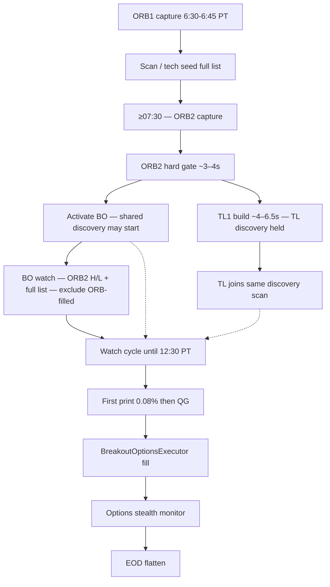

# Easy 0DTE Strategy — ORB2 Breakout 0DTE

**Filename:** `0DTEORB2Breakout.md` (ORB2 Breakout · formerly `0DTEBreakout.md`)  
**Last updated:** October 30, 2026 — serving Demo `YOUR_SERVICE_NAME-00618-cvb`. Local source also has the Trade Profile strike-to-fill path ([0.OrderExecution.md](0.OrderExecution.md)), which that image does not yet include. `breakout_watch_activated` is cache session-tech + ORB box only (`po_fill_pct_scope=watch_activation`); do not score it as a 267-key training fill and do not add chain on a 200-name watch.

**This path:** **ORB2 Breakout** is a rolling watch on the **first hour**. The box is the High and Low of **06:30–07:30**, frozen at **07:30**. Entries run **07:30–12:30**, the same watch process as ORB1, on the next **24** names every **10s**. First print **0.08%** beyond that box → Trade Profile → order. The 1-hour range is not complete before 07:30, so this path does not enter during the 06:45–07:25 ORB1 window.

**Admit:** [0.TradeProfiles.md](0.TradeProfiles.md). **Order:** [0.OrderExecution.md](0.OrderExecution.md). **Monitor / exit:** [PositionMonitoring.md](PositionMonitoring.md) · [0DTEProfitCapture.md](0DTEProfitCapture.md).

**Clocks (PT):**

| Window | What |
|--------|------|
| **06:30–07:30** | ORB2 box. Freeze at 07:30 into `orb2` |
| **06:45–07:25** | ORB1 + TL0 only. This path is not open |
| **07:25–07:30** | Capture gap. ORB2 freeze completes at 07:30 |
| **07:30–12:30** | ORB2 watch + TL1+. Unlock does not wait for TL1. No new entries after 12:30 |
| **12:50 / 12:55** | Flatten / EOD report |

**Status:** `ENABLE_BREAKOUT_STRATEGY=true` · `configs/Breakout0DTE.env`. Activate after ORB2 complete inside `_release_tl_bo_after_orb_0dte`. Confirm FSM shared with ORB1 (`breakout_confirm_shell.py`). Fill does **not** day-lock the symbol. After reject or fill, that same CALL/PUT edge takes **1h** cooldown and must print **inside** the ORB2 box before it can fire again. The other H/L stays open.

**Persistence (required):** ORB2 `orb_high` / `orb_low` in `{ns}/daily_markers/{date}.json` → `orb2`. A restart must not recapture a different 1-hour box. TL1+ uses this same freeze.

**Legacy / unused:** GATE_* / E16 collect as the admit (the admit is the Trade Profile). Score ≥55 as admit. Continuation / FT / chop. `unified_contract_select` walk when the Trade Profile pick is present. Dated notes that say ORB1 stops at **07:10** — live ORB1 stop is **07:25**. Dated notes that treat ORB1 as a 7:30 batch — that batch is rolled back.

**Not this file:** ORB1 → [0DTEORB1Breakout.md](0DTEORB1Breakout.md) · Trendline → [0DTETrendline.md](0DTETrendline.md) · risk → [0DTERisk.md](0DTERisk.md) · exits → [0DTEProfitCapture.md](0DTEProfitCapture.md) · env → [Configs.md](Configs.md).

**How to read**

| Layer | Sections |
|-------|----------|
| Mission | Breakout Mission · Grade A vs Skip |
| Architecture | Pipeline · four-path comparison |
| Implementation | Configs · code map |

---

## Which guide for which path?

| Path | Guide |
|------|--------|
| **ORB SO** (ETF long @ 7:30 — paused) | **[0DTEORB1Breakout.md](0DTEORB1Breakout.md)** — Part II |
| **ORB1 0DTE** (options watch **06:45–07:25**) | **[0DTEORB1Breakout.md](0DTEORB1Breakout.md)** — Part III |
| **Trendline 0DTE** (intraday structure) | **[0DTETrendline.md](0DTETrendline.md)** |
| **Breakout 0DTE** (delayed ORB#2 high/low break) | **This file** |
| **0DTE risk & sizing** | **[0DTERisk.md](0DTERisk.md)** |
| **Exits / profit capture** | **[0DTEProfitCapture.md](0DTEProfitCapture.md)** |

**Do not blend lanes.** ORB1 = continuation vs the **15m** box **06:45–07:25**. Trendline = numbered line on that box (TL0) or the 1-hour box (TL1+). ORB2 = **later** break of the **6:30–7:30 flat H/L box**.

---

## Breakout Mission Statement {#breakout-mission-statement}

**Breakout 0DTE** trades **delayed ORB-range resolution** with options — not the 7:30 ORB batch, and not Trendline cap/floor geometry.

### Breakout is NOT

| Misconception | Why it fails |
|---------------|--------------|
| **ORB1 @ 7:30 batch** | Rolled back. ORB1 owns the **15m** box watch **06:45–07:25**. This path owns the **1-hour** box after **07:30** |
| **Spike / wick chase** | A single print beyond first-hour high/low without follow-through is **invalid** — reclaim re-arms the watch |
| **Trendline structure** | No descending resistance / ascending support contest — levels are the **flat first-hour high and low** (6:30–7:30) |
| **Momentum ranking** | No Convex morning rank pool — Breakout is **event-driven** after 7:30 |

### Breakout IS

| Pillar | Meaning |
|--------|---------|
| **Full-list watch** | Activate from full `0dte_list` — fair rotate **24**/10s; CONFIRM/READY do not pin slots; optional scan seed stores tech only |
| **First-hour levels** | Freeze **6:30–7:30** H/L into `orb_high`/`orb_low` fields (`box_source=orb2_630_730 (ETrade ORB #2)`) |
| **True break confirmation** | First print ≥ **0.08%** beyond the box → QG. Continuation / FT / chop **deleted**. Reclaim invalidates |
| **Quality** | Trade Profile after the 0.08% print. Score ≥55 / GATE_* collect is not the admit |
| **Event-driven options** | **CALL** above first-hour high · **PUT** below first-hour low — long premium only |

**Four-path reminder:**

| Path | One-line thesis |
|------|-----------------|
| **ORB SO** | Long ETF continuation above ORB high @ 7:30 |
| **ORB1 Breakout** | 15m box watch 06:45–07:25 |
| **Trendline 0DTE** | Cap/floor structure built on **ORB2** after ORB 0DTE · emit on line break later |
| **Breakout 0DTE** | Full list @ 7:30 · emit on **first-hour high/low** break later |

---

## Grade A vs Skip Framework (Breakout) {#grade-a-vs-skip-framework-breakout}

**Purpose:** Every gate change should answer:

> *Does this catch real ORB-range expansions — or only spikes and retests?*

| | **Grade A** | **Skip** |
|---|-------------|----------|
| **Seed** | On full-list watch · not already ORB-filled | ORB batch already filled / pending the symbol |
| **Break** | First print beyond first-hour high/low by ≥ **0.08%** | Wick through level then immediate reclaim into box |
| **Follow-through** | **Deleted** — QG decides enter vs fakeout | — |
| **Quality** | Volume ≥ **0.80** · VWAP side aligned · score ≥ **55** | CALL below VWAP · PUT above VWAP · RSI wrong side · score fail |
| **Skew** | pc_oi confirms side (CALL ratio `<1`, PUT `>1`) | Wrong skew · chain unavailable when gate hard |
| **Premium** | Premium expands with continuation move | Flat / fade after entry |

**Runtime path today:** seed → ORB2 complete → **BO activate** → (TL1 builds in parallel; TL held) → watch cycle → `process_breakout_tick` → `compute_breakout_quality_score` → `confirm_breakout_dir_pct_before_execution` (alias `confirm_breakout_pc_oi_*`) → `BreakoutOptionsExecutor` → ORB-style options stealth.

---

## Pipeline steps — eight stages {#pipeline-steps--eight-stages}

Breakout uses the same **lifecycle labels** as sibling 0DTE paths, but **step 2** is **seed + activate** (not a 7:30 options batch) and **step 3** is the **first-print 0.08% + QG** stack.

```text
Breakout 0DTE (delayed ORB-range path)
  1 ORB Capture          → ORB2 6:30–7:30 PT freeze at 07:30
  2 Seed + Activate      → freeze full-list + ORB2 H/L after ORB2 complete (BO unlock; TL1 may still be building)
  3 Confirmation         → first print ≥0.08% beyond box → Trade Profile
  4 Position Sizing / Risk → sacred buffer · equal 1/N · shared pool
  5 Execution            → that strike until no-new-entries (**12:30 PT**)
  6 Position Monitoring  → shared options stealth (~2s) · strategy_type=breakout_0dte
  7 Exits                → premium stealth (ORB-like singles: price_stop · price runner · BE/scratch)
  8 EOD                  → 12:50 PT flatten + 12:55 PT report
```

| Step | Topic | Primary section |
|:----:|--------|-----------------|
| **1** | ORB Capture | [§5 Daily timeline](#5-daily-timeline-pacific) · [0DTEORB Step 1](0DTEORB1Breakout.md#step-1--orb-capture-shared) |
| **2** | Seed + Activate | [§2 Seed & activate](#2-seed-and-activate) |
| **3** | Confirmation Gate | [§6 Confirmation](#6-true-breakout-confirmation) · [§7 Quality](#7-quality-gates--pc_oi) |
| **4** | Position Sizing / Risk | [§9 Account management](#9-account-management) · [0DTERisk.md](0DTERisk.md) |
| **5** | Execution | [§8 Execution](#8-execution-and-contract-selection) |
| **6** | Position Monitoring | [§10 Monitoring](#10-monitoring-and-exits) · **[PositionMonitoring.md](PositionMonitoring.md)** |
| **7** | Exits | [§10 Exits](#10-monitoring-and-exits) · [0DTEProfitCapture.md](0DTEProfitCapture.md) · [PositionMonitoring.md](PositionMonitoring.md) |
| **8** | EOD | [§5 timeline](#5-daily-timeline-pacific) |

---

## At a glance — Easy Breakout 0DTE

| Attribute | Breakout 0DTE |
|-----------|----------------|
| **Clock** | Tech seed during scan → **activate after ORB2 complete** (TL1 may still be building) → watch until **12:30 PT** |
| **Thesis** | Full list later **break and hold** first-hour high (CALL) or low (PUT) |
| **Side rule** | Price ≥ 1h high × (1 + min break %) → **CALL** · Price ≤ 1h low × (1 − min break %) → **PUT** |
| **Selectivity** | 0.08% beyond the 1-hour box → Trade Profile. Score ≥55 is not the admit |
| **Executor** | `BreakoutOptionsExecutor` (subclass of Trendline executor) · `path_strategy_type=breakout_0dte` |
| **Exits** | Treated as **0DTE long / ORB-like** stealth ladder (`breakout_0dte` in options stealth) |
| **Telegram** | Fill: **`⛓️ Breakout Order Filled`** · Close: **`⛓️ Breakout Order Closed`** |
| **Sibling paths** | ORB1 watch **06:45–07:25**. Trendline uses **line geometry**. This path uses the **first-hour box** after **07:30**. |



---

## 1. Shared foundation

Breakout does **not** capture its own ORB. It consumes the same:

- Universe: **`0dte_list.csv`**
- Levels at activate: **`orb_high` / `orb_low`** = **6:30–7:30** H/L (not the 15m ORB box)
- Account / slots: **`modules/unified_0dte_account.py`** · shared `0DTE_SLOT_COUNT`
- Entry: the Trade Profile strike on the live chain. The executor orders that strike. [0.OrderExecution.md](0.OrderExecution.md). The `unified_contract_select` walk is the no-pick fallback (δ **0.18–0.42**, OTM **≤3.5%** on this path)
- Monitor: **`prime_options_stealth_trailing_tp.py`** (ORB stealth instance / unified 0DTE monitor)

---

## 2. Seed and activate {#2-seed-and-activate}

### Seed (during collection / scan)

`seed_breakout_candidate()` stores **optional tech** (volume / VWAP / RSI) for 0DTE names during scan. It is **not** a Mid-only gate — watch universe is built at activate.

### Activate (after ORB2 complete — BO first)

`activate_breakout_watch_async()` freezes the watchlist **after** `_release_tl_bo_after_orb_0dte` clears the ORB2 hard gate (today’s freeze stamped + usable coverage ≥50%). **BO unlocks immediately**; the same release then builds/hydrates TL1 while **TL discovery is held** (`_trendline_discovery_hold_for_tl1`). TL joins the shared scan only when `_trendline_discovery_allowed()`.

1. Universe = **full `0dte_list`** (same sources as Trendline)  
2. **ORB #2 levels** already frozen via `capture_orb2_breakout_ranges` (session H/L ≈ 6:30–7:30) into `orb_high` / `orb_low`; stored on `_orb2_data` (does not overwrite ORB #1). **Day-locked like ORB #1:** valid ≥07:30 freezes persist to `{ns}/daily_markers/{date}.json` key `orb2` and hydrate on Cloud Run restart — never re-pull live session OHLC mid-day. TL1 build and Breakout activate **reuse** those levels.

#### ORB2 persistence required {#orb2-persistence-required}

| Persist key | Meaning | Store |
|-------------|---------|-------|
| `orb_high` / `orb_low` | Frozen 06:30–07:30 session H/L (Breakout box) | `{ns}/daily_markers/{date}.json` → `orb2.snapshot` |
| `capture_time` / `captured_at` | Prove freeze is today’s post-**07:30** capture | same |
| `box_source` | Typically `orb2_630_730 (ETrade ORB #2)` | in-memory + marker snapshot metadata |

**Policy:** `record_orb2_capture` — no overwrite of valid day freeze unless `force=True`. Hydrate: `_hydrate_orb2_from_daily_markers`. Without this freeze, TL1/BO unlock blocks or redraws wrong edges. Catalog: [Data.md §10](Data.md#persistence-required-for-app-performance).  
3. **Drop** symbols already in ORB pending/filled sets (slot hygiene)  
4. Merge scan-seed tech when present  
5. Set `_breakout_watch_candidates` · `_breakout_watch_active=true`  
6. Priority snapshot stage: **`breakout_watch_activated`** — cache hub tech + ORB high/low. Not an Entry training row. Not scored as a 267-key fill.

**Log:** `BREAKOUT_PIPELINE | stage=activate | … | box_source=orb2_630_730 (ETrade ORB #2)`

---

## 3. Watch cycle

`run_breakout_watch_cycle(system)` runs from the main trading loop when `_breakout_watch_active`:

| Knob | Default | Role |
|------|---------|------|
| `BREAKOUT_WATCH_INTERVAL_SEC` | **30** | Steady-state poll |
| `BREAKOUT_OPENING_WATCH_INTERVAL_SEC` | **15** | Faster early window (≈7:30–7:45) |
| `BREAKOUT_WATCH_SYMBOLS_PER_TICK` | **24** | Fair-rotate cap; CONFIRM/READY do not append beyond the window |
| `0DTE_DISCOVERY_SYMBOLS_PER_TICK` | **24** | Shared discovery **rotate window** (`Shared.env`) — **no while-open shrink** |
| `0DTE_DISCOVERY_INTERVAL_SEC` | **10** | Shared discovery cadence (133 @ 24/tick → every symbol ≤**60s**) |
| Merged TL+BO equity poll | **window 24** | Next 24 of `0dte_list`; cursor always advances; status does not pin slots |
| `BREAKOUT_NO_NEW_ENTRIES_AFTER_PT` | **12:00** | Hard stop new entries (alias of `DISCOVERY_ORB2_TL_END_PT`) |
| `BREAKOUT_SIMPLE_ENTRY_WINDOW_SEC` | **300** | Soft expire CONFIRM after material break → re-arm WAIT_BREAK. READY this tick does **not** expire — QG decide; reject = 1h same-side CD |

**Scan tiers**

| Tier | States | Behavior |
|------|--------|----------|
| **Rotate window** | `waiting_for_break` · `waiting_for_confirmation` · `ready_to_execute` | Quoted **only** when the symbol is in this scan's 24-name window. Status does **not** pin extras or skip the next 24. |
| **Fair rotate** | `waiting_for_break` | Next **24** by **`0dte_list` tier → row**, then round-robin |
| **Off scan** | `executed` | Fill does **not** day-lock the symbol. After **1h** + inside-ORB2 reclaim, that same H/L can break again (`reentry_required_sides`). Opposite edge stays on scan. |

**Discovery scan order:** CSV **tier → row** fair rotate only (`modules/dte_list_order.rotation_tier_key` + `select_tier_rotated_batch`). Do **not** reorder the quote window by proximity to ORB H/L — that clogged early discovery with near-execute names.  
**Break / entry:** live quote vs **day-frozen** ORB #2 H/L inside `process_breakout_tick` (CONFIRM → READY). Helper `_breakout_rank_key` is diagnostic/unit-test only — **not** used for quote selection.  
**Restart safety:** CONFIRM/READY/EXECUTED hot set persisted under daily marker `watch_fsm` (transition + ~5s debounce; WAIT_BREAK omitted) via `modules/discovery_watch_fsm_persist.py`.

**Discovery equity quotes:**

| Condition | Broker call |
|-----------|-------------|
| No open-position quote priority | This lane’s own `get_batch_quotes` |
| Open + exact OCC healthy + **BO and TL both due** | Shared rotate window (**24** / 10s, always advance) then path eval of that window only |
| Open + exact OCC unhealthy | **Skip** discovery that tick |

Equity batch = **price** (`last`) + raw session volume for break/confirm **and** quote-delta minute bars. **VWAP / RSI / volume_ratio / quality** come from the **central session-tech hub** each watch tick (`hydrate_breakout_session_bars` → `hydrate_equity_session_tech` → `enrich_breakout_tech` — same hub as ORB/TL). **VWAP missing fail-closed** (`BREAKOUT_VWAP_MISSING_FAIL_OPEN=false`). **Volume missing fail-closed** (`BREAKOUT_VOLUME_MISSING_FAIL_CLOSED`). **RSI missing soft-skips** the RSI band (never invent 50). Thin early-session bars may Yahoo-backfill RTH 1m history (`0DTE_SESSION_TECH_YF_1M_BACKFILL`). **pc_oi + dir%** are **separate chain calls at execute** only. See [Data.md §4](Data.md#4-session-tech-hub).

Per symbol tick:

1. Quote → price + tech  
2. `process_breakout_tick` → confirmation state machine  
3. If ready → `compute_breakout_quality_score`  
4. If quality pass → build signal → **pc_oi + dir% @ execute** → execute  

Candidate states (`BreakoutCandidateState`):

| State | Meaning |
|-------|---------|
| `waiting_for_break` | Base rotating scan (inside ORB / re-armed) |
| `waiting_for_confirmation` | Broke · gathering follow-through (evaluated when in rotate window) |
| `ready_to_execute` | Confirmation + quality ready (pre-pc_oi) (evaluated when in rotate window) |
| `executed` | Fill recorded; watch stays live — that side needs **1h** + inside-ORB2 reclaim before the same H/L can fire again |
| `invalidated` / `expired` | Terminal (rare); quality / pc_oi / OTM / structural / market-quality rejects → **1h same-side cooldown** + re-arm `waiting_for_break`; rejected side must re-enter ORB2 before a fresh same-side breakout can qualify |

---

## 4. How Breakout differs from sibling paths {#4-how-breakout-differs-from-sibling-paths}

| Dimension | **ORB1 0DTE (watch)** | **Trendline 0DTE** | **Breakout 0DTE** |
|-----------|----------------------|--------------------|-------------------|
| **Morning role** | Execute **06:45–07:25** on ORB#1 | TL0 with ORB1; **TL1 after ORB2 ≥07:30** (TL held until TL1 ready) | Activate **right after ORB2** |
| **Level** | ORB#1 06:30–06:45 H/L | Cap or floor geometry on ORB#2 (TL0 uses ORB1) | **ORB#2 06:30–07:30** box |
| **Who trades** | Early ORB#1 break confirms | Any list name with valid line | Full list after unlock |
| **Side rule** | CALL up / PUT down | CALL on cap break · PUT on floor break | CALL above ORB2 high · PUT below ORB2 low |
| **Selectivity** | E16 QG + dir% hard (watch) | Emit gates + score ≥ 55 | Confirm + score ≥ 55 + dir% |
| **Reject / fill cooldown** | **1h** symbol+side; fill = **one trade** (no re-entry) | Hard reject/fill **expire** that slot/side envelope | **1h** symbol+side **+ inside-ORB2 re-entry** (reject **or** fill) |
| **strategy_type** | `orb_0dte` | `trendline_0dte` | **`breakout_0dte`** |
| **Alert emoji** | 🔮 | 📏 | **⛓️** |
| **Guide** | [0DTEORB1Breakout.md](0DTEORB1Breakout.md) | [0DTETrendline.md](0DTETrendline.md) | **This file** |

---

## 5. Daily timeline (Pacific) {#5-daily-timeline-pacific}

| Time (PT) | Event |
|-----------|--------|
| **6:25** | Token / OAuth prep (shared) |
| **6:30–6:45** | ORB#1 capture — high/low for ORB1 watch |
| **06:45–07:25** | **ORB1 watch** discovery → 0.08% → Trade Profile → execute (no new ORB1 after 07:25) |
| **07:25–07:30** | Arm TL1 pending **once** — do **not** spam ORB2/unlock |
| **≥07:30** | **ORB #2 capture** (~3–4s) → hard gate → **BO unlock + `activate_breakout_watch`** → **Yahoo 1m** + **exactly one TL1 build** (~4–6.5s; single-flight; TL held; primary TL1 exempt from while-open symbol cap) → **TL joins** shared discovery |
| **Unlock–12:30** | Shared discovery → BO immediately; TL after TL1 ready → confirm → execute (**no new entries after 12:30 PT**) |
| **Until 12:50** | Stealth monitor open Breakout positions (`mfe_trail` after 12:30) |
| **12:50** | EOD flatten |
| **12:55** | EOD Telegram |
| **~13:05** | EOD reports |

---

## 6. True breakout confirmation {#6-true-breakout-confirmation}

Module: `easyBreakout/breakout_confirmation.py` · `process_breakout_tick()`.

| Gate | Env | Default | Meaning |
|------|-----|---------|---------|
| break_min | `BREAKOUT_BREAK_MIN` | **0.08** (%) | CALL trigger = 1h high × (1+d) · PUT = 1h low × (1−d). First print → READY → QG |
| Reclaim | `BREAKOUT_RECLAIM_INVALIDATES` | **true** | Price back inside ORB band → re-arm `waiting_for_break` (base rotate; opposite edge still eligible) |

**Design intent:** first print beyond the box goes to QG (TL parity). Continuation / FT / chop are **not** admit knives. Quality decides enter vs fakeout.

---

## 7. Quality gates + pc_oi + dir% {#7-quality-gates--pc_oi}

### Quality (`breakout_quality.py`)

Aligned with Trendline simple quality / ORB Convex spirit:

| Gate | Env | Default |
|------|-----|---------|
| Volume ratio | `BREAKOUT_MIN_VOLUME_RATIO` / `BREAKOUT_VOLUME_RATIO_GATE_ENABLED` | **observe** (`gate=false`; stamp ref 0.80) |
| Entry window | `BREAKOUT_SIMPLE_ENTRY_WINDOW_SEC` | **300** (TL parity; expire → re-arm) |
| VWAP alignment | `BREAKOUT_REQUIRE_VWAP_ALIGNMENT` | **false** (GATE_BO_VWAP observe owns stamp) |
| VWAP extension | `BREAKOUT_VWAP_EXTENSION_REJECT_PCT` | **0.01** (observe stamp \|vwap%\| ≤1.00) |
| CALL RSI floor | `BREAKOUT_CALL_MIN_RSI` | **0** (off) |
| PUT RSI ceiling | `BREAKOUT_PUT_MAX_RSI` | **100** (off) |
| Extension score | `GATE_BO_score` | **observe** (rank only — not Quality ≥55) |

Score composition (0–100, observe): ATR fuel **40** · vol **25** · dir% **20** · unused chase room **15**. Not a hard floor. Immediate reclaim caps score and fails (Layer A).

**Current profitable-trade settings (Breakout 0DTE — BO-QG-A7∩A10-S):**

Hard admit first; observe/off last. Canonical: [0DTEQualityGates.md §6](0DTEQualityGates.md#6-breakout-quality-gate).

| Gate | Expected profitable level | Notes |
|------|---------------------------|-------|
| Direction | CALL above ORB2 high; PUT below ORB2 low | Uses 6:30–7:30 ORB2 box |
| Material break | **0.08%** beyond ORB2 edge | `BREAKOUT_BREAK_MIN=0.08` · first print → QG |
| Entry window | **300s** after material break | CONFIRM expire → re-arm. READY this tick → QG (reject = 1h CD) |
| Follow-through / continuation / chop | **Deleted** as admit | Reclaim still invalidates and re-arms |
| Volume ratio | **>0.12 hard** | `GATE_BO_Vol_Ratio` · missing fail-closed |
| break_max | **≤2.50%** | `GATE_BO_break_max` |
| BB mid-stretch | CALL **≥50** · PUT **≤50** | `GATE_BO_BB_mid=observe` (stamp; not admit) |
| Contract δ | \|δ\| **0.18–0.42** | Shared with ORB1 (`0DTE_ENTRY_DELTA_*`) |
| Extension score | **observe** (rank only) | `GATE_BO_score=observe` — not Quality ≥55 |
| dir% | Same-side chain volume share **>0.10** | Layer C · `GATE_BO_dir_pct=hard` |
| Contract | OTM **≤3.5%**, premium **≥$0.03**, contract vol **≥50**, OI **≥100** | Cheap-lotto guard; WULF-class 3.6% OTM blocked |
| VWAP | **observe** (`GATE_BO_VWAP`) | Stamp side / ext; scorer knife off |
| RSI | **off** (`GATE_BO_RSI_band`) | CALL min 0 / PUT max 100 |
| MACD | **off** (stamp only) | `BREAKOUT_MACD_HOLD_GATE_ENABLED=false` |
| pc_oi | **off** (removed from admit) | `GATE_BO_pc_oi=off` |
| Reject behavior | Real quality / OTM / structural / MQ reject → **1h same-side cooldown** | Opposite ORB2 side stays eligible |
| Profit Capture | Price runner shared · **`price_stop` −0.8%** BO-only · BE/scratch Aug 11 bands | ORB/TL stay Shared **−1.8%** · [§5.10.16](0DTE_Exit_Optimization.md) |

**Expected book at this live QG (A7∩A10-S):** 42 closed fills (Aug 7–12) **+$578**. Same stack on Aug 13 = **0 BO fills** (no new option $). Wide beginner fills on that book were **−$3,951**.

**Aug 13:** 0 BO fills. LRCX/TSLA stay skipped under uniform BB/A10. A7-dev is **invalid** (do not code). ATR **0.17** is **+$558** — do not promote. See [0DTEQualityGates §3.1](0DTEQualityGates.md#31-matrix-derived-qg-baseline-aug-712-guides--enter-wins--skip-losses) · [ORB2BOImprovementGuide](Improvement%20Guide/ORB2BOImprovementGuide.md#aug-13-findings--executive-summary).

**Current reject / fill policy:** session-tech data gaps defer without blocking. Real quality / pc_oi / OTM / structural / market-quality rejects (incl. `ask_size_too_small`) **or a fill** → **1h same-side cooldown** (ORB#2 CALL=high / PUT=low) + re-arm `waiting_for_break`. Opposite side stays eligible; the consumed side can trigger again only after cooldown and after price re-enters ORB2, then breaks that edge again. Fill does **not** day-lock the symbol.

Missing VWAP tech **fail-closed** (`BREAKOUT_VWAP_MISSING_FAIL_OPEN=false`, Jul 27) — stubs made gates useless; continuation + pc_oi/dir% remain hard. Volume missing also fail-closed (`BREAKOUT_VOLUME_MISSING_FAIL_CLOSED=true`).

### Layer C handoff (`breakout_pc_oi_gate.py`)

Canonical: `confirm_breakout_dir_pct_before_execution` (legacy alias `confirm_breakout_pc_oi_before_execution`). Hydrates chain vols once per execution attempt → QG **`dir_pct` hard**. **`GATE_BO_pc_oi=off`** — do **not** set `BREAKOUT_PC_OI_CONFIRMATION_ENABLED=false` (that skips dir% too).

**On fail (dir% / quality / OTM / structural / market-quality) or after a fill:** **1h** same-side cooldown + re-arm `waiting_for_break` + **inside-ORB2 re-entry** so the opposite ORB#2 edge can still trade immediately. Capital/slot waits retry until the 1-minute exec-ready TTL, then the same 1h + re-entry. Module: `path_exec_day_exclude.py` · `_side_day_block_and_rearm_breakout` · default `BREAKOUT_SIDE_REJECT_COOLDOWN_SECONDS=3600`.

### Same-side dir% (Aug 6 beginner · Aug 7 Layer C lock)

Breakout dir% floor is path-owned (ORB/TL stay **>0.54**).

| Key | Value |
|-----|-------|
| `BREAKOUT_DIR_VOLUME_GATE_ENABLED` | **true** |
| `BREAKOUT_DIR_VOLUME_MIN_PCT` | **0.10** (collect; archive A7 **0.55**) |
| `GATE_BO_dir_pct` | **hard** |
| `GATE_BO_pc_oi` | **off** |

CALL uses `call/(call+put)` · PUT uses put share. Fail-closed when chain vols missing. Runs with pc_oi at execute.

---

## 8. Execution and contract selection {#8-execution-and-contract-selection}

**Order contract:** [0.OrderExecution.md](0.OrderExecution.md). A Trade Profile accept orders that strike. The table below is the older selector detail.

| Item | Detail |
|------|--------|
| **Adapter** | `to_trendline_compatible_signal()` — stamps `setup_type=orb_range_breakout`, `trigger_direction=above_orb_high\|below_orb_low`, `strategy_type=breakout_0dte` |
| **Executor** | `BreakoutOptionsExecutor` · `path_strategy_type=breakout_0dte` · skips Trendline geometry veto |
| **Sizing** | Trendline/shared slot capital (`_trendline_slot_capital` / unified 1/N) · `entry_budget=slot_capital` |
| **Contract** | The Trade Profile strike. [0.OrderExecution.md](0.OrderExecution.md). Breakout does not run a second OTM gate on that pick. The `unified_contract_select` walk is the no-pick fallback |
| **One symbol / day** | Fill does **not** day-lock the symbol. After reject **or** fill, that CALL/PUT edge takes **1h** cooldown and must print **inside** ORB2 (`reentry_required_sides`) before the same H/L can qualify again. Opposite edge stays open. ORB1 does **not** use this path. |
| **Handoff snapshot** | `breakout_emit_handoff` |
| **Fill snapshot** | `breakout_options_executed` |
| **PO shadow** | `track_breakout_fill` / `_profit_optimizer_track_breakout_fill` |

**Log:** `BREAKOUT_EXECUTION_HANDOFF` · `BREAKOUT_EXECUTION_ALLOWED` · `BREAKOUT_PIPELINE | stage=execute_fail` · `BREAKOUT_UNIFIED_SELECT_REJECT` · `UNIFIED_CONTRACT_WALK` · `BREAKOUT_OTM_GATE`

**Jul 27 desk:** Never-armed losers averaged ~**18%** OTM vs winners ~**8%**. Contract OTM + cheap-lotto gates + real VWAP/vol hydrate are the primary separators; score alone did not separate. See [BreakoutImprovementGuide.md](../../1.%20The%20Easy%20ORB%20Strategy%20FINAL%20APP/docs/Improvement%20Guide/BreakoutImprovementGuide.md).

---

## 9. Account management {#9-account-management}

Breakout shares the **unified 0DTE book** with ORB 0DTE and Trendline:

| Control | Behavior |
|---------|----------|
| **Slot pool** | `0DTE_SLOT_COUNT` / `TOTAL_0DTE_MAX_POSITIONS` — one pool |
| **Capital** | Equal 1/N tradable after sacred buffer |
| **Red Day / kill switch** | Same global option entry protections as siblings when armed |
| **Path tag** | Fills tagged `breakout_0dte` for registry, PO, and alerts |

See **[0DTERisk.md](0DTERisk.md)** for shared pre-fill risk.

---

## 10. Monitoring and exits {#10-monitoring-and-exits}

| Item | Detail |
|------|--------|
| **Engine** | `prime_options_stealth_trailing_tp.py` — `breakout_0dte` treated as **0DTE long / ORB-like** single-leg profile |
| **Loop** | Fast options stealth (~2s unified monitor where enabled) + shared backup |
| **Primary winner** | ARM_TRAIL +30% → **price runner** (`price_trail` 0.20% · prem floor; und hard TP **OFF**) |
| **`price_stop`** | **−0.8%** und vs entry, only before ARM_TRAIL (ORB/TL Shared **−1.8%**) |
| **BE / scratch** | never-armed · BE ≥**60m** **−0.05%…&lt;+2%** · scratch ≥**62m** **&lt;−0.05%** |
| **MFE / Hold** | **Config-off / removed** (historical Jul 28 Hold@0.55) |
| **Exit taxonomy** | Same `OptionsStealthExitReason` catalog as ORB/Trendline — [0DTEProfitCapture.md](0DTEProfitCapture.md#exit-taxonomy) |
| **PO observe** | `_profit_optimizer_observe_0dte_exit` routes by `strategy_type` containing `breakout` |
| **Exit snapshot** | `breakout_options_exited` |
| **Telegram** | Routed via `send_options_position_exit_alert` → `send_breakout_position_exit_alert` when position is Breakout-owned |

**Do not** expect Trendline-only timeouts (`OPTION_STEALTH_TLINE_*`) unless explicitly shared; Breakout follows the **ORB-like** long 0DTE ladder unless config says otherwise.

---

## 11. Alerts {#11-alerts}

| Event | Title | Method |
|-------|-------|--------|
| **Fill / post-executor reject** | `⛓️ Breakout Order Filled` | `send_breakout_options_execution_alert` (from `breakout_watch`) |
| **Close** | `⛓️ Breakout Order Closed` | `send_breakout_position_exit_alert` (via ORB stealth exit path + Breakout detector) |

### Fill layout (summary)

```text
⛓️ Breakout Order Filled
          | DEMO Mode

💼 Result: Filled • execution

1) 🔴 7 • PUT on AMD
          Setup: breakout below orb low
          Option Leg: PUT
          Strike: … • Delta: …
          Entry Premium: …
          $… deployed (…%)
          Trade ID: …
          chain_source=… | slot_capital_target=… | entry_budget=…

🛡️ Monitoring: All positions tracked …
```

**Aug 11 compact rejects:** `Reason:` = bare code (e.g. `ask_size_too_small`); no duplicate `reject_reason=` line; **no** `📋 Symbol execution diagnostics:` on Filled/Rejected.

Setup display:

| Trigger / side | Setup line |
|----------------|------------|
| `below_orb_low` / PUT | `breakout below orb low` |
| `above_orb_high` / CALL | `breakout above orb high` |

### Exit layout (summary)

Trendline-style rich closed block: PnL %/$ · contract line · deployed % · exit premium/net · **Expiry / DTE / Is_0dte** · delta range · entry/exit underlying · MFE / liq · quote fields · Entry Chain · Exit Grade · Trade ID · Reason · Account Balance.

**Aug 10:** Exit formatter digs `execution_payload` / `signal_snapshot` (and trade-id fallback) when top-level metadata lacks expiry — `prime_alert_manager._collect_expiry_fields_for_exit_alert`.

RESEARCH Telegram also prefixes the desk banner (`🏁 RESEARCH APP…`) via the shared alert manager.

**Tests:** `tests/test_breakout_alerts.py` · `tests/test_strategy_alert_consolidation.py`

---

## 12. Configuration {#12-configuration}

**File:** `configs/Breakout0DTE.env` (loaded by `config_loader` with other path envs)

| Section | Keys |
|---------|------|
| **Toggle** | `ENABLE_BREAKOUT_STRATEGY` · `ENABLE_BREAKOUT_PROFIT_OPTIMIZER` |
| **Watch** | `BREAKOUT_NO_NEW_ENTRIES_AFTER_PT` · `BREAKOUT_WATCH_INTERVAL_SEC` · `BREAKOUT_OPENING_WATCH_INTERVAL_SEC` · `BREAKOUT_WATCH_SYMBOLS_PER_TICK` |
| **Seed band** | `BREAKOUT_SEED_ABOVE_HIGH_MULT` · `BREAKOUT_SEED_BELOW_LOW_MULT` |
| **Confirmation** | `BREAKOUT_BREAK_MIN` · `BREAKOUT_RECLAIM_INVALIDATES` |
| **Hard QG** | `GATE_BO_Vol_Ratio` · `GATE_BO_break_max` · `GATE_BO_dir_pct` · `BREAKOUT_MIN_VOLUME_RATIO` · `QG_BREAK_MAX` · `BREAKOUT_DIR_VOLUME_*` |
| **Contract** | `BREAKOUT_OTM_GATE_ENABLED` · `BREAKOUT_PREFER/RESEARCH_MAX_OTM_PCT` · `BREAKOUT_CHEAP_LOTTO_*` |
| **Observe / off** | `GATE_BO_BB_mid` · `GATE_BO_VWAP` · `GATE_BO_RSI_band` · `GATE_BO_pc_oi` · stamps · `BREAKOUT_REQUIRE_VWAP_ALIGNMENT=false` · `BREAKOUT_VOLUME_RATIO_GATE_ENABLED=false` · `BREAKOUT_MACD_HOLD_GATE_ENABLED=false` |

Shared capital / stealth keys remain in `Risk.env`, `ORB0DTE.env`, and options stealth env — Breakout does not own a separate slot count.

### Appendix — Breakout0DTE.env snapshot (A7∩A10-S · hard first)

```env
ENABLE_BREAKOUT_STRATEGY=true
BREAKOUT_NO_NEW_ENTRIES_AFTER_PT=12:00
BREAKOUT_SIMPLE_ENTRY_WINDOW_SEC=300
BREAKOUT_BREAK_MIN=0.08
BREAKOUT_RECLAIM_INVALIDATES=true
GATE_BO_Vol_Ratio=hard
BREAKOUT_MIN_VOLUME_RATIO=0.12
GATE_BO_break_max=hard
QG_BREAK_MAX=2.50
QG_BO_BREAK_MAX=2.50
GATE_BO_BB_mid=observe
GATE_BO_score=observe
GATE_BO_dir_pct=hard
BREAKOUT_DIR_VOLUME_MIN_PCT=0.10
BREAKOUT_OTM_GATE_ENABLED=true
BREAKOUT_PREFER_MAX_OTM_PCT=0.035
0DTE_ENTRY_DELTA_MIN=0.18
0DTE_ENTRY_DELTA_MAX=0.42
GATE_BO_VWAP=observe
GATE_BO_RSI_band=off
GATE_BO_pc_oi=off
BREAKOUT_MACD_HOLD_GATE_ENABLED=false
BREAKOUT_REQUIRE_VWAP_ALIGNMENT=false
BREAKOUT_VOLUME_RATIO_GATE_ENABLED=false
ENABLE_BREAKOUT_PROFIT_OPTIMIZER=true
```

---

## 13. Code map {#13-code-map}

| Area | Path |
|------|------|
| Package | `easyBreakout/` |
| Models / config | `breakout_models.py` · `breakout_config_loader.py` |
| Confirmation | `breakout_confirmation.py` |
| Quality | `breakout_quality.py` |
| pc_oi | `breakout_pc_oi_gate.py` |
| Signal adapter | `breakout_signal_adapter.py` |
| Executor | `breakout_options_executor.py` (extends Trendline executor) |
| Orchestration | `modules/breakout_watch.py` |
| Wiring | `modules/prime_trading_system.py` (seed, activate, watch loop, PO/snapshots) |
| Alerts | `modules/prime_alert_manager.py` (`send_breakout_*`) |
| Stealth | `modules/prime_options_stealth_trailing_tp.py` |
| PO schema | `profit_optimizer` · `easy_breakout_0dte` feature schema |
| Snapshots | `modules/execution_feature_snapshot.py` · `extract_breakout_pool_features` |
| Config | `configs/Breakout0DTE.env` |
| Tests | `tests/test_breakout_confirmation.py` · `tests/test_breakout_seed_activate.py` · `tests/test_breakout_alerts.py` |

---

## 14. Priority Optimizer & forensics {#14-priority-optimizer--forensics}

| Stage | Snapshot / hook |
|-------|-----------------|
| Watch activated | `breakout_watch_activated` (`po_fill_pct_scope=watch_activation`; cache tech + ORB box only) |
| Emit handoff | `breakout_emit_handoff` |
| Options executed | `breakout_options_executed` |
| Options exited | `breakout_options_exited` |
| Shadow fill | `track_breakout_fill` |
| Exit observe | `_profit_optimizer_observe_0dte_exit` (breakout branch) |

Retrieve alongside ORB/Trendline:

```bash
python3.11 priority_optimizer/retrieve_execution_snapshots.py --date YYYY-MM-DD
```

See **[PriorityOptimizer.md](PriorityOptimizer.md)** for retrieve conventions (when present in this app tree).

---

## Related documentation

| Doc | Role |
|-----|------|
| [0DTEORB1Breakout.md](0DTEORB1Breakout.md) | ORB SO + ORB 0DTE @ 7:30 |
| [0DTETrendline.md](0DTETrendline.md) | Structure build + intraday emit |
| [0DTEProfitCapture.md](0DTEProfitCapture.md) | Premium stealth exits |
| [PositionMonitoring.md](PositionMonitoring.md) | Unified ~2s monitor · exact OCC · quote priority |
| [0DTERisk.md](0DTERisk.md) | Caps · Red Day · execution risk |
| [0DTEQualityGates.md](0DTEQualityGates.md) | BO + ORB + TL Quality Gate SoT |
| [Alerts.md](Alerts.md) | Telegram catalog (add Breakout rows as desk updates) |
| [Configs.md](Configs.md) | Full env index |
| [ORBSO.md](ORBSO.md) | ORB SO ETF path + scheduler jobs |

---

## Revision history

| Date | Change |
|------|--------|
| **2026-08-31** | Fair rotate only: next **24** / **10s**, always advance. CONFIRM/READY do **not** pin extras. 133 names ≤**60s** full coverage. Local until `deploy now`. |
| **2026-08-16** | Reject **or fill** = **1h** same-side cooldown **+ inside-ORB2 re-entry** · fill does **not** day-lock the symbol · opposite H/L stays open · ORB1 does **not** use this re-entry path · local until **`deploy now`** |
| **2026-08-11** | **Single-flight TL1** after BO unlock (no dual Yahoo build) · keep BO/TL **merged discovery quotes** · compact reject Telegram (bare MQ codes; no diagnostics block) · Yahoo TL1 batch sleep **0.5s** (watch hits=90/90) — local until `deploy now` |
| **2026-08-10** | Watch-mode timeline: after ORB1 **07:10** arm TL1 → **≥07:30** ORB2→**BO unlock**→TL1 (TL held)→**TL join** · reject cooldown **1h** (incl. `ask_size_too_small`) · exit alert Expiry/DTE · RESEARCH Demo **`00482`** · research ledger [ORB2BOImprovementGuide](Improvement%20Guide/ORB2BOImprovementGuide.md) |
| **2026-08-04** | Central session-tech hub on every watch tick · Yahoo RTH 1m RSI backfill when thin · invent-clear (no RSI-50 / MACD-0) · RESEARCH+FINAL local until `deploy now` — [Data.md](Data.md) |
| **2026-08-02** | **CONFIRM/READY must-run** as quote+eval extras every tick (WAIT_BREAK fair rotate unchanged) — entry speed for FT / 30s MFE · Immediate quality/pc_oi/structural → same-side cooldown (later **1h** Aug 10) · Hold/mfe **OFF** · und-runner primary · RESEARCH Demo **`00456-hbp`** (prior TL locks on **`00455-lzz`**) |
| **2026-07-28** | Entry dir% **> 0.54** · OTM ≤**5.5%** · discovery **24 / 15s** (no while-open 12) · **Hold@0.55** reclaim **20m** (later OFF) · quality/pc_oi/OTM reject handling introduced · VWAP missing fail-closed |
| **2026-07-27** | Discovery: shared ≤24 TL+BO equity poll while open · pc_oi = execute-time only · early timeline draft used **11:00** · **current cutoff 12:30 PT** (Jul 30+) · link [PositionMonitoring.md](PositionMonitoring.md) budget |
| **2026-07-25** | Watch: must-run claimed as first-on-cap (superseded Aug 2 extras model) · tier→row fair rotate · FT = watch ticks · quality/pc_oi re-arm to WAIT_BREAK · Demo **`00438-qhn`** |
| **2026-07-24** | Initial **0DTEORB2Breakout.md** — mission, pipeline, confirmation/quality/pc_oi, execution, stealth, alerts, config, code map · RESEARCH + FINAL parity |

---

**Profitability first:** Prefer fewer Grade A delayed ORB expansions over more spike fills. When tuning Breakout gates, ask whether the change improves **held continuation after a real ORB break** — not just emit count.
