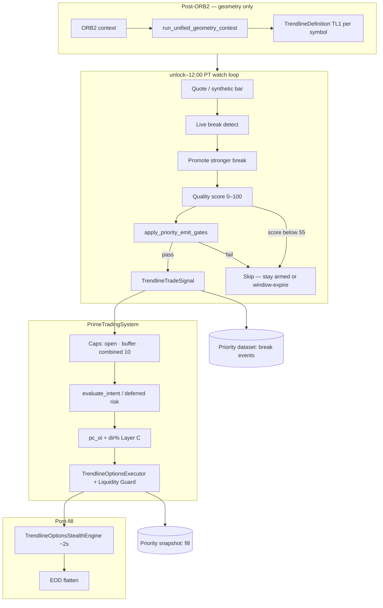
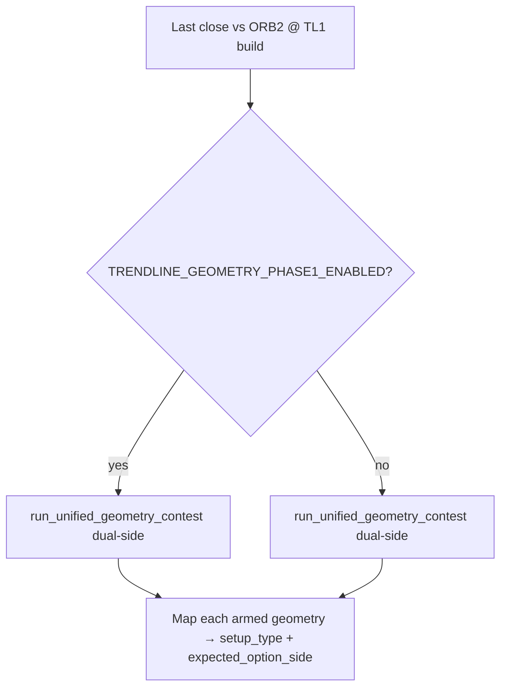
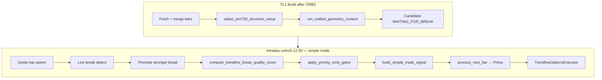

# Easy 0DTE Strategy — Trendline 0DTE

**Last updated:** October 30, 2026 — serving Demo `YOUR_SERVICE_NAME-00618-cvb`. Local source also has the Trade Profile strike-to-fill path ([0.OrderExecution.md](0.OrderExecution.md)), which that image does not yet include.

**This path:** numbered trendlines on each symbol. **TL0** is drawn on the **ORB1 15-minute box** (06:30–06:45). **TL1, TL2, TL3…** are drawn on the **ORB2 1-hour box** (06:30–07:30). A break of that line is a CALL (cap) or PUT (floor). Yahoo 1m backfill sets the real A1/A2 minutes. Day-freeze persistence is required so a Cloud Run restart keeps the same lines.

**Admit:** [0.TradeProfiles.md](0.TradeProfiles.md). **Order:** [0.OrderExecution.md](0.OrderExecution.md). **Monitor / exit:** [PositionMonitoring.md](PositionMonitoring.md) · [0DTEProfitCapture.md](0DTEProfitCapture.md).

**Clocks (PT, `configs/Shared.env` §5):**

| Window | What |
|--------|------|
| **06:30–06:45** | ORB1 box. Freeze at 06:45 |
| **06:45–07:25** exclusive | TL0 discovery with ORB1 Breakout. Hard stop `DISCOVERY_ORB1_TL0_END_PT=07:25` |
| **07:25–07:30** | Capture gap. Arm TL1 pending once. No TL0 / ORB1 entries |
| **07:30–12:30** | ORB2 freeze, then TL1 build, then TL1+ with ORB2 Breakout. No new entries after 12:30 |
| **12:50** | Flatten. **12:55** EOD report |

The token `tl0_geometry_cutoff_0710` is kept. The live cutoff is **07:25**. Dated notes below that still say 07:10 are history.

**Structure:** close **0.08%** through the line (`TRENDLINE_MIN_BREAK_DISTANCE_PCT`). **5%** break distance is a score bonus only, not a hard reject. Dual-side: bull PUT and bear CALL can both arm. One attempt per slot/side. A1/A2 stay frozen for the session.

**Yahoo:** TL0 uses 1m bars for 06:30–06:45. TL1 uses 1m bars for 06:30–07:30. A 06:30 placeholder on A1 is replaced by the matching 1m minute (`structure_1m_match`). Watch hydrate of thin bars runs **after** the price compare, not before it.

**Persistence (required):** `{ns}/daily_markers/{date}.json` → `trendline_geometry`. A1/A2 ts+price+source, slope, intercept, slot, side, `candidate_state` / `attempt_consumed`. Never overwrite a valid A1/A2. Hydrate restores EXPIRED/EXECUTED so a restart does not re-arm a spent envelope. Module: `modules/trendline_geometry_persist.py`.

**Scan:** next **24** names every **10s** (`0DTE_DISCOVERY_SYMBOLS_PER_TICK` / `0DTE_DISCOVERY_INTERVAL_SEC`). Shared with ORB1 and ORB2.

**Status:** `ENABLE_TRENDLINE_STRATEGY=true` · `configs/Trendline0DTE.env` · shared slot pool. Simple break mode is the only emit (`TrendlineSignalEngine._is_simple_break_mode()` always true). `TRENDLINE_BREAK_MODE=false` does not restore the old confirm stack.

**Not this file:** ORB1 → [0DTEORB1Breakout.md](0DTEORB1Breakout.md) · ORB2 → [0DTEORB2Breakout.md](0DTEORB2Breakout.md) · risk → [0DTERisk.md](0DTERisk.md) · exits → [0DTEProfitCapture.md](0DTEProfitCapture.md) · env → [Configs.md](Configs.md).

**How to read**

| Layer | Sections |
|-------|----------|
| Mission | Trendline Mission · Grade A vs Skip |
| Architecture | Pipeline · 7:30 build formula · sibling comparison |
| Implementation | Simple break mode · configs · code map |

**Legacy / unused (still in the tree):** `GATE_TL_*` as the admit (the admit is the Trade Profile). `TRENDLINE_BREAK_MODE=false` confirm stack (unreachable). `confirm_trendline_pc_oi_before_execution` (removed Oct 13). Control-line v3 / reversal lane (removed). Signal Collection arm (`ORB_0DTE_DISCOVERY_MODE=batch`). `TRENDLINE_ALLOW_SYNTHETIC_ENTRY` default false. Dated notes that say TL0 stops at **07:10** — live stop is **07:25**.

Dated scheduler and GATE_TL notes through August 2026 are history. Live clocks, admit, and persistence are in the banner above. Persistence keys, dual-side keys, one-attempt expire, and Yahoo A1/A2 still apply.

#### Trendline persistence keys {#trendline-persistence-required}

| Persist key | Slot | Why required |
|-------------|------|--------------|
| A1 `ts` / `price` / `source` | TL1/TL2/TL3 | Correct envelope anchor; restart must not re-pin 06:30 |
| A2 `ts` / `price` / `source` | TL1/TL2/TL3 | Binding hull bar for slope |
| `slope_per_second` + intercept | TL1/TL2/TL3 | Drawn line identity for break detection |
| `slot` + expected side | TL1/TL2/TL3 | Candidate key identity (sibling lines stay independent) |
| `candidate_state` / `attempt_consumed` | TL0–TL4 | Restart must not re-arm EXPIRED/EXECUTED envelopes |
| TL2/TL3 inject / armed flags | Extension | Skip rebuild after inject |
| Refined ORB2 extreme timestamps | Shared | A1 time authority after Yahoo match |

**ORB2 H/L** for TL also comes from persisted `orb2` (see [0DTEORB2Breakout.md](0DTEORB2Breakout.md#orb2-persistence-required)). Bar caches / VWAP are **ephemeral** and rebuild after hydrate.  
**Scan:** Must-run (`READY`/`CONFIRM`) every tick · fair-rotate `WAITING_FOR_BREAK` by `0dte_list` **tier→row** — batch size **`0DTE_DISCOVERY_SYMBOLS_PER_TICK=24`** / **`0DTE_DISCOVERY_INTERVAL_SEC=10`**.  
**Discovery quotes:** `run_unified_0dte_discovery_scan` — one shared **24** / **10s** rotate (118 names → every symbol ≤**50s**) when TL0 / ORB1 / TL1+ / BO are due — equity quotes only (ORB geometry is separate). CONFIRM/READY do not pin slots. [PositionMonitoring.md § Broker Data Budget](PositionMonitoring.md#broker-data-budget-open-positions--discovery).  
**Entry:** 0.08% close through the line → Trade Profile ([0.TradeProfiles.md](0.TradeProfiles.md)) → order ([0.OrderExecution.md](0.OrderExecution.md)). Soft window **`TRENDLINE_ENTRY_WINDOW_SEC=300`**. ARMED **TL1–TL4** first-break clock **3h** from `built_at`. **TL0** hard-expires at **07:25**. One attempt per slot/side. `GATE_TL_*` is not the admit.  
**Exits:** `price_stop` −1.8% before ARM_TRAIL · **price runner** after +30% (`price_trail` 0.20% · und hard TP **OFF**) · `breakeven` ≥**60m** **−0.05%…&lt;+2%** · `scratch` ≥**62m** **&lt;−0.05%** · Hold / MFE trail **OFF** — [0DTEProfitCapture.md](0DTEProfitCapture.md) · [0DTE_Exit_Optimization.md](0DTE_Exit_Optimization.md).  
**Path code:** `easyTrendline/*` · `modules/prime_trading_system.py` (`_release_tl_bo_after_orb_0dte` · `_finish_tl1_and_release_tl_discovery` · `_trendline_discovery_allowed` · `_build_trendline_candidates_at_730` · `_trendline_finalize_empty_tl1_build` · `_arm_deferred_trendline_build_if_needed` · `_run_deferred_trendline_build_if_pending` · `_tl1_build_single_flight_active` · `_maybe_recover_deferred_trendline_build` · watch cycle) · unified monitor.

**How to read**

| Layer | Sections |
|-------|----------|
| Mission | Trendline Mission · Grade A vs Skip |
| Architecture | Pipeline · 7:30 build formula · sibling comparison |
| Implementation | Simple break mode · configs · code map |

---

## Which guide for which path?

| Path | Guide |
|------|--------|
| **ORB SO** (RESEARCH Demo ETF) | **[0DTEORB1Breakout.md](0DTEORB1Breakout.md)** — Part II |
| **ORB1 Breakout** (06:45–07:25 watch) | **[0DTEORB1Breakout.md](0DTEORB1Breakout.md)** — Part III |
| **Trendline 0DTE** (intraday) | **This file** |
| **Breakout 0DTE** (delayed ORB high/low) | **[0DTEORB2Breakout.md](0DTEORB2Breakout.md)** |
| **0DTE risk & sizing** | **[0DTERisk.md](0DTERisk.md)** |

**ORB SO ETF:** RESEARCH Demo only — [0DTEORB1Breakout.md Part II](0DTEORB1Breakout.md). FINAL has no SO ETF execution.

---

## Trendline Mission Statement {#trendline-mission-statement}

**Trendline 0DTE** trades **first-hour control structure resolution** with options — not ORB continuation, not momentum chasing, and not “strongest trend / highest volume” selection.

### Trendline is NOT

| Misconception | Why it fails |
|---------------|--------------|
| **ORB continuation** | ORB 0DTE fires at **7:30** on breakout/breakdown impulse; Trendline **builds at 7:30** and **emits later** on structure break — see [0DTEORB Part III](0DTEORB1Breakout.md#orb-0dte-mission) |
| **Momentum chasing** | Grade A is **compression → resolution**, not buying the loudest tape at the open |
| **Strongest trend** | A ramp into a **floor** can be Grade A **PUT**; a dump into a **cap** can be Grade A **CALL** |
| **Highest volume names** | Volume confirms breaks; it does not replace correct geometry |

### Trendline IS

| Pillar | Meaning |
|--------|---------|
| **First-hour control structure analysis** | One primary line per symbol from ~6:30–7:30 PT — cap (descending resistance) or floor (ascending support) |
| **Trapped participant detection** | Failed downside tests · failed upside tests · compression against the control line |
| **Structure resolution** | Post-7:30 close **through** the committed line on the **correct** side with follow-through |
| **Event-driven options** | CALL on cap break up · PUT on floor break down — see [Mission](Improvement%20Guide/Trendline%20Improvements/Trendline%20Strategy%20Mission.md) |

**Two-path reminder (Live app):** **ORB 0DTE** = option continuation @ 7:30 · **Trendline 0DTE** = structure resolution — never blend ranking or research cohorts across lanes. ORB SO ETF → DEMO sibling only.

---

## Trendline Two-Phase Philosophy {#trendline-two-phase-philosophy}

| Phase | Question | Owner |
|-------|----------|-------|
| **Phase 1 — Correct 7:30 structure selection** | Did we draw the **envelope line(s)** and map **expected option side(s)**? | Dual-side A1→A2 structure envelopes (bull PUT + bear CALL) · `select_pre730_structure_setup()` · [Trendline Strategy Mission](Improvement%20Guide/Trendline%20Improvements/Trendline%20Strategy%20Mission.md) |
| **Phase 2 — Which breaks deserve capital** | Among valid structures, which emits pass quality + follow-through + caps? | **`trendline_emit_gates.py`** Priority Gate (Grade A sustain **OFF**) + **liquid reversal lane** · `trendline_reversal_lane.py` · `compute_trendline_break_quality_score()` · Red Day Tier 1 (paused) · slot caps |

> **Correct geometry comes before emit quality.** A mis-drawn 7:30 line cannot be fixed by post-break scoring alone.

Phase 2 emit-quality work must **not** substitute for Phase 1 build quality — see [§16 Calibration plan](#16-calibration-plan).

---

## Canonical Trendline Examples {#canonical-trendline-examples}

Desk charts that teach **mission intent** — not threshold templates. See [Trendline Strategy Mission](Improvement%20Guide/Trendline%20Improvements/Trendline%20Strategy%20Mission.md).

### Descending cap → CALL (resolution up)

| Symbol | ORB / first-hour context | Chosen structure | Expected side | Why it matches mission |
|--------|--------------------------|------------------|---------------|------------------------|
| **APLD** | Post-open dump · compression under cap | **Descending resistance** (desk); prod mis-picked bull pre-mission | **CALL** on break **up** through cap | Cap → trapped shorts → resolution **up** — mis-build produced wrong PUT @ 7:30 |
| **IREN** | Cap from ~06:33 → lower high ~07:15 | **Descending resistance** | **CALL** · break ~**07:41** (not 7:30 open) | Delayed valid break after structure set — not ORB 7:30 batch |
| **NFLX** | Descending cap · inside/below ORB | **Descending resistance** | **CALL** · break ~07:26–07:41 | Jun 15 desk **best** — prod blocked mechanical gates; sustain lane target |
| **SOFI** | Sharp cap break ~07:30 | **Descending resistance** | **CALL** | Jun 15 desk **best** — same gate stack as NFLX |
| **NBIS** | Descending cap | **Descending resistance** | **CALL** · break ~07:30+ | Jun 15 desk **good** (3rd) — range-chaos + defer loop pre-fix |
| **INTC** | Below-ORB cap | **Descending resistance** | **CALL** · ~07:31–07:35 | May 19 desk miss — sustain lane restores weak-break class |
| **WULF** / **MAGS** | Descending ceiling | **Descending resistance** | **CALL** @ ~07:30 | May 22 — live emit distance (not frozen first break) |
| **NVDA** | Open dump · lower highs into 7:30 | **Descending cap** | **CALL** on break through resistance | Right geometry; Jun 4 emit gated on volume/distance — build pass, Phase 2 tuning |
| **CRWD** | Descending cap from ~06:30 | **Descending resistance** | **CALL** · break ~07:30 | Strong post-break uptrend in review window — textbook cap resolution |

### Ascending floor → PUT (resolution down)

| Symbol | ORB / first-hour context | Chosen structure | Expected side | Why it matches mission |
|--------|--------------------------|------------------|---------------|------------------------|
| **AVGO** | Ramp along rising support into 7:30 | **Ascending support** (floor) | **PUT** · break **at 7:30** below floor | Ramp → trapped longs → resolution **down** — valid opening-bar break when geometry aligns |
| **SLV** | Above-ORB floor · May 7 / May 11 desk | **Ascending support** | **PUT** | May 7 textbook · May 11 sustain-lane PUT class |
| **NBIS** | Rising support break | **Ascending support** | **PUT** · May 15 | Grade A PUT — symmetric sustain lane |
| **MSFT** | Inside-ORB ramp · floor at 7:30 control | **Ascending support** (desk) | **PUT** · break ~**7:41** | Jun 9 DEMO desk: correct side but legacy line **~1.5%** above 7:30 → `entry_distance_extended`; cutoff-control restores emit |
| **META** | Same ramp PUT class as MSFT | **Ascending support** (desk) | **PUT** · break ~**7:41** | Jun 9: cutoff-control fixes gap@730; **`simple_reclaim_persisted`** still blocks emit |

**Skip contrast (not wrong-lane mis-build):** micro-break, reclaim, chop — e.g. RUT Jun 4 false PUT follow-through.

### Multi-line day (TL1 + TL2 + TL3) — dump then reclaim

| Symbol | Geometry sequence | Expected sides | Why it matches mission |
|--------|-------------------|----------------|------------------------|
| **QQQ** (desk) | Steep CAP from ORB2 high @ TL1 · shallower CAP from same ORB2 high @ TL2 (post-7:30 hull) · ascending floor from session low @ TL3 after upside ORB2 break | **CALL** / **CALL** / **PUT** | Same-location TL1+TL2 share A1; only A2 window differs · TL3 session extreme on 2nd break · ORB2 inject expires prior slot so discovery uses newest line |

---

## Grade A vs Skip Framework (Trendline) {#grade-a-vs-skip-framework-trendline}

**Purpose:** Every build, emit, or gate change should answer:

> *Does this move us closer to Grade A winners — or only improve a metric?*

| | **Grade A** | **Skip** |
|---|-------------|----------|
| **Structure** | Control line = cap or floor · correct `setup_type` | Lowest-MSE chord through chop · wrong lane (bull line on cap day) |
| **Execution** | Emit on correct side · δ in band · fills when gates pass | `delta_out_of_band` · repeated false breaks |
| **Close-beyond floor** | Close ≥ **0.08%** beyond the line (`TRENDLINE_MIN_BREAK_DISTANCE_PCT=0.0008`; continuation **deleted**) | Wick-through that closes back · `break_distance_below_min` |
| **Sustain lane** | **Deleted / OFF** — not live | Historical above-ORB chase filter — do not treat as a continuation key |
| **Premium expansion** | Premium expands with resolution move | Flat / fade after entry |
| **Liquidity** | Tradable chain at emit | Illiquid legs · spread degradation |
| **Profitability** | Closed winners in desk cohort | Repeated scratch / false emit losses |

**Runtime gate:** Grade A vs Skip desk labels inform research. **Today's path:** live break → **GATE_TL_*** → **`apply_priority_emit_gates()`** (geometry side + min break) → caps — see [§8](#8-simple-break-mode-default-runtime) and [0DTEQualityGates.md §5](0DTEQualityGates.md#5-trendline-quality-gate).

**ORB 0DTE Grade A** is a different profile (continuation moonshots) — see [0DTEORB — Grade A ORB 0DTE](0DTEORB1Breakout.md#grade-a-orb-0dte-characteristics).

---

## Pipeline steps — eight stages {#pipeline-steps--eight-stages}

Trendline uses the same **lifecycle labels** as ORB paths, but **step 2** is **Trendline Build** (not a 7:30 options batch) and **step 3** is the **Priority Gate** (quality score + caps + **Red Day Tier 1 gate** when `_red_day_filter_blocked`), not the 7:30 Portfolio Protection batch.

```text
Trendline 0DTE (intraday path)
  1 ORB Capture          → ORB1 6:30–6:45 PT (shared) · ORB2 6:30–7:30 after ORB 0DTE
  2 Trendline Build      → post-ORB2 TL1 geometry only · no options trade
  3 Trade Profile        → Skip Signals + one pick + one stamp + one profile ([0.TradeProfiles.md](0.TradeProfiles.md))
  4 Position Sizing / Risk → sacred 10% buffer · equal 1/N tradable · shared pool cap 10
  5 Execution            → event-driven fills after TL unlock until 12:30 PT
  6 Position Monitoring  → TrendlineOptionsStealthEngine ~2s
  7 Exits                → premium stealth exits (see 0DTEProfitCapture §3)
  8 EOD                  → 12:50 PT flatten + 12:55 PT report
```

| Step | Topic | Primary section |
|:----:|--------|-----------------|
| **1** | ORB Capture | [§5 Daily timeline](#5-daily-timeline-pacific) · [0DTEORB Step 1](0DTEORB1Breakout.md#step-1--orb-capture-shared) |
| **2** | Trendline Build | [§2 The 7:30 build](#2-the-730-build--geometry-only-no-trades) · [Design formula](#730-trendline-build--design-formula) · [Geometry Phase 1](#geometry-phase-1-730-selection) |
| **3** | Priority Gate | [§8 Simple break mode](#8-simple-break-mode-default-runtime) · [Phase 2 Priority Gate](#phase-2-priority-gate) · [§11 Account caps](#11-account-management) |
| **4** | Position Sizing / Risk | [§11 Account Management](#11-account-management) |
| **5** | Execution | [§9 Execution](#9-execution-and-contract-selection) · 7:30 alert order: defer post-build watch until after ORB Step 5 when `TRENDLINE_DEFER_POST_BUILD_WATCH_UNTIL_ORB_BATCH=true` |
| **6** | Position Monitoring | [§10 Monitoring](#10-monitoring-and-exits--profit-capture-post-fill) |
| **7** | Exits | [§10 Exits](#10-monitoring-and-exits--profit-capture-post-fill) · [0DTEProfitCapture §6](0DTEProfitCapture.md#6-trendline-0dte-profile-summary) |
| **8** | EOD | [§5 timeline](#5-daily-timeline-pacific) · [§10 EOD row](#10-monitoring-and-exits--profit-capture-post-fill) |

**Step 3 — Priority Gate (detail):** Not Convex or SO rank. Intraday emits: live break → **GATE_TL_*** (TL-QG-LS1) → **`apply_priority_emit_gates()`** (geometry side + `TRENDLINE_MIN_BREAK_DISTANCE_PCT` only) → Prime Red Day / slots / dedupe. Quality score (`TRENDLINE_MIN_SCORE` **55**) is scaffolding/logs — **not** admit. Historical Jun 12–17 Grade A / FT / continuation knives are **deleted**, not off. **Module:** `easyTrendline/trendline_emit_gates.py` · `easy0DTE/modules/quality_gate_stack.py`. **Log:** `TRENDLINE_EMIT_GATE_AUDIT` · `GATE_STACK_REPORT`. Canonical admit: [0DTEQualityGates.md §5](0DTEQualityGates.md#5-trendline-quality-gate).

---

## At a glance — Easy Trendline 0DTE framework (May 29)

This section is the **quick reference** for how Trendline works end-to-end. Detailed sections below expand each stage.

### What is Easy Trendline 0DTE?

**Easy Trendline 0DTE** trades **long 0DTE calls and puts** on **`0dte_list.csv`**. **TL0** is drawn after the 15-minute ORB1 box. **TL1+** is drawn after the 1-hour ORB2 box. It is not a 7:30 options batch.

| Attribute | Trendline 0DTE |
|-----------|----------------|
| **Clock** | **TL1 after ORB2** (geometry only) → **intraday emit** (until **12:30 PT**) → monitor until EOD |
| **Thesis** | First-hour **control structure** (cap/floor) → **resolution** after 7:30 (often cap→**CALL**, floor→**PUT**); not ORB **continuation** — see [Mission](Improvement%20Guide/Trendline%20Improvements/Trendline%20Strategy%20Mission.md) |
| **Side rule** | Bear descending resistance → long **CALL** on breakout; bull ascending support → long **PUT** on breakdown |
| **Selectivity** | **Simple break mode** — one quality score gate (9 env keys); **rolling pool** — **`0DTE_SLOT_COUNT`** / **`TRENDLINE_MAX_OPEN_POSITIONS`** default **10** (keep aligned with total) |
| **Exits** | `price_stop` −1.8% before ARM_TRAIL · price runner after +30% · BE ≥**60m** **−0.05%…&lt;+2%** · scratch ≥**62m** **&lt;−0.05%** · Hold / MFE **OFF** · unified singles timeouts (**60 min** no-progress · **150 min** time · **384s** min-hold) · `OPTION_STEALTH_TLINE_*` on spreads — [0DTEProfitCapture.md](0DTEProfitCapture.md) |
| **Sibling paths** | ORB1 watch **06:45–07:25**. ORB2 watch **07:30–12:30**. Trendline emits on the line, not the flat box. |

Unlike ORB 0DTE, Trendline does **not** rank morning Convex candidates. Every fill is an **event-driven** options leg tied to the **7:30 line** and live price action after the build.

---

### 7:30 trendline build — design formula {#730-trendline-build--design-formula}

**Jul 30 law — one envelope story for TL1 / TL2 / TL3:**

```text
One Envelope Law
  Draw both envelopes when intact + relevant → A1 from the right box extreme → A2 = steepest outside structure hull

TL0 @ post-ORB1 (≥06:45)  dual-side watch (bull PUT ± bear CALL)   A1 = ORB1 (6:30–6:45)
TL1 @ post-ORB2 (≥07:30)  dual-side watch (bull PUT ± bear CALL)   A1 = ORB2 (6:30–7:30)
TL2 @ 1st ORB2 break side from break direction                 A1 = ORB2 opposite edge
TL3 @ 2nd ORB2 break side from break direction                 A1 = session extreme

Then: identical simple break → quality → emit → execute
Dedupe: entry-only — same symbol+Trendline+CALL/PUT while that position is open; TL0/1/2/3 lines always build when ready
Same-location dual break: prefer newest active slot (TL3→TL2→TL1→TL0); prior slots expire on ORB2 extension inject
ORB1 → TL0 + ORB1 watch | ORB2 → TL1 + Breakout + TL2/TL3
Sequence: ORB1 (≥06:45) → Yahoo 1m → TL0 build → TL0 + ORB1 discovery together (structure-ready→&lt;07:25); both hard-expire at 07:25
         → … → ORB2 (≥07:30) → BO unlock → Yahoo 1m → TL1 build → TL unlock (TL2/TL3 join same watch)
Hard gate: no TL0 until ORB1 stamp + Yahoo/build; no BO until ORB2 stamp; no TL1+ discovery until TL1 build attempt
Persist keys: SYM:bull|bear:trendline0|1|2|3 — never overwrite across slots
```

The **post-ORB2** step produces **0–2** watchable TL1 envelope lines per symbol (bull PUT and/or bear CALL when intact + relevant). **No options trade at build.** Selection is **dual-side envelope draw** — not ORB 0DTE rank, not Convex, **not** a mission side contest. **Never pin A2 to 7:30 close.**

```text
INPUTS (per symbol @ TL1 build)
  orb_high, orb_low                          ← E*TRADE **session quote H/L** at ORB2 freeze (~7:30) = 6:30–7:30 **prices** (broker authority)
  orb_high_extreme_ts, orb_low_extreme_ts   ← **correct minute from Yahoo 1m backfill** after match to broker H/L
                                               (`orb_*_ts_source=structure_1m_match` via `trendline_orb2_timestamp_refinement.py`).
                                               Broker ingest may temporarily park a 06:30 placeholder until that backfill runs —
                                               **drawn TL1 lines use the 1m-verified A1 time, not 06:30.**
  path OHLCV through 7:30 PT                 ← **batched Yahoo RTH 1m [06:30–07:30]** primary (`TRENDLINE_BUILD_YF_1M_*`);
                                               broker `bars=1` + quote merge is fallback only (not real multi-bar history)
  cutoff_close                               ← last bar with ts ≤ 7:30 PT

WHY YAHOO FOR A1/A2 TIMESTAMPS (not prices)
  App doctrine = **broker data first** (quotes, ORB prices, chains, execution).
  E*TRADE today does **not** expose requestable 1m/5m equity candles for the full 0dte list —
  only session OHLC — so without Yahoo we would wrongly pin A1 at 06:30 and starve A2 hulls.
  Batched **yfinance** 1m RTH bars identify the **true A1 minute** (ORB2 H/L print) **and** the **A2 bar**
  for correct slope. TL2/TL3 watch backfill does the same for their A1/A2 pairs.
  When IBKR / Schwab / TastyTrade provide broker 1m candles, prefer those and keep Yahoo as fallback only.
  Cross-ref: [Data.md §2](Data.md#2-data-sources--broker-policy).

ROUTER (select_pre730_structure_setup) — envelope-only
  all regimes (inside / above / below) → run_unified_geometry_contest → build_structure_envelope(a1_policy=tl1)
  above-box: allow session A1 fallback if ORB2 edge cannot bind A2

SIDE (dual-side watch — no mission contest)
  Arm every intact + relevance-passing envelope (bull PUT and/or bear CALL)
  Live break: fill = EXECUTED · hard reject = EXPIRED (one attempt per envelope)
  Opposite peer stays armed; A1/A2 persist for plots

GEOMETRY POOL (≤2 envelopes)
  bull envelope: A1=ORB2 low  @ **1m-verified ts** → A2 under subsequent lows (**1m bar ts**)
  bear envelope: A1=ORB2 high @ **1m-verified ts** → A2 above subsequent highs (**1m bar ts**)
  Keep each side that passes relevance and is intact at cutoff (`_collect_dual_side_watch_candidates`)
  Shared hull: `_fit_structure_envelope_anchor_two` validates full fit window for TL1 / TL2 / TL3 (terminal bar included)
  Hard rejects: trend_continuation · no_valid_candidate · line_distance_exceeded (per side)
  No close-pin / v3 / dual-lane / legacy_builder / mission winners
  Logs: GEOMETRY_SELECTION_AUDIT (INFO) · TRENDLINE_ORB2_ENVELOPE · orb2_ts_refined

PRODUCT MAPPING (fixed)
  descending_resistance (bear)  →  trigger breakout_up  →  long CALL
  ascending_support (bull)      →  trigger breakdown_down →  long PUT

OUTPUT
  TrendlineDefinition + setup_payload (orb_box_source=orb2_630_730)
  Engine: `seed_bar_cache_from_intraday` (all symbols with path bars) → `initialize_candidates` → WAITING_FOR_BREAK
  Empty qualified set: `_trendline_finalize_empty_tl1_build` — preserve / arm TL2–TL3 watch; **bar cache still seeded**
  Watch: **force Yahoo 1m** hydrate for pending inject symbols (bypass 60s gate; **no synth** geometry) **before** TL2/TL3 inject
  Logs: TRENDLINE_PIPELINE | tl1_structure_yf_1m | orb2_ts_refined | seed_bar_cache | watch_hydrate yf_1m_structure | orb2_extension_inject
```

**Operator check for any TL trade:** **box → side → A1/A2 envelope (1m-correct times) → close through line.**

**Build budgets:** chunked broker fetches (`TRENDLINE_DATA_CHUNK_SIZE`, max intraday/quote batch calls); partial build + defer when `TRENDLINE_ENABLE_BUILD_DEGRADATION=true`. Typical full-universe TL1 wall time **~4–6.5s** (Yahoo 1m + fit). Missing **ORB2** capture → **no TL1 and no BO/TL unlock**. After ORB2, **BO may scan while TL1 builds**; TL discovery waits for TL1 attempt. Empty TL1 **with ORB2 ready** still keeps watch armed for **TL2/TL3** inject (Aug 3). **Aug 5/11 data path:** Yahoo 1m verifies TL1 A1+A2 times; TL2/TL3 inject **forces** Yahoo 1m (no synth) and bypasses the 60s hydrate gate for pending symbols; empty TL1 seeds `_bar_cache`.

---

### A1 / A2 timestamp authority (TL0 · TL1 · TL2 · TL3 · TL4) {#a1-a2-timestamp-authority}

**Production truth after Yahoo 1m backfill:** A1 and A2 are **point + timestamp correct** from 1m bars so the envelope slope matches the desk. The old “always use 06:30 for A1” path is retired for drawn lines.

| Slot | A1 **price** | A1 **time** (from 1m) | A2 (from 1m) |
|------|--------------|------------------------|--------------|
| **TL0** (post-ORB1) | Broker ORB1 high (bear) / low (bull) | Yahoo 1m bar in [06:30–06:45] matching broker ORB1 H/L | Hull on same Yahoo path to 06:45 |
| **TL1** (post-ORB2 build) | Broker ORB2 high (bear) / low (bull) | Yahoo 1m bar in [06:30–07:30] whose high/low matches broker ORB2 H/L (`structure_1m_match`) | Steepest outside hull on same Yahoo path; **A2 ts = binding 1m bar** |
| **TL2** (1st material ORB2 break **from inside** the box after 07:30) | ORB2 opposite edge **or** farther Yahoo 1m extreme if backfill prints beyond the box | Minute-aligned Yahoo 1m (last genuine retest, not a live tick at inject) | Watch Yahoo 1m hull; **never synthetic ×1.001** — skip inject until a real A2 binds. **No quote-tick fallback** if Yahoo 1m is empty. Already-extended at freeze does **not** count as this first break — reclaim into the box first, same floor as TL3+. |
| **TL3 / TL4** (2nd / 3rd ORB2 break) | Farthest Yahoo 1m session extreme (often **beyond** ORB2 H/L). TL4 reuses TL3 A1/A2 when the session extreme has not moved — so a shallow H/L nick must **not** re-arm TL4 | Timestamp of that extreme **1m bar** (not 07:31:04 quote ticks) | Same shared fitter on watch-hydrated Yahoo 1m; skip if no real A2. Stub A1/A2 is **not persisted** (plots stay off the synthetic envelope). Next slot arms only after a 1m close **≥0.08% into** the ORB2 box (`TRENDLINE_ORB2_RECLAIM_INSIDE_PCT`). |

**Broker ingest note:** E*TRADE session OHLC may still write a temporary 06:30 placeholder before TL1 backfill. That placeholder is **not** the geometry used once 1m data identifies the real A1 minute.

**Degraded only if backfill fails:** Yahoo off / no price match → placeholder 06:30 or thin seed may remain (wrong slope vs desk). Prefer denser broker 1m when a future adapter provides it.

---

### Trendline 0DTE execution — from build to option fill

Post-7:30 runtime is **simple break mode** (default ON). Legacy confirm/emit stack (~25 stages) is bypassed; see [§8](#8-simple-break-mode-default-runtime) and [Legacy emit path](#legacy-emit-path-compare-only).



#### Stage A — Watch and break (`trendline_simple_mode.py`)

| Step | Behavior |
|------|----------|
| **Bar ingest** | `process_new_bar(symbol, bar)` on quote-derived or merged bars |
| **Live break** | Close beyond line by `TRENDLINE_MIN_BREAK_DISTANCE_PCT` (**0.08%** / `0.0008`) — detect and emit; no continuation key |
| **Promotion** | Stronger break replaces micro first break (distance improves). **`BREAK_PROMOTED` resets `entry_window_at` only** — does **not** reset `material_break_at` |
| **Reclaim** | Shallow reclaim **downgrades** confidence; does not solo-kill when expansion improving |
| **Entry window** | `TRENDLINE_ENTRY_WINDOW_SEC` (**300s**) from **`entry_window_at`** after material break; then soft-expire + re-arm. Promotion (≥1.05×) refreshes the window; otherwise stronger later bars do not extend it. |
| **Trade-activate age** | `TRENDLINE_TRADE_ACTIVATE_MAX_AGE_SEC` (**10800s** / **3h**) from line **`built_at`** (draw/inject). ARMED **TL1–TL4** → **EXPIRED** after age; late intersections do not enter. **TL0** → **EXPIRED** at **07:25 PT** (`tl0_geometry_cutoff_0710` token kept) — not the 3h clock. Prior-slot inject: TL2 expires TL1; TL3 expires TL1+TL2; TL4 expires TL1–TL3; **TL0 left alone**. Fresh `built_at` on TL2+ inject. Distinct from soft entry window and `TRENDLINE_MAX_ACTIVE_MINUTES` (not a 3h line TTL). |
| **Cutoff** | No new entries after `DISCOVERY_ORB2_TL_END_PT` (**12:00** PT) |

#### Stage B — Quality gate + emit

`compute_trendline_break_quality_score()` is **scaffolding** (logs / stamps). Post-geometry admit is **GATE_TL_*** only — [0DTEQualityGates.md §5](0DTEQualityGates.md#5-trendline-quality-gate). Score inputs still compute; they do **not** hard-admit.

| Component | Role |
|-----------|------|
| Break distance vs min **0.08%** | Geometry Layer A (`tl_break`) — sole floor; continuation **deleted** |
| Volume ratio **≥0.012** | `GATE_TL_Vol_Ratio=hard` · `GATE_TL_Vol_Ratio_MIN` |
| VWAP | `GATE_TL_VWAP=observe` · `QG_TL_VWAP_REJECT_AT` (stamp shape) |
| RSI | `GATE_TL_RSI=observe` · CALL **≤80** (`QG_TL_RSI_CALL_MAX`) / PUT **≥20** (`QG_TL_RSI_PUT_MIN`) |
| BB anti-stretch | `GATE_TL_BB=observe` · CALL **≤70** (`QG_TL_BB_CALL_MAX`) / PUT **≥30** (`QG_TL_BB_PUT_MIN`) |
| Score | Scaffolding / logs only — not on the TL stack |

Pass → `build_simple_trade_signal()` → **`process_new_bar()` returns signal** → log `TRENDLINE_SIGNAL_RETURNED_TO_PRIME`.

Soft quality miss → stay armed for must-run retry until pass / reclaim reject / entry window. Soft miss does **not** day-kill.

#### Stage C — Prime handoff and caps

| Check | Limit / behavior |
|-------|------------------|
| `TRENDLINE_MAX_OPEN_POSITIONS` | **10** rolling concurrent — match **`0DTE_SLOT_COUNT`** |
| `0DTE_SLOT_COUNT` | **10** — `slot_target = tradable_equity / N` (alias `TRENDLINE_SLOT_COUNT`; flat while slots fill) |
| `TOTAL_0DTE_MAX_POSITIONS` | **10** combined with ORB 0DTE (one shared slot pool) |
| **Sacred buffer** | **10%** of equity locked @ 7:30; never shrinks on loss; ratchets up on profit |
| **Entry budget** | `min(slot_target, available_cash)` — full target when cash allows; partial slot OK after partial-loss exits (`trendline_capital_allocation.compute_entry_budget`) |
| Per-symbol dedupe | Same symbol+Trendline+**slot+side** is **one attempt** (reject → EXPIRED · fill → EXECUTED). Opposite envelope and sibling slots stay eligible. Breakout independent. **ORB2 extension:** on TL2 inject expire that symbol's **TL1**; on TL3 inject expire **TL1+TL2**; on TL4 expire **TL1–TL3**; **TL0 left alone**. Watch evaluates **newest active slot first**. |
| Full-slot / no-slot cap | Rearm the current qualified signal until the **1-minute** exec-ready TTL expires; then **skip/reject current signal only** (`slot_signal_rejected`, `classification=expire` / `skip_reject`). Do **not** symbol day-exclude. TL1/TL2/TL3 are separate candidate keys, so sibling lines can still trigger later if slots free up. |
| Exec-ready TTL | `0DTE_EXEC_SIGNAL_EXPIRE_MINUTES=1`; stale `QUALITY_CONFIRMED` / ready signals classify as **expire** (`exec_ready_ttl_expired`) |
| Exec-ready TTL retire (**LOCAL ONLY, not deployed**) | `EXEC_READY_TTL_RETIRE_NO_COOLDOWN` (Shared.env `false`; recommended `true`): a TTL expiry (capacity wait, never sent to the executor) retires the current break and re-arms the line for the next break, label `exec_ready_ttl_retired` / classification `expire_retire`, **no 1 h slot/side cooldown**; Breakout re-arms without a side block. Hard rejects unchanged. 10/13: 134 TL1 expiries at 07:33–07:48 (book full at 7) each armed a 1 h cooldown. Code: `path_exec_ready_ttl.py`, `path_exec_day_exclude.py`, `trendline_simple_mode.py`, `prime_trading_system._trendline_reject_current_exec_signal`, `breakout_watch.py`; tests `tests/test_exec_ready_ttl_retire.py`. |
| **dir% @ execute** | Same-side session dir% **strictly > 0.10** · `GATE_TL_dir_pct=hard` · `TRENDLINE_DIR_VOLUME_PCT=0.10` · `confirm_trendline_dir_pct_before_execution` · fail-closed if vols missing · **hard**. Does **not** change ORB `0DTE_DIR_VOLUME_MIN_PCT=0.54` or BO `BREAKOUT_DIR_VOLUME_MIN_PCT=0.55`. `GATE_TL_dir_pct=off` skips hydrate+eval. |

Grep: `TRENDLINE_EXECUTION_HANDOFF`, `TRENDLINE_EXECUTION_ALLOWED`, `TRENDLINE_EXECUTION_BLOCKED`, `slot_signal_rejected`, `classification=skip_reject`, `exec_ready_ttl_expired`, `buffer_reserve_exhausted`, `execution_rearm`.

#### Stage D — Option execution (`trendline_options_executor.py`)

| Step | Behavior |
|------|----------|
| Contract pick | The Trade Profile strike. Order rules: [0.OrderExecution.md](0.OrderExecution.md). The delta walk and synthetic entry below are the no-pick fallback (`TRENDLINE_ALLOW_SYNTHETIC_ENTRY=false`) |
| **Pre-execution** | `_validate_final_entry_execution()` — quote age ≤ **10s** when LIVE / true-to-live Demo; canonical `option_*` reject codes |
| **Sizing** | Qty from **`entry_budget`** via `trendline_capital_allocation.py` (deployed **00372+**) — see [§11](#11-account-management) |
| Degraded path | Optional nearest-liquid retry via shared ORB opening selector |
| **Execution** | `execute_lotto_sleeve()` + **Execution Risk Layer** (Demo: audit-only) — [0DTERisk.md §11](0DTERisk.md#11-execution-risk-layer-live-entry) |
| Fill | Demo + Live via **`_execute_unified_lotto_open()`** → shared `OptionsTradingExecutor.execute_lotto_sleeve()`; unified `MockOptionsExecutor` ledger (Demo) or broker (Live) |
| Stealth register | `normalized_options` → `register_on_open` with `trendline_for_exit` |

#### Stage E — Monitoring (unchanged)

Premium + price-runner exits per [0DTEProfitCapture.md](0DTEProfitCapture.md). **Primary enabled (Aug 14):** `price_stop` (−1.8% und, before ARM_TRAIL) · price runner after +30% (`price_trail` / prem BE floor; und hard TP **OFF**) · `breakeven` (≥60m, **−0.05%…&lt;+2%**) · `scratch` (≥62m, **&lt;−0.05%**) · `time_exit` · `no_progress` · `no_data` · `degraded_data` · `eod_close`. **Config-off:** `mfe_giveback` · Hold **removed**. Structure invalidation exits **removed** from active evaluate path (Jul 1, 2026).

**Runtime telemetry:** Cloud logs `TRENDLINE_SIMPLE_SIGNAL_EMITTED`, `TRENDLINE_EXECUTION_HANDOFF`, `TRENDLINE_PIPELINE`. Optional feature rows via `easyTrendline/trendline_feature_logger.py` when wired at init.

---

## Table of contents

**Mission (read first)**

- [Trendline Mission Statement](#trendline-mission-statement)
- [Two-Phase Philosophy](#trendline-two-phase-philosophy)
- [Canonical Trendline Examples](#canonical-trendline-examples)
- [Grade A vs Skip Framework](#grade-a-vs-skip-framework-trendline)

0. [Pipeline steps — eight stages](#pipeline-steps--eight-stages)
0b. [At a glance — framework (May 29)](#at-a-glance--easy-trendline-0dte-framework-may-29)

**Eight pipeline steps (quick jump)**

| Step | Section |
|:----:|---------|
| 1 ORB Capture | [Step 1](#step-1--orb-capture-trendline) |
| 2 Trendline Build | [Step 2](#step-2--trendline-build) |
| 3 Priority Gate | [Step 3](#step-3--priority-gate) |
| 4 Position Sizing / Risk | [Step 4](#step-4--position-sizing--risk-trendline) |
| 5 Execution | [Step 5](#step-5--execution-trendline) |
| 6 Position Monitoring | [Step 6](#step-6--position-monitoring-trendline) |
| 7 Exits | [Step 7](#step-7--exits-trendline) |
| 8 EOD | [Step 8](#step-8--eod-trendline) |

1. [Executive overview](#1-executive-overview)
2. [The 7:30 build — geometry only, no trades](#2-the-730-build--geometry-only-no-trades)
3. [Intraday CALL and PUT signals (after 7:30)](#3-intraday-call-and-put-signals-after-730)
4. [How Trendline differs from sibling paths](#4-how-trendline-differs-from-sibling-paths)
5. [Daily timeline (Pacific)](#5-daily-timeline-pacific)
6. [Signal pipeline](#6-signal-pipeline)
7. [Setup geometry and CALL/PUT mapping](#7-setup-geometry-and-callput-mapping)
8. [Simple break mode (default runtime)](#8-simple-break-mode-default-runtime)
8b. [Envelope geometry config (7:30 + TL2/3)](#envelope-geometry-config-730--tl23)
8c. [Legacy emit path (compare-only)](#legacy-emit-path-compare-only)
9. [Execution and contract selection](#9-execution-and-contract-selection)
10. [Monitoring and exits](#10-monitoring-and-exits)
11. [Account Management](#11-account-management)
12. [Alerts and Cloud forensics](#12-alerts-and-cloud-forensics)
13. [Configuration](#13-configuration)
14. [Code map](#14-code-map)
15. [Production baseline and recent desks](#15-production-baseline-and-recent-desks)
16. [Calibration plan](#16-calibration-plan)
17. [Current limitations](#17-current-limitations)
18. [Revision history](#18-revision-history)
19. [Appendix: env snapshot](#appendix-configstrendline0dteenv-snapshot)
20. [Profitability first (development rule)](#profitability-first)
21. [Related documentation](#related-documentation)

---

## 1. Executive overview

### Step 1 — ORB Capture {#step-1--orb-capture-trendline}

Shared **6:30–6:45 PT** ORB high/low on unified **`0dte_list.csv`** — prerequisite for line anchors. No ORB → no Trendline build. See [0DTEORB1Breakout.md Step 1](0DTEORB1Breakout.md#step-1--orb-capture-shared-0dte) and [§5 Daily timeline](#5-daily-timeline-pacific).

### Step 2 — Trendline Build {#step-2--trendline-build}

**After ORB 0DTE + ORB2 complete** — for each `0dte_list` symbol with **ORB2** context, the service fetches pre-cutoff bars, runs **`select_pre730_structure_setup()`**, and stores **0–2** **`TrendlineDefinition`** rows per symbol (`orb_box_source=orb2_630_730`; keys `SYM:bull:trendline1` / `SYM:bear:trendline1`). Candidates arm for intraday breaks; **no options trade at build.**

| What | Detail |
|------|--------|
| **Orchestrator** | `PrimeTradingSystem._build_trendline_candidates_at_730()` — runs **after** ORB 0DTE when deferred (`_release_tl_bo_after_orb_0dte` → `_ensure_orb2_captured_for_tl_bo`) |
| **Hard gate** | Today’s ORB2 freeze stamped + usable coverage ≥ **50%** of Breakout universe; else hold TL1 / no TL·BO unlock |
| **Universe** | Full **`0dte_list.csv`** when `TRENDLINE_USE_FULL_0DTE_LIST=true`; skips symbols without ORB2 high/low |
| **Selection router** | Dual-side envelope draw: all regimes → `run_unified_geometry_contest` → `build_structure_envelope(a1_policy=tl1)` → 0–2 candidates |
| **Product output** | `descending_resistance` → long **CALL** on breakout · `ascending_support` → long **PUT** on breakdown · `trend_continuation` → skip |
| **Post-build state** | `TrendlineSignalEngine.initialize_candidates()` → **`WAITING_FOR_BREAK`** |

Full build spec: [§2 The 7:30 build](#2-the-730-build--geometry-only-no-trades) · [Geometry Phase 1](#geometry-phase-1-730-selection).

### Step 3 — Priority Gate {#step-3--priority-gate}

Post-build **until 12:30 PT**: live break → **GATE_TL_*** → **`apply_priority_emit_gates()`** (geometry side + min break) → caps → emit. [§8 Simple break](#8-simple-break-mode-default-runtime) · [0DTEQualityGates.md §5](0DTEQualityGates.md#5-trendline-quality-gate) · [§11 Account Management](#11-account-management).

### Step 4 — Position Sizing / Risk {#step-4--position-sizing--risk-trendline}

Sacred **10%** buffer @ 7:30 · **`slot_target = tradable_equity / 0DTE_SLOT_COUNT`** (flat while rolling slots fill) · **`entry_budget = min(slot_target, available_cash)`**. [§11 Account Management](#11-account-management).

### Step 5 — Execution {#step-5--execution-trendline}

`TrendlineOptionsExecutor` — delta **0.18–0.42**, prefer near-ATM / higher δ + `unified_contract_select` walk, unified ledger debit via `execute_lotto_sleeve()`, stealth register. [§9](#9-execution-and-contract-selection).

### Step 6 — Position Monitoring {#step-6--position-monitoring-trendline}

`monitor_0dte_options_positions()` → synchronizer (Live) → Premium Engine → `TrendlineOptionsStealthEngine.evaluate` @ ~**2s** (`0DTE_POSITION_MONITOR_INTERVAL_SEC`). [§10](#10-monitoring-and-exits--profit-capture-post-fill).

### Step 7 — Exits {#step-7--exits-trendline}

Premium stealth exits — **primary enabled:** `price_stop` · price runner (`price_trail`) · `breakeven` / `scratch` · weak exits (`no_progress` · `time_exit`) · data (`no_data` · `degraded_data`) · `eod_close`. **Config-off:** `mfe_giveback` · Hold. **Disabled:** `profit_floor` · `trailing_stop`. Single-leg: unified `OPTION_*` / `OPTION_SINGLE_*`. [§10](#10-monitoring-and-exits--profit-capture-post-fill) · [0DTEProfitCapture.md §3](0DTEProfitCapture.md#exit-taxonomy).

### Step 8 — EOD {#step-8--eod-trendline}

**12:50–12:51 PT** `flatten_all_paths_for_eod_scheduler()` · **12:55–12:56 PT** unified **`🏦 END-OF-DAY 0DTE`**. [§5](#5-daily-timeline-pacific).

---

**Easy Trendline 0DTE** is the third strategy path in the Easy ORB application. See **[At a glance](#at-a-glance--easy-trendline-0dte-framework-may-29)** for the full build → emit → execution summary. Unlike ORB Standard Orders and ORB 0DTE—which **execute at 7:30 AM PT** from the morning signal batch—Trendline **builds structure at 7:30** and then **emits CALL and PUT trade signals intraday** when price breaks and confirms against that line.

| Principle | Meaning |
|-----------|---------|
| **Structure-first** | Direction and option side come from **pre-7:30 trendline geometry** and ORB-window behavior—not from ORB signal-collection side or fixed long bias. |
| **Event-driven entries** | Trades fire on **live break + promotion** and a **single quality score**; execution is **first-come** within slot caps, not 7:30 ranked batch. |
| **Long premium only** | Every fill is a **long call** or **long put** (0DTE); no short options stock. |
| **Resolution thesis** | Trendline targets **break of first-hour control structure** with follow-through—not ORB **continuation** @ 7:30 (ORB 0DTE batch). Jun 4 **APLD/IREN**: prod picked low-MSE bull → **PUT**; desk cap → **CALL** ([Mission](Improvement%20Guide/Trendline%20Improvements/Trendline%20Strategy%20Mission.md)). |
| **Simple post-draw (00371)** | **Four stages** after 7:30 draw: detect break → promote stronger break → quality score → emit. **One gate** replaces ~25 legacy confirm/emit stages. |

**Core idea:** After **ORB2**, the system draws **one envelope line per symbol** (ascending support or descending resistance) and seeds **watch candidates**. From unlock until **12:30 PT** (default entry cutoff), the watch loop detects **live breaks**, promotes stronger breaks, scores quality, and emits **`TrendlineTradeSignal`** objects with **`option_side=call`** or **`put`**. **`process_new_bar()`** returns the signal to Prime → **TrendlineOptionsExecutor** → **premium-based stealth exits**.

```mermaid
flowchart LR
  ORB[ORB capture 6:30-6:45] --> BUILD["7:30 PT — trendline build"]
  BUILD --> WATCH[Watch loop unlock-12:30]
  WATCH --> BRK[Live break + promote]
  BRK --> Q[Quality score gate]
  Q --> SIG[CALL / PUT emit]
  SIG --> PRIME[Prime caps]
  PRIME --> EX[Execute ≤5 open]
  EX --> MON[Stealth monitor ~2s]
  MON --> EOD[EOD flatten + report]
```



**Sibling path (Live app):** **[ORB 0DTE](0DTEORB1Breakout.md)** executes at **7:30** from the morning batch. **Do not copy ORB priority weights into Trendline tuning** — different edge hypothesis. ORB SO ETF → DEMO sibling only.

**Universe:** **`data/watchlist/0dte_list.csv`** (**78** symbols + header at Jun 9, 2026) when `TRENDLINE_USE_FULL_0DTE_LIST=true`.

**Desk calibration:** tune `TRENDLINE_*` gates from closed-fill outcomes and Cloud logs — see [§8](#8-simple-break-mode-default-runtime) and [§13](#13-configuration).

---

## 2. The 7:30 build — geometry only, no trades

**Pipeline step 2 — Trendline Build.** See also [Step 2 summary](#step-2--trendline-build) and [design formula](#730-trendline-build--design-formula).

The **7:30 AM PT** step is the **structural foundation** for all intraday CALL/PUT signals. It answers: *which line should price break today, and should that break be traded as a long CALL or long PUT?* **No options are bought or sold at 7:30.**

### Summary

At 7:30 the Cloud Run service runs **`_build_trendline_candidates_at_730()`** on the full **0DTE universe** (symbols with valid **ORB2** session H/L). For each symbol it builds a pre-cutoff **path** series — **batched Yahoo RTH 1m [06:30–07:30]** — uses those bars to set **correct TL1 A1 timestamps** (match broker ORB2 H/L) **and** the **A2 hull** (prices stay E*TRADE) — calls **`select_pre730_structure_setup()`**, **seeds** engine `_bar_cache` for all symbols with path bars (even when 0 TL1 lines qualify), and registers **`TrendlineCandidate`** rows with a drawn **`TrendlineDefinition`**. The signal engine then sets **`WAITING_FOR_BREAK`**. Watch **Yahoo 1m backfill** hydrates the ORB2 universe **before** TL2/TL3 inject so those lines also get **correct A1+A2 times** for slope.

Selection is **not** a ranked batch like ORB 0DTE. It is a **per-symbol dual-side envelope draw** for **all ORB regimes** (inside / above / below) via **`run_unified_geometry_contest`** when `TRENDLINE_GEOMETRY_PHASE1_ENABLED=true` (production default in `configs/Trendline0DTE.env`) — returns **0–2** watchable setups (no mission pin).

---

### Orchestration (Prime → selector → engine)

| Phase | Module / function | What it does |
|-------|-------------------|--------------|
| **Trigger** | `prime_trading_system.py` | `_build_trendline_candidates_at_730()` **after** ORB 0DTE + ORB2 complete (`_release_tl_bo_after_orb_0dte`) |
| **Universe** | `dte0_manager` / `load_0dte_symbols()` / `0dte_list.csv` | `TRENDLINE_USE_FULL_0DTE_LIST=true` → all list symbols with ORB; else pending 0DTE/SO rows only |
| **ORB gate** | `orb_strategy_manager.orb2_data` | Skip symbol if ORB2 `orb_high` / `orb_low` missing (`etrade_session_ohlc`) |
| **Fetch** | `get_batch_quotes` (ORB2 frozen) + optional `bars=1` seed + **batched Yahoo RTH 1m [06:30–07:30]** | **ORB2 H/L prices = E*TRADE**. Same Yahoo 1m batch **identifies correct A1 minute + A2 bar** for TL1 slope (`TRENDLINE_BUILD_YF_1M_BATCH_SIZE` ≈20/chunk). Empty TL1 still **seeds** `_bar_cache`; watch Yahoo hydrate **before** TL2/TL3 inject |
| **A1/A2 from 1m** | `refine_orb2_extreme_timestamps_from_bars` + envelope fitter | Match Yahoo 1m high/low to broker ORB2 prices → stamp real A1 ts (`structure_1m_match`); A2 = steepest outside hull on that path. Prices unchanged |
| **Merge** | `_trendline_merge_structure_bars()` | Yahoo/broker path + quote (+ optional 7:00/7:15 prefetch) → `merged` series; filter `ts ≤ 7:30 PT` for selector input. Prefer denser Yahoo 1m over single quote-OHLC seed |
| **Select** | `trendline_setup_selector.select_pre730_structure_setup()` | Returns `List[StructureSetupResult]` (**0–2** intact relevance-passing envelopes; **1m-verified A1+A2**) |
| **Seed cache** | `TrendlineSignalEngine.seed_bar_cache_from_intraday()` | All symbols with path bars — including empty-TL1 names — so TL2/TL3 have hull data |
| **Register** | `TrendlineSignalEngine.initialize_candidates()` | Up to **two** TL1 peers (`SYM:bull:trendline1` / `SYM:bear:trendline1`); state → **`WAITING_FOR_BREAK`**. Mission contest / control-line secondaries are **removed / quarantined** |
| **Capital prep** | `_ensure_trendline_buffer_floor()` · `_refresh_0dte_slot_capital()` | Sacred buffer floor + shared slot capital refreshed at build |

**Key logs:** `TRENDLINE_PIPELINE | stage=build` · `stage=build_summary` · `stage=build_context` · `stage=build_bar_diagnostics` · `stage=setup_detected` · `TRENDLINE_DRAW_AUDIT` (DEBUG; only with `TRENDLINE_GEOMETRY_AUDIT_LOGS=true`).

---

### Selection router (decision tree)

`select_pre730_structure_setup()` uses the **last pre-7:30 close** vs **ORB2** bounds (`trendline_setup_selector.py`). **Aug 11 production:** dual-side envelope draw for **inside / above / below** (mission contest removed).



| Regime | Path | Product |
|--------|------|---------|
| **Inside / above / below ORB2** | `run_unified_geometry_contest` → `build_structure_envelope(a1_policy=tl1)` → `_collect_dual_side_watch_candidates` | Bear DR → **CALL**; bull AS → **PUT** — both may arm when intact + relevant |
| **Above ORB2** | Same draw; session A1 fallback if ORB2 cannot bind A2 | Both peers may arm; live break decides |
| **Below ORB2** | Same draw | Both peers may arm; live break decides |
| **Post-build TL2 / TL3** | 1st / 2nd material ORB2 break → `a1_policy=orb2` / `session` | Same envelope fitter; **always build** when ready (open positions do not skip line build) |

---

### How lines are constructed (one envelope law)

| Method | When used | Anchor rule | Geometry |
|--------|-----------|-------------|----------|
| **`build_structure_envelope(a1_policy=tl1)`** | TL1 after ORB2 | **Bear:** ORB2 high @ **1m-verified** ts → steepest high above hull · **Bull:** ORB2 low @ 1m-verified ts → steepest low under hull | A2 ts = binding 1m bar; never pin A2 to 7:30 close |
| **`build_structure_envelope(a1_policy=orb2)`** | TL2 @ 1st ORB2 break | ORB2 opposite edge @ **1m-verified** ORB2 ts → confirm hull on **watch Yahoo 1m backfill** | Same `_fit_structure_envelope_anchor_two` (correct TL2 A1+A2 times) |
| **`build_structure_envelope(a1_policy=session)`** | TL3 @ 2nd ORB2 break | Session extreme @ **extreme 1m bar ts** → confirm hull on watch Yahoo 1m | Same fitter (correct TL3 A1 extreme + A2) |

Wrappers `build_pre730_envelope_line` / `build_orb2_extension_envelope_line` remain for callers. **Removed Oct 13:** `trendline_control_line.py` (v3). **Not used:** close-pin cutoff_control, farthest-extreme — not production winners.

**Line object:** `TrendlineDefinition` — `slope_per_second`, `intercept`, two `TrendlineAnchor`s, metadata (`orb_box_source`, `a1_policy`, `construction_rule`).

---

### Geometry Phase 1 — dual-side TL1 watch {#geometry-phase-1-730-selection}

**Module:** `trendline_geometry_selection.run_unified_geometry_contest()` · **Builder:** `TrendlineBuilder.build_structure_envelope`

**Draw steps (shared envelope law — TL1; same fitter for TL2/TL3):**

1. **`classify_orb_test_failure`** — if **`trend_continuation`** → **no setup** (ORB lane owns continuation; `TRENDLINE_GEOMETRY_SKIP_TREND_CONTINUATION=true`).
2. Build ≤2 envelopes via `build_structure_envelope(a1_policy=tl1)` (optional session A1 fallback above ORB2). A2 = steepest **wick** high/low outside the structure hull — **never** the 7:30 close.
3. **`_collect_dual_side_watch_candidates`** — keep every **intact** + **relevance-passing** envelope (up to one bull PUT + one bear CALL). Already-broken-at-cutoff lines are skipped.
4. **No mission side contest / pin / MSE flip fallback.** Live break: fill = **EXECUTED**, hard reject = **EXPIRED** (one attempt per envelope); the opposite peer and sibling slots stay armed.
5. Emit **`GEOMETRY_SELECTION_AUDIT`** (INFO) once per armed candidate (TL0 and TL1): `selection_source` (e.g. `geometry_contest|tl0_structure_envelope`), MSEs, `line_distance_pct`, `geometry_confidence`. `selected_builder=pre730_structure_envelope` lives in explainability and in `TRENDLINE_DRAW_AUDIT` (DEBUG, flag-gated).

**Removed (Aug 11):** mission side contest / pin (`_classify_mission_structure_first`, `_pick_winner_with_relevance`, `TRENDLINE_GEOMETRY_MISSION_*`, mixed-compression label kill). Dual-side watch is the only TL1 draw path.

**Jul 30 regressions:** GOOGL / IWM / GE still **arm CALL**; PUT peer may also arm when intact. GLD-class above-box still **arms ascending PUT**.

Phase 1 changes **build selection only** — not `TRENDLINE_*` break gates. **Phase 2** emit gates unchanged. TL2/TL3 keep A1 policy differences only; product mapping and hull fitter are shared.

---

### ORB test failure classifier (structure context)

`TrendlineBuilder.classify_orb_test_failure()` runs on the **6:45–7:30 PT** window (post-ORB bars). It labels failed tests for **explainability / draw audit only**; it does **not** pick the TL1 side. Dual-side envelope draw owns which lines arm. (Selector v3 / control-line are quarantined.)

| Outcome | Line thesis | Intraday option |
|---------|-------------|-----------------|
| **`failed_downside`** | Descending resistance | Long **CALL** on breakout above line |
| **`failed_upside`** | Ascending support | Long **PUT** on breakdown below line |
| **`trend_continuation`** | — | **No setup** for the day |
| **`unclear` / compression** | Explainability only; dual-side watch arms both relevance-passing envelopes | Side from each armed geometry |

Grep: `TRENDLINE_STRUCTURE_CLASSIFIED` · `TRENDLINE_SETUP_SKIP` · `TRENDLINE_TREND_CONTINUATION_SKIP`.

---

### Product mapping (geometry → CALL / PUT)

**Fixed rule (May 19):** Option side follows **line type**, not ORB zone.

| `setup_type` | `TrendlineDirection` | Break direction | `expected_option_side` |
|--------------|----------------------|-----------------|------------------------|
| `descending_resistance` | `bear` | Close **above** line | **call** |
| `ascending_support` | `bull` | Close **below** line | **put** |

ORB zone (`below_orb` / `within_orb` / `above_orb`) is stored in explainability for research; it does **not** override this mapping at build time.

---

### Build budgets and degradation

| Knob | Default | Role |
|------|---------|------|
| `TRENDLINE_DATA_CHUNK_SIZE` | 25 | Symbols per broker chunk pair |
| `TRENDLINE_MAX_INTRADAY_BATCH_CALLS_PER_BUILD` | 8 | Caps chunk pairs per build |
| `TRENDLINE_ENABLE_BUILD_DEGRADATION` | true | Defer symbols when budget exhausted |
| `TRENDLINE_MAX_SYMBOLS_PER_BUILD` | 200 | Pre-chunk universe cap |
| `TRENDLINE_BUILD_YF_1M_BACKFILL` | true | TL1: batched Yahoo RTH 1m [06:30–07:30] for **A1 ts refine + A2** |
| `TRENDLINE_BUILD_YF_1M_BATCH_SIZE` | 20 | Symbols per `yf.download` (not per-symbol) |
| `TRENDLINE_BUILD_YF_1M_BATCH_SLEEP_SEC` | 0.5 | Pause between Yahoo chunks (150 names ≈ 8 calls of 20) |
| `TRENDLINE_BUILD_YF_1M_MAX_SYMBOLS` | 150 | Cap Yahoo structure symbols per TL0/TL1 build (full `0dte_list`) |
| `TRENDLINE_WATCH_YF_1M_BACKFILL` | true | Watch hydrate: batched Yahoo when `_bar_cache` thin / stale / near break |
| `TRENDLINE_WATCH_YF_1M_MIN_BARS` | 15 | Thin threshold before watch Yahoo structure merge |
| `TRENDLINE_WATCH_YF_1M_MAX_SYMBOLS` | 150 | Cap watch Yahoo structure symbols (full `0dte_list`) |

If **ORB2** context is missing (failed morning capture), **no TL1** and **no TL/BO unlock**. If TL1 qualifies **0** symbols, or all TL1 candidates later expire/invalidated, but ORB2 is ready and entries are still before cutoff, watch stays armed for **TL2/TL3** (`preserve_watch` / `arm_watch_tl2_tl3` / `_trendline_keep_orb2_extension_watch_alive`). Mid-session / post-**08:00 PT** cold starts **skip late TL1 rebuild** rather than wiping the path on sparse bars. **Aug 4–5:** empty/expired TL1 **seeds** `_bar_cache` from Yahoo path bars; **A1 timestamps refined** (`orb2_ts_refined`); watch **hydrates before inject**; synth is last-resort only and must **not** bake ORB H/L into every bar (that blocked A2). Grep: `seed_bar_cache` · `tl1_structure_yf_1m` · `orb2_ts_refined` · `yf_1m_structure` · `orb2_extension_inject`.

---

## 3. Intraday CALL and PUT signals (after 7:30)

This section is the **operational center** of the guide: how Trendline turns a built line into a **CALL** or **PUT** execution.

### Primary lane — geometry ↔ option side

**Product rule (May 19):** Option side follows **line type**, not ORB band position.

| `setup_type` | Line geometry (`TrendlineDirection`) | Break trigger | Intraday signal |
|--------------|----------------------------------------|---------------|-----------------|
| `ascending_support` | `bull` | Close **below** line (breakdown) | Long **PUT** |
| `descending_resistance` | `bear` | Close **above** line (breakout) | Long **CALL** |

ORB zone (`below_orb`, `within_orb`, `above_orb`) tunes **follow-through gates** (reclaim, chop, continuation floors)—it does **not** forbid within-ORB CALLs or above-ORB PUTs when geometry is valid.

Enforced at build, emit, and early-break via **`_fails_primary_lane_gate()`** → grep `primary_lane_geometry_mismatch`.

### Signal lifecycle (simple mode — default)

```
ARMED / WAITING_FOR_BREAK
  → BREAK_DETECTED (live break + optional promote)
  → QUALITY_CONFIRMED (score ≥55 + Phase 2 gates)
  → EMITTED → EXECUTED
  → REJECTED / EXPIRED (candidate-only; siblings may continue)
```

Legacy watch-batch aliases still used for fair-rotate: `WAITING_FOR_BREAK`, `WAITING_FOR_CONFIRMATION`, `READY_TO_EXECUTE`.

**Module:** `easyTrendline/trendline_simple_mode.py`. States are tracked per candidate; shallow reclaim **downgrades** rather than hard-invalidates when a stronger break is still forming.

**Production bug (00370, fixed in 00371):** `process_new_bar()` did not return the built signal — Prime never received trades even when emit logic passed. Grep **`TRENDLINE_SIGNAL_RETURNED_TO_PRIME`** on current revision.

Common skip / reject reasons (**Aug 13 admit**): geometry (`break_distance_below_min`, `geometry_side_mismatch`, `no_material_break`, `entry_window_expired`, `tl0_geometry_cutoff_0710`, `line_activate_max_age`) · **GATE_TL_*** (`gate_stack:…` — `rsi_anti_chase`, BB anti-stretch, `volume_ratio_below_min`, dir%; VWAP **observe** stamp only) · exec/MQ after emit. See [0DTEQualityGates.md §5](0DTEQualityGates.md).

### When a CALL or PUT signal fires

**Watch loop** (shared monitor cadence + quote-derived synthetic bars):

1. **Live break** — close beyond line by `TRENDLINE_MIN_BREAK_DISTANCE_PCT` (**0.08%** / `0.0008`). Continuation is **deleted**.
2. **Promotion** — stronger break replaces active break when distance improves (micro-break → material break); resets **`entry_window_at`** only.
3. **Quality score** — `compute_trendline_break_quality_score()` (0–100) is **scaffolding / logs only** (`TRENDLINE_MIN_SCORE` **55** is not admit).
4. **Emit** — `apply_priority_emit_gates()` (geometry side + min break) → `build_simple_trade_signal()` → `process_new_bar()` returns `TrendlineTradeSignal` with `option_side` **call** or **put**.
5. **dir% (Layer C)** — verified **once per execution attempt** at Prime execute handoff (`confirm_trendline_dir_pct_before_execution` / legacy `confirm_trendline_pc_oi_*`). **Not** refreshed on every discovery equity tick.

**Scan batch** (`_trendline_select_watch_batch`):

| Tier | States | Behavior |
|------|--------|----------|
| **Must-run** | `READY_TO_EXECUTE` · `WAITING_FOR_CONFIRMATION` | Every tick (first claim on cap) |
| **Fair rotate** | `WAITING_FOR_BREAK` | Leftover slots; pool ordered **`0dte_list` tier → row**, then round-robin |
| **Off scan** | `EXECUTED` / terminal | Rest of session |

**Opportunity rank** (among peers — **not** tier): state → `−priority_score` → symbol. Tier is rotation-only (`modules/dte_list_order.rotation_tier_key`). Cap: **`0DTE_DISCOVERY_SYMBOLS_PER_TICK=24`** from Shared.env (legacy `TRENDLINE_WATCH_SYMBOLS_PER_TICK` is unused for batch size; no while-open shrink).

**Discovery equity quotes (post‑7:30 watch):**

| Condition | Broker call |
|-----------|-------------|
| No open-position quote priority | This lane’s own `get_batch_quotes` (up to per-tick cap) |
| Open + exact OCC healthy + **TL and/or BO due** | `run_unified_0dte_discovery_scan` → **one** 24 equity batch (next 24 of the list; always advance) shared with Breakout |
| Open + exact OCC unhealthy | **Skip** discovery that tick (fail-closed for P0 monitor) |

Equity batch fields (`last` / OHLC / `volume`) feed **price break** and bar upsert. **VWAP / RSI / volume-ratio / quality** come from the **central session-tech hub** (`_trendline_hydrate_watch_bar_cache` → `hydrate_equity_session_tech` ~60s) + `trendline_simple_mode` — not from the equity batch alone. Full policy: [Data.md](Data.md) · [PositionMonitoring.md § Broker Data Budget](PositionMonitoring.md#broker-data-budget-open-positions--discovery).

**Post-draw tuning:** Geometry keys (`TRENDLINE_MIN_BREAK_DISTANCE_PCT`, window, side) plus **GATE_TL_*** admit (see [post-draw env keys](#post-draw-env-keys)). Legacy confirm/hold/emit stack runs only when `TRENDLINE_BREAK_MODE=false` (compare-only; logs `TRENDLINE_LEGACY_COMPARE_MODE`).

**Entry window:** New signals only after TL unlock until **12:30 PT** (default `DISCOVERY_ORB2_TL_END_PT=12:30`). Per-break soft maturation window: `TRENDLINE_ENTRY_WINDOW_SEC` (default **300s**) from **`entry_window_at`**. Open positions continue to monitor and exit after cutoff.

**Execution model:** **Rolling max-open** — up to **`TRENDLINE_MAX_OPEN_POSITIONS`** concurrent (default **10**). Full-slot / no-slot misses rearm the qualified signal until the **1-minute** exec-ready TTL expires; TTL expiry **consumes that envelope** (one attempt). Later sibling slots / opposite envelope may still fire if slots free up. Keep **`0DTE_SLOT_COUNT`**, path max-open, and **`TOTAL_0DTE_MAX_POSITIONS`** aligned at **10**. See [Configs.md](Configs.md) and [§11 Account Management](#11-account-management).

### CALL vs PUT — geometry (unchanged)

Applied at build and emit. Option side follows **line type**, not ORB band position.

| Gate | CALL impact | PUT impact |
|------|-------------|------------|
| **Primary lane** | Descending resistance → long **CALL** on breakout above line | Ascending support → long **PUT** on breakdown below line |
| **VWAP** | `GATE_TL_VWAP=observe` — stamp above / `at` / below; **no hard reject** | Same (PUT below is the researched hard shape; collect first) |
| **RSI** | Anti-chase **≤80** (`QG_TL_RSI_CALL_MAX`) | Anti-chase **≥20** (`QG_TL_RSI_PUT_MIN`) |
| **BB** | Anti-stretch **≤70** (`QG_TL_BB_CALL_MAX`) | Anti-stretch **≥30** (`QG_TL_BB_PUT_MIN`) |

**Shared session tech (Jul 16 · Aug 4):** Trendline quality VWAP/RSI/volume_ratio and ORB Convex L3/L4/E14 (`0DTE_CONVEX_SESSION_TECH=true`) share the **central hub** (`hydrate_equity_session_tech` → `request_equity_session_tech` / `compute_session_tech_from_bars`) — broker quote minutes + optional Yahoo RTH 1m backfill when thin. **Not** multi-day daily VWAP. RSI missing → soft-skip band (stamp **null**, never invent 50). Cross-ref: [Data.md §4](Data.md#4-session-tech-hub) · [0DTEORB1Breakout.md §8.2](0DTEORB1Breakout.md#82-hydrate--session-tech--chain-skew-steps-3–3b).

ORB zone still influences **follow-through / research labels** after draw — not the post-draw emit side mapping. Build side comes from each armed dual-side envelope (line type → CALL/PUT).

### Signal payload (what defines the trade)

| Field | Meaning |
|-------|---------|
| `option_side` | **`call`** or **`put`** (trade leg) |
| `direction` | Line geometry: **`bull`** or **`bear`** |
| `setup_type` | `ascending_support` or `descending_resistance` |
| `trigger_type` | `trendline_break_momentum` |
| `strategy_name` | `easyTrendline_0DTE` |
| `expiry_ymd` | US/Eastern calendar day for 0DTE chain |
| `trendline_for_exit` | Slope/intercept stored for diagnostics; structure invalidation evaluate path **removed** Jul 1, 2026 |
| `metadata["execution_intent"]` | Unified routing object for Prime risk gate |

**Analytics tags:** `strategy_name=easyTrendline_0DTE`, `entry_type=trendline_break`, `source_path=easyTrendline` / `trendline_0dte`.

---

## 4. How Trendline differs from sibling paths

| Dimension | ORB 0DTE (Live) | **Trendline 0DTE** |
|-----------|-----------------|---------------------|
| **Signal clock** | 7:30 batch | **7:30 build + intraday emit** |
| **CALL/PUT source** | ORB break + Convex | **Line break + quality score** |
| **Ranking** | SO-mirror priority rank | **First-come within cap** |
| **Thesis** | Selective convex amplification | **Structure resolution / reversal** |
| **Ledger** | **Unified** `OptionsTradingExecutor` | **Same unified book** |
| **Exit engine** | `prime_options_stealth_trailing_tp` | **Same options stealth + `OPTION_STEALTH_TLINE_*`** |

**DEMO sibling only:** ORB SO = long ETF @ 7:30 — see [0DTEORB Part II](0DTEORB1Breakout.md#part-ii--orb-so-demo-mode-historical--retired-in-live-app).

**Combined cap:** New Trendline and ORB 0DTE opens both respect **`TOTAL_0DTE_MAX_POSITIONS`** / **`UNIFIED_0DTE_MAX_TOTAL_POSITIONS`** (default **10**) on **one shared slot pool** — Demo: `$5k` mock · Live: broker `ETRADE_0DTE_ACCOUNT_ID` (`Account0DTE.env`).

---

## 5. Daily timeline (Pacific)

| Time (PT) | Event | CALL/PUT impact |
|-----------|--------|-----------------|
| **6:30–6:45** | ORB1 window → **ORB1 capture** (≥06:45) | ORB1 box for TL0 + ORB1 Breakout |
| **≥06:45** | **Yahoo 1m** → **TL0 build** → **TL0 + ORB1 discovery** through **&lt;07:25** | TL0 + ORB1 options after structure ready; both hard-stop at 07:25 |
| **06:45–07:25** | **ORB1 watch** (with TL0; shared **24/10s**) | ORB1 options; `expire_orb1_discovery_after_cutoff` @ 07:25 |
| **07:25–07:30** | Arm TL1 pending **once** | No ORB2 / unlock / TL1 build; **no TL0 / ORB1** new entries |
| **≥07:30** | **ORB2 capture** → **BO unlock** → **Yahoo 1m** + **single-flight TL1** → **TL join** | TL1 envelopes trade first. TL2+ inject only after a **start-from-inside** ORB2 break (already-extended @ 7:30 waits for reclaim ≥0.15% from the broken edge — already-inside at that depth counts — then a later break). Incomplete ORB2 holds TL1/TL/BO |
| **After 08:00 PT** | Cold-start / recover | **Skip late TL1**; arm TL2/TL3 watch if ORB2 ready; drop stale TL1 pending |
| **Unlock–12:30** | **Watch + signal_emit** (+ TL2/TL3 inject on ORB2 breaks) | Intraday **CALL/PUT** signals and fills |
| **Unlock–12:50** | Position monitor | Stealth on open Trendline options (~**2s** unified monitor); `mfe_trail` after 12:30 |
| **12:50–12:51** | EOD flatten | All paths including Trendline |
| **12:55–12:56** | EOD Telegram | **`END-OF-DAY 0DTE`** — one unified report (ORB + Trendline path breakdown) |

**Paused / rollback only:** 7:15–7:30 Signal Collection + 7:30 SO/0DTE batch (`ORB_0DTE_DISCOVERY_MODE=batch`).

---

## 6. Signal pipeline



| Stage | Module | Key log tokens |
|-------|--------|----------------|
| Build (production) | `trendline_setup_selector.py`, `trendline_geometry_selection.py`, `trendline_builder.py`, `trendline_orb2_extension.py` | `line_built`, `GEOMETRY_SELECTION_AUDIT`, `GEOMETRY_REJECTION_AUDIT`, `geometry_dual_side_watch` · DRAW_AUDIT / STRUCTURE_COMPARISON only with `TRENDLINE_GEOMETRY_AUDIT_LOGS=true` |
| Watch arm / recover | `prime_trading_system.py` (`_trendline_finalize_empty_tl1_build`, `_arm_deferred_*`, `_maybe_recover_*`) | `preserve_watch`, `arm_watch_tl2_tl3`, `skip_late_tl1_rebuild`, `drop_late_tl1_pending` |
| Break + promote | `trendline_simple_mode.py` | `TRENDLINE_SIMPLE_BREAK_DETECTED`, `TRENDLINE_SIMPLE_BREAK_PROMOTED` |
| Quality gate | `trendline_simple_mode.py` | `TRENDLINE_SIMPLE_QUALITY_SCORE` |
| Phase 2 emit | `trendline_emit_gates.py` | `TRENDLINE_EMIT_GATE_AUDIT` |
| Emit + handoff | `trendline_signal_engine.py`, `trendline_simple_mode.py` | `TRENDLINE_SIMPLE_SIGNAL_EMITTED`, `TRENDLINE_SIGNAL_RETURNED_TO_PRIME` |
| Dataset | `trendline_simple_mode.py` / break snapshot | `TRENDLINE_PRIORITY_DATASET_CAPTURED`, `TRENDLINE_BREAK_SNAPSHOT` |
| Execute | `trendline_options_executor.py` + Liquidity Guard | `stage=execution`, `contract_selected`, `TRENDLINE_DIR_PCT_*`, `LIVE_ENTRY_*` |
| Dedupe | Engine + Prime + executor | `stage=dedupe_guard` |
| Startup audit | `trendline_config_loader.py` | `TRENDLINE_SIMPLE_CONFIG_AUDIT` |

**Legacy path (compare-only):** When `TRENDLINE_BREAK_MODE=false`, the engine falls through to the pre-cleanup confirm/emit stack (`break_detector`, `trendline_break_registry`, `trendline_expansion_score`, chart emit gates). **Oct 13 code check:** this path is unreachable. `TrendlineSignalEngine._is_simple_break_mode()` always returns `True`, so `TRENDLINE_BREAK_MODE` is inert; `trendline_legacy_config_defaults.py` and `TRENDLINE_LEGACY_COMPARE_MODE` do not exist in code (pending Eric decision whether to delete the non-simple branches).

---

## 7. Setup geometry and CALL/PUT mapping

### Line construction

**One Envelope Law** (production): pick side → A1 from the right extreme → A2 = steepest wick outside the structure hull via `_fit_structure_envelope_anchor_two`.

| Policy | A1 | A2 | When |
|--------|----|----|------|
| **`tl1` / `pre730`** | ORB2 high (bear) / ORB2 low (bull) | Steepest outside hull after A1 | TL1 after ORB2 |
| **`orb2` / `tl2`** | ORB2 opposite edge | Post-7:30→confirm hull | TL2 @ 1st material ORB2 break |
| **`session` / `tl3`** | Session high/low | 6:30→confirm hull | TL3 @ 2nd material ORB2 break |

`TrendlineDirection` = **line geometry** (`bull` = ascending support, `bear` = descending resistance)—not ORB “side.” Never pin A2 to the 7:30 close.

### ORB test failure classifier (inside ORB)

`classify_orb_test_failure` on post-ORB → 7:30 window:

- **Failed downside** → prefer bear geometry → intraday **CALL** on resistance break.
- **Failed upside** → prefer bull geometry → intraday **PUT** on support break.
- **Trend continuation** → skip symbol for the day.

### Lane separation (do not mix tuning)

| Path optimizes for | Do not import into Trendline |
|--------------------|------------------------------|
| ORB SO continuation rank weights | `SO_CONTINUATION_MOMENTUM_WEIGHT`, VWAP chase rejects |
| ORB 0DTE Convex + priority | `0DTE_PRIORITY_RANK_*`, Convex exhaustion rejects |

Trendline funnel tokens (**Aug 13**): geometry / window (`break_distance_below_min`, `geometry_side_mismatch`, `entry_window_expired`, `tl0_geometry_cutoff_0710`, `line_activate_max_age`) · QG (`gate_stack:` VWAP / RSI anti-chase / volume_ratio / BB / dir%) · score observe-only. **Deleted (not live):** `TRENDLINE_MIN_CONTINUATION_PCT` · `continuation_insufficient` · `follow_through_insufficient` · `post_break_chop` as admit knives. Other retired tokens: `call_below_vwap` / `put_above_vwap` (legacy simple), `index_above_orb_put_blocked`, `simple_reclaim_persisted`, `opening_bar_deferred`.

---

## 8. Simple break mode (default runtime)

**Pipeline step 3 — Priority Gate (runtime).** Live break, **GATE_TL_*** admit, geometry emit, and the 300s window live here. Canonical knives: [0DTEQualityGates.md §5](0DTEQualityGates.md#5-trendline-quality-gate). See [Step 3 summary](#step-3--priority-gate).

**Default:** `TRENDLINE_BREAK_MODE=true` (in `configs/Trendline0DTE.env` and `modules/trendline_entry_defaults.py`). This is the **sole post-draw tuning surface** — legacy confirm/hold/emit keys were removed from env, profile bundles, and the config loader (May 29 cleanup).

### Runtime path

```text
TL1 DRAW (run_unified_geometry_contest → build_structure_envelope a1_policy=tl1)
  → live break detect + promote (trendline_simple_mode.py)
  → compute_trendline_break_quality_score()   ← scaffolding / logs only
  → GATE_TL_* admit (quality_gate_stack)
  → apply_priority_emit_gates()               ← geometry side + min break only
  → build_simple_trade_signal()
  → process_new_bar() returns signal → TRENDLINE_SIGNAL_RETURNED_TO_PRIME
  → Prime caps (Red Day tier · slots · buffer · combined book)
  → confirm_trendline_dir_pct_before_execution (dir% hard; pc_oi not on TL stack)
  → TrendlineOptionsExecutor + validate_option_entry_liquidity(path=trendline)
  → execute_lotto_sleeve → Live Liquidity Guard / Execution Risk
  → stealth monitor
```

**Current profitable-trade settings (Trendline 0DTE):**

| Gate | Expected profitable level | Notes |
|------|---------------------------|-------|
| Direction | Descending cap break → CALL; ascending floor break → PUT | Geometry must agree with setup side |
| Material break | **0.08%** stocks + index | Sole key `TRENDLINE_MIN_BREAK_DISTANCE_PCT=0.0008` (detect + emit). Continuation **deleted**. |
| Quality score | Scaffolding / logs only | Not an admit gate |
| Volume ratio | **≥0.012** hard when measured (all slots) | `GATE_TL_Vol_Ratio=hard` + `GATE_TL_Vol_Ratio_MIN` — missing **skip** (TL0 first bars) |
| VWAP | **observe** | `GATE_TL_VWAP` + `QG_TL_VWAP_REJECT_AT` — stamp, never hard-block while collecting |
| RSI | Anti-chase CALL **≤80** · PUT **≥20** | `GATE_TL_RSI` + `QG_TL_RSI_CALL_MAX` / `QG_TL_RSI_PUT_MIN` |
| BB anti-stretch | CALL **≤70** · PUT **≥30** | `GATE_TL_BB` + `QG_TL_BB_CALL_MAX` / `QG_TL_BB_PUT_MIN` |
| MACD / EMA | Stamped and reported only | `GATE_TL_MACD=observe` — not an admit knife |
| dir% | Same-side chain volume share **>0.10** | `GATE_TL_dir_pct=hard` + `TRENDLINE_DIR_VOLUME_PCT` (`confirm_trendline_dir_pct_before_execution`) |
| Contract | Delta **0.18–0.42**, OTM **≤5.5%**, premium **≥$0.03**, contract vol **≥50**, OI **≥100** | Terminal contract reject invalidates current TL candidate only |

**Research rule:** Tune Phase 1 geometry before Phase 2 emit thresholds. Trendline is newer than ORB, so these levels are the current lock, not a permanent theorem.

### Phase 2 Priority Gate (Grade A vs Skip) {#phase-2-priority-gate}

**Historical Jun 12–17 research** — not live operator knobs. Those env keys were **deleted**. Live emit is geometry side + min break; live admit is **GATE_TL_*** — [0DTEQualityGates.md §5](0DTEQualityGates.md#5-trendline-quality-gate).

**Module (historical):** `easyTrendline/trendline_emit_gates.py` · ~~`easyTrendline/trendline_reversal_lane.py`~~ (Jun 17 liquid index lane — module removed Oct 13; it was never imported).

| Gate | Default / behavior | Blocks (Skip class) | Passes (Grade A class) |
|------|-------------------|---------------------|------------------------|
| **Geometry→side validator** | `TRENDLINE_ENFORCE_GEOMETRY_SIDE=true` | `ascending_support` with CALL lane · `descending_resistance` with PUT lane | KTOS DR→CALL · AVGO AS→PUT |
| **Material-break score** | Score at **first** material break ≥ `TRENDLINE_MIN_SCORE` (**55**) | NVDA (39.5) · RUT (39.7) · CSCO (28.1) | KTOS (75.2) · NFLX/SOFI/NBIS (90+) when sustain lane on |
| **Emit break-distance floor** | **0.08%** (`TRENDLINE_MIN_BREAK_DISTANCE_PCT=0.0008`; continuation **deleted**) | — | A1/A2 outside-hull close-beyond |
| **2-bar follow-through** | `TRENDLINE_MIN_FOLLOW_THROUGH_BARS=2` | VST · WULF · SPX (NF — no hold on break side) | KTOS sustained above cap · sustain lane → **1** bar |
| **Index above-ORB PUT block** | `TRENDLINE_BLOCK_INDEX_ABOVE_ORB_PUT=true` | RUT PUT above ORB (default) | **Liquid reversal lane:** waive when PUT VWAP-aligned + score ≥ **85** — **GLD** above-ORB · **SPY/QQQ** below-ORB Protection Day |
| **ORB zone (CALL below / PUT below)** | Sustain lane `orb_zone_allows_reversal_emit_for_lane()` | Continuation chase outside reversal zones | **Liquid reversal lane:** CALL **`below_orb`** + above VWAP · PUT **`below_orb`** + below VWAP (SPY/QQQ) |
| **Continuation + chop** | **Deleted** — not a live knife. Former 0.04% continuation folded into `TRENDLINE_MIN_BREAK_DISTANCE_PCT=0.0008`. | — | — |
| **Reclaim (existing)** | 3 consecutive reclaim bars → `REJECTED` | MELI · MSFT · ASTS (Skip batch 2) | Bounceback tolerated ≤2 bars |
| **Grade A sustain lane** (Jun 15 local) | `TRENDLINE_GRADE_A_SUSTAIN_LANE_ENABLED=false` | Above-ORB continuation CALLs · below-ORB continuation PUTs · early chase **>2.5%** within **15** min · HD-class chop (wide range + weak cont) | **NFLX / SOFI / NBIS** Jun 15 · **INTC** May 19 · **SLV** May 11 PUT |

**Sustain lane ORB zones (symmetric reversal):**

| Side | Allowed ORB zones | Blocked (default) | Liquid index extension (score ≥ **85** + VWAP-aligned) |
|------|-------------------|-------------------|--------------------------------------------------------|
| **CALL** (`descending_resistance`) | `below_orb` · `inside_orb` | `above_orb` (continuation chase) | **`below_orb`** breakout — SPY/QQQ-class weak-tape CALL |
| **PUT** (`ascending_support`) | `above_orb` · `inside_orb` | `below_orb` (continuation chase) | **`above_orb`** (**GLD**) · **`below_orb`** (**SPY/QQQ** Protection Day) |

**Sustain lane (Jun 15–17 historical — keys deleted / OFF):** do not treat `continuation_insufficient` or FT waivers as live. Live emit is geometry side + `TRENDLINE_MIN_BREAK_DISTANCE_PCT` only.

**Liquid reversal lane mechanics (Jun 17 — historical; `trendline_reversal_lane.py` removed Oct 13, not live):** Applies to **SPY, QQQ, GLD, IWM, DIA, RUT, SLV, SPX, NDX, MAGS** on **both CALL and PUT**:

| Mechanism | Stocks (default) | Liquid index reversal |
|-----------|------------------|------------------------|
| Volume floor | **0.80** | **0.15** (`TRENDLINE_LIQUID_REVERSAL_MIN_VOLUME_RATIO`) |
| Opening-bar range chaos | **1.20×** ORB | **2.00×** ORB (`TRENDLINE_INDEX_OPENING_BAR_MAX_RANGE_TO_ORB_RATIO`) |
| Grade A sustain min score | **90** | **85** (`TRENDLINE_GRADE_A_SUSTAIN_MIN_SCORE_INDEX`) |
| Post-material-break volume (after defer) | **0.80** | **0.15** for **all symbols** (`TRENDLINE_POST_MATERIAL_BREAK_MIN_VOLUME_RATIO`) |
| Defer window | strict **45s** | **+0.5s** tolerance (`defer_sec_met`) |

**Code-level fixes (no new env keys):**

| Fix | Module | Targets |
|-----|--------|---------|
| **Material score refresh** | `trendline_simple_mode.py` | **UBER** · **SMCI** — score updates on promotion + watch bars |
| **Score ≥95 continuation floor** | **deleted** | Historical IBM sustain-lane hair — not live |
| **89-key break hydration** | `trendline_break_snapshot.py` | All breaks — comprehensive merge at capture (DEMO PO path) |
| **Emit handoff / fail snapshots** | `prime_trading_system.py` | `trendline_emit_handoff` · `trendline_emit_execution_failed` · `trendline_options_executed` |

**Jun 17 local bundle — Grade A PUT expected to execute after deploy:**

#### Grade A PUT — expected to emit → execute (comparable Protection / weak-tape day)

| Symbol | Jun 17 blocker | Local fix | Next session |
|--------|----------------|-----------|--------------|
| **QQQ** | defer **44.9s** · chaos **1.63–1.80×** · volume | Liquid reversal lane + sustain waivers | **Execute** |
| **SPY** | chaos **1.87×** · marginal continuation | Liquid lane · index opening-bar cap **2.00×** | **Execute** |
| **GLD** | Cleared emit · `order_submit_failed` | Liquid lane (above-ORB PUT waiver) · broker path | **Execute** (emit + handoff snapshot) |
| **SMCI** | `put_above_vwap` · vol **0.002** · frozen score **34.8** | Post-material volume **0.15** · **material score refresh** on promotion | **Execute** after watch bars |
| **IWM** | continuation · volume | Liquid index lane | **Execute** |
| **IBM** | chaos **1.25×** · cont **−0.07%** | Sustain lane · score **≥95** continuation floor **−0.10%** | **Execute** |
| **UBER** | frozen material score **47.6** · chaos | **Material score refresh** on watch bars · post-material volume | **Execute** |
| **RUT** | Cleared emit · no fill snapshot | Liquid lane · index emit distance **0.15%** | **Execute** |
| **HD** | Cleared emit · no fill snapshot | Sustain-qualified reversal (monitor chop filter) | **Execute** |

#### Skip PUT — expected to remain blocked

| Symbol | Jun 17 blocker | Why fix does not open |
|--------|----------------|----------------------|
| **CRWV** | **`entry_distance_extended`** (0.013–0.018) | Anti-chase — **never waived** by sustain or liquid lane |
| **PANW** | defer **41.8s** · chaos **1.34×** · marginal cont | Never fully sustain-qualified despite score **95.5** |

**Session-agnostic rule:** Fixes apply on **any** trading day when gates pass — not Protection-Day-specific logic. **Portfolio Protection** blocks non–Tier-1 **CALLs** by design; **PUTs** are not tier-blocked. **ORB 0DTE unchanged.** [TrendlineJun17Review](Improvement%20Guide/Trendline%20Improvements/TrendlineJun17Review.md)

**Log:** `TRENDLINE_EMIT_GATE_AUDIT | gate_stage=grade_a_sustain_lane | symbol=…`

**Design rule:** Phase 2 gates use **follow-through and break quality**, not time-only defer — delayed valid breaks (IREN ~7:41, AMD ~7:35) remain allowed when geometry and post-break tape confirm. Sustain lane restores **reversal** Grade A breaks without opening above/below-ORB continuation floodgates (NVDA/MSTR/DAL class).

### Post-draw env keys {#post-draw-env-keys}

**Core simple mode (geometry + QG admit):**

| Key | Default | Role |
|-----|---------|------|
| `TRENDLINE_BREAK_MODE` | `true` | Documented master switch; **inert in code** (`_is_simple_break_mode()` is hard `True`) |
| `TRENDLINE_MIN_SCORE` | **55** | Scaffolding score (0–100); not on the TL stack |
| `TRENDLINE_MIN_BREAK_DISTANCE_PCT` | **0.0008** | Sole close-beyond floor at **detection and emit** (0.08%). Continuation key **deleted**. |
| `GATE_TL_Vol_Ratio` | **hard** | Equity vol admit (all TL slots) |
| `GATE_TL_Vol_Ratio_MIN` | **0.012** | Sole vol floor — missing **skip** (first-hour TL0) |
| `GATE_TL_VWAP` | **observe** | Sole VWAP location (stamp only) |
| `QG_TL_VWAP_REJECT_AT` | **true** | VWAP `at` stamp shape (hard-reject `at` only if VWAP is later promoted) |
| `GATE_TL_RSI` | **observe** | RSI stamp (CALL≤80 / PUT≥20) — no hard reject |
| `QG_TL_RSI_CALL_MAX` / `QG_TL_RSI_PUT_MIN` | **80** / **20** | CALL ceiling / PUT floor |
| `GATE_TL_BB` | **observe** | BB stamp (CALL≤70 / PUT≥30) — no hard reject |
| `QG_TL_BB_CALL_MAX` / `QG_TL_BB_PUT_MIN` | **70** / **30** | CALL ceiling / PUT floor |
| `GATE_TL_dir_pct` | **hard** | Layer C @ execute — same-side dir% strictly **> 0.10** |
| `TRENDLINE_DIR_VOLUME_PCT` | **0.10** | Sole TL dir% floor (no `0DTE_DIR_VOLUME_MIN_PCT` fallback; ORB/BO unchanged) |
| `TRENDLINE_MAX_ENTRY_DISTANCE_PCT` | **0.05** | Scaffolding cap from line (no hard reject) |
| `TRENDLINE_ENTRY_WINDOW_SEC` | **300** | Max seconds from `entry_window_at`; soft maturation expires this candidate after the window (Aug 2 desk lock) |

Jun 4 / Grade A / liquid-reversal / FT / continuation env keys were **deleted** — they are not live and are not listed as `=off`. Sole break floor: `TRENDLINE_MIN_BREAK_DISTANCE_PCT`. Canonical admit: [0DTEQualityGates.md §5](0DTEQualityGates.md#5-trendline-quality-gate).

**Operator tuning order:** (1) Phase 1 geometry keys (pre-draw), (2) `GATE_TL_*` knives, (3) `TRENDLINE_MIN_BREAK_DISTANCE_PCT`, (4) entry window.

**Compare-only legacy:** Set `TRENDLINE_BREAK_MODE=false` to exercise the old confirm/emit stack — **not available**: the switch is inert and the defaults file / log tag do not exist (Oct 13 code check).

**Reports:** [TRENDLINE_SIMPLE_ONLY_CLEANUP_REPORT.md](doc_elements/TRENDLINE_SIMPLE_ONLY_CLEANUP_REPORT.md) · [Grade A Trendlines.md](Improvement%20Guide/Trendline%20Improvements/Grade%20A%20Trendlines.md) · [Skip Trendlines.md](Improvement%20Guide/Trendline%20Improvements/Skip%20Trendlines.md).

---

## Legacy emit path (compare-only)

> **Historical reference.** The sections below describe the **pre–May 29** confirm/hold/emit stack active on production **00370**. They are **not** loaded from env when simple mode is ON. Kept for desk context and legacy compare runs.

## Entry confirmation and emit gates (legacy)

### Chart follow-through gates (May 19b emit path)

Final **`signal_emit`** runs after `ready_to_execute`. Besides the §3 zone table, these gates still apply unchanged:

| Gate | Config / behavior | Typical grep reason |
|------|-------------------|---------------------|
| Primary lane | `TRENDLINE_PRIMARY_LANE_ENFORCE_GEOMETRY_ALIGNMENT` | `primary_lane_geometry_mismatch` |
| Within-ORB follow-through | `TRENDLINE_WITHIN_ORB_*` | `within_orb_call_needs_followthrough` |
| Consecutive reclaim | `TRENDLINE_EMIT_CONSECUTIVE_RECLAIM_*` | `consecutive_line_reclaim_at_emit` |
| Choppy structure | `TRENDLINE_EMIT_BLOCK_CHOPPY_STRUCTURE` | `choppy_structure_at_emit`, `chop_range_expansion_fail` |
| Emit follow-through | `TRENDLINE_EMIT_REQUIRE_ACCEPTANCE_OR_MOMENTUM` | `emit_followthrough_missing` |

### Live break distance at emit (May 22)

| Item | Detail |
|------|--------|
| **When evaluated** | `_emit_trade_signal` after primary lane, when candidate is `ready_to_execute` |
| **Distance used** | `bd_emit = _current_distance_from_line_pct(candidate, bars)` — latest close vs `trendline.value_at(ts)` |
| **Prerequisite** | Valid original `break_event` (close-break); emit blocked with `no_break_event` if missing |
| **Base threshold** | `TRENDLINE_MIN_BREAK_DISTANCE_PCT` = **0.0008** (Aug 13 unified 0.08%; was 0.0004 Aug 11 / 0.0020 May 29) — normal in-ORB CALL/PUT |
| **After-ORB threshold** | `TRENDLINE_ENTRY_AFTER_ORB_MIN_BREAK_DISTANCE_PCT` = **0.0004** (same floor) — below-ORB CALL or above-ORB PUT only; **not** `max(base, after_orb)` |
| **Telemetry** | `TRENDLINE_EMIT_LIVE_BREAK_DISTANCE` (frozen vs live, threshold, zone); startup `TRENDLINE_CALIBRATION_CONFIG` logs both global keys |
| **Early entry** | Still uses frozen break distance at break detection time (main emit path only uses live distance) |

**Block reason codes (min-break):** `call_break_distance_below_min` / `put_break_distance_below_min` (in-ORB); `call_break_distance_below_below_orb_min` / `put_break_distance_below_above_orb_min` (entry-after-ORB band).

### Primary-lane expansion and survival (May 22 PM — on **00348**)

**Config principle:** **One env key per function** — side from **7:30 geometry** (`descending_resistance`→CALL, `ascending_support`→PUT). Do **not** duplicate CALL/PUT pairs for the same knob (e.g. one `TRENDLINE_EXPANSION_OVERLAP_MAX`, not separate descending/ascending keys).

| Unified config | Default | When it applies |
|----------------|---------|-----------------|
| `TRENDLINE_EXPANSION_OVERLAP_MAX` | **0.85** | Expansion chop; primary-lane material break relaxes overlap when returns ≤ max |
| `TRENDLINE_EXPANSION_BREAK_RETURNS_MAX` | **8** | Max returns-to-break-line (alias: `EXPANSION_BREAK_LEVEL_RETURN_MAX`) |
| `TRENDLINE_EXPANSION_MFE_CHOP_WAIVE_MIN` | **0.35** | Chop waive when MFE ratio sufficient |
| `TRENDLINE_PRIMARY_LANE_ENTRY_SCORE_DISCOUNT` | **0.12** | Entry score threshold (e.g. 0.58→**0.46** for drift) |
| `TRENDLINE_MATERIAL_BREAK_SURVIVAL_EXTRA_BARS_DRIFT` | **0** | Shortened survival window (~4 bars vs 6) |

**Code helpers:** `_is_primary_lane_candidate()`, `_effective_break_distance_pct()` (`max(frozen, live)`), `_primary_lane_material_break()`.

**Grade-A audit (May 22 AM on `00347`):** **MSFT, QQQ, IREN, CRCL** — charts show profitable descending→CALL breaks; **0 `signal_emit`**. See [May 22 session](doc_elements/Sessions/2026/May22%20Session/SESSION_SUMMARY_MAY22_2026.md) Part C2.

**Post-00348 grep:** `TRENDLINE_EMIT_LIVE_BREAK_DISTANCE`, `TRENDLINE_EXPANSION_PRIMARY_LANE_CHOP_RELIEF`, `signal_emit` on material breaks.

**Tests:** `tests/test_trendline_simple_mode.py` · `tests/test_trendline_selector_v3.py`.

### Confirmation stack (canonical order)

1. Break (`TRENDLINE_MIN_BREAK_PCT`, `TRENDLINE_USE_ATR_BREAK`)
2. Hold (`TRENDLINE_CONFIRM_SECONDS` default **10**, clamped 1–30)
3. Normal-path OR — expansion / local continuation / structure
4. Post-break acceptance (impulse-fast)
5. Momentum persistence (2-of-3)
6. Chart gates (May 19b + **live min-break** — §3 and subsections above)
7. Entry composite score (`TRENDLINE_ENTRY_SCORE_*`, profile `TRENDLINE_ENTRY_PROFILE=balanced`)
8. Anti-chase

Pipeline shorthand:

`break → hold → [OR: expansion | continuation | structure] → acceptance → momentum → chart_gates (live min_break) → anti_chase → contract → execute`

### Hardening features

- **Dual-path confirmation** — immediate break confirm or bounded pullback continuation.
- **Score-first anti-overfit** — `TRENDLINE_SCORE_SUMMARY`; hard vetoes only for catastrophic/chop/stale/liquidity.
- **Late confirmation timeout** — `TRENDLINE_MAX_BREAK_TO_CONFIRM_MINUTES`.
- **Late but expanding entry (May 28 — local)** — when `entry_max_seconds_after_break` would reject (`too_late_sec`), allow emit if price is still moving away from the line, distance is increasing, at least one close beyond the line, and no reclaim. Grep: `TRENDLINE_LATE_ENTRY_EVALUATED`, `TRENDLINE_LATE_ENTRY_ALLOWED_EXPANDING`, `TRENDLINE_LATE_ENTRY_REJECTED_STALE`. Does **not** bypass chop/expansion quality vetoes.
- **Expansion quality audit** — `TRENDLINE_EXPANSION_QUALITY_AUDIT` on expansion pass (distance, closes beyond line, MFE ratios).
- **Blocked outcome watch** — `TRENDLINE_BLOCKED_CANDIDATE_OUTCOME_AUDIT` registers skip for forward MFE tracking (`TRENDLINE_MISSED_WIN`).
- **No-trade zone** — no new entries after **12:30 PT** default.
- **Chop filter** — cross-count / compressed range invalidation.
- **Duplicate protection** — per symbol/day, candidate ID, trade ID guards.
- **Re-anchor freeze** — `TRENDLINE_REANCHOR_REJECT_BREAK_ERASURE` when re-anchor would erase valid break.

### Prime direction advisory

When `execution_reason=executed_valid_confirmation` and `seconds_since_break <= 20`, orchestrator may allow fresh confirmation despite direction conflict advisory (`TRENDLINE_DIRECTION_ADVISORY`).

### Grade-A emit lane (May 29 local)

Hard filters at **`chart_gates_bundle`** (before composite score path):

| Gate | Config | Blocks |
|------|--------|--------|
| Non-index PUT | `TRENDLINE_EMIT_BLOCK_NON_INDEX_PUT=true` | PANW, MU, CRWD, FIG, SMCI-class above-ORB PUT |
| Above-ORB CALL | `TRENDLINE_EMIT_BLOCK_ABOVE_ORB_CALL=true` | MSFT continuation CALL |
| Upper-zone CALL | `TRENDLINE_CALL_UPPER_ORB_MAX_PCT_FROM_LOW=0.85` | UBER-class |
| Weak compressed line | `TRENDLINE_GRADE_A_CALL_MIN_BODY_RATIO_BREAK=0.50` | SOFI-class `orb_high→lower_high` |

Grep: `TRENDLINE_EMIT_GATE_AUDIT | gate_stage=grade_a_lane`.

### May 29 emit timing knobs (local)

| Knob | Default | Role |
|------|---------|------|
| `TRENDLINE_MIN_BREAK_DISTANCE_PCT` | **0.0008** | In-ORB live min close-beyond at emit (Aug 13 unified 0.08%) |
| `TRENDLINE_MAX_SECONDS_AFTER_BREAK` | **360** | Entry window after first break (was 180s on prod **00370**) |
| `TRENDLINE_EMIT_CALL_WAIVE_CONFIRM_MIN_BREAK_PCT` | **0.0035** | Post–chart-gates momentum/velocity waive |
| `TRENDLINE_BOUNCEBACK_EARLY_RECLAIM_WAIVE_MIN_BREAK_PCT` | **0.0035** | Material break held through bar 1–3 reclaim |
| `TRENDLINE_GRADE_A_BREAK_OVERRIDE_MIN_PCT` | **0.0035** | After chart gates pass → `TRENDLINE_GRADE_A_BREAK`, reclaim cleared |

**Cumulative emit velocity:** `_emit_gate_velocity_pct` — move since break bar + recent bar delta (fixes **velocity=0** on drift winners).

---

## Break Lifecycle v2 and Expansion Quality Score (legacy — compare-only)

**Desk insight (May 29):** Winning trendline trades follow:

```text
trendline cross → shallow reclaim / consolidation → increasing separation
  → higher-low (CALL) / lower-high (PUT) → expansion
```

**00370 failure mode:** Candidate locked to **first micro break**; **`TRENDLINE_BOUNCEBACK_BLOCK`** / early-reclaim **invalidate** at material distance (**COIN** 7:44 @ 0.38%).

### Expansion Quality Score (0–100)

Computed each confirmation bar in `trendline_expansion_score.py`:

| Component | Weight | Meaning |
|-----------|--------|---------|
| Distance beyond line | 25% | Peak separation vs target (~0.5%) |
| Separation velocity | 20% | Distance increasing over last bars |
| Higher-low persistence | 20% | CALL: rising lows; PUT: falling highs |
| Reclaim shallow bonus | 15% | Shallow reclaim scores high (desk pattern) |
| Momentum acceleration | 10% | Recent bar deltas vs earlier segment |
| Volume expansion | 10% | Last bar volume vs prior average |

**Promotion:** `expansion_promotion_score = total×10 + peak_distance×4000`; promote when > active × ratio → **`TRENDLINE_EXPANSION_PROMOTION`** + update `break_event` peak / anchor.

**First-break retrace waiver:** `first_break_retrace_only()` — micro first break + improving expansion → waive **`RETRACE_VIOLATION`** on hold and shallow reclaim kill.

**Counterfactual:** **`TRENDLINE_WINNER_WOULD_HAVE_BEEN_CAPTURED`** when micro first break + material peak (desk YES join).

### Reclaim downgrade (not solo invalidate)

| Old (00370) | New (local) |
|-------------|-------------|
| `TRENDLINE_BOUNCEBACK_BLOCK` → invalidate / rearm | **`TRENDLINE_RECLAIM_DOWNGRADE`** — increment `reclaim_count`, **remain armed** |
| Kill on any early reclaim | Kill only if **reclaim depth + duration**, downgrade exhausted, or **structure broken** |
| — | **Compression persist:** shallow reclaim + intact compression → no kill |

---

## Envelope geometry config (7:30 + TL2/3)

**Production surface (Aug 11):** dual-side envelope wick/min-anchor + `TRENDLINE_*` + `TRENDLINE_ORB2_*`. Mission contest knobs **removed**. v3 / close-pin knobs stay **false** and quarantined.

| Knob | Default | Role |
|------|---------|------|
| `TRENDLINE_GEOMETRY_PHASE1_ENABLED` | `true` | Unified envelope contest for TL1 |
| `TRENDLINE_PRE730_STRUCTURE_ENVELOPE_ENABLED` | `true` | TL1 A1→A2 hull |
| `TRENDLINE_PRE730_ENVELOPE_WICK_BUFFER_PCT` | **0.0005** | Wick buffer for TL1 envelope |
| `TRENDLINE_PRE730_ENVELOPE_MIN_ANCHOR_SECONDS` | **60** | Min A1→A2 spacing |
| `TRENDLINE_MAX_LINE_DISTANCE_AT_CUTOFF_PCT` | **0.02** | Line relevance distance cap at cutoff |
| `TRENDLINE_LINE_RELEVANCE_RETRY_ALTERNATES` | `true` | Retry alternate envelopes on relevance fail |
| `TRENDLINE_MSE_OVERRIDE_BLOCK_RATIO` | **3.0** | Soft dominance ratio for ORB-side rank / expansion lane (not control-score swap) |
| `TRENDLINE_MSE_DOMINANCE_EXPANSION_MAX_LINE_DIST_MULT` | **2.5** | Expansion lane distance multiplier (legacy soft rank; not a side pin) |
| `TRENDLINE_GEOMETRY_SKIP_TREND_CONTINUATION` | `true` | No TL setup on classifier `trend_continuation` (**in** env) |
| `TRENDLINE_ORB2_EXTENSION_ENVELOPE_ENABLED` | `true` | TL2/TL3/TL4 arming |
| `TRENDLINE_ORB2_ENVELOPE_WICK_BUFFER_PCT` | **0.0005** | ORB2 envelope wick buffer |
| `TRENDLINE_ORB2_ENVELOPE_MIN_BREAK_DISTANCE_PCT` | **0.0015** | Material ORB2 break to arm TL2/TL3/TL4 (0.15% *beyond* the box) |
| `TRENDLINE_ORB2_RECLAIM_INSIDE_PCT` | **0.0008** | 1m close must be **≥0.08% into** the ORB2 box from the broken edge before the next break can inject TL3/TL4 — and before the **first TL2** when price was already outside the box at 07:30 (KTOS 2026-08-25). Effective floor is **max(this, min_break 0.15%)**. A nick of the H/L (AMD 2026-08-18 TL4: 477.495 vs low 477.46 = **0.007%**) stays the same episode |
| `TRENDLINE_ORB2_ENVELOPE_MIN_ANCHOR_SECONDS` | **60** | Min A1→A2 for TL2/TL3/TL4 |
| `TRENDLINE_BUILD_YF_1M_BACKFILL` | `true` | TL1: batched Yahoo 1m [06:30–07:30] for **A1 ts refine + A2 hull** |
| `TRENDLINE_BUILD_YF_1M_BATCH_SIZE` | **20** | One `yf.download` per chunk (150 symbols ≈ 8 calls) |
| `TRENDLINE_BUILD_YF_1M_MAX_SYMBOLS` | **150** | Cap symbols in TL0/TL1 Yahoo batch (full `0dte_list`) |
| `TRENDLINE_WATCH_YF_1M_BACKFILL` | `true` | Watch structure hydrate when thin / stale / near ORB2 break (TL2/TL3 A1/A2) |
| `TRENDLINE_WATCH_YF_1M_BATCH_SIZE` | **20** | Watch Yahoo chunk size |
| `TRENDLINE_ORB2_TS_REFINE_*` | code defaults | Price/time tolerances for A1 refine (`trendline_orb2_timestamp_refinement.py`) |
| `TRENDLINE_*` | see env / models | Sole post-draw break / quality surface (+ Phase 2 / sustain / liquid keys) |
| `TRENDLINE_CONTROL_LINE_V3_ENABLED` | `false` | Retired (loader ignore list); control-line module removed Oct 13 |
| `TRENDLINE_CUTOFF_CONTROL_LINE_ENABLED` | `false` | Quarantined — no close-pin |
| `TRENDLINE_GEOMETRY_AUDIT_LOGS` | `false` | Oct 13: per-candidate `TRENDLINE_DRAW_AUDIT` + `TRENDLINE_STRUCTURE_COMPARISON` at DEBUG (needs DEBUG log level to show). Never changes selection |

**Tests:** `tests/test_pre730_structure_envelope.py` · `tests/test_geometry_phase1.py` · `tests/test_trendline_orb2_extension.py` · `tests/test_trendline_simple_mode.py`.

---

## 9. Execution and contract selection

**Pipeline step 5 — Execution.** The order contract is [0.OrderExecution.md](0.OrderExecution.md): the Trade Profile strike is what gets filled. The table below is the older selector detail. See [Step 5 summary](#step-5--execution-trendline).

| Step | Behavior |
|------|----------|
| **Intent** | `TrendlineSignalEngine` attaches `ExecutionIntent` on signal metadata |
| **Account / caps** | Sacred buffer · slot budget · Red Day · open / combined caps · exec-ready TTL — see [§11](#11-account-management) |
| **Risk gate** | Demo: `PrimeTradingSystem.evaluate_intent` / deferred unified risk before executor |
| **dir% (Layer C)** | **One** handoff via `confirm_trendline_dir_pct_before_execution`: `GATE_TL_dir_pct=hard` hydrates chain vols once → **dir% strictly > 0.10** (`TRENDLINE_DIR_VOLUME_PCT`); **pc_oi not on TL stack**. `GATE_TL_dir_pct=off` skips hydrate+eval. Dir% fail → **reject current TL candidate only**. Grep `TRENDLINE_DIR_PCT_PASS` / `TRENDLINE_DIR_PCT_REJECT` |
| **Payload / ledger** | `build_execution_payload()` strips non-JSON `meta` via `execution_intent_to_dict()`; `_save_ledger()` uses `_metadata_for_persist()` + `_ledger_json_default()` (Rev **00379** — fixes **`ExecutionIntent is not JSON serializable`** on demo fill) |
| **Selection** | Trade Profile `pick_contract` on the live chain. The executor orders that strike. Same-strike ask may move $0.05–$0.15. A missing strike may move $1 only inside that price margin. Guide: [0.OrderExecution.md](0.OrderExecution.md). Liquidity still checks the quote that will be sent (`validate_option_entry_liquidity`). A failure rejects this candidate |
| **Degraded selector** | Legacy. Runs only when the Trade Profile pick is missing. Do not use it to replace an accept |
| **Fill** | Demo + Live via **`TrendlineOptionsExecutor._execute_unified_lotto_open()`** → `OptionsTradingExecutor.execute_lotto_sleeve(strategy_type=trendline_0dte)` — same registry as ORB 0DTE |
| **Liquidity Guard (Live)** | `apply_live_execution_risk_limits()` in `modules/dte0_execution_risk_manager.py` — ADV participation + market-quality depth for `path=trendline` — [LiquidityGuard.md](LiquidityGuard.md) · [0DTERisk.md §11](0DTERisk.md#11-execution-risk-layer-live-entry) |
| **Stealth register** | `normalized_options` validated → `register_on_open` with `break_archetype`, `trendline_for_exit` |

**Slot sizing (shared sacred buffer model — `trendline_capital_allocation.compute_0dte_capital_snapshot`):**

```text
equity           = cash + sum(open entry_cost)              ← deployed cash still counts; target stays flat while filling
buffer_reserve   = max(session_floor @ 7:30, equity × 10%)   ← never shrinks intraday on loss
tradable_equity  = equity − buffer_reserve                  ← 90% pool (0DTE_TRADING_CAPITAL_PCT)
slot_target      = tradable_equity / 0DTE_SLOT_COUNT        ← 1/N reference size (alias TRENDLINE_SLOT_COUNT)
available_cash   = max(0, cash − buffer_reserve)
entry_budget     = min(slot_target, available_cash)         ← partial slot OK when cash is short
```

**Module:** `easyTrendline/trendline_capital_allocation.py` · refreshed before each entry and after every exit (`_refresh_0dte_slot_capital`).

| Scenario | Entry budget |
|----------|--------------|
| **Rolling fill** (signals 1–6, $10k, 10 slots) | **$900** each — target flat; not shrinking % of remaining cash |
| **7th emit** ($600 left, target $900) | **$600** — deploy released / remaining cash |
| **10/10 full book** | **$0** — wait for exit |
| After **+50%** exit ($1,350 on $900), 9 open | **~$981** (rebased 1/10 tradable) — when cash ≥ target |
| After **partial loss** ($700 released, target ~$860) | **$700** — min(slot, available) |
| After **total loss** ($0 on $900) | **$0** — wait for next close |

**Sibling execution policy:** Trendline **opens and closes** use the same `OptionsTradingExecutor` / `close_position_with_data()` path as ORB 0DTE. Position registry: `options_executor.get_open_positions()` filtered by `strategy_type` containing `trendline`.

---

## 10. Monitoring and exits — Profit Capture (post-fill)

**Pipeline steps 6–8:** [Step 6 — Monitoring](#step-6--position-monitoring-trendline) · [Step 7 — Exits](#step-7--exits-trendline) · [Step 8 — EOD](#step-8--eod-trendline).

**Pipeline placement:** Trendline fills are **event-driven** after 7:30 line build (not step 7 of the 0DTE batch). Once filled, positions enter the same **Profit Capture** engine as ORB 0DTE — premium stealth on the **unified ~2s** monitor. Guide: [0DTEProfitCapture §0](0DTEProfitCapture.md#canonical-profit-capture-pipeline) · Trendline thresholds: [§6](0DTEProfitCapture.md#6-trendline-0dte-profile-summary).

**Chart vs contract:** Desk charts (e.g. **IONQ**, **TSLA**, **ASTS**, **RKLB**, **AMD**) show **underlying** price and a manual trendline. **Entries** are triggered on that underlying break geometry; **exits** are **not** tied to underlying PnL. Every profit capture, MFE retention, and timeout uses **option premium** from the **Premium Engine snapshot** (`modules/premium_engine.py` → `stealth.evaluate`).

```text
Underlying break (7:30 line)  →  long 0DTE CALL/PUT fill  →  unified monitor @ ~2s
                                      ↓
              Unified0DTEPositionMonitor.maybe_tick  (_monitor_loop; fill request_wake)
                                      ↓
         exact OCC quotes → monitor_0dte_options_positions(unified|…)
                                      ↓
         synchronize (Live) → PremiumEngine → stealth.evaluate → ExitDecision
                                      ↓
              price_stop · price runner · BE/scratch · weak exits · data · eod_close  (mfe/Hold OFF)
```

**Unified monitor:** Cadence **`0DTE_POSITION_MONITOR_INTERVAL_SEC=2`** (sole knob for ORB + Trendline + Breakout). `_monitor_loop` calls `maybe_tick`. Open set from **`_trendline_unified_open_positions()`** + ORB/Breakout book in one `maybe_tick`. Exact OCC quotes first; **`force_refresh_symbols=set()`** when complete → **no** full-chain hydrate; bridge only missing underlyings. Trendline must **not** auto force-refresh every chain on `unified|` triggers. Skips ledger-closed rows (`skip_ledger_closed`). Shared stealth engine aliases. Architecture: **[PositionMonitoring.md](PositionMonitoring.md)**. Grep: **`UNIFIED_0DTE_MONITOR`**, **`BROKER_POSITION_SYNC`**, **`ORB_0DTE_MONITOR_CHAIN_HYDRATE_SKIPPED`**, **`TRENDLINE_PIPELINE | stage=monitor_chain_hydrate_skipped`**.

**Premium resolution (via Premium Engine):** Bid-first STC when `OPTION_TRUE_TO_LIVE_EXECUTABLE_MARKS=true` — see [0DTEProfitCapture §3.1](0DTEProfitCapture.md#31-resolution-order-0dte-single-leg). Production: `OPTION_REQUIRE_LIVE_QUOTES=true`, `OPTION_STEALTH_REQUIRE_LIVE_OPTION_DATA=true` in **`ProfitCapture.env`** / **`Shared.env`**; `REQUIRE_LIVE_OPTION_DATA=true` in **`System.env` §5**.

**PnL / protection math (premium-only):**

| Quantity | Formula / source |
|----------|------------------|
| `current_pnl_pct` | `(effective_premium − entry_premium) / entry_premium` |
| `max_pnl_pct` / MFE | Ratchet on **live** or **trusted-degraded** premium marks only |
| `breakeven_floor` | Absolute **premium** level (not underlying) |
| Profit lock / micro-lock | Arms when `max_pnl_pct` crosses trigger; raises floor in **premium** space — **disabled** Jul 1, 2026 |
| Trailing stop | `trail_stop_premium` from `premium_hwm` — **disabled** (`OPTION_MFE_TRAILING_STOP_ENABLED=false`) |

**Underlying is used only for:** optional **no-progress / opportunity** assists (`OPTION_STEALTH_TLINE_UNDERLYING_*`) and **HWM ratchet** when quote is degraded but underlying still confirms direction — never as the primary BE trigger. Structure invalidation evaluate path **removed** Jul 1, 2026.

**Exit brain:** `TrendlineOptionsStealthEngine.evaluate()` in `prime_options_stealth_trailing_tp.py` — shared with ORB 0DTE; primary Live monitor path (`OPTION_STEALTH_USE_EVALUATE_API=true`). **`_resolve_exit_profile()`**: **single-leg** Trendline lotto uses the **unified `OPTION_*` / `OPTION_SINGLE_*`** profile — same **60 min** no-progress · **150 min** time cap · **`384s`** min-hold as ORB singles. **Primary winner path:** ARM_TRAIL +30% → **price runner** (`price_trail` / prem floor). **`mfe_giveback`** keys retained but **config-off**. **`breakeven`** ≥**60m** never-armed **−0.05%…&lt;+2%** · **`scratch`** ≥**62m** **&lt;−0.05%** ([0DTEProfitCapture §4.3A](0DTEProfitCapture.md)). Trail / profit-lock exits **gated off**. **`OPTION_STEALTH_TLINE_*`** timeout keys apply to **spreads** only.

| Mechanism | Single-leg Trendline lotto | Trendline spreads (`OPTION_STEALTH_TLINE_*`) | Status (Aug 11, 2026) |
|-----------|----------------------------|-----------------------------------------------|------------------------|
| **Primary winner exit** | ARM_TRAIL +30% → **price runner** (`price_trail` 0.20% · prem floor) | Archetype trail keys | **Enabled** |
| **`price_stop`** | **−1.8%** und vs entry, only before ARM_TRAIL | ✗ | **Enabled** |
| **MFE trail / Hold** | `OPTION_SINGLE_MFE_TRAIL_*` / Hold family | same | **Config-off / removed** |
| **BE / scratch** | never-armed · BE ≥**60m** **−0.05%…&lt;+2%** · scratch ≥**62m** **&lt;−0.05%** | ✗ | **Enabled** |
| Min hold | **`OPTION_MIN_HOLD_SECONDS=384`** | `TRENDLINE_EXIT_MIN_HOLD_SECONDS=240` | **Enabled** (weak exits only) |
| Weak exits | **`OPTION_TIME_EXIT_MINUTES=150`** · **`OPTION_SINGLE_NO_PROGRESS_MINUTES=60`** (skip when ARM_TRAIL-armed) | `OPTION_STEALTH_TLINE_TIME_EXIT_MINUTES=240` · `OPTION_STEALTH_TLINE_NO_PROGRESS_EXIT_MINUTES=6` | **Enabled** |
| Data safety | `no_data` · `degraded_data` | same | **Enabled** |
| Trail / profit lock | keys retained | same | **Disabled** |
| Structure invalidation | **Removed** from evaluate path | **Removed** | **Off** |
| EOD | `flatten_all_paths_for_eod_scheduler()` + `options_exit_summary` | same | **Enabled** (`eod_close`) |

**Theta / premium reversal:** If underlying stays flat but **premium** fades (time decay), `current_pnl_pct` falls → **`breakeven` / `scratch`** (never-armed) or weak exits can fire even when the stock chart still looks fine. That is intentional: the position is long **premium**, not shares.

**Min hold (single-leg):** **`OPTION_MIN_HOLD_SECONDS=384`** via `_resolve_exit_profile()` — blocks weak exits (no-progress / time) until elapsed. Path helper `TRENDLINE_EXIT_MIN_HOLD_SECONDS=240` applies to **spreads / TLINE profile**, not single lotto. **`mfe_giveback`** is not blocked by min-hold once MFE threshold is met.

**Jun 27 exit parity (historical — superseded Jul 1 unified singles):**

| Issue | Symptom | Fix (then) / current |
|-------|---------|----------------------|
| Wrong TLINE single profile | Trendline singles held to EOD / ORB **90 min** stall | Restored TLINE singles branch → later unified to **384s / 60m / 150m** |
| Ghost close failures | Stealth exits but ledger row stays open | `_build_0dte_external_close_payload()` · auto-register + recovery close · `OPTIONS_CLOSE_IDEMPOTENT` |
| Stale monitor marks | Exit-grade timeouts deferred | Exact OCC batch + bridge only for missing contracts (not force-all each tick) |
| Chop-hold over-blocking | Winners never time out | `tline_hold_chop_no_progress` blocks **no-progress only** |

Grep post-deploy: `OPTIONS_STEALTH_PROFILE_RESOLVED | source_path=trendline_0dte | min_hold_seconds=384` · `OPTIONS_STEALTH_MAX_PNL_DRAWDOWN_EXIT` · `TRADE_CLOSE_CERTIFICATION | reason=mfe_giveback` · `OPTIONS_CLOSE_IDEMPOTENT` · **no** `OPTION_EXIT_WITHOUT_POSITION` assert spam.

**Jun 26 exit/ledger fixes (retained):** Exit Telegram `acct` fix · demo ghost active purge · duplicate close guard — see changelog in [0DTEProfitCapture.md §12](0DTEProfitCapture.md#12-changelog).

**Monitor parity (Rev Jun 18+):** Unified registry on DEMO · shared stealth instance · `_ensure_trendline_options_stealth_engine()` lazy-init; `_register_trendline_stealth_if_missing()` on monitor tick.

**Jun 3 fixes (00379):** `hold_mode` on `TrendlineConfig` (`time_based` default) — stops `TRENDLINE_BREAK_SNAPSHOT | record_failed`; neutral volume gate on watch bars (no false **`volume_ratio_below_min:0.000`**); quote-bar hydration for morning hold quality. Grep post-deploy: `TRENDLINE_BREAK_SNAPSHOT | action=recorded`, `TRENDLINE_EXECUTION_ALLOWED | action=filled` — **not** `ExecutionIntent is not JSON serializable`. [Jun 3 session](doc_elements/Sessions/2026/Jun%203%20Session/SESSION_SUMMARY_JUN03_2026.md).

**Jun 2 monitor fix (00358):** GCS ledger no longer serializes `OptionStealthState` as str (`trendline_metadata_persist.py` + `coerce_option_stealth_engine_state`). Unified `monitor_0dte_options_positions()` must complete without `'str'.last_effective_premium` — Jun 2 desk had **4** ORB 0DTE fills and monitor issues on **00357**. Grep post-deploy: `OPTION_POSITION_MONITOR_TICK | trade_id=TL_`. [Jun 2 session](doc_elements/Sessions/2026/Jun%202%20Session/SESSION_SUMMARY_JUN02_2026.md).

**Exit taxonomy:** Same canonical IDs as ORB 0DTE — [0DTEProfitCapture §3](0DTEProfitCapture.md#exit-taxonomy). **Primary enabled:** `price_stop` · `price_trail` · `breakeven` · `scratch` · `time_exit` · `no_progress` · `no_data` · `degraded_data` · `eod_close`. **Config-off:** `mfe_giveback`. **OFF / removed:** Hold · `profit_floor` · `trailing_stop` · `profit_target`. Catalog: `easy0DTE/modules/options_exit_reason_catalog.py`.

**Pipeline:** Trendline uses **event-driven execution** after 7:30 line build (not a 7:30 batch). **Profit Capture** begins at fill registration — same options engine as ORB 0DTE step **8**. Canonical guide: [0DTEProfitCapture.md §0](0DTEProfitCapture.md#canonical-profit-capture-pipeline) · ORB 0DTE opening ladder: [§0c](0DTEProfitCapture.md#orb-0dte-profit-capture-summary) · Trendline profile: [§6](0DTEProfitCapture.md#6-trendline-0dte-profile-summary).

**Config reference:** [0DTEProfitCapture.md](0DTEProfitCapture.md) (canonical) · [Configs.md § 0DTE options stealth](Configs.md#0dte-options-stealth-premium-only-profit-capture--breakeven) · [0DTEORB1Breakout.md §13](0DTEORB1Breakout.md#13-monitoring-and-exits-options).

ORB ETF `prime_stealth_trailing_tp.py` is **unchanged** by Trendline.

---

## 11. Account Management

**Pipeline step 4 — Position Sizing / Risk** (and step 3 cap checks). See [Step 4 summary](#step-4--position-sizing--risk-trendline).

Trendline 0DTE shares the **unified 0DTE options account** with ORB 0DTE — one balance, one position registry, one combined open cap. ORB Standard Orders (ETF) remain on a **separate** equity ledger.

**Risk cross-reference:** **[0DTERisk.md §6](0DTERisk.md#6-trendline-account-management--sizing)** · [0DTEORB1Breakout.md §14](0DTEORB1Breakout.md#14-risk-capital-and-position-limits) · **Env keys:** [Configs.md § Easy Trendline 0DTE](Configs.md#easy-trendline-0dte-configuration) · **Modules:** `modules/unified_0dte_account.py` · `easyTrendline/trendline_capital_allocation.py` · `easy0DTE/modules/options_trading_executor.py`

---

### 11.1 Demo vs broker account modes (unified with ORB 0DTE)

| Mode | Balance source | Position registry | Opens | Closes |
|------|----------------|-------------------|-------|--------|
| **Demo** | `MockOptionsExecutor` @ **`0DTE_DEMO_STARTING_BALANCE`** (**$5,000**) | `options_executor.get_open_positions()` | `TrendlineOptionsExecutor._execute_unified_lotto_open()` → `execute_lotto_sleeve(strategy_type=trendline_0dte)` | `close_position_with_data()` on unified executor |
| **Live** | Broker **`ETRADE_0DTE_ACCOUNT_ID`** (`ETRADE_0DTE_ACCOUNT_ID`) | Same unified registry | Same `execute_lotto_sleeve()` + **Execution Risk Layer** | Broker-confirmed close via shared executor |

**Shared rules:**

- ORB 0DTE and Trendline **debit the same account** — Demo: one `$5k` mock book; Live: one broker account.
- Combined **open-position count** ≤ **`TOTAL_0DTE_MAX_POSITIONS`** (**10**) across both paths.
- **`evaluate_intent`** (Prime risk manager) runs before every Trendline fill.
- Opens/closes register only in `OptionsTradingExecutor` / `MockOptionsExecutor` — no separate Trendline ledger.

**7:30 sequencing (watch default — build vs discovery):**

| Stage | When | Config / code |
|-------|------|--------|
| **Arm TL1 pending** | Once after ORB1 cutoff (**07:25**) | `_arm_deferred_trendline_build_if_needed` · `TRENDLINE_DEFER_BUILD_UNTIL_ORB_BATCH=true` |
| **ORB2 capture** | ≥07:30 (`_ensure_orb2_captured_for_tl_bo`) | Must stamp today + usable coverage ≥50% |
| **BO unlock** | Immediately after ORB2 complete | `activate_breakout_watch` — does **not** wait for TL1 |
| **Yahoo 1m + TL1 build** | Single-flight when ORB2 complete · **before 08:00 PT** primary window | `_run_deferred_trendline_build_if_pending` · pending cleared only on success |
| **Empty / late TL1** | Empty qualify or post-08:00 recover | `_trendline_finalize_empty_tl1_build` · `skip_late_tl1_rebuild` — keep TL2/TL3 watch |
| **TL discovery join** | After TL1 attempt finishes | `TRENDLINE_DEFER_POST_BUILD_WATCH_UNTIL_ORB_BATCH` · `reason=watch_mode_post_tl1` |

**Shared equal-slot model (capital priority):**

```text
07:25  Arm TL1 pending once (no build)
≥07:30 ORB2 capture (freeze stamped + usable coverage)
      → BO unlock (shared discovery immediately)
      → TL1 BUILD once (geometry only — no options; holds if ORB2 incomplete; single-flight)
      → TL joins shared discovery; slot refresh from remaining cash outside buffer
Intraday  entry_budget = min(slot_capital, available_cash) until 12:30 PT
```

ORB1 / Trendline / Breakout use the **same** `compute_0dte_capital_snapshot` math on the shared open pool.

**Demo ledger persistence (unified):**

| Store | Path |
|-------|------|
| GCS (primary) | `demo_account/mock_options_history.json` |
| Local backup | `data/mock_options_history.json` |

ORB 0DTE and Trendline opens both persist in this file. Legacy `trendline_mock_history.json` is **not** the canonical ledger (removed Jun 2026).

**Ghost-row hygiene (Jun 26 local):** On save, `MockOptionsExecutor` purges any `active_positions` row whose `position_id` is already in `closed_positions`. GCS merge skips resurrecting closed IDs. `record_external_closed_position()` promotes an active row to a proper close instead of failing. Operator symptom fixed: positions that **closed** (ORB or Trendline) but still appeared **open** in monitor/UI.

**Read API:** `sync_unified_account_balance()` · `sync_unified_cash_available()` · `unified_account_equity()` · `count_unified_open_positions()` in `modules/unified_0dte_account.py`.

---

### 11.2 Starting cash and equity

| Setting | Default | File | Role |
|---------|---------|------|------|
| `0DTE_DEMO_STARTING_BALANCE` | **5000** | `Account0DTE.env` | Unified demo seed (ORB + Trendline) |
| `TRENDLINE_DEMO_STARTING_BALANCE` | **5000** (legacy alias) | `Trendline0DTE.env` | Reporting-only sync; canonical key is `0DTE_DEMO_STARTING_BALANCE` |

**Runtime balances (unified):**

```text
cash_available      = mock.available_balance() or broker cash (post-ORB refresh)
equity_basis        = cash + sum(open entry costs across ORB + Trendline)
deployed_capital    = sum(open entry costs) — used for flat 1/N slot math
```

| Ledger action | Cash effect |
|---------------|-------------|
| **Open** (either path) | Unified mock/broker debits total cost |
| **Close** (either path) | Credits exit proceeds to same account |
| **Trendline sizing** | Shares equal-slot allocator with ORB — cash already reduced by ORB opens |

---

### 11.3 Sacred buffer reserve and tradable pool

**Config:** `0DTE_TRADING_CAPITAL_PCT=90` (Account0DTE.env) · ``0DTE_TRADING_CAPITAL_PCT=90` (Account0DTE.env) → **90% tradable** / **10% sacred buffer**.

| Bucket | Rule |
|--------|------|
| **Buffer (10%)** | Floor locked at **7:30 PT** (`buffer_floor_locked`); **never shrinks** intraday on losses; **ratchets up** when equity grows from profits |
| **Tradable pool (90%)** | Funds the rolling slot pool; only **cash outside the buffer** may debit for new entries |

**Capital formulas** (`compute_0dte_capital_snapshot` in `trendline_capital_allocation.py`; refreshed each watch cycle + after every exit):

```text
equity           = cash + sum(open entry_cost)
buffer_reserve   = max(session_floor @ 7:30, equity × 10%)
tradable_equity  = equity − buffer_reserve
slot_target      = tradable_equity / 0DTE_SLOT_COUNT        ← 1/N reference (NOT available_cash / N)
available_cash   = max(0, cash − buffer_reserve)
entry_budget     = min(slot_target, available_cash)         ← partial slot OK when cash is short
```

**Rolling fill rule:** While entries deploy with no closes, `equity` stays constant (cash → open `entry_cost`), so **`slot_target` stays flat** (e.g. **$900** on a **$10k** account with **10** slots). New signals do **not** shrink to a smaller % of remaining cash.

**Realized PnL only:** Open-position **unrealized** premium PnL does not change sizing until exit proceeds hit cash.

#### Example scenarios

**$10,000 account · 10 slots · 90/10**

| State | Slot target (1/10) | Entry budget | Notes |
|-------|----------------------|--------------|-------|
| Day start | $900 | $900 | Tradable $9,000 |
| Signals 1–6 (no closes) | **$900** each | **$900** each | Equity unchanged while filling |
| 7th emit ($600 cash left) | $900 | **$600** | Partial — min(slot, available) |
| **10/10 full** | $900 | **$0** | Cash at buffer edge |

**$5,000 account · 5 slots · 90/10** (legacy desk reference)

| State | Buffer | Available cash | Slot target | Entry budget | Next entry? |
|-------|--------|----------------|-------------|--------------|-------------|
| Day start | $500 | $4,500 | $900 | $900 | Yes |
| **5/5 full** | $500 | **$0** | $900 | **$0** | No — wait for exit |
| **4/5** after **total loss** ($0 exit) | $500 | **$0** | ~$820 | **$0** | No |
| **4/5** after **partial loss** ($700 on $900) | $500 | **$700** | ~$860 | **$700** | Yes — min(slot, available) |
| **4/5** after **+50% profit** ($1,350 on $900) | **$545** ↑ | ~$1,305 | **~$981** | **~$981** | Yes — **1/N tradable**, not full cash |

---

### 11.4 Rolling trade slot count and concurrency

Trendline uses a **rolling pool** — not a 7:30 ranked batch. When a position closes, its slot and capital can fund the next emit (subject to buffer and dedupe rules).

| Setting | Default | Role |
|---------|---------|------|
| `0DTE_SLOT_COUNT` | **50** (RESEARCH `Account0DTE.env`) | Shared equal-slot divisor (alias `TRENDLINE_SLOT_COUNT`) |
| `TRENDLINE_MAX_OPEN_POSITIONS` | **50** | Max **concurrent** open Trendline options — keep aligned with slot count |
| `0DTE_TRADING_CAPITAL_PCT` | **90** | Tradable pool; implicit **10%** sacred buffer |

```bash
# Account0DTE.env + Trendline0DTE.env — scale together (RESEARCH)
0DTE_SLOT_COUNT=50
TRENDLINE_SLOT_COUNT=50          # alias
TRENDLINE_MAX_OPEN_POSITIONS=50
TOTAL_0DTE_MAX_POSITIONS=50
```

**Removed (Jun 2026):** `TARGET_TRENDLINE_ACTIVE` (soft backoff), `TRENDLINE_MAX_TRADES_PER_DAY` (never enforced), `TRENDLINE_MAX_POSITION_PCT` (legacy fallback).

**GCS global daily cap** (cross-instance safety):

| Setting | Default | Role |
|---------|---------|------|
| `TRENDLINE_GLOBAL_DAILY_CAP_ENABLED` | **true** | Claim/release GCS slot markers (`slot_01`…`slot_N`) |
| `TRENDLINE_GLOBAL_DAILY_CAP_FAIL_OPEN` | **true** | Allow entries if GCS unavailable |
| `TRENDLINE_GLOBAL_DAILY_CAP_NAMESPACE` | `trendline_daily_cap` | GCS prefix |

Markers are **released on intraday stealth exit**, failed fill, and EOD close — slots recycle for later symbols.

**Oct 13 2026 (deployed `YOUR_SERVICE_NAME-00599-lhd`) — release points and SINGLE_TP_ADMIT claim order.** Flag off: the claim runs before the Trade Profile / dir% confirm and is released on geometry mismatch, legacy risk reject, `max_open_positions_reached`, `dir_pct_data_unavailable`, `required_data_not_ready`, TP/dir% reject, executor failure, intraday exit and EOD close. Known leak (flag off, kept as-is): `missing_execution_intent` / `invalid_execution_intent` and exceptions before the executor do not release. Flag on: no claim before the TP; after the TP admits, `modules/tl_slot_admit.claim_slot_and_reserve` does one locked step — refresh capital → entry_budget = min(slot, available_cash − in-flight TL holds) → `buffer_reserve_exhausted` with zero GCS ops if ≤ 0 → GCS claim (fast path kept) → hold cash. Every non-fill exit (executor fail or exception) goes through one idempotent `release`; a fill keeps the marker (released on close) and drops the cash hold. Review: `TL_SLOT_REVIEW.md` (session_monitor/tl_slot_1013).

---

### 11.5 Entry sizing

| Layer | Setting / behavior |
|-------|-------------------|
| **Slot target** | `tradable_equity / 0DTE_SLOT_COUNT` — flat while rolling slots fill; updates on **realized** close PnL |
| **Deploy size** | `entry_budget` full `slot_target` only when `available_cash ≥ slot_target` → contract qty from `TrendlineOptionsExecutor` |
| **Contract pick** | Delta **0.18–0.42**, prefer near-ATM / higher δ; OTM ≤**5.5%**; premium ≥$0.03; walk closer on floor/δ; spread/OI/volume floors — reject if min contract cost > budget |
| **Ledger guard** | `execute_lotto_sleeve()` + pre-check `cash_available − buffer_reserve` rejects debits that would spend sacred buffer |
| **Sizing reject logs** | `buffer_reserve_exhausted`, `execution_skipped_due_to_slot_sizing`, `insufficient_unified_balance`, `insufficient_unified_demo_balance` |

---

### 11.6 Shared and path risk gates (execution order)

After a signal emits, Prime applies these **account-related** checks in order:

| # | Gate | Setting / mechanism |
|---|------|---------------------|
| 1 | Per-symbol / envelope | Same symbol+Trendline+**slot+side** is one attempt (EXPIRED/EXECUTED). Opposite envelope and Breakout independent. Dual-break preference: **newest slot** (TL4→TL3→TL2→TL1); prior slots expired on ORB2 inject (TL0 left alone) |
| 2 | **Red Day Tier 1 gate** | When `_red_day_filter_blocked` and `TRENDLINE_RED_DAY_GATE_ENABLED=true`: block Tier 2+ CALL; allow Tier 1 CALL + all PUT — stage `red_day_tier2_call_blocked` (silent Telegram, rearm) |
| 3 | Global option cooldown | Brief pause when combined cap hit (`OPTION_ENTRY_COOLDOWN`) |
| 4 | **Combined options book** | `TOTAL_0DTE_MAX_POSITIONS=50` (Account0DTE.env; live 00599-lhd 10/13; FINAL Live Pilot 7) — shared ORB + Trendline slot pool |
| 5 | Open cap | `open >= TRENDLINE_MAX_OPEN_POSITIONS` |
| 6 | **Buffer / available cash** | `entry_budget <= 0` → `buffer_reserve_exhausted` |
| 7 | Slot refresh | `_refresh_trendline_slot_capital()` (runs with step 6, before the claim) |
| 8 | GCS global slot | `_trendline_try_claim_global_daily_slot` — with `SINGLE_TP_ADMIT=true` this moves to after the Trade Profile admit (see note below) |
| 9 | Risk manager | `evaluate_intent` approval |
| 10 | **Execution Risk Layer** | `apply_live_execution_risk_limits()` in `execute_lotto_sleeve()` — four Live gates (Demo: audit-only) — [0DTERisk.md §11](0DTERisk.md#11-execution-risk-layer-live-entry) |
| 11 | Executor + registry | `TrendlineOptionsExecutor._execute_unified_lotto_open()` → `execute_lotto_sleeve()` → `options_executor.get_open_positions()` (stamps **`account_equity_at_entry`** in position metadata) |

**Signal-load classification:** Soft maturation remains on the current candidate until the **300-second** entry window expires (`TRENDLINE_ENTRY_WINDOW_SEC=300`; opening-bar defer **0**), then **re-arms**. Full-slot / no-slot cap misses rearm to `QUALITY_CONFIRMED` and retry until the **1 minute** exec-ready TTL expires; TTL expiry **consumes that envelope**. Sibling slots / opposite envelope remain eligible. Hard QG **and** post-exec contract-class rejects **expire that slot/side** (no symbol day-exclude). **TL0** candidates expire at **07:25** (not the 3h clock). **TL1–TL4** ARMED first-break clock is **3h**.

**Capacity-full Telegram suppress (deployed Jun 8):** Stages in `_TRENDLINE_CAPACITY_SILENT_ALERT_STAGES` (`open_cap_reached`, `buffer_reserve_exhausted`, `option_global_cap`, `global_daily_cap`, `option_entry_cooldown`, `red_day_tier2_call_blocked`) log without reject Telegram. Full-slot / no-slot stages rearm until the 1-minute TTL, then reject the current signal only. Quality rejects (delta, chain, spread) still alert.

**Multi-fill day capacity:**

| Mechanism | Supports many fills/day? |
|-----------|----------------------------|
| Rolling N concurrent + GCS slot release | Yes — if exits free slots |
| Different symbols across session | Yes — both envelopes on a name may fill (CALL and PUT) subject to slot cap; each envelope is one attempt |
| Same envelope re-entry after reject or fill | **No** — that slot/side stays EXPIRED/EXECUTED. A later **sibling slot** (TL2 after TL1 expire) or **opposite envelope** may still fire |

---

### 11.7 Portfolio-wide limits (shared with other paths)

These are **not** Trendline-ledger settings but bound Trendline entries:

| Setting | Default | File | Role |
|---------|---------|------|------|
| `TOTAL_0DTE_MAX_POSITIONS` | **10** | `Account0DTE.env` | Max open ORB 0DTE + Trendline options combined (shared slot pool) |
| `MAX_OPEN_POSITIONS` | **26** | `Risk.env` | Portfolio-wide tracked position ceiling (all paths) |
| `TRENDLINE_RED_DAY_GATE_*` | enabled | `Trendline0DTE.env` §6 | When `_red_day_filter_blocked`: Tier 1 CALL + all PUT; block Tier 2+ CALL — [PortfolioProtectionGuide § execution policy](PortfolioProtectionGuide.md#execution-policy-when-gate-blocks) |
| Red Day batch @ 7:30 | enabled | `Risk.env` §E + unified manager | Sets `_red_day_filter_blocked` for SO + 0DTE + Trendline intraday gates |

ORB SO ETF path **retired** — unified capital uses **`0DTE_TRADING_CAPITAL_PCT`** in `Account0DTE.env`.

---

### 11.8 Account management telemetry

| Log token | When |
|-----------|------|
| `TRENDLINE_PIPELINE` + `stage=buffer_floor_locked` | Session 10% floor set @ 7:30 (00372+) |
| `TRENDLINE_PIPELINE` + `stage=slot_cap_refresh` | Per-cycle capital snapshot (`entry_budget`, `available_cash`, `buffer_reserve`) |
| `TRENDLINE_PIPELINE` + `stage=buffer_reserve_exhausted` | No deployable cash outside buffer |
| `TRENDLINE_PIPELINE` + `stage=slot_signal_rejected` | Full-slot / no-slot current TL signal rejected (`classification=skip_reject`) |
| `TRENDLINE_PIPELINE` + `stage=execution_rearm` | Cash / Red Day deferred emit returned for bounded retry |
| `TRENDLINE_PIPELINE` + `stage=open_cap_reached` | Max concurrent open hit |
| `UNIFIED_0DTE_ACCOUNT` + `action=refresh` | Post-ORB broker/mock cash refresh for equal-slot sizing |
| `SCHEDULER_ORDER` + `stage=trendline_release` | ORB batch complete → Trendline watch released |
| `OPTION_POSITION_REGISTERED` + `strategy=trendline_0dte` | Unified registry row after fill |
| `TRENDLINE_PIPELINE` + `stage=execution` + `mode=demo/live` | Unified lotto open result |

**Tests:** `tests/test_trendline_capital_allocation.py` (**12/12**) · `tests/test_trendline_orb_batch_order.py` (**4/4**) · `tests/test_trendline_red_day_gate.py` (**6/6**).

---

## 12. Alerts and Cloud forensics

### Telegram (see [Alerts.md](Alerts.md))

| Event | Title pattern |
|-------|----------------|
| Fill / reject | `🔮 Trendline Options Execution | DEMO` — rejects show **`selected_delta`**; capacity/Red Day blocks **silent** (rearm only) |
| Exit | `🔮 Trendline 0DTE Closed | DEMO` — **`Entry Premium` / `Exit Premium` then `$X deployed (Y%)`** where **Y = deployed ÷ account equity at entry**; balance from `_orb_0dte_resolve_account_balance_for_alerts()` |
| Monitor (optional) | `🔮 Easy Trendline 0DTE — Monitor | DEMO` (`TRENDLINE_MONITOR_ALERT_ENABLED=false` default) |
| EOD | Unified **`🏦 END-OF-DAY 0DTE`** (with ORB 0DTE) |

### Primary grep tokens

| Purpose | Token |
|---------|--------|
| Path lifecycle | `TRENDLINE_PIPELINE` |
| 7:30 / TL1 build | `build_summary`, `build_degraded`, `line_built`, `TRENDLINE_DRAW_AUDIT` (DEBUG, flag) |
| Geometry draw | `GEOMETRY_SELECTION_AUDIT` (INFO), `GEOMETRY_REJECTION_AUDIT`, `geometry_dual_side_watch` |
| Intraday funnel | `TRENDLINE_SIMPLE_BREAK_DETECTED`, `TRENDLINE_SIMPLE_BREAK_PROMOTED`, `TRENDLINE_SIMPLE_QUALITY_SCORE`, `TRENDLINE_SIMPLE_SIGNAL_EMITTED`, `TRENDLINE_SIGNAL_RETURNED_TO_PRIME` |
| Phase 2 / sustain | `TRENDLINE_EMIT_GATE_AUDIT` (`gate_stage=grade_a_sustain_lane`) |
| Config deploy verify | `TRENDLINE_SIMPLE_CONFIG_AUDIT`, `SYSTEM_VERSION`, `TRENDLINE_CONFIG_SURFACE_AUDIT` |
| Red Day gate (Jun 8) | `TRENDLINE_RED_DAY_GATE`, `red_day_tier2_call_blocked`, `execution_alert_suppressed` |
| dir% (Layer C) | `TRENDLINE_DIR_PCT_PASS`, `TRENDLINE_DIR_PCT_REJECT` |
| Execution Risk / Liquidity Guard (Live) | `LIVE_ENTRY_EXECUTION_RISK_AUDIT`, `LIVE_ENTRY_MARKET_QUALITY_REJECT`, `LIVE_ENTRY_QUANTITY_CLAMP`, `LIVE_ENTRY_PARTICIPATION_CLAMP` |
| Legacy compare-only | `TRENDLINE_EMIT_LIVE_BREAK_DISTANCE`, `TRENDLINE_LEGACY_COMPARE_MODE`, `TRENDLINE_RECLAIM_DOWNGRADE` |
| Stealth | `OPTIONS_STEALTH_PROFILE_RESOLVED`, `OPTIONS_STEALTH_MFE_RETENTION`, `TRENDLINE_BREAKEVEN_EXIT_GIVEBACK`, `options_exit_summary` |
| Exit / ledger (Jun 26) | `TRENDLINE_PIPELINE | stage=exit`, `OPTION_POSITION_EXIT | strategy=trendline_0dte`, `MockOptionsExecutor | purged ghost active rows`, `skip_ledger_closed` |
| Exit alert failure (fixed Jun 26) | `TRENDLINE_PIPELINE | stage=exit | alert_error=` — should be **absent** post-deploy |
| Monitor | `TRENDLINE_OPTIONS_STEALTH`, `OPTIONS_STEALTH_REGISTER`, `OPTION_POSITION_MONITOR_TICK`, `UNIFIED_0DTE_MONITOR` |
| Degraded selector (May 28) | `TRENDLINE_DEGRADED_SELECTOR_*`, `ORB_0DTE_NEAREST_LIQUID_SCORE`, `ORB_0DTE_EXITABILITY_SCORE`, `ORB_0DTE_BEST_EXECUTABLE_MISSED_CONTRACT` |

### Telemetry files

| File | Content |
|------|---------|
| `priority_optimizer/trendline_break_snapshots/YYYY-MM-DD_breaks.json` | First break per symbol · **89-key** `features_89` (when `ENABLE_TRENDLINE_BREAK_SNAPSHOT=true`) |
| `priority_optimizer/execution_snapshots/*_trendline_emit_handoff.json` | Pre-broker `quality_pass` |
| `priority_optimizer/execution_snapshots/*_trendline_options_executed.json` | One per fill |
| `priority_optimizer/execution_snapshots/*_trendline_emit_execution_failed.json` | Emit pass · broker miss |
| `priority_optimizer/retrieved_data/execution_snapshots/YYYY-MM-DD/` | Post-desk retrieve (DEMO research path · Python **3.11**) |
| Cloud Run logs | `TRENDLINE_SIMPLE_SIGNAL_EMITTED` · `TRENDLINE_EXECUTION_HANDOFF` · `EXECUTION_FEATURE_SNAPSHOT_ATTEMPT` |
| `data/trendline_optimizer/trendline_features.jsonl` | Optional feature rows when `TrendlineFeatureLogger` is wired |
| `easyTrendline/trendline_executed_trade_dataset.py` | Executed-trade dataset updates on fill/exit |

---

## 13. Configuration

### Load order

`Data.env` → `System.env` → `ORBPipeline.env` → `Account0DTE.env` → `ProfitCapture.env` → `ORB0DTE.env` → **`Trendline0DTE.env`** (path-specific; wins on duplicates). See `configs/README.md`.

### Configuration levels

| Level | Source | Role |
|-------|--------|------|
| **A** | `load_trendline_config_from_env` → `TrendlineConfig` | Pre-draw / geometry / watch ops + canonical `TRENDLINE_*` post-draw keys + Phase 2 emit floors (see `_TRENDLINE_MAIN_ENV_KEYS`, **~52** keys) |
| **B** | `load_trendline_option_selection_config` | Delta band, spread, OI/volume |
| **C** | `trendline_options_executor.py` | `TRENDLINE_DELTA_TOLERANCE` · sizing from orchestrator `entry_budget` |
| **D** | `PrimeTradingSystem` | Caps, build budgets, discovery (`0DTE_DISCOVERY_*`), monitor intervals |
| **E** | `modules/trendline_entry_defaults.py` | Entry-profile defaults merged via `config_profiles` (skipped when simple mode ON) |
| **F** | `load_option_stealth_config` | `OPTION_STEALTH_*`, `OPTION_STEALTH_TLINE_*` (canonical in `ProfitCapture.env` / Shared) |
| **Shared** | `Shared.env` / `Account0DTE.env` | Discovery batch/interval · slot count · Liquidity Guard ADV · unified singles stealth |

**Authority:** `ALL_TRENDLINE_CONSUMED_ENV_KEYS` in `easyTrendline/trendline_config_loader.py` (main + option + stealth TLINE + outside-loader + deprecated). Stray legacy post-draw keys in Cloud Run env → `TRENDLINE_CONFIG_UNUSED_WARNING` (some Phase 2 / sustain keys may still warn if loaded outside the frozenset — treat env + models as source of truth). **`TRENDLINE_ENTRY_PROFILE`** is **deprecated for post-draw** — profile merge skipped when simple mode is ON (`modules/config_loader.py`).

### Operator tuning order

1. **Phase 1 geometry:** `TRENDLINE_GEOMETRY_*` / envelope wick / line relevance — dual-side draw (no mission pin)
2. **Post-draw admit:** `GATE_TL_VWAP` / `GATE_TL_RSI` / `GATE_TL_BB` / `GATE_TL_Vol_Ratio` + `GATE_TL_dir_pct` @ execute + `TRENDLINE_MIN_BREAK_DISTANCE_PCT` + `TRENDLINE_ENTRY_WINDOW_SEC`
3. `TRENDLINE_NO_NEW_ENTRIES_AFTER_PT`, build budgets if TL1 coverage is thin
4. Contract band + Liquidity Guard + `OPTION_*` / `OPTION_SINGLE_*` / `OPTION_STEALTH_TLINE_*`

---

## 14. Code map

| Area | Path |
|------|------|
| Package root | `easyTrendline/` (**18** `.py` modules incl. `__init__`) |
| Line builder / envelope | `easyTrendline/trendline_builder.py` (`build_structure_envelope`) |
| Geometry contest | `easyTrendline/trendline_geometry_selection.py` |
| 7:30 / TL1 selector | `easyTrendline/trendline_setup_selector.py` |
| TL2 / TL3 ORB2 extension | `easyTrendline/trendline_orb2_extension.py` |
| Models / defaults | `easyTrendline/trendline_models.py` |
| Signal engine | `easyTrendline/trendline_signal_engine.py` |
| Simple break mode | `easyTrendline/trendline_simple_mode.py` |
| Emit (geometry side + min break) | `easyTrendline/trendline_emit_gates.py` |
| Quality Gate stack | `easy0DTE/modules/quality_gate_stack.py` (`PATH_TL`) |
| Execution | `easyTrendline/trendline_options_executor.py` (`_execute_unified_lotto_open`) |
| Capital / intent | `trendline_capital_allocation.py`, `trendline_intent_adapter.py` |
| Metadata persist | `easyTrendline/trendline_metadata_persist.py` |
| Feature / executed datasets | `trendline_feature_logger.py`, `trendline_executed_trade_dataset.py` |
| Config | `easyTrendline/trendline_config_loader.py`, `modules/trendline_entry_defaults.py` |
| pc_oi + dir% @ execute | `modules/trendline_pc_oi_gate.py` · `easy0DTE/modules/quality_gate_stack.py` |
| Break snapshots | `modules/trendline_break_snapshot.py` |
| ORB2 A1 timestamp refine | `modules/trendline_orb2_timestamp_refinement.py` |
| Liquidity / ADV Guard | `modules/dte0_execution_risk_manager.py` · `modules/adv_data_manager.py` · `easy0DTE/modules/option_entry_liquidity_validator.py` |
| Exec-ready TTL / candidate reject | `modules/path_exec_ready_ttl.py` · `modules/path_exec_day_exclude.py` |
| Discovery fair-rotate | `modules/discovery_watch_batch.py` |
| Unified account | `modules/unified_0dte_account.py` |
| Shared options executor | `easy0DTE/modules/options_trading_executor.py` |
| Telemetry | `modules/trendline_telemetry.py` |
| App integration | `modules/prime_trading_system.py` — `_release_tl_bo_after_orb_0dte` · `_build_trendline_candidates_at_730` · `_trendline_finalize_empty_tl1_build` · `_arm_deferred_trendline_build_if_needed` · `_maybe_recover_deferred_trendline_build` · `_run_deferred_trendline_build_if_pending` · `_tl1_build_single_flight_active` · `_trendline_select_watch_batch` · watch cycle · `confirm_trendline_pc_oi_before_execution` |
| Options exits | `modules/prime_options_stealth_trailing_tp.py` (`TrendlineOptionsStealthEngine`) |
| Path env | `configs/Trendline0DTE.env` · Shared discovery / stealth / Liquidity Guard |

**Startup (when enabled):** `TrendlineSignalEngine`, `TrendlineOptionsExecutor`, `TrendlineFeatureLogger`, `TrendlineOptionsStealthEngine`, optional `_trendline_options_quote_api`.

---

## 15. Production baseline and recent desks

| Session | Revision | Trendline desk | Notes |
|---------|----------|----------------|-------|
| **Aug 11** | Local (cloud pending `deploy now`) | Ops check: ORB2 **90/90** · Yahoo 1m **hits=90/90** · TL1 ~83 · BO+TL discovery | Fix dual TL1: **single-flight** + arm-once stamp · Yahoo sleep **0.5** · `watch_mode_post_tl1` defer wording |
| **Aug 3** | Demo **`00458-8fw`** (cloud) · **local pending** | **0** TL trades | Morning: opposite-side flip on light already-broken · Midday: sparse rebuild → empty TL1 → `watch_active=false` killed TL2/TL3 · **Local fix:** keep-same-side + empty-TL1 watch preserve + skip late TL1 after 08:00 PT |
| **June 17** | Local bundle (not deployed) | **0** fills | Protection Day · **45** PUT breaks · **6** `quality_pass` · **0** broker fills; liquid reversal lane + material score refresh + 89-key PO snapshots local — Grade A **QQQ/SPY/GLD/SMCI/IWM/IBM/UBER/RUT/HD** target execute; Skip **CRWV/PANW** stay blocked — [TrendlineJun17Review](Improvement%20Guide/Trendline%20Improvements/TrendlineJun17Review.md) |
| **June 15** | Local pending (not deployed) | **0** fills | **NFLX / SOFI / NBIS** Grade A CALL (score **90–95**) blocked mechanical gates; **Grade A sustain lane** + promotion timer fix local — [Improvement Guide § Jun 15](Improvement%20Guide/Trendline%20Improvements/TrendlineImprovementGuide.md#jun15-improvement-review-summary) |
| **June 12** | Local Phase 2 + geometry merge | **14** symbols built | Geometry **11/13** LIVE vs DEMO **8/13**; Phase 2 blocks Skip cohort; **KTOS** passes |
| **June 10** | DEMO **`00369-7cf`** · local pending | **5** geometry mismatches | **SPY/QQQ/RGTI/NBIS/QBTS** legacy **CALL** → desk **PUT**; local replay **10/10** after mission structure-first fix · **MELI/NFLX** CALL · **MAGS/SLV/HD** PUT preserved |
| **June 9** | DEMO **`00368-g2k`** | **0** executes (DEMO desk) | **MSFT/META** ascending-support PUT correct side · legacy anchor drift → `entry_distance_extended`; cutoff-control restores emit in replay · **PANW/NFLX** Red Day gate |
| **June 8** | **`00366-fwc`** (desk) · **`00367-gsd`** deploy | **7** entries · **2** closed (**RUT**, **QQQ**) · **5/5** cap | Red Day Pattern 3 · Tier 2 CALL drag open @ snapshot; **00367** adds **10/10** slots · Red Day gate · equity **deployed (%)** — [session](doc_elements/Sessions/2026/Jun%208%20Session/SESSION_SUMMARY_JUN08_2026.md) |
| **June 5** | **`00364-2n5`** (BUILD **00381**) | **4** fills · **2** closed · **2** open | **MU**/**RUT** closed (`mfe_giveback`); **PHM**/**RVMD** open; **RVMD** strike mismatch + synthetic quotes (**~2,754** `TRENDLINE_OPTIONS_DEGRADED_DATA_HOLD` lines); build competed with ORB 7:30 batch — local defer fix — [session](doc_elements/Sessions/2026/Jun%205%20Session/SESSION_SUMMARY_JUN05_2026.md) |
| **June 4** | **`00363-n5j`** (desk) · **00381** deploy next | **0** fills · **≥5** emit rejects @ 7:30 | **45** first breaks; high scores (**APLD 81.5**); false **`delta_out_of_band`**; Trendline Telegrams before ORB batch on prod — [session](doc_elements/Sessions/2026/Jun%204%20Session/SESSION_SUMMARY_JUN04_2026.md) |
| **June 3** | **`00359-pxp`** (deploy **00360**) | **0** fills · **3** partial (**GDX/MAGS/WULF**) | Option selection OK; ledger **`ExecutionIntent`** JSON fail — fixed **00379**; morning **`volume_ratio=0`** + **`hold_mode`** snapshot failures — [session](doc_elements/Sessions/2026/Jun%203%20Session/SESSION_SUMMARY_JUN03_2026.md) |
| **June 2** | **`00357-htc`** | Trendline **78** draw audits; **VST** elite DR breaks (~14% promote); **NVDA** wrong AS on prod; volume_ratio=0 notes | Geometry Phase 1 on **00358** — [session](doc_elements/Sessions/2026/Jun%202%20Session/SESSION_SUMMARY_JUN02_2026.md) |
| **May 29 EOD** | **`00354-llj`** (**00371**) | *(prior desk)* | Simple break mode deployed — [session](doc_elements/Sessions/2026/May29%20Session/SESSION_SUMMARY_MAY29_2026.md) |
| **May 29 desk** | **`00352-wdj`** (**00370**) | **0 trades** | Legacy emit stack; **154+** `chart_gates_passed`/interval; signal handoff bug — [session](doc_elements/Sessions/2026/May29%20Session/SESSION_SUMMARY_MAY29_2026.md) |
| **May 28** | **`00351-65z`** | **0 trades** (typical) | ~**79** watchers; expansion quality / distance shrink / `too_late_sec` on delayed scans; late-expanding + degraded selector **deployed 00370** |
| **May 26 AM** | `00349-lbx` | **0 trades** | **81/81** built; desk **6 A** / **8 F**; A names blocked on pre-deploy revision |
| **May 26 PM** | **`00350-lcf`** deploy | *(next desk)* | **00355–00356** on prod — verify A-name emits |
| **May 22 AM** | `00347-4kq` | **0 trades** | WULF/NVDA/MAGS + **MSFT/QQQ/IREN/CRCL** blocked (frozen min-break, chop, survival, score) |
| **May 22 PM** | `00348-n6m` → **00349** | *(deploy)* | **00351/00352/Trendline** bundle; options stealth **00364–00365** on **00349** |
| **May 21** | `00345-6cn` | **0 trades** | AM ORB 0/95 (`token_rejected`); no ORB baseline for build |
| **May 20** | `00339-hp4` | **0 trades** | Watch `cannot assign to field 'high'` (**12×**); funnel **`blocked_emit_min_break_distance` (78)**; MU/SNDK **`chop_range_expansion_fail`** |
| **May 19** | `00337-gdn` | Calibration on prod | Primary lane + emit follow-through gates |
| **May 18** | `00335-vgn` | Below-ORB CALL gates | Local until deploy |
| **May 15** | May 15 bundle | Impulse acceptance pass | MELI/NBIS desk calibration |

**On `00350-lcf` (May 26 deploy):** All of **`00349`** plus **00355–00356** — `TRENDLINE_WITHIN_ORB_FOLLOWTHROUGH_WAIVE_MIN_BREAK_PCT`, bounceback waivers, structure waive, `TRENDLINE_TIER1_INDEX_*`, peak break at min-break emit. Watchlist: **DHI**, **MSTZ**, **AEHR**, **TOL** out.

**Earlier local fixes (now on prod or superseded):**

- `upsert_watch_quote_bar()` → `dataclasses.replace()` (frozen `OHLCVBar`).
- `_orb_price_pct_from_low()` from `orb_high`/`orb_low` when missing; deprecated duplicate CALL/PUT expansion keys removed from env.

**Expected post-deploy grep (break mode):** `TRENDLINE_SIMPLE_CONFIG_AUDIT`, `TRENDLINE_SIMPLE_BREAK_DETECTED`, `TRENDLINE_SIMPLE_BREAK_PROMOTED`, `TRENDLINE_SIMPLE_SIGNAL_EMITTED`, `TRENDLINE_SIGNAL_RETURNED_TO_PRIME`, `GATE_STACK_REPORT`, `TRENDLINE_EMIT_GATE_AUDIT`. **Absent on live path:** Grade A sustain / FT / continuation knives (deleted).

---

## 16. Calibration plan

1. **Collect ≥8–12 sessions** of closed-fill outcomes before aggressive retuning or hard symbol blocks.
2. **Segment** by `strategy_name=easyTrendline_0DTE` vs ORB paths.
3. **Count rejection buckets:** live — `break_distance_below_min`, `geometry_side_mismatch`, `entry_window_expired`, `gate_stack:` (`rsi_anti_chase`, BB, `volume_ratio`, dir%). VWAP stamps are observe-only. Grep **`GATE_STACK_REPORT`** / **`TRENDLINE_EMIT_GATE_AUDIT`**.
4. **Tune** per [post-draw env keys](#post-draw-env-keys) — Phase 1 geometry first, then `GATE_TL_*`, then min break / window.
5. **Opportunity cost:** `TRENDLINE_MISSED_OPPORTUNITY`, `TRENDLINE_MISSED_WIN`.
6. **Promote** only stable win-rate / expectancy improvements.

**May 22 focus:** Deploy full bundle; verify **MSFT/CRCL/QQQ/IREN-class** `signal_emit` on material breaks; `TRENDLINE_EMIT_LIVE_BREAK_DISTANCE` shows rising `live_break_distance_pct`; DELL-class stay out via low live distance and/or emit follow-through/chop gates.

---

## 17. Current limitations

| Limitation | Impact |
|------------|--------|
| **Live + Demo wired** | Same `execute_lotto_sleeve` path; Live adds Liquidity Guard / Execution Risk clamps |
| **Buffer capital** | Sacred **10%** buffer + **1/N** sizing — on prod since **00372+** / **`00367-gsd`** |
| **Per-symbol / envelope** | Same symbol+Trendline+slot+side is one attempt — opposite envelope and Breakout allowed; no same-envelope re-entry after reject or fill. ORB2 inject expires prior slot (TL0 left alone); discovery uses newest line only |
| **`MAX_TRADES_PER_DAY` unused** | Env value logged but not enforced |
| **Legacy tests** | ~23 legacy emit/confirm tests fail by design when simple mode is default |
| **Sparse build bars** | Primary path is batched Yahoo RTH 1m so **TL1 A1+A2 timestamps are correct**; broker `bars=1` + quote merge is fallback only — shared hull still validates the terminal bar; keep correct-side if lightly broken |
| **Quote-derived watch bars** | Watch Yahoo 1m backfill before TL2/TL3 inject supplies **correct A1+A2 times** when cache thin; quality still depends on Yahoo availability |
| **Backfill / match miss** | Only then may `orb_*_extreme_ts` remain the temporary **06:30** placeholder → wrong slope vs desk |
| **Yahoo / third-party for structure** | Required under E*TRADE until a broker supplies requestable 1m candles; prices/execution remain broker-authority — [Data.md §2](Data.md#2-data-sources--broker-policy) |
| **Degraded option marks** | Trusted-degraded HWM + BE giveback; monitor may hold on non-exit-grade marks |
| **ORB snapshot legacy** | Missing extreme timestamps → refine attempts; else anchor time fallback |
| **No SO/0DTE rank at entry** | By design — first-come rolling pool |

---

## 18. Revision history

| Date | Rev / theme | Summary |
|------|-------------|---------|
| **Aug 25** | **TL2 waits for inside-ORB2 then break** (local; Demo still old until `deploy now`) | Already-extended @ 07:30 (KTOS below ORB2 low) does **not** inject TL2 / expire TL1. Same reclaim floor as TL3+ (`max(TRENDLINE_ORB2_RECLAIM_INSIDE_PCT, min_break)`) must print inside the box, then a later material break arms TL2. Inside-at-freeze then later break still injects TL2 as before. Inject also blocked while TL1 discovery is held. |
| **Aug 16** | **One attempt + 3h first-break clock** (local R+F) | Hard reject or fill **expires that slot/side envelope** (A1/A2 persist) · opposite envelope stays live · **TL1–TL4** ARMED age **3h** (`TRENDLINE_TRADE_ACTIVATE_MAX_AGE_SEC=10800`) · **TL0** still hard-stop **07:10** · prior-slot expire on inject (TL0 left alone) · hydrate restores EXPIRED/EXECUTED · Cloud needs **`deploy now`** |
| **Aug 11** | **Dual-side TL1 + reject re-arm** (local; superseded Aug 16) | Mission contest **removed** · arm bull PUT + bear CALL when intact/relevant · hard reject was **1h `{SYM}:{TLn}:{side}` cooldown + re-arm WAIT_BREAK** (now expire envelope) · slot-aware (TL1 ≠ TL2) · single-flight TL1 + arm-once + Yahoo **0.5s** · `watch_mode_post_tl1` · keep merged BO/TL discovery quotes |
| **Aug 11** | **Single-flight TL1 + arm-once + Yahoo 0.5s** (local) | *(superseded/merged into dual-side row above for scheduler)* Stop dual TL1 (pending cleared too early) · `_tl1_build_in_flight` / asyncio lock · `_trendline_tl1_armed_pt_date` · pending survives until ORB2 |
| **Aug 5** | **A1/A2 timestamp accuracy + Yahoo structure doctrine** (local; Demo `00464-dxx` prior) | Yahoo **1m backfill verifies TL1 A1+A2 times** (match broker ORB2 H/L → real A1 minute; A2 = hull bar) · **TL2/TL3 watch backfill** does the same for their A1+A2 slopes · ORB2 **prices** stay E*TRADE · temporary 06:30 ingest placeholder is **not** used once 1m identifies the point · docs: broker-first + yfinance exception — [Data.md §2](Data.md#2-data-sources--broker-policy) · [A1/A2 authority](#a1-a2-timestamp-authority) |
| **Aug 4** | **ORB2 session H/L + batched Yahoo A2** (local) | ORB2 box = E*TRADE session H/L @ ~7:30 · A1 time **ingest stub** 06:30 PT (pre-refine) · TL1 A2 + watch TL2/TL3 = **batched Yahoo 1m** · empty TL1 **seeds** `_bar_cache` · hydrate-before-inject · synth last-resort · session-tech invent-clear · chain `expiryYear/Month/Day` |
| **Aug 3** | **Shared already-broken policy** (local) | Keep correct-side CAP/floor when under / at / just-beyond (HD CALL / GLD PUT) — **no** opposite flip · side flip only via `mse_misalign_release` (×**12**) · shared `_fit_structure_envelope_anchor_two` validates full fit window for **TL1/TL2/TL3** · `GEOMETRY_MISSION_KEEP_BROKEN_SAME_SIDE` · TL2/3 `arm_already_broken_same_side` telemetry |
| **Aug 3** | **Empty-TL1 watch preserve** (local) | Mid-session sparse rebuild must **not** set `watch_active=false` · empty TL1 → preserve candidates or **arm TL2/TL3** when ORB2 ready · skip late TL1 rebuild after **08:00 PT** · drop stale TL1 pending on recover |
| **Aug 3** | **Mission MSE misalign** (Demo `00458-8fw`) | `mse_misalign_release` (mission MSE ≥ alt × **12**) · intact-first contest sort — stops hard-pinning wrong-side lines when alternate MSE dominates |
| **Aug 2** | **Soft window + candidate-only rejects** (Demo `00455-lzz`) | `TRENDLINE_ENTRY_WINDOW_SEC=**300**` (was 60; Jul 28 had 600) · chart desk GLD/SPY/GOOGL/IBM/GE/IWM/MCD/NFLX · post-exec spread/premium/no-contract/pc_oi → **current TL candidate only** (no symbol day-exclude) · Hold **OFF** |
| **Jul 30** | **One Envelope Law TL1/2/3** | Envelope-only contest all regimes · quarantine v3/close-pin · dual-side mission · TL2 `a1_policy=orb2` · TL3 `a1_policy=session` · ORB2 ≥50% unlock gate |
| **July 28** | **Full stack lock** (local; day-exclude superseded Aug 2) | Dir% **> 0.54** · OTM ≤**5.5%** · discovery **24 / 15s** · (historical) exec reject → day-exclude · **Hold@0.55** reclaim **20m** · base +10/−10 — later Hold OFF / candidate-only |
| **July 27** | **Discovery + broker budget** (local) | While open: TL+BO share one ≤24 equity `get_batch_quotes` when both due + open exact healthy · pc_oi remains execute-time only · PO entry/exit force enrich (P1) — [PositionMonitoring.md](PositionMonitoring.md) |
| **July 25 / Aug 2** | **Entry window + fair scan** | Aug 2 chart desk lock: `TRENDLINE_ENTRY_WINDOW_SEC=**300**` (was 60; Jul 28 had 600) — defer 45s + ≥1×5m soft FT + fair-rotate; must-run + tier→row fair rotate for WAIT_BREAK · pc_oi @ execute |
| **July 16** | **Shared session VWAP** (local) | Trendline watch 1m RTH bars also feed ORB Convex when `0DTE_CONVEX_SESSION_TECH=true` — same session VWAP source as quality gate |
| **June 18** | **0DTE exit unifiers** (local) | §2b `OPTION_STEALTH_0DTE_SINGLE_*` · shared MFE/no-progress/exit-grade · adverse_guard spreads-only · DEMO unified registry · single stealth instance · config alias cleanup — [0DTEProfitCapture.md](0DTEProfitCapture.md) |
| **June 17** | **Liquid reversal lane** (local) | `trendline_reversal_lane.py` — index CALL+PUT weak-tape waivers; material score refresh (`trendline_simple_mode.py`); 89-key break snapshots + `trendline_emit_handoff` / `trendline_emit_execution_failed`; Jun 17 desk **9** Grade A PUT target · **CRWV/PANW** Skip — [TrendlineJun17Review](Improvement%20Guide/Trendline%20Improvements/TrendlineJun17Review.md) |
| **June 15** | **Grade A sustain lane** (local) | Symmetric CALL/PUT reversal sustain in `trendline_emit_gates.py`; promotion no longer resets `material_break_at`; Jun 15 desk **NFLX/SOFI/NBIS** target; **11** unit tests — [Improvement Guide](Improvement%20Guide/Trendline%20Improvements/TrendlineImprovementGuide.md) |
| **June 12** | **Phase 2 Priority Gate** (local) | `apply_priority_emit_gates()` — follow-through, emit distance, chop, geometry validator; Jun 12 geometry merge fix |
| **June 10** | **Mission structure-first geometry** (local) | P0–P4 in `trendline_geometry_selection.py` synced from DEMO; Jun 10 replay **10/10**; cutoff-control extends to above-ORB ramps |
| **June 9** | **Cutoff-control anchor** (local) | `build_cutoff_control_line()` · `TRENDLINE_CUTOFF_CONTROL_*` · draw-audit fields; ported from DEMO; **17** tests pass |
| **June 9** | **Unified watchlist + 0DTE account** (local) | ORB capture from single **`0dte_list.csv`** (**78** symbols); Trendline build uses same list; **`_execute_unified_lotto_open()`** → shared `execute_lotto_sleeve()`; **one demo ledger**; **`MAX_TOTAL_OPTION_POSITIONS=20`**; remainder sizing after ORB 7:30 batch |
| **June 11** | **`00008-5q5`** (LIVE Demo deploy) | **Build @ 7:30** (`TRENDLINE_DEFER_BUILD_UNTIL_ORB_BATCH=false`) · **full-slot-only** sizing · unified Demo session — [session](../sessions/2026/Jun%2011%20Session/SESSION_SUMMARY_JUN11_2026.md) |
| **June 5** | **Jun 5 patch** local (desk **00364-2n5**) | **`TRENDLINE_DEFER_BUILD_UNTIL_ORB_BATCH`** (later **reverted Jun 11** — build must run @ 7:30) · **`_snap_strike_to_exchange_grid()`** — [session](doc_elements/Sessions/2026/Jun%205%20Session/SESSION_SUMMARY_JUN05_2026.md) |
| **June 4** | **00381** deploy (**00364-2n5**) | **Mission geometry contest** @ 7:30 (APLD/IREN class) · execution **`delta_est`** / **`abs_contract_delta()`** · index **$10** grid · defer post-build watch · measurement + PO emit shadow; prod **≥5** `delta_out_of_band` with valid detection — [session](doc_elements/Sessions/2026/Jun%204%20Session/SESSION_SUMMARY_JUN04_2026.md) · [Mission](Improvement%20Guide/Trendline%20Improvements/Trendline%20Strategy%20Mission.md) |
| **June 3** | **00379** deploy (**00360**) | **`hold_mode`** on `TrendlineConfig`; neutral volume gate + watch-bar hydration; **ExecutionIntent** ledger JSON-safe (`execution_intent_to_dict`, `_metadata_for_persist`); profit_optimizer UTC `entry_time` parsing; registry recovery adds symbol to `_trendline_signals_executed_today` — [session](doc_elements/Sessions/2026/Jun%203%20Session/SESSION_SUMMARY_JUN03_2026.md) |
| **June 2** | Geometry Phase 1 (**00358**) | `trendline_geometry_selection.py`; above-ORB contest; line relevance **2%**; telemetry `GEOMETRY_*_AUDIT`; elite audit NVDA/VST/CEG/RKLB — [session](doc_elements/Sessions/2026/Jun%202%20Session/SESSION_SUMMARY_JUN02_2026.md) |
| **May 29** | Simple-only cleanup (**deployed 00371**) | Post-draw **9** env keys; loader **43** fields; `process_new_bar` fix; `trendline_simple_mode.py` — [cleanup report](doc_elements/TRENDLINE_SIMPLE_ONLY_CLEANUP_REPORT.md) |
| **May 29** | Sacred buffer capital (**local 00372+**) | **10%** session floor; **1/N** tradable sizing; re-arm deferred emits; `trendline_capital_allocation.py` — [session](doc_elements/Sessions/2026/May29%20Session/SESSION_SUMMARY_MAY29_2026.md) |
| **May 29** | Docs split | `0DTEORB1Breakout.md` = ORB SO + 0DTE; this file = Trendline-only |
| **May 28** | Timing + selector (**deployed 00370**) | Late expanding entry; expansion/blocked outcome audit; degraded selector reuses ORB **executable-quality** nearest-liquid + exitability scoring; [session](doc_elements/Sessions/2026/May28%20Session/SESSION_SUMMARY_MAY28_2026.md) |
| **May 27** | **00367** emit (**local**) | Post-confirm waiver for material breaks; profit-capture calibration |
| **May 26** | Desk + **00355–00356** | **81/81** build, **0** fills; **6 A** / **8 F** desk; emit waivers + tier-1 index + peak min-break — [session](doc_elements/Sessions/2026/May26%20Session/SESSION_SUMMARY_MAY26_2026.md) |
| **May 22 AM** | Live emit min-break | Global break-distance keys; `_current_distance_from_line_pct` at emit |
| **May 22 PM** | Primary-lane + deploy **00348** | Unified `TRENDLINE_EXPANSION_*`, primary-lane score/survival; BUILD_ID **00363** |
| **May 22 close** | Options **00364–00365** (local) | BE giveback exit; monitor lazy init/register; `APP_VERSION=00365` |
| **May 21** | 00358–00361 | Token policy deploy; Trendline enabled; 0 desk (ORB failure) |
| **May 20** | 00339-hp4 desk | 0 fills; watch-bar bug; emit min-break funnel dominant |
| **May 19b** | Chart emit gates | PUT tiers, within-ORB CALL, reclaim, chop, follow-through |
| **May 19a** | Primary lane | Geometry ↔ CALL/PUT; ORB MSE bias 6.0; below-ORB relief |
| **May 18** | Below-ORB CALL | Reclaim, continuation, block weak impulse below ORB |
| **May 15** | Impulse calibration | Post-break acceptance; body_ratio_vs_prev; 2-of-3 momentum |
| **May 14** | Outside ORB geometry | `cutoff_to_farthest_extreme`; lane separation doc |
| **May 13** | Stealth TLINE | DAL/fast 0DTE exit overlays in ProfitCapture.env |
| **May 11** | Config surface | `ALL_TRENDLINE_CONSUMED_ENV_KEYS`; canonical archetypes |
| **May 7** | Anti-overfit + archetypes | Score summary; break archetype routing; MFE retention |
| **Apr 10–17** | Build + anchors | Chunked build; ORB extreme timestamps; normalized_options stealth |

Session write-ups: [May 26](doc_elements/Sessions/2026/May26%20Session/SESSION_SUMMARY_MAY26_2026.md), [May 22](doc_elements/Sessions/2026/May22%20Session/SESSION_SUMMARY_MAY22_2026.md), [May 21](doc_elements/Sessions/2026/May21%20Session/SESSION_SUMMARY_MAY21_2026.md), [May 20](doc_elements/Sessions/2026/May20%20Session/SESSION_SUMMARY_MAY20_2026.md), [May 19](doc_elements/Sessions/2026/May19%20Session/SESSION_SUMMARY_MAY19_2026.md).

---

## Appendix: `configs/Trendline0DTE.env` snapshot

**Purpose:** Operator-facing inventory of committed Trendline path defaults. **Refresh** this block when `configs/Trendline0DTE.env` changes. Full file is authoritative (~**213** lines).

**Merge context:** Loaded **after** `ORB0DTE.env`. Unified-account keys in `Account0DTE.env`: `0DTE_DEMO_STARTING_BALANCE=5000`, `0DTE_TRADING_CAPITAL_PCT=90`, `0DTE_SLOT_COUNT=10`, `TOTAL_0DTE_MAX_POSITIONS=10`, `UNIFIED_0DTE_*`. Discovery in **Shared.env**: `0DTE_DISCOVERY_SYMBOLS_PER_TICK=24`, `0DTE_DISCOVERY_INTERVAL_SEC=10`, `0DTE_EXEC_SIGNAL_EXPIRE_MINUTES=1`. Shared stealth / Hold OFF in `ProfitCapture.env` / Shared: `OPTION_*` / `OPTION_SINGLE_*`, `OPTION_HOLD_EXIT_ENABLED=false`, `OPTION_STEALTH_TLINE_*`. Liquidity Guard: [LiquidityGuard.md](LiquidityGuard.md).

*Snapshot date: August 11, 2026. Post-draw = canonical `TRENDLINE_*` + Phase 2 emit floors + sustain / liquid keys. Geometry = dual-side envelope Phase 1 (**mission contest removed**). **`TRENDLINE_ENTRY_PROFILE`** removed. Quarantined: `CONTROL_LINE_V3` / `CUTOFF_CONTROL_LINE` = **false**.*

```env
# --- 1) Path toggle & scope ---
ENABLE_TRENDLINE_STRATEGY=true
TRENDLINE_USE_FULL_0DTE_LIST=true

# --- 2) ORB & session timing ---
TRENDLINE_NO_NEW_ENTRIES_AFTER_PT=12:30
TRENDLINE_EXPIRATION_TIME_PT=12:00
TRENDLINE_TRADE_ACTIVATE_MAX_AGE_SEC=10800
# Discovery owned by Shared.env 0DTE_DISCOVERY_* (not TRENDLINE_WATCH_INTERVAL_SEC)

# --- 3) Envelope geometry (TL1) + quarantined leftovers ---
TRENDLINE_GEOMETRY_PHASE1_ENABLED=true
TRENDLINE_PRE730_STRUCTURE_ENVELOPE_ENABLED=true
TRENDLINE_PRE730_ENVELOPE_WICK_BUFFER_PCT=0.0005
TRENDLINE_PRE730_ENVELOPE_MIN_ANCHOR_SECONDS=60
TRENDLINE_MAX_LINE_DISTANCE_AT_CUTOFF_PCT=0.02
TRENDLINE_MSE_OVERRIDE_BLOCK_RATIO=3.0
TRENDLINE_MSE_DOMINANCE_EXPANSION_MAX_LINE_DIST_MULT=2.5
TRENDLINE_GEOMETRY_SKIP_TREND_CONTINUATION=true
TRENDLINE_CONTROL_LINE_V3_ENABLED=false
TRENDLINE_CUTOFF_CONTROL_LINE_ENABLED=false

# --- 3b) TL2/TL3 ORB2 envelopes ---
TRENDLINE_ORB2_EXTENSION_ENVELOPE_ENABLED=true
TRENDLINE_ORB2_ENVELOPE_WICK_BUFFER_PCT=0.0005
TRENDLINE_ORB2_ENVELOPE_MIN_BREAK_DISTANCE_PCT=0.0015
TRENDLINE_ORB2_RECLAIM_INSIDE_PCT=0.0008
TRENDLINE_ORB2_ENVELOPE_MIN_ANCHOR_SECONDS=60

# --- 3c) Simple post-draw + GATE_TL admit ---
TRENDLINE_BREAK_MODE=true
TRENDLINE_MIN_SCORE=55
TRENDLINE_MIN_BREAK_DISTANCE_PCT=0.0008
GATE_TL_VWAP=observe
QG_TL_VWAP_REJECT_AT=true
GATE_TL_RSI=observe
QG_TL_RSI_CALL_MAX=80
QG_TL_RSI_PUT_MIN=20
GATE_TL_BB=observe
QG_TL_BB_CALL_MAX=70
QG_TL_BB_PUT_MIN=30
GATE_TL_Vol_Ratio=hard
GATE_TL_Vol_Ratio_MIN=0.012
GATE_TL_dir_pct=hard
TRENDLINE_DIR_VOLUME_PCT=0.10
TRENDLINE_MAX_ENTRY_DISTANCE_PCT=0.05
TRENDLINE_ENTRY_WINDOW_SEC=300
TRENDLINE_ENFORCE_GEOMETRY_SIDE=true

# --- 4–7) Caps, options, build, exits — see configs/Trendline0DTE.env ---
```

**Full file:** `configs/Trendline0DTE.env`. Loader surface: `_TRENDLINE_MAIN_ENV_KEYS` (**~52**) + outside-loader geometry / caps keys in `easyTrendline/trendline_config_loader.py`.

---

## Profitability first {#profitability-first}

When evaluating future Trendline build, emit, or gate changes, use this **priority order**:

1. **Profitability** — realized option P&amp;L on closed fills and desk YES/NO registry  
2. **Execution success** — emit → fill rate · delta viability · spread path  
3. **Correct signal selection** — Phase 1 geometry + Phase 2 emit aligned with Grade A profile  
4. **Telemetry quality** — break snapshots · events JSONL · emit cohort · Profit Optimizer rows  
5. **Code elegance** — refactor only after the above  

**Avoid** changes that improve MSE, quality scores, or classification metrics while **reducing** realized profitability or increasing Skip-class emits. Trendline exists to capture **structure resolution winners**, not to win geometry contests in isolation.

**Review loop:** Closed-fill P&amp;L → Cloud log tokens → gate/config review — see [§16 Calibration plan](#16-calibration-plan).

---

## Related documentation

| Doc | Use |
|-----|-----|
| **[0DTERisk.md](0DTERisk.md)** | **0DTE pre-fill risk & sizing** — caps · Red Day · Execution Risk Layer · [§6 Trendline](0DTERisk.md#6-trendline-account-management--sizing) |
| **[0DTEQualityGates.md](0DTEQualityGates.md)** | **QG** — Trendline Phase 2 + Layer C · ORB E16 · Breakout |
| **[LiquidityGuard.md](LiquidityGuard.md)** | **0DTE Liquidity Guard** — ADV · market quality · `path=trendline` |
| **[PositionMonitoring.md](PositionMonitoring.md)** | Unified monitor · broker data budget · TL+BO discovery merge |
| **[0DTEProfitCapture.md](0DTEProfitCapture.md)** | **Unified 0DTE profit capture** — Architecture, exit taxonomy, Trendline §6 profile |
| **[ARCHITECTURE.md](ARCHITECTURE.md)** | System modules, `monitor_0dte_options_positions`, profit-capture boundaries |
| **[Configs.md](Configs.md)** | **All configs** — `Trendline0DTE.env`, `Account0DTE.env`, `ProfitCapture.env`, nine-file merge order |
| **[0DTEORB1Breakout.md](0DTEORB1Breakout.md)** | **ORB 0DTE** — [ORB 0DTE mission](0DTEORB1Breakout.md#orb-0dte-mission) · [Grade A ORB 0DTE](0DTEORB1Breakout.md#grade-a-orb-0dte-characteristics) · [§4 execution policy](0DTEORB1Breakout.md#4-operational-infrastructure) |
| **[0DTEORB2Breakout.md](0DTEORB2Breakout.md)** | Sibling delayed ORB H/L path (shares unlock after TL1) |
| **[Profitability first](#profitability-first)** | Development priority order (this file) · [ORB](0DTEORB1Breakout.md#profitability-first) |
| [0DTEORB1Breakout.md §4](0DTEORB1Breakout.md#4-operational-infrastructure) | Scheduler jobs · GCS · execution policy |
| [Cloud.md](Cloud.md) | Deploy · Cloud Run · maintenance |
| [profit_optimizer/README.md](../profit_optimizer/README.md) | Flight recorder (`trendline_0dte` cohort when enabled) |
| [EXECUTIVE_SUMMARY.md](../EXECUTIVE_SUMMARY.md) | Cross-path executive summary |
| [Alerts.md](Alerts.md) | Telegram flows |
| [configs/README.md](../configs/README.md) | Env merge order |
| [Trendline Strategy Mission.md](Improvement%20Guide/Trendline%20Improvements/Trendline%20Strategy%20Mission.md) | **Canonical lane** — ORB vs Trendline · contest vs MSE · two-phase plan |
| [TrendlineImprovementGuide.md](Improvement%20Guide/Trendline%20Improvements/TrendlineImprovementGuide.md) | **Improvement roadmap** — Jun 15 sustain lane · emit gate matrix |
| [TrendlineJun17Review.md](Improvement%20Guide/Trendline%20Improvements/TrendlineJun17Review.md) | Liquid reversal lane desk · Grade A PUT cohort |
| [Grade A Trendlines.md](Improvement%20Guide/Trendline%20Improvements/Grade%20A%20Trendlines.md) | Desk-validated Grade A inventory |
| [Skip Trendlines.md](Improvement%20Guide/Trendline%20Improvements/Skip%20Trendlines.md) | Skip cohort · Phase 2 blocking table |
| [TRENDLINE_SIMPLE_ONLY_CLEANUP_REPORT.md](doc_elements/TRENDLINE_SIMPLE_ONLY_CLEANUP_REPORT.md) | Config surface before/after; telemetry; tests |
| [May 29 session](doc_elements/Sessions/2026/May29%20Session/SESSION_SUMMARY_MAY29_2026.md) | Monitor dispatcher; simple break mode cleanup (**local**) |
| [May 28 session](doc_elements/Sessions/2026/May28%20Session/SESSION_SUMMARY_MAY28_2026.md) | Late entry + degraded selector with shared executable-quality scoring (**deployed 00370**) |
| [May 27 session](doc_elements/Sessions/2026/May27%20Session/SESSION_SUMMARY_MAY27_2026.md) | **0** fills; **00367** emit + profit capture (local) |
| [May 26 session](doc_elements/Sessions/2026/May26%20Session/SESSION_SUMMARY_MAY26_2026.md) | **6 A / 8 F** desk; **00355–00356** local |
| [June 8 session](doc_elements/Sessions/2026/Jun%208%20Session/SESSION_SUMMARY_JUN08_2026.md) | **`00367-gsd`** deploy — **10/10** slots · Red Day gate · equity **deployed (%)** · Execution Risk · Live exit hardening |
| [June 2 session](doc_elements/Sessions/2026/Jun%202%20Session/SESSION_SUMMARY_JUN02_2026.md) | **00358** deploy — ORB profitability + unified monitor; Geometry Phase 1; ledger coerce; 0DTE exit taxonomy |

**Developer validation:** `TrendlineSignalEngine.dry_run_candidate(...)` — replay build/break without live order. **Unit tests:** `tests/test_trendline_simple_mode.py`, `tests/test_geometry_phase1.py` (**17** — MSE misalign · keep broken same-side HD/GLD · buffer under/at/beyond · shared hull), `tests/test_trendline_emit_gates.py` (**11** — sustain lane + Phase 2 gates), `tests/test_trendline_orb2_extension.py`, `tests/test_trendline_orb_batch_order.py` (TL2/TL3 watch stays alive after TL1 expiry), `tests/test_pre730_structure_envelope.py`.

## Oct 13 2026 — canonical spread rule (SINGLE_TP_ADMIT, deployed `YOUR_SERVICE_NAME-00599-lhd`)

Flag off (rollback; live through `00598`): ORB1 8 % (opening selector classes 9/10/12, hard 20), Trendline **and Breakout** 30 % (`TRENDLINE_OPTION_MAX_SPREAD_PCT=0.30`; BO reuses the TL executor), QG `spread` gate skips at admit (no contract yet). Flag on: one rule, per path — spread % of mid ≤ ORB1 **8** / Breakout **30** / Trendline **30** (`0DTE_MAX_SPREAD_PCT_ORB1` / `_BREAKOUT` / `_TRENDLINE`; Breakout now has its own explicit key instead of inheriting the TL cap; ORB1 opening-class 9/10/12 variants retired to 8) **or** ask−bid ≤ `0DTE_SPREAD_CHEAP_MAX_USD` (default $0.01), applied in the shared picker and re-checked at submit. Exit-grade spread (`OPTION_STEALTH_EXIT_GRADE_MAX_SPREAD_PCT`), `EXEC_LAST_LOOK_MAX_SPREAD_PCT`, Hard Gate 5 % and Skip-Signal chain-spread stamps are out of scope and unchanged. Review: `session_monitor/spread_1013/SPREAD_REVIEW.md`.

