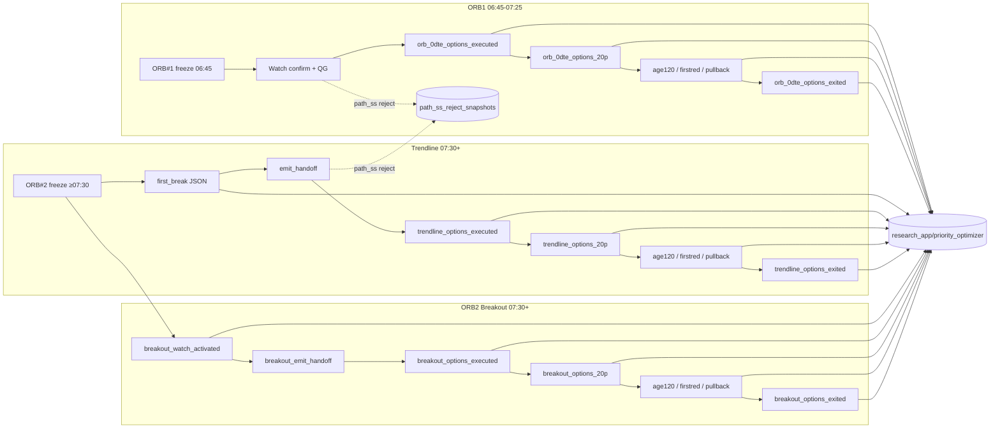

# Priority Optimizer — Go-To Guide (Easy 0DTE)

**Last updated:** November 4, 2026 — local until `deploy now`. Serving Demo **`YOUR_SERVICE_NAME-00619-xr6`** still writes schema-v8 families (handoff / executed / 20p / age_120s / first_red / pullback / exit). **Local stamp method:** one scored record (`po_decision_freeze.values` = `po_profile_decision.keys`, same `decision_digest`); one age table (`max_age_by_source`: chain 60 / quote 120 / SPY 45 / session tech 90); a still-stale gated key waits after one refresh; one owned UL refresh per tick with the broker clock (cap 25; skip if the last call is still running; age from that stored clock); path `timestamp` = monitor clock, `broker_quote_timestamp` separate; stale chain `*_now` empty. `dir_pct_change_5m` stays phased. Discovery is 24 names every 10s. The monitor and the flight recorder share the 2s tick, or 3s at 20+ opens. **In `00619-xr6` (was local on `00618-cvb`):** (1) `commit_bytes` holds one lock per object name — two ticks no longer both POST create-if-absent; a GCS 412 on that create means the object already exists (`00618-cvb` can still log that 412). (2) The owned tick skip_cache-fetches a live E\*TRADE last (oldest first, then the rest, cap 25). PO mid-trade / 20p / pullback / exit rows consume that cache. They do not restamp a discovery last as fresh. (3) Persist is time-correct without extra Market API: session tech uses bars whose minute close is ≤ the event; a future session-tech clock nulls RSI/MACD/BB instead of leaving filled values; executed copies the handoff freeze (no fill-time hub restamp); first_red ages the live OCC quote already on the monitor tick, not the entry equity clock; `breakout_watch_activated` stays cache-tech + ORB box (`po_fill_pct_scope=watch_activation`) and is not scored as a 267-key training fill. Never-written keys (`a1_policy`, `eligibility_score`, `momentum_score`, `pressure_score`, `spread_type`, `spread_width`, `target_delta`) join `FILL_PCT_SKIP_KEYS`. Mid-trade greeks restamp from the live OCC quote on that tick (or stay null) — they do not copy the previous event. A mid/exit chain older than 60 s, or a row with no chain read (`age_120s` / `first_red`), nulls chain volumes instead of keeping the executed copy (`po_chain_source=stale_over_60s` / `entry_carry`). Owned 5m keys come from OCC volume/OI samples already on the trade; they stay null until ~5 minutes of samples exist. Flatten primes remaining open symbols once, then persist stays cache-only. Chain cap stays 2; `age_120s` / `first_red` still do not pull a chain.  
**Role:** Essential operator guide for **Priority Optimizer (PO)** — handoff, fill, first +20% MFE, mid-trade Profit Capture clocks (`age_120s`, `first_red`, `pullback`), and exit snapshots. PO records those files. It does not compute the live Trade Profile and it does not run the 20% Save exit. Save is Profit Capture (`OPTION_PATH_V2_20P_SAVE_ENABLED`, off). The session-tech hub and `central_tech` stamp live tech. `dynamic_volume` is reserved for rolling volume and open-interest keys that are not built yet. Live mode can run with PO recording off.  
**Canonical schema:** [`modules/po_feature_schema.py`](../modules/po_feature_schema.py) (`SCHEMA_VERSION = 8`, 267 densified keys + envelope `lifecycle_event` on mid-trade rows). Column order is `SNAPSHOT_SCHEMA_ORDER`. Research rank is `USEFULNESS_ORDER` in [`modules/po_key_usefulness.py`](../modules/po_key_usefulness.py).  
**Not this file:** Live admit → [0DTEQualityGates.md](0DTEQualityGates.md) · Path SS knives → [0MFESkipSignal.md](SkipSignal/0MFESkipSignal.md) · Missed-win ledger → [MissedProfits.md](SkipSignal/0.MissedProfits.md) · ORB rank → [0DTEPriorityScore.md](0DTEPriorityScore.md) · in-trade exit flight recorder → Profit Optimizer (`profit_optimizer/`) · path pipelines → [0DTEORB1Breakout.md](0DTEORB1Breakout.md) · [0DTETrendline.md](0DTETrendline.md) · [0DTEORB2Breakout.md](0DTEORB2Breakout.md).

| Doc | Audience | Role |
|-----|----------|------|
| **This document** | Operators / analysts | **Primary** go-to — what PO is, what freezes, hydrate policy, GCS layout, daily workflow |
| [priority_optimizer/README.md](../priority_optimizer/README.md) | Desk | Script cheat sheet |
| [SCHEMA_V2_0DTE_SNAPSHOT_FIELDS.md](../priority_optimizer/docs/2026/Reference/SCHEMA_V2_0DTE_SNAPSHOT_FIELDS.md) | Analysts | Field index (filename legacy; **code truth is schema v8** in `po_feature_schema.py`) |
| [Data.md](Data.md) §5.2–5.3 · §8 | Operators | Trade Profile keys, time-correct freeze ages, cache-first PO hydrate |

---

## Table of contents

1. [What Priority Optimizer is](#1-what-priority-optimizer-is)
2. [Easy 0DTE lanes — what gets captured](#2-easy-0dte-lanes--what-gets-captured)
3. [Entry, 20% MFE, mid-trade, and exit clocks](#3-entry-20-mfe-mid-trade-and-exit-clocks)
3.1. [Trade Profile key fill (training)](#31-trade-profile-key-fill-training)
4. [Cache-first hydrate (performance)](#4-cache-first-hydrate-performance)
5. [Schema v8 — keys and blocks](#5-schema-v8--keys-and-blocks)
6. [Tech keys collected for desk review](#6-tech-keys-collected-for-desk-review)
7. [Daily workflow](#7-daily-workflow)
8. [GCS and local layout](#8-gcs-and-local-layout)
9. [Track B — comprehensive_data backfill](#9-track-b--comprehensive_data-backfill)
10. [Join keys and analysis](#10-join-keys-and-analysis)
11. [Configuration](#11-configuration)
12. [Operations and troubleshooting](#12-operations-and-troubleshooting)
13. [Related documentation](#13-related-documentation)

---

## 1. What Priority Optimizer is

PO **freezes each snapshot at its own moment** — the gate for entry, the first +20% MFE, the mid-trade Profit Capture clocks, and the exit — so the desk can replay:

> “Would this QG / dir% / PS / OTM floor have kept winners and skipped losers?”

| System | Role | Affects live fills? |
|--------|------|---------------------|
| **Priority Optimizer** | Write schema-v8 JSON snapshots to GCS. Copies tech the hub already stamped | **No** — recording only. Live trading does not require it |
| **20p snapshot** | First bid return ≥ +20%. One hub PVE3 read, frozen on that row | **No** — PO family `mfe_20p`. Runs with Save on or off |
| **20% Save** | Path V2 STEP 1A profit-take (`0DTEProfitCapture.md`) | **Yes**, when enabled. **Off** on the next Demo deploy |
| **Quality Gate** | Trade Profile admit or reject, from the session-tech hub and `central_tech` | **Yes** |
| **Priority Score (PS)** | Rank ORB1 survivors | **Yes** (fill order / top-N) |
| **Profit Optimizer** | In-trade flight recorder + exit shadow | Research / shadow (not PO writer) |

**Service scope:** RESEARCH Cloud Run (`YOUR_SERVICE_NAME`, `gcs_namespace=research_app`) writes PO artifacts when `ENABLE_EXECUTION_FEATURE_SNAPSHOT=true`. FINAL live does not use PO to admit or reject. Prefer RESEARCH Demo for desk datasets.

**Master switch:** `ENABLE_EXECUTION_FEATURE_SNAPSHOT=true` (`configs/Shared.env`). Disabling stops I/O only — trading logic unchanged.

**Aug 7 product lock (context for what you expect on disk):** Candle Validation, Signal Collection, ORB SO ETF, and Portfolio Protection / Red Day are **paused**. Live options lanes are **ORB1 Breakout** (watch **06:45–07:25** PT with TL0), **Trendline**, and **ORB2 Breakout** (07:30–12:30). 07:25–07:30 is the ORB2 gap. Legacy SO / 7:30 batch snapshot stages may still appear on older session pulls.

**Sep 3–7:** Path SS volume can multiply reject events. Full **unified-key** PO stays on **handoff / execution / exit** (cache-first hydrate; broker only on miss). Path SS rejects write an **entry-comparable densified** pack (`qg_admit` + `features_entry` + `path_ss_atoms`) from **cache / hot-path only** (no broker). **Sep 7 schema v3** drops never-filled densify keys; owned-depth gate prevents Layer C skew-only `cache_row` from skipping volume/OI/liquidity. Entry/exit hydrate stays **cache-first** so the 2s exact-OCC monitor and discovery scans keep cadence — see §4.

---

## 2. Easy 0DTE lanes — what gets captured

All options lanes share **`FEATURE_KEYS_0DTE_UNIFIED`** (sparse rows). `snapshot_strategy` + `stage` label the path and moment.

| Lane | `snapshot_strategy` | Entry stages (typical) | Mid-trade stages | Exit stage |
|------|---------------------|------------------------|------------------|------------|
| **ORB1 Breakout / 0DTE** | `easy_orb_0dte` | `orb_0dte_emit_handoff` (decision) · `orb_0dte_options_executed` (fill); legacy batch: `orb_0dte_execution_window_input` | `orb_0dte_options_20p` · `_age120` · `_firstred` · `_pullback` | `orb_0dte_options_exited` |
| **Trendline** | `easy_trendline_0dte` | `trendline_break_snapshot` (daily JSON) · `trendline_emit_handoff` (decision) · `trendline_options_executed` (fill) | `trendline_options_20p` · `_age120` · `_firstred` · `_pullback` | `trendline_options_exited` |
| **ORB2 Breakout** | `easy_breakout_0dte` | `breakout_watch_activated` · `breakout_emit_handoff` (decision) · `breakout_options_executed` (fill) | `breakout_options_20p` · `_age120` · `_firstred` · `_pullback` | `breakout_options_exited` |
| **ORB SO ETF** *(paused)* | `easy_orb_etf_so` | `execution_window_input` · `pre_broker_execution` · `blocked_*` | SO equity path (separate) |



**Writers (code):**

| Path | Entry | Exit |
|------|-------|------|
| ORB1 | `_save_orb_0dte_execution_priority_snapshot` · `_save_orb_0dte_pipeline_snapshot` (batch) | `_save_orb_0dte_exit_priority_snapshot` |
| Trendline | break collector · `_save_trendline_execution_priority_snapshot` | `_save_trendline_exit_priority_snapshot` |
| Breakout | `_save_breakout_watch_activation_snapshot` · `_save_breakout_execution_priority_snapshot` | `_save_breakout_exit_priority_snapshot` |
| **+20% MFE** | `maybe_persist_po_20p_snapshot` in [`po_mfe20_snapshot.py`](../modules/po_mfe20_snapshot.py) | One sealed row per `trade_id` at the first cross. Stage `*_options_20p`, `po_tech_asof=mfe_20p`, clock `po_20p_event_at`. A later retry writes that same payload. |
| **Mid-trade lifecycle** | `maybe_persist_lifecycle_snapshots` in [`po_lifecycle_snapshots.py`](../modules/po_lifecycle_snapshots.py) | Record-only. Families `age_120s`, `first_red`, `pullback`. Same hydrate/seal writer as 20p. Pullback identity is `{trade_id}__pullback_s{n}` (1–4). Does not change Path V2. |
| Envelope | `build_execution_snapshot_payload` → `persist_execution_snapshot` in [`execution_feature_snapshot.py`](../modules/execution_feature_snapshot.py) | same |

Capture methods live on `PrioritySnapshotMixin` in [`modules/po_priority_snapshot.py`](../modules/po_priority_snapshot.py). `PrimeTradingSystem` inherits that mixin. The trading loop only calls it.
| **Path SS reject** | `capture_path_ss_reject_snapshot` in [`path_ss_reject_snapshot_store.py`](../modules/path_ss_reject_snapshot_store.py) — ORB1 + TL + Breakout on `gate_stack:path_ss:*` / quality `path_ss` | n/a |

**Trendline first-break file:** one append-only session JSON (`YYYY-MM-DD_breaks.json`) via [`trendline_break_snapshot.py`](../modules/trendline_break_snapshot.py). Log: `TRENDLINE_BREAK_SNAPSHOT`.

**Fill vs reject (broker):** `trendline_options_executed` / `breakout_options_executed` / `orb_0dte_options_executed` fire on **each attempt**. Use `broker_success` (`true`/`false`) — broker rejects are valid research rows.

**Path SS reject (QG):** Entry-comparable PO payload (not compact-only). Densified `qg_admit` (all `QG_ADMIT_KEYS`) + densified `features_entry` / `features_entry_dense` (unified 0DTE schema, same keys as admit entry snaps) + densified `path_ss_atoms` + evaluate-time `path_ss_fields` / `quality_gate_report` (same knife atoms an entered trade's PO entry snap would carry). Local `tmp/path_ss_reject_snapshots/{day}/` · GCS `{ns}/profit_optimizer/path_ss_reject_snapshots/{day}/…`. GCS upload is **async** (daemon thread) so discovery never waits on network. Toggle: `EASY_CAPTURE_PATH_SS_REJECT_SNAPSHOTS` (default on in non-live; set `=1` on live/Cloud when capture is wanted). **Note:** 2026-09-04 local folder was largely `reconstructed_from: cloud_logs` (sparse) — live densify + gate_report merge is the accurate path going forward. See [MissedProfits.md](SkipSignal/0.MissedProfits.md).

---

## 3. Entry, 20% MFE, mid-trade, and exit clocks

Each snapshot stamps that symbol's tech at its own moment. A later chain read, or the owned contract after the fill, must not be written back onto an earlier file.

| Moment | Stages | `po_tech_asof` | What the file holds |
|--|--|--|--|
| **Decision** | `*_emit_handoff` | `gate` | The research row, hydrated from data already in the process, then sealed at `po_decision_freeze_at`. This is the Entry training row. A Quality Gate reject (`hard_gate_passed=False` and `qg.admitted=False`) is labeled `quality_gate_reject` and is **not** Entry training. |
| **Fill** | `*_options_executed` | `gate` when the handoff freeze matches | The sealed decision research row, plus fill identity (`entry_premium`, owned `strike`, `fill_delta`, broker result). It does not rebuild chain or session tech. Lookup is `trade_id`, then same-day freeze + symbol + side. |
| **Fill, unsealed** | `*_options_executed` with no matching handoff | `executed_unsealed` | Not an Entry training row. `po_entry_training_eligible` is false. |
| **First +20% MFE** | `*_options_20p` | `mfe_20p` | Current-state tech and chain at `po_20p_event_at`, first **bid** return ≥ +20% (`arm_20p_from_live_bid_return`). One hub read, frozen as `po_20p_tech`. Independent of 20% Save. One payload per `trade_id`. `exit_reason` stays empty. |
| **Age 120s** | `*_options_age120` | `age_120s` | Current-state tech at `po_age_120s_event_at`, first tick with wall-clock age ≥ 120 s from the earliest fill/open. Path V2 age is not the clock. Once per `trade_id`. May refresh session tech when the cache is older than 90 s. |
| **First red** | `*_options_firstred` | `first_red` | Current-state tech at `po_first_red_event_at`, first tick with bid return `< 0`. Cache-only hub. Holds until the **live OCC** quote on that monitor tick is ≤45 s, or 15 s, then writes `quote_over_45s`. Age is `po_monitor_quote_at` from `metadata.exact_quote`, not the entry `quote_observed_at`. Once per `trade_id`. |
| **Pullback** | `*_options_pullback` | `pullback` | Ladder, up to 4 shots per trade. Arms at bid high `H ≥ +15%`; fires at `r ≤ H − dip`. Canonical identity `{trade_id}__pullback_s{n}`. May refresh session tech when the cache is older than 90 s. Shares the two-per-trade live-chain cap with 20p. See *Pullback ladder* below. |
| **Exit** | `*_options_exited` | `exit` | Current-state tech and chain at `po_exit_event_at`. One research payload per `trade_id`. ORB EOD flatten also writes this file (`via=eod_flatten_orb`). Live chain is allowed outside the 2-cap; reused when the stamp is ≤60 s. |

`representative_call_delta` and `representative_put_delta` are the near-spot moon pair. `representative_delta` is the viability delta. `delta` is the selected-contract greek. `chosen_delta` and `fill_delta` are fill identity. They are not aliases of each other.

### Pullback ladder (Oct 23, 2026)

**Ladder (Oct 23, 2026; refresh Oct 24).** `H` = running max of the bid return (`bid / entry_fill − 1`, bid only), updated every tick in memory. Shot 1 arms at `H ≥ 0.15` and fires on the first tick before the exit tick with `r ≤ H − dip`; `dip = max(0.03, 0.70·H)` for `H < 0.20`, `max(0.03, 0.10·H)` for `H ≥ 0.20`. No wait or confirm. After shot n the next shot needs `H ≥ Hmin = max(0.30, H_fire + 0.05, H_fire × mult[n])` (mult 1.25 / 1.5 / 1.5 / 1.5) and then the first dip. Max 4 shots. Each shot freezes ONE `read_session_tech_at` at the fire tick and writes ONE create-if-absent object `{date}__pullback__{trade_id}__pullback_s{n}.json` (seal first). If the hub cache is older than 90 s, pullback may refresh from the tick-primed bars (same policy as 20p / age_120s / exit). `first_red` stays cache-only. `extra.trade_id` / `source_trade_id` stay the real trade id (no `_cN`). A failed prime still writes a labeled stamp (`refresh_failed` / `tech_stale`) so the cell is not empty.

- **Fields frozen at the fire tick** (fields only, never a gate): `pullback_seq`, `pullback_shots_max`, `pullback_H_fire`, `pullback_running_high`, `pullback_fire_return`, `pullback_dip`, `pullback_depth`, `pullback_seconds_since_H`; underlying `pullback_ul_fav_move_pct`, `pullback_ul_run_extreme_pct`, `pullback_ul_retrace_pct`, `pullback_ul_retrace_frac_of_move`, `pullback_ul_s1a_*`, `pullback_ul_extreme_minus_prem_peak_s` (sign-adjusted for puts through Path V2), `pullback_ul_age_s`. The underlying values come from Path V2 STATE S1/S2, which only update when the monitor last is live (`underlying_source` not `unavailable`, `underlying_age_ms` ≤ 10 s). Age is the broker/receive clock on the flight-recorder row, not the tick timestamp.
- **Restart recovery.** The shot latch (shots fired, last `H_fire`, next `Hmin`) is rebuilt read-only from stored `…__pullback_s{n}` objects the first time a shot is due, when the trade was first seen more than 30 s after open. A shot whose canonical object exists is skipped and logged (`skip_exists`); one whose seal exists is promoted with the sealed bytes (`skip_seal_exists_promoted`). Snapshots are never edited.
- **Exit flags.** If `H ≥ 0.15` was reached but no shot fired before the exit tick, the exit snapshot carries `pullback_missing=true` and `late_fallback=true` (also `pullback_H_at_exit`, `pullback_shots_fired`).
- **Collection.** Shots are ordinary `pullback` family objects (`{date}__pullback__{trade_id}__pullback_s{n}.json` + `{date}__seal_pullback__…`) in the same `execution_snapshots/` store, so `retrieve_execution_snapshots.py` and the daily after-session collect pick them up. `lifecycle_coverage` strips `__pullback_s{n}` (and legacy `_c{n}`) to the trade id. The last shot of a trade is the highest `pullback_seq`.
- **Cap.** Pullback shots have their own cap (`PO_PB_MAX_SHOTS`) and do not count toward `PO_SNAP_MAX_PER_TRADE`.

**Time-correct fill (Oct 24 / Oct 27 / Oct 30).** Every written snapshot must fill research cells from the data at that event clock. Empty keys that have a writer are a miss. Always-empty pipeline/convex/reject names, and never-written score/spread keys (`a1_policy`, `eligibility_score`, `momentum_score`, `pressure_score`, `spread_type`, `spread_width`, `target_delta`), stay in the 267-key row and are excluded from fill% (`FILL_PCT_SKIP_KEYS` in `po_key_usefulness.py`; `po_session_certification.py` skips them). Trade Profile extras (`call_share`, `put_share`, `total/call/put_chain_vol_oi`) are **not** in the 267-key densify list. They ride `po_decision_freeze.values` on handoff/executed and, after the Oct 27 local stamp, are recomputed on later families from that row's own volumes (`stamp_tp_profile_derived_keys`). Score them on the dense row and the freeze, not only `FEATURE_KEYS_0DTE_UNIFIED`. Session-tech persist slices the hub to bars whose minute close is ≤ the event (`read_session_tech_at` / `get_session_tech_asof`). If a session-tech clock would still be after the event, RSI/MACD/Bollinger/VWAP are nulled with the clock. Executed does not restamp that hub. `breakout_watch_activated` is not a 267-key or 27-key training fill — cache session-tech + ORB high/low only; do not add chain on a 200-name watch. After the next session, score `watch_activation_fill` / `watch_tp27_in_scope_fill` and `exit_session_tech_fill` from `po_session_certification.py`. A 27-key watch average near 31% is the six in-scope session-tech keys (6/27 ≈ 22%) plus an occasional SPY or UL L1 print — not a session-tech regression. Compare those six plus `orb_high` / `orb_low` / `orb_range_pct` to 10/29. Exit RSI/MACD/Bollinger blanks are the flatten-prime miss rate.

### 3.1 Trade Profile key fill (training)

**P0 is the handoff.** Future Trade Profile cuts are mined from the decision freeze on `*_emit_handoff`. That file must hold the template keys with source ages ([Data.md](Data.md) §5.2–5.3). `po_profile_decision` is the same scored dict and the same digest — not a second pre-pick copy. A sealed executed file copies the same freeze. Later families (`mfe_20p`, `age_120s`, `first_red`, `pullback`, `exit`) restamp at their own event. They must reach the same fill bar as handoff **from cache**, not from a new Market API.

| Policy | What it means |
|--------|----------------|
| Handoff / executed | Freeze values + `features_full_pool_dense[0]`. Do not restamp chain or session tech after the gate. Hydrate on `*_options_executed` returns the sealed freeze; `apply_gate_tech_lock` also copies the envelope clocks (`po_session_tech_asof_at`, quote/SPY/chain as-of). |
| Later families | Moment restamp from bars closed by that event. Derive share / vol-OI from the volumes already on that row. Copy live TP keys from `option_stealth` when the row is blank. Overlay the sliced 1m hub when the frozen dict is empty (`ensure_bars=False`). Underlying L1 from the equity ring only if age ≤20 s. SPY from the session pin. OTM from spot + strike. Option L1 from sizes already on the tick. Greeks from the live OCC quote. Chain volumes only when this event took a live read ≤60 s old. Flatten primes remaining opens once before the EOD flag; persist after that is cache-only. |
| `dir_pct_change_5m` | **Phased out of the Trade Profile.** Missing-PASS. 10.27 handoff fill was 62.4% with named reasons (`prior_too_old`, `prior_outside_window`, `no_prior`). Do not train on it. Do not copy a tape ratio from the owned tick. Envelope `po_dir5m` is diagnostics only. It moves to missing-reject only after measured fill is above 95%. |
| No extra API | Discovery 10s / 24 names, exact OCC, and the flight recorder stay in front. Persist does not raise dir% keep-alive or held resample to chase fill. |

**10.27 measured (deployed `00613-w2r`, before the local moment-cache stamp):** handoff/executed ≥96% on every TP key except dir% (62.4%) and underlying L1 (96.1%). Mid-trade/exit had volume and OI at 100% but `call_share` / `put_share` / `*_vol_oi` at 0% (aliases never written). PVE and L1 dropped after entry. Those alias and cache-overlay holes are what `stamp_tp_moment_cache` in [`po_snapshot_hydration.py`](../modules/po_snapshot_hydration.py) closes locally. Key fill is not the same as `po_entry_training_eligible` (2 / 229 on 10.27 were eligible; the rest were mostly `quality_gate_reject`).

**Shared tick prime.** The open-position monitor starts three things together: exact OCC (batch 12), skip_cache E\*TRADE last for **owned** names this tick (stale first, then the rest, cap 25), and one session-tech bar fetch. Persist is then cache-only. Handoff still tops up when that tick is not primed. Quotes and bars share a 3 s wall from tick start (`finish_prime_with_quote_wait`). Monitor cadence is 2 s under 20 open and 3 s at 20+ (`effective_position_monitor_interval_sec`). The flight recorder samples once per finished tick. Path `timestamp` is the monitor clock; `broker_quote_timestamp` is the broker field. UL last carries provenance (`underlying_source` / `underlying_age_ms` / `underlying_observation_timestamp`). Discovery/last cache is not restamped as `fresh_batch`. End-of-day flatten primes remaining open symbols once, then marks EOD so persist stays cache-only, and paces exit chains 250 ms. See [PositionMonitoring.md](PositionMonitoring.md) and [profit_optimizer/README.md](../profit_optimizer/README.md#owned-tick-stamp-open-position-review-keys).

**Chain overlay.** Mid-trade live chain is capped at two refreshes per trade for 20p + pullback. `age_120s` and `first_red` do not force a live chain and do not overlay executed volumes. Exit may force a live chain and does not increment that cap; dir% still uses the **pre-event** ring (a post-event fetch is not causal). If the stamped chain is ≤60 s old, persist reuses it (`chain_should_live_refresh`). Older than 60 s, or no live read this event, nulls the chain moment keys (`po_chain_source=stale_over_60s` / `entry_carry`). Greeks come from the live OCC quote on the tick, not the chain overlay.

**Source clocks (do not mix them):**

| Clock | Cap | Where |
|-------|-----|--------|
| Session tech | 90 s (bar close = minute start + 60 s) | Gate freeze and mid-trade hub. Persist slices to close ≤ event. `first_red` is cache-only (no sync bar refresh). |
| Chain | 60 s | Gate freeze and mid-trade overlay. |
| SPY | 45 s | Gate freeze (`TP_FREEZE_SPY_MAX_AGE_SEC`) and `po_spy_asof_at`. |
| Quote (gate L1) | **120 s** (`TP_FREEZE_QUOTE_MAX_AGE_SEC`) | Decision freeze. Same table as PO hydrate when the env override is unset. |
| Quote (mid-trade L1 persist) | 20 s | `stamp_underlying_l1_from_cache` writes only when the ring is this young. Older stays missing. |
| Owned UL last (monitor / Path V2) | 4 s fresh / 8 s last_good / >8 s unavailable | One skip_cache E\*TRADE last per tick (cap 25), broker `date_time_utc`. Path V2 UL steps also cap at 10 s (`OPTION_PATH_V2_STALE_MAX_SECONDS`). |
| Option quote (first_red hold) | 45 s, then 15 s wait | Live OCC `broker_quote_timestamp` on that tick (`po_monitor_quote_at`). Writes `quote_over_45s` if still stale. |

**SPY and last-bar OHL.** Every mid-trade and exit write stamps `po_spy_asof_at` from cache. Last-bar `open` / `high` / `low` / `volume` ride `SESSION_TECH_PATH_KEYS` onto frozen mid/exit rows.

Mine Entry, Skip, and Moon from the handoff. A sealed executed file should match that research row. Schema 3–5 executed files rewrote chain, greeks, IV, SPY, and premium after the decision; do not train Entry on those. Quality Gate rejects are not Entry training. Mine the +20% moment from the 20p file. Mine exit-vs-hold from `age_120s`, `first_red`, and `pullback`. Mine the sale from the exit file. Mid-trade rows never write `exit_reason` or Path V2 outcomes.

| | **Entry** | **Exit** |
|--|-----------|----------|
| **Goal** | Lock tech to the gate | Restamp tech at the exit, then write outcomes |
| **Excluded** | `ENTRY_SNAPSHOT_EXCLUDED` — `exit_*`, `win`, `pnl_*`, `holding_minutes`, exit observation stamps | — |
| **Added** | Fill identity only (`entry_premium`, owned strike, `fill_delta`) | Outcomes + `FEATURE_KEYS_EXIT_OBSERVATION` (HWM, giveback, decision vs fill bid, slippage) |
| **Hydration** | Handoff fills blanks from the decision row, then seals. The fill copies that seal and does not issue a second chain or quote pull when the handoff exists (§4) | Carry-forward fills gaps, then session tech and the chain are restamped at the exit clock. A storage retry writes the same sealed payload |

**Entry feature caches (in-process only):**

| Path | Cache | Match |
|------|-------|------|
| ORB1 | `_orb_0dte_po_entry_features_by_symbol` | `trade_id`, else the decision freeze, else the one handoff of that option side. Last 8 rows per symbol |
| Trendline | `_trendline_po_entry_features_by_trade_id`, then the symbol list | `trade_id` first |
| Breakout | `_breakout_po_entry_features_by_symbol` | Same match as ORB1 |

A symbol is not a single slot. Two open sides on the same name keep their own handoffs.

Exit, 20p, and mid-trade writer: `_save_0dte_exit_priority_snapshot` in [`modules/po_priority_snapshot.py`](../modules/po_priority_snapshot.py). Each purpose builds once at its event clock (`20p`, `age_120s`, `first_red`, `pullback`, or exit). The sealed bytes are written to GCS: first `{date}__seal_{family}__{identity}.json`, then the canonical `{date}__{family}__{identity}.json`. The 20p and lifecycle commit runs on a side thread so one name's upload does not hold the next exit check. `commit_bytes` in [`po_canonical_store.py`](../modules/po_canonical_store.py) is create-if-absent. Local source (not in `00618-cvb`) holds one lock per object name, so a second tick sees the first body instead of a GCS 412. Identical bytes are a retry. A different body is a conflict and is not written over. A crash after the seal object exists promotes those exact bytes. It does not rebuild from a later market. If the seal upload never finished and the event clock was saved, the trade is `recovery_unsealed` and is left out of training. Session tech and the chain on a mid-trade file are the bars and chain at that file's event clock. Outcome keys stay empty on those files. Mid-trade envelopes add `lifecycle_event`. `retrieve_execution_snapshots.py` pulls every family in `_LIFECYCLE_FAMILIES` plus older clock-named files.

---

## 4. Cache-first hydrate (performance)

**Known lag (Oct 27, leave running):** Discovery, the open-position monitor, the exit check, and the flight-recorder series are on their clocks (24 names every 10s; monitor 2s, or 3s at 20+ opens; one path row per evaluated tick). A full book pulls a lot of that series. The process time still left on the main loop is here: every Priority Optimizer snapshot is stamped with time-correct hydrated keys. Past about **120** of those snapshots, that hydrate lags the main process. Do not take that time from the 10s discovery rotation. Review this hydrate after the session.

**Why:** Admit already paid for Layer C chain + session bars. Path SS rejects multiply events but must **not** steal E\*TRADE budget from exact OCC (2s monitor) or discovery equity. Reject snaps densify from that paid row + cache-only stamp (nulls OK when history cold). Entry/exit still **must fill** verified schema keys when data exists — prefer cache over a second live pull.

**Code:** [`modules/po_snapshot_cache_hydrate.py`](../modules/po_snapshot_cache_hydrate.py) · `_hydrate_po_snapshot_row_with_market_data` · `_fetch_options_features_for_trendline_signal` · [`options_snapshot_fields.py`](../modules/options_snapshot_fields.py). The numbers on the row come from [`modules/session_tech_admit.py`](../modules/session_tech_admit.py) and [`central_tech/`](../central_tech/). [`po_observe_trajectory.py`](../modules/po_observe_trajectory.py) calls those modules when a snapshot is written.

| Step | Prefer | Live broker only when |
|------|--------|------------------------|
| Equity / TA | Session 1m hub + discovery/path quote cache (≤ `quote_max_age_sec()`, 120 s, unless `0DTE_PO_CACHE_QUOTE_MAX_AGE_SEC` is set) | Session TA thin **and** quote cache miss → `get_market_data_for_strategy` |
| RS vs SPY | Quote-cache `change_pct` (or derive from `previous_close`) across **all** quote bags; never invent `0.0` | Cache miss / sentinel → `_live_rs_vs_spy_from_broker_quotes` on force hydrate |
| Options (handoff) | Admit Layer C **plus owned depth** (`representative_volume`/`cumulative_volume` + OI + `liquidity_class`) → `cache_row` | Skew-only seed is **not** sufficient (Sep 4 TL/BO gap) → in-process chain TTL (`chain_max_age_sec()`, 60 s, unless `0DTE_PO_ENTRY_CHAIN_ALLOW_STALE_SEC` is set), and only if that read finishes before the decision freeze |
| Options (fill) | The sealed handoff. `chain_fetch_source=sealed_handoff`. No second chain pull | No handoff cache. The row is then hydrated as today and labeled `executed_unsealed` |
| Options (exit / 20p / pullback) | Cached chain if age ≤60 s (`chain_should_live_refresh`). Else live; 20p+pullback share a 2/trade cap; exit is outside that cap | Cache miss **and** open-quote priority **not** active |
| Options (age_120s / first_red) | Cached chain only. No live refresh on those families | — |
| Trade Profile extras / moment keys | `stamp_tp_moment_cache`: derive shares and vol/OI; copy live keys from `option_stealth`; hub overlay with `ensure_bars=False`; L1 ring ≤20 s; SPY pin; OTM and option L1 from fields already on the row | Never a new get_quotes / chain for these keys |
| Trajectory / L1 | Entry keeps chain deltas already stamped at the gate freeze. 20p, mid-trade, and exit recompute those deltas at their own clock | Never invent; null when ring cold (~2–5m for chain deltas). Windows shorter than 5 m also stamp since-entry deltas and `window_lt_5m`. Do not copy `dir_pct_change_5m` from the owned tick |
| While positions open | `prefer_cache_only=True` for PO chain — exact OCC keeps P0 | — |

**Status stamps (desk / logs):**

| Field | Values (examples) |
|-------|-------------------|
| `po_market_enrichment_status` | `sealed_handoff` on a fill that reused the decision row · `session_tech_cache` · `cache` · `ok` (broker) · `session_tech` · `deferred` · `failed` |
| `po_market_enrichment_source` | `decision_freeze` · `session_tech+quote_cache` · `quote_cache` · `broker` |
| `po_options_enrichment_status` | `sealed_handoff` · `cache_row` · `cache` · `ok` · `deferred` / `deferred_cache_row` · `failed` |

`force=True` still means “do not defer the **write**” — it does **not** mean “always hit live E\*TRADE.” Monitor cadence policy: [PositionMonitoring.md](PositionMonitoring.md).

---

## 5. Schema v8 — keys and blocks

**Code truth (Oct 19, 2026):** `FEATURE_KEYS_0DTE_UNIFIED` = **267** keys (`SCHEMA_VERSION = 8`). The densified key set is unchanged from v7. Mid-trade rows add envelope `lifecycle_event` (`FEATURE_KEYS_LIFECYCLE_EVENT`). Dense snapshots use **`SNAPSHOT_SCHEMA_ORDER`**: a stable semantic layout (identity, research families, chain, contract, session tech, volume, break geometry, L1, candle path, pipeline metadata, fill identity, premium path by clock, aliases, outcome). **`USEFULNESS_ORDER`** is the separate research ranking. Changing that rank does not reorder persisted columns. Gate evaluation order is unchanged. v8 added the lifecycle envelope. v7 added the two near-spot moon deltas. v6 added the path-signal stamps. v5 added the owned-contract premium trajectory block. v4 (Sep 18) is **208** keys. Older archives stay readable in their own era. Serving `00618-cvb` writes schema v8 canonical families. The Oct 30 per-object lock is local and is not in that image. It is not a schema change.

The 267 names are still assembled from the implementation tuples (identity, underlying, peak, options microstructure, pipeline, structure, trajectory, premium path, path-signal). Densify then writes them in `SNAPSHOT_SCHEMA_ORDER`. That read order is:

| Read order | What is together |
|---|---|
| Identity | `symbol`, `trade_id`, strategy, side, option type, `trendline_slot`, `entry_mode` |
| Active research | Chain volume, moon deltas, price-volume efficiency, break distance, chain deltas and open interest, RSI, IV, theta, delta, gamma, vega, SPY change, VWAP distance, direction percent, ATR, one-minute volume, break level and time |
| Rest of chain | Totals, ratios, sanity, `chain_fetch_source` |
| Representative contract | `representative_delta` and the bid/ask/volume/OI/strike fields. Not the moon pair |
| Session price and indicators | Spot and OHLC, SPY price, MACD, Bollinger, VWAP, session `sma_20` / `sma_50`, EMA |
| Volume | Rates, session volume, ratios, `price_volume_efficiency_1m` |
| Break and ORB | ATR distances, line, ORB high/low, archetype |
| Underlying L1 and liquidity | Sizes, imbalance, quote age, spread |
| Candle path | 1m/3m/5m price change, bar position, wick |
| Pipeline | Scores, convex, hard gate, broker success |
| Fill identity | Strike, `chosen_delta`, `fill_delta`, `entry_premium` |
| Premium path | Now, then 30 seconds ago, then 5 minutes ago, then derived slope and path state |
| Aliases | `iv`, `call_volume`, `put_volume` |
| Outcome inside the 267 | `peak_price`, `peak_pct`, `exit_underlying`, `hold_exit_dir_pct` |

| | Count | |
|---|---:|---|
| **Unified total** | **267** | `easy_orb_0dte` · `easy_trendline_0dte` · `easy_breakout_0dte` |
| ORB SO ETF schema | **85** | `easy_orb_etf_so` only |
| Entry/exit **critical** subset | **107** | `FEATURE_KEYS_ENTRY_EXIT_CRITICAL`, in usefulness order |

**Envelope fields (every execution snapshot JSON):**

| Field | Meaning |
|-------|---------|
| `schema_version` | `8` on `00618-cvb` (`00613-w2r` onward). Sep 23–25 pulls are schema 5. Older pulls are 4, 3, or 2 |
| `po_decision_freeze_at` | Decision clock. Entry sources must be at or before this |
| `po_snapshot_event_at` | Clock of this file: the freeze, a mid-trade event, or the exit |
| `po_20p_event_at` / `po_age_120s_event_at` / `po_first_red_event_at` / `po_pullback_event_at` / `po_exit_event_at` | One clock per family (pullback one per shot; the shot's own clock is stamped in `po_pullback_event_at`) |
| `po_session_tech_asof_at`, `po_quote_asof_at`, `po_spy_asof_at`, `po_chain_asof_at`, `po_premium_path_asof_at` | Source clocks. A missing clock stays missing and is listed in `po_clock_gaps` |
| `po_tech_asof` | `gate`, `mfe_20p`, `age_120s`, `first_red`, `pullback`, `exit`, or `executed_unsealed` |
| `lifecycle_event` | Mid-trade only. `snapshot_type`, `event_ts`, `seconds_since_entry`, `pret`, `peak_pret`, pullback `pullback_seq` (1–4, also `rearm_cycle`), `pullback_shots_max`, `H_fire`, since-entry deltas |
| `po_decision_freeze` | Handoff/executed. `values` holds the scored TP keys including share / vol-OI extras. `ages_sec` / `asof` are the Data.md §5.3 clocks |
| `po_dir5m` | Envelope diagnostics for `dir_pct_change_5m` (value, prior age, window, missing reason, now-chain age). Not a Trade Profile setting while fill is under 95% |
| `po_entry_training_eligible` | False when `po_tech_asof` is `executed_unsealed`, or when the handoff is a Quality Gate reject (`training_ineligible_reason=quality_gate_reject`) |
| `po_canonical_event` | `{date}__{family}__{trade_id}` without the `.json`. One object per event |
| `po_sma_horizon` | `session_1m` when `sma_20` / `sma_50` are a full session window. `session_1m_not_warm` when they are null for that reason |
| `date` | PT session `YYYY-MM-DD` |
| `stage` / `snapshot_strategy` | Capture moment / path |
| `source_app` / `gcs_namespace` | `RESEARCH` / `research_app` |
| `market_context` | SPY momentum, VIX, `total_scanned` |
| `feature_schema_keys` | Full key list for that strategy |
| `features_*_dense` | Sparse per-symbol rows |
| `features_*` / `features_89_*` | Compact / legacy aliases (path-specific content) |

**Not available from E\*TRADE:** L2 multi-level book depth, aggressor buyer/seller volume ratio, Time & Sales / footprint. Top-of-book L1 sizes **are** available and stamped as observe fields.

---

## 6. Tech keys collected for desk review

These are the fields used with [0DTEQualityGates.md](0DTEQualityGates.md) matrices. The live Trade Profile reads the session-tech hub and `central_tech`, not this snapshot writer. Admit-time keys are stamped by `stamp_admit_tech` ([Data.md](Data.md) §5.1). The handoff copies that row. Family sections under this heading still name the gate layers. Snapshot column order is the physical order in §6.0, not the research table.

### 6.0 Two orders

**Physical snapshot order** (`SNAPSHOT_SCHEMA_ORDER`) is how a dense row is written and how a human should read it: who the row is, then the active research families, then the rest of each family, then pipeline metadata, fill identity, the premium path grouped as now / 30 seconds / 5 minutes / derived, then compatibility aliases, then outcome fields. Provenance clocks sit on the snapshot envelope, after strategy identity and before the feature arrays. They are not part of the 267.

**Research usefulness order** (`USEFULNESS_ORDER`) says which features currently matter for Entry, Skip, and Moon. The leading tier is the active research families. `iv`, `call_volume`, and `put_volume` are compatibility aliases and sit behind that tier. A later rerank edits `USEFULNESS_ORDER` only. It does not change `FEATURE_KEYS_0DTE_UNIFIED`.

Column order on a snapshot is the physical order. The table below is the research ranking, not the file layout.

| Rank | Key |
|-----:|-----|
| 1–2 | `call_chain_volume`, `put_chain_volume` |
| 3–4 | `representative_call_delta`, `representative_put_delta` |
| 5–6 | `price_volume_efficiency_3m`, `price_volume_efficiency_5m` |
| 7 | `break_distance_pct` |
| 8–11 | `call_chain_volume_delta_5m`, `put_chain_volume_delta_5m`, `same_side_chain_volume_delta_5m`, `same_side_chain_volume_5m_ago` |
| 12–14 | `total_chain_open_interest`, `call_chain_open_interest`, `put_chain_open_interest` |
| 15–20 | `rsi`, `implied_volatility`, `theta`, `delta`, `gamma`, `vega` |
| 21–24 | `spy_change_pct`, `distance_from_vwap_atr`, `vwap_distance_pct`, `dir_pct_change_5m` |
| 25–30 | `relative_volume_time_adjusted`, `quality_score`, `atr`, `underlying_volume_1m`, `volume_1m`, `break_level` |

The names after rank 30 keep the previous Cliff and replay order, except `iv`, `call_volume`, and `put_volume`, which sit with the other compatibility names just before the premium-path block. The full list is `USEFULNESS_ORDER`.

### 6.1 Session tech (QG Layer B)

From `SESSION_TECH_PATH_KEYS` (`profit_optimizer/path_chain_skew.py`) + core schema:

| Family | Keys |
|--------|------|
| MACD | `macd`, `macd_signal`, `macd_histogram`, `prior_macd_histogram`, `macd_above_zero`, `macd_cross`, `macd_hold_ok_call`, `macd_exit_signal_call`, `macd_hist_sign`, `macd_missing` |
| MAs | `sma_20`, `sma_50`, `ema_12`, `ema_26`. On a PO row, `sma_20` and `sma_50` are the session 1-minute SMA and only when 20 or 50 closed minutes exist. A broker daily SMA is not stored under these keys. `po_sma_horizon` says which |
| RSI / VWAP | `rsi`, `vwap_distance_pct`, `vwap`, `vwap_position`, `rsi_missing`, `vwap_missing` |
| Volume | `volume_ratio`, `orb_volume_ratio`, `session_bar_count`, `volume_ratio_missing`, `volume_ratio_source`, `tech_source` |
| Other | `macd_signal`, `macd`, Bollinger width, `atr`, `momentum_10`, `rs_vs_spy` |

### 6.2 Chain skew / tape (QG Layer C)

`PATH_CHAIN_SKEW_KEYS`, in research rank rather than snapshot order: `call_chain_volume`, `put_chain_volume`, `total_chain_open_interest`, `total_chain_volume`, `put_call_oi_ratio`, `call_chain_open_interest`, `put_chain_open_interest`, `put_call_volume_ratio`, `direction_volume_pct`. The moon pair `representative_call_delta` / `representative_put_delta` is the near-spot chain, not `representative_delta`.

### 6.3 Contract / structure (Layers A & D)

| Layer | Keys |
|-------|------|
| Geometry | `orb_high`, `orb_low`, `orb_range_pct`, `break_distance_pct`, `setup_type`, `trigger_direction` |
| Contract | `otm_pct`, `chosen_delta`, `fill_delta`, `viability_score`, `representative_delta` and the representative bid/ask/volume fields, `liquidity_class`, `quality_gate_report`. Moon call/put delta is not this row |

### 6.4 Trajectory observe (state → path) — observe-only

The live copies are `modules/session_tech_admit.py` (VWAP distance, price/volume efficiency, equity L1) and `central_tech/chain_ring.py` (five-minute chain deltas and `dir_pct_change_5m`). Option L1 is `central_tech/option_l1.py`. `modules/po_observe_trajectory.py` calls those when it writes a snapshot. **Not live hard gates by themselves.** Volume_* fields are **participation proxies**, not aggressor order flow. Chain deltas reuse the ring already filled at the Trade Profile check — no extra full-chain polls.

**Decision-time freeze (entry research):**

| Stage | Trajectory behavior |
|-------|---------------------|
| `*_emit_handoff` | Marks `po_decision_freeze_at`; stamps from **closed** 1m bars (drops forming minute); L1/chain samples ≤ freeze |
| `*_options_executed` | Copies the sealed handoff, including trajectory. Premium anchors stay on the decision clock. A fill does not restamp them from a later path |
| `*_options_20p` | Current-state bars and chain at `po_20p_event_at`. Premium ticks after that clock are dropped |
| `*_options_age120` / `_firstred` / `_pullback` | Current-state bars and chain at that type's event clock. Same rule as 20p. Outcome keys stay empty |
| `*_options_exited` | Current-state bars and chain at `po_exit_event_at`. Premium ticks after that clock are dropped |
| `path_ss_reject` | Cache-only stamp + densify (same unified keys); no broker |

Entry research should treat handoff (+ carried executed) as the admission-state freeze. Fill economics (premium, broker_success) still come from executed.

| Family | Keys (examples) | Entry population notes |
|--------|-----------------|------------------------|
| Underlying L1 | `underlying_l1_imbalance`, `*_delta_5s/15s`, signed `l1_delta_5s_with` | Needs quote ring warm ≥15s (watch polls). Cold start → null deltas OK |
| Option L1 | `option_bid_size/ask_size/imbalance` | From owned/selected contract / fill payload; handoff may still be thin |
| Participation | `volume_1m/3m/5m`, rates, accel | Closed bars at freeze — **not** forming minute |
| RVOL time-adj | `relative_volume_time_adjusted` | **`linear_rth` heuristic only** — research field, **never** QG candidate until true TOD curve |
| Price × volume | `price_change_*`, `price_volume_efficiency_*` | Same closed-bar freeze |
| Candle | `entry_bar_range_pct`, `entry_bar_close_position`, consecutive directional bars, HH · signed `wick_against` / `close_with` | Last **closed** bar = entry bar. Body/wick stay on `qg_admit` for Path SS, not PO densify |
| Break geometry | `seconds_since_break`, ATR distances | Clocked to freeze, not fill+hydrate |
| Chain trajectory | `dir_pct_change_5m`, `*_chain_volume_delta_5m`, `owned_contract_volume_delta_5m` | Needs prior hydrate ≥~2–5m **and** owned volume on row. Null at first touch is correct |
| Premium trajectory | `premium`, `premium_30s_ago`, `premium_5m_ago`, `premium_change_pct_30s` / `_5m`, slope/R², elasticity, HWM/LWM | From `premium_path`. Entry is usually `current_only`. A 5-minute slope without a 30-second slope is `ok_5m_only`. 30s/5m anchors fill once a prior print is in tolerance. No bare `premium_change_pct` |

**Null policy:** sparse null ≠ 0. Never impute. Compare cohorts with `is not null` filters; do not treat missing `dir_pct_change_5m` as flat conviction.

**Post-deploy desk priorities (analysis layer — not new fields):**

1. Volume acceleration × outcome  
2. Break volume expansion × MFE  
3. `direction_volume_pct` × `dir_pct_change_5m`  
4. Price-volume efficiency × outcome  
5. L1 imbalance trajectory × outcome  
6. ATR-normalized break distance × MFE/MAE  

### 6.4b Schema triage (v4 densify is already pruned)

v4 removed mining-dead densify keys (`FEATURE_KEYS_SNAPSHOT_DROPPED`). Desk matrices should concentrate on:

**Research tier (usefulness ranks 1–30, not the snapshot columns):** chain volume, the moon call/put deltas, price-volume efficiency 3m and 5m, break distance, chain-volume deltas, chain open interest, RSI, IV, theta, delta, gamma, vega, SPY change, VWAP distance, direction percent, ATR, one-minute volume, `break_level`. The full rank is `USEFULNESS_ORDER`.

**Keep densifying but lower matrix priority:** compatibility aliases (`iv`, `call_volume`, `put_volume`), pipeline stamps, and premium-path history until the path is warm. `put_call_oi_ratio` stays an observe stamp. Candle body and wick stay on compact `qg_admit` for Path SS.

Watch `continuation_pct` / `follow_through_bars` still exist on live confirm objects — they are **not** PO snapshot keys. Candle body/wick remain on compact `qg_admit` for Path SS.

SO-only fields (`prev_day_*`, `orb_open/close/volume`) live on `easy_orb_etf_so` only — not on unified 0DTE densify.

### 6.4c Premium trajectory (schema v5) — observe-only

Implemented in [`modules/premium_trajectory_v5.py`](../modules/premium_trajectory_v5.py) and stamped from `stamp_po_observe_trajectory`. **Not a live gate.** History is the open trade’s `premium_path`, with the snapshot row as now. A path tick older than 15 seconds of quote age is dropped. A missing anchor stays null. There is no bare `premium_change_pct`.

`premium` is the executable owned-contract mark (path `mark`, else bid). Bid, mid, and ask stay separate so a spread change is not read as premium movement.

| Piece | Keys |
|-------|------|
| Now / ~30s / ~5m | `premium`, `option_bid`, `option_mid`, `option_ask`, `underlying_price` (current already in core), `option_bid_size`, `option_ask_size`, `option_l1_imbalance` (current already in trajectory observe), `option_spread_pct`, `option_spread_to_premium`, `implied_volatility`, `delta`. Historical copies use `_30s_ago` / `_5m_ago` |
| Change | `premium_change_pct_30s`, `premium_change_pct_5m`, `underlying_change_pct_30s`, `underlying_change_pct_5m` |
| Slope | `premium_slope_30s`, `premium_slope_5m` (premium per second) and `premium_slope_r2_30s`, `premium_slope_r2_5m`. Needs 3 clean quotes spanning at least half the window. The fit uses quotes with `now - horizon <= t <= now + 0.25` after the path is sorted by time |
| Response | `premium_ul_elasticity_30s`, `premium_ul_elasticity_5m` (null when the underlying move is under 1 bp). `premium_ul_direction_agree` uses the 30s window: calls agree when the underlying rises with premium, puts when it falls with premium. `premium_acceleration_30s_vs_5m` is the 30s slope minus the 5m slope |
| Path state | `premium_hwm`, `premium_drawdown_from_hwm_pct`, `seconds_since_hwm`, `premium_lwm`, `premium_recovery_from_lwm_pct`, `seconds_since_lwm`, `premium_negative_velocity_streak_sec`, `premium_positive_velocity_streak_sec`. These use the full owned path. `premium_velocity_sign_flips_5m` uses the same 5-minute quote window as the 5-minute slope |
| Quality | `premium_trajectory_quality`: `insufficient` (no usable quote), `current_only` (neither slope), `ok_30s` (only the 30-second slope), `ok_5m_only` (only the 5-minute slope), `ok_5m` (both slopes) |

A 30-second anchor is the nearest clean tick to 30 seconds ago, within 10 seconds, and at least 15 seconds old. A 5-minute anchor is within 45 seconds of the 5-minute mark and at least 150 seconds old. Anchors, high, and low still read the full path. Slope, R², acceleration, and sign flips do not. Entry handoff is usually `current_only`. Rows written before `ok_5m_only` still store `current_only` when only the 5-minute slope was present. The dense row groups the path as now, then 30 seconds ago, then 5 minutes ago, then the derived slopes. Exit and +20% fill the older anchors once the path is long enough, and only with ticks at or before that file's event clock.

### 6.5 Exit-only observation

`armed_at`, `hwm_timestamp`, `hwm_bid`, `hwm_pnl_pct`, `giveback_floor_bid`, `exit_decision_bid`, `exit_fill_bid`, `decision_to_fill_slippage`, `gap_guard_state`, `quote_continuity_status`.

---

## 7. Daily workflow

| Step | Action | Output |
|------|--------|--------|
| 1 | Confirm writes in Cloud Logging | `EXECUTION_FEATURE_SNAPSHOT`, `TRENDLINE_BREAK_SNAPSHOT` |
| 2 | Pull session | `python3.11 priority_optimizer/retrieve_execution_snapshots.py --date YYYY-MM-DD` |
| 3 | Read summary | `retrieved_data/execution_snapshots/YYYY-MM-DD/SESSION_SUMMARY.md` |
| 4 | Optional CSV export | `tools/export_session_cohorts.py --date YYYY-MM-DD` |
| 5 | Optional schema check | `tools/verify_schema_v2_snapshots.py --date YYYY-MM-DD` (tool name legacy; expects current `schema_version`) |
| 5b | Session certification | `python3 priority_optimizer/tools/po_session_certification.py YYYY-MM-DD` — cardinality, clocks, required-core gaps, duplicate canonical ids |
| 6 | Label outcomes | `session_observations/YYYY-MM-DD_orb_0dte.md` · `_trendline.md` · `_breakout.md` |
| 7 | Path SS rejects (MissedProfits) | GCS `{ns}/profit_optimizer/path_ss_reject_snapshots/{date}/` or local `tmp/path_ss_reject_snapshots/` |
| 8 | Optional Track B | `collect_comprehensive_data_fast.py --date YYYY-MM-DD` |

```text
priority_optimizer/retrieved_data/execution_snapshots/YYYY-MM-DD/
├── SESSION_SUMMARY.md
├── trendline_break_snapshots_YYYY-MM-DD_RESEARCH.json   # when present
├── YYYY-MM-DD_HHMMSS_RESEARCH_orb_0dte_options_executed.json
├── YYYY-MM-DD_HHMMSS_RESEARCH_orb_0dte_options_exited.json
├── YYYY-MM-DD_HHMMSS_RESEARCH_trendline_*.json
├── YYYY-MM-DD_HHMMSS_RESEARCH_breakout_*.json
└── cohort_export/                                       # after export tool
```

Serving `00618-cvb` (and `00613-w2r` onward) writes `schema_version: 8` and `feature_schema_keys` length **267**, in `SNAPSHOT_SCHEMA_ORDER`. Canonical files are `{date}__{family}__{identity}.json` (`entry_handoff`, `entry_executed`, `mfe_20p`, `age_120s`, `first_red`, `pullback`, `exit`) plus a `seal_` sibling written first. Pullback identity is `{trade_id}__pullback_s{n}`. Older clock-named files (`{date}_{HHMMSS}_{APP}_{stage}.json`) remain in the archive. Local until `deploy now` adds the GCS `commit_bytes` lock, owned UL skip_cache last (consumed by these snapshots), and cache-only TP moment fill on later families. Older pulls stay in their own era: v7 **267**, v5 **260**, v4 **208**, v3 **221**, v2 **236**. Schema 3–5 executed files are not Entry training rows when they disagree with the handoff.

**Rule:** Change QG / PS floors only from **multi-session** PO matrices — same contract as [0DTEQualityGates.md](0DTEQualityGates.md). Path SS remine: prefer **narrow** live knives from MissedProfits — do not default to banning ([0MFESkipSignal.md](SkipSignal/0MFESkipSignal.md)).

---

## 8. GCS and local layout

**Bucket:** `YOUR_GCS_BUCKET` (`GCS_PERSISTENCE_ENABLED=true`).  
**Namespace:** `research_app/` for RESEARCH (`modules/runtime_mode.py` `gcs_namespace()`).

| Artifact | GCS path |
|----------|----------|
| Execution snapshots | `research_app/priority_optimizer/execution_snapshots/{date}__{family}__{identity}.json` for handoff, executed, 20p, age_120s, first_red, pullback, and exit. A `seal_` object of the same identity is written first. Older sessions use `{date}_{HHMMSS}_{APP}_{stage}.json` |
| Trendline breaks | `research_app/priority_optimizer/trendline_break_snapshots/{date}_breaks.json` (retrieve also checks `final_app/` + legacy flat `priority_optimizer/…`) |
| **Path SS reject (entry-comparable)** | `research_app/profit_optimizer/path_ss_reject_snapshots/{date}/…` (async upload; dense `qg_admit` + `features_entry`) |
| Daily markers (ORB1/ORB2 freezes, TL geometry freeze, legacy SC) | `research_app/daily_markers/…` (`orb` · `orb2` · `trendline_geometry`) |
| Track B comprehensive | `priority_optimizer/comprehensive_data/` (often flat; join carefully) |

**Local (dev):** `priority_optimizer/execution_snapshots/` when `EXECUTION_SNAPSHOT_LOCAL` allows. Path SS rejects: `tmp/path_ss_reject_snapshots/{date}/`. Cloud Run typically GCS-only for execution snaps.

**Retention:** `EXECUTION_SNAPSHOT_KEEP_SESSIONS=2` in `configs/Shared.env` for the active short in-app window; GCS lifecycle is a separate backstop. Pull daily snapshots locally after each session for durable research history.

**Git:** Snapshot JSON is gitignored — always retrieve for analysis.

---

## 9. Track B — comprehensive_data backfill

Optional wide-timestamp REST replay — **different schema** from Track A (~89 fields). Do **not** treat Track B keys as interchangeable with `feature_schema_keys`.

```bash
cd priority_optimizer
python3 collect_comprehensive_data_fast.py --date YYYY-MM-DD
```

Join Track A ↔ Track B on `date` + `symbol` only. Details: [MANUAL_89_DATAPOINTS_SUMMARY.md](../priority_optimizer/docs/2026/Reference/MANUAL_89_DATAPOINTS_SUMMARY.md).

---

## 10. Join keys and analysis

| Key | Use |
|-----|-----|
| `date` (PT) | All paths |
| `symbol` | Cross-path |
| `trade_id` | Trendline break ↔ fill ↔ exit; Breakout/ORB fills |
| `broker_success` | Fill vs broker reject |
| `break_snapshot_joined` | Trendline execute joined to first-break row |
| `quality_gate_report` | Admit stack stamp at snapshot time |
| `po_decision_freeze_at` | Join handoff to the sealed fill. Research fields should match |
| `po_tech_asof` / `po_entry_training_eligible` | `executed_unsealed` is out of Entry training |
| `po_canonical_event` | Object identity. One handoff, one executed, one 20p, one age_120s, one first_red, up to four pullback shots (`{trade_id}__pullback_s{n}`), and one exit per trade. A retry of the same bytes is the same object |
| Event clocks | `po_20p_event_at`, `po_age_120s_event_at`, `po_first_red_event_at`, `po_pullback_event_at`, `po_exit_event_at` |
| Seal status | `po_*_seal_status`. `recovered_seal` reused the durable payload. `recovery_unsealed` means the clock survived and the payload did not. Leave those out of training |
| `po_market_enrichment_status` / `po_options_enrichment_status` | How the row was filled (`sealed_handoff`, cache, or broker) |
| Path SS reject `qg_admit` + `features_entry` + `reason_code` | MissedProfits / remine (densified entry-comparable) |

**Suggested order**

1. Confirm handoff, executed, and exit files exist for each filled trade.  
2. Compare winners vs losers on the 27 Trade Profile keys from the handoff freeze (`po_decision_freeze.values` and `features_full_pool_dense[0]`). Do not treat `dir_pct_change_5m` as a profile setting while it is phased.  
3. Use `age_120s` / `first_red` / `pullback` for exit-vs-hold; use the exit file for sale outcomes. After the next deploy, later families should carry the same share / vol-OI / cache TP keys as handoff.  
4. Join Path SS reject snaps for knives that blocked would-be winners ([MissedProfits.md](SkipSignal/0.MissedProfits.md)).  
5. Promote gate changes only after multi-session evidence.

---

## 11. Configuration

| Key | Default | Effect |
|-----|---------|--------|
| `ENABLE_EXECUTION_FEATURE_SNAPSHOT` | `true` | Master switch — all path execution/exit snaps |
| `ENABLE_TRENDLINE_BREAK_SNAPSHOT` | `true` | Daily first-break JSON |
| `ENABLE_TRENDLINE_LEGACY_JSONL_DATASET` | `false` | Retired event stream |
| `0DTE_PRIORITY_COLLECTOR_ENABLED` | `false` | Retired collector |
| `EXECUTION_SNAPSHOT_KEEP_SESSIONS` | `2` (`Shared.env`) | Rolling in-app/session retention; retrieve daily for local archive |
| `EXECUTION_SNAPSHOT_LOCAL` | `false` on Cloud Run | GCS-only when false |
| `GCS_PERSISTENCE_ENABLED` | `true` | Required for cloud writes |
| `0DTE_CONVEX_SESSION_TECH` | `true` | Session-tech hub for QG + PO hydrate |
| `0DTE_PO_CACHE_QUOTE_MAX_AGE_SEC` | unset → **120** | Max age for discovery/path equity quotes reused by PO. Reads `TP_FREEZE_QUOTE_MAX_AGE_SEC` when unset |
| `0DTE_PO_ENTRY_CHAIN_ALLOW_STALE_SEC` | unset → **60** | Entry PO reuses Layer C / in-process chain. Reads `TP_FREEZE_CHAIN_MAX_AGE_SEC` when unset |
| `0DTE_PO_EXIT_CHAIN_ALLOW_STALE_SEC` | unset → **60** | Mid-trade and exit reuse a chain stamp ≤60 s. Exact OCC stays on the monitor |
| `0DTE_POSITION_MONITOR_INTERVAL_SEC` | `2` | Monitor + flight-recorder intent while open &lt; 20 |
| `0DTE_MONITOR_WIDE_OPEN_COUNT` / `_WIDE_INTERVAL_SEC` | `20` / `3` | 3 s ticks at 20+ open so 50-wide stays near the 180-call cap |
| `0DTE_OPEN_EXACT_QUOTE_BATCH_SIZE` | `25` | Exact OCC batch while positions are open (E*TRADE cap) |
| `0DTE_PO_HEAVY_ENRICH_WHILE_OPEN` | `false` | Non-forced mid-session enrich yields to open OCC |
| `EASY_CAPTURE_PATH_SS_REJECT_SNAPSHOTS` | on in non-live | Entry-comparable Path SS reject snaps (dense `qg_admit` + `features_entry`) |
| `EASY_CAPTURE_PATH_SS_REJECT_SNAPSHOTS_GCS` | on under `K_SERVICE` | Async GCS upload for reject snaps |
| `PO_SNAP_AGE120_ENABLED` | `true` | First tick at age ≥ 120 s |
| `PO_SNAP_FIRST_RED_ENABLED` | `true` | First bid return below entry |
| `PO_SNAP_PULLBACK_ENABLED` | `true` | Pullback ladder on/off (knobs below) |
| *(removed)* `PO_SNAP_50P_ENABLED` | — | Retired Oct 23, 2026. Older `mfe_50p` objects stay on disk |
| `PO_PB_ARM_H` / `PO_PB_BAND_H` | `0.15` / `0.20` | Shot-1 arm level; `H` where the dip rule switches from `LOW_K` to `HI_K` |
| `PO_PB_LOW_K` / `PO_PB_HI_K` / `PO_PB_MIN_DIP` | `0.70` / `0.10` / `0.03` | `dip = max(MIN_DIP, K·H)` |
| `PO_PB_MAX_SHOTS` / `PO_PB_NEXT_MULTS` | `4` / `1.25,1.5,1.5,1.5` | Shot cap; `H_fire` multiplier after shot 1, 2, 3, 4 |
| `PO_PB_NEXT_MIN_H` / `PO_PB_NEXT_MIN_ADD` | `0.30` / `0.05` | `Hmin = max(NEXT_MIN_H, H_fire + NEXT_MIN_ADD, H_fire × mult)` |
| `PO_PB_HUB_TIMEOUT_S` | `3` | Hard timeout on the single frozen hub read per shot |
| *(removed)* `PO_SNAP_PULLBACK_ARM_PEAK` / `_DEPTH` / `_REARM_PP` / `_MAX_CYCLES` | — | Old +30% / 0.85× / +5 pp / 3-cycle rule, replaced by the ladder |
| `PO_SNAP_AGE_SEC` | `120` | Age clock |
| `PO_SNAP_MAX_PER_TRADE` / `PO_SNAP_MAX_PER_MIN` | `6` / `40` | Per-trade extras can drop; per-minute logs `over_min_cap` and still writes the first due event |
| `PO_SNAP_SYNC` | `true` | Seal and upload on the monitor tick (Cloud Run) |

Source: `configs/Shared.env`, `configs/Data.env`.

---

## 12. Operations and troubleshooting

```bash
python3.11 priority_optimizer/retrieve_execution_snapshots.py --date YYYY-MM-DD
python3.11 priority_optimizer/tools/verify_schema_v2_snapshots.py --date YYYY-MM-DD
python3.11 priority_optimizer/tools/export_session_cohorts.py --date YYYY-MM-DD
```

Requires **Python 3.10+**.

### Cloud Logging

| Prefix | Meaning |
|--------|---------|
| `EXECUTION_FEATURE_SNAPSHOT_ATTEMPT` | Writer invoked |
| `EXECUTION_FEATURE_SNAPSHOT` | Persist completed |
| `TRENDLINE_BREAK_SNAPSHOT` | Break row appended |
| `ORB_CAPTURE` / `ORB1_MARKER` / `ORB2_MARKER` | Day-freeze context for geometry fields |
| `0DTE_CHAIN_SOURCE` / `QG_CHAIN_YIELD` | Chain cache vs live (admit / PO) |

### Common gaps

| Symptom | Likely cause |
|---------|----------------|
| No `*_options_executed` | Zero attempts that session, or snapshot disabled |
| No `*_options_exited` | Position still open, or exit path skipped snapshot |
| No breakout files | BO not activated / no fills; check `breakout_watch_activated` |
| Empty tech on row | Hydrate failed / missing session bars — check `*_missing` flags |
| Mid-trade `call_share` / `*_vol_oi` all null (10.27) | Deployed writer never derived the extras. Local `stamp_tp_profile_derived_keys` fills them from the volumes already on the row |
| Handoff `dir_pct_change_5m` null with `po_dir5m.missing_reason` | Expected while phased. Do not impute 0.0. Do not raise sampler caps |
| `po_market_enrichment_status=session_tech_cache` | Expected — filled without broker comprehensive |
| `po_options_enrichment_status=cache_row` | Expected on entry when Layer C **and** owned volume/OI/liquidity already on the row |
| Many Path SS rejects, monitor still 2–4s | Expected — reject snaps are densified from cache + async GCS |
| Monitor slow after Path SS volume | Check leftover/shadow OCC off owned lock; PO must not live-chain while open |
| `schema_version: 3` / ~221 keys | Pre–Sep 18 archive — still usable; compare within same era |
| `schema_version: 2` / ~236 keys | Pre–Sep 7 archive — still usable; compare within same era |
| `schema_version: 1` or ~135 keys only | Older cutover archive — still usable; compare within same era |
| TL/BO missing `representative_volume` / owned deltas | Pre–owned-depth gate (fixed Sep 7) — redeploy required |
| `rs_vs_spy` null or always `0.0` | Pre–quote-cache RS fix; post-fix expect real cache/live values |
| `gcs=None` | Persistence off or credentials missing |
| `broker_success=false` | Broker reject — keep for research |
| `po_tech_asof=executed_unsealed` | Fill found no handoff in memory and no same-day handoff for that freeze + symbol + side. Keep the file, and leave it out of Entry training |
| `training_ineligible_reason=quality_gate_reject` | Handoff after TP freeze but Quality Gate / hard gate blocked the order. Not Entry training. No executed/exit expected |
| `refresh_failed` / `tick_primed` / `eod_flatten` | Session-tech skip reason on that write. The row still exists. Do not treat as an empty miss |
| `quote_over_45s` | first_red waited 15 s and the option quote was still older than 45 s |
| `po_20p_seal_status=build_failed` | The first +20% payload could not be built. A later tick did not replace that clock |
| `po_20p_seal_status=recovered_seal` | Restart promoted the sealed +20% bytes. The row is the original crossing |
| `recovery_unsealed` | The event clock was saved and the seal object was not. Do not train on a later rebuild |
| `PO_CANONICAL_CONFLICT` / `PO_SEAL_CONFLICT` | A different payload tried to reuse a canonical name. The first object was kept |
| `po_sma_horizon=session_1m_not_warm` | Fewer than 20 or 50 closed session minutes. `sma_20` / `sma_50` stay null on purpose |

---

## 13. Related documentation

| Document | Role |
|----------|------|
| [0DTEProfitCapture.md](0DTEProfitCapture.md) | 20% Save and other Path V2 exits. Not the 20p snapshot |
| [0DTEQualityGates.md](0DTEQualityGates.md) | Live QG floors PO matrices revise |
| [0MFESkipSignal.md](SkipSignal/0MFESkipSignal.md) | Path SS knives (LS100-93) |
| [MissedProfits.md](SkipSignal/0.MissedProfits.md) | Path SS reject → missed-win ledger |
| [0DTEPriorityScore.md](0DTEPriorityScore.md) | ORB PS v2.1 rank |
| [0DTEORB1Breakout.md](0DTEORB1Breakout.md) | ORB1 path |
| [0DTETrendline.md](0DTETrendline.md) | Trendline path |
| [0DTEORB2Breakout.md](0DTEORB2Breakout.md) | ORB2 Breakout path |
| [Data.md](Data.md) | Session-tech hub · Trade Profile keys §5.2 · freeze ages §5.3 · PO hydrate §8 |
| [PositionMonitoring.md](PositionMonitoring.md) | Exact OCC P0 vs PO lane · skip_cache owned UL last |
| [profit_optimizer/README.md](../profit_optimizer/README.md) | In-trade flight recorder JSONL (not this PO writer) |
| [Configs.md](Configs.md) | Env reference |
| Improvement Guides (FINAL) | Win/loss registries + matrix ledgers |

---

## Summary

- PO is the **desk dataset**, not the admit layer and not the 20% Save exit. Entry research is the handoff seal. The fill may add identity. The first +20% and the exit are each one sealed current-state row.
- Three live options strategies share one **267-key** schema (`easy_orb_0dte` · `easy_trendline_0dte` · `easy_breakout_0dte`). Columns follow `SNAPSHOT_SCHEMA_ORDER`. Research rank is `USEFULNESS_ORDER` and does not move those columns. SO ETF is paused but its schema remains.
- **Full PO = handoff, fill, first +20%, age_120s, first_red, pullback, and exit.** `mfe_50p` is retired. Path SS rejects → densified `qg_admit` + `features_entry` (async GCS, cache-only); no second broker budget.
- Hydration is **cache-first** after one shared bar fetch per monitor tick. A sealed fill does not call the broker again for chain or quotes. Mid-trade chain reuses a stamp ≤60 s. Live E\*TRADE is the fallback when that stamp is gone. The owned tick skip_cache-fetches a live last for stale unique underlyings (local until `deploy now`); PO mid-trade rows copy that cache and do not restamp discovery last as fresh. Trade Profile extras and later-family TP keys fill from volumes, the owned tick, and the hub (`stamp_tp_moment_cache`) — local until `deploy now`.
- Train Entry on handoff rows with `po_entry_training_eligible` true **and** filled freeze keys. Quality Gate rejects and `executed_unsealed` stay out. Do not score `breakout_watch_activated` as a 267-key or 27-key fill (`po_fill_pct_scope=watch_activation`). Use `watch_activation_fill` and `watch_tp27_in_scope_fill`. Report `exit_session_tech_fill` for flatten RSI/MACD/Bollinger blanks. `dir_pct_change_5m` is phased (missing-PASS, not a profile setting). Pull the 20p file for the first +20% and the exit file for the exit. Skip `FILL_PCT_SKIP_KEYS` when scoring the 267-key fill%; still score the five TP extras on the freeze / dense extras.
- Trajectory, L1, and participation fields on a snapshot are copies of the session-tech hub and `central_tech`. The Trade Profile is what admits or rejects. The snapshot does not.
- GCS: `research_app/priority_optimizer/…` (+ `profit_optimizer/path_ss_reject_snapshots/…`). Canonical snapshot names do not include the wall clock. A seal object is written before the canonical upload so a restart can restore that payload. After each session: retrieve → `po_session_certification.py` → label. Revise gates only with multi-session evidence. Serving Demo is `00618-cvb`. The GCS `commit_bytes` lock, owned UL skip_cache last, Oct 27 moment-cache stamp, and Oct 30 time-correct persist (bar-close session tech, executed freeze lock, first_red OCC clock, FILL_PCT skip, watch scope) are local until `deploy now`.

This document is the single entry point for Priority Optimizer on the Easy 0DTE.
